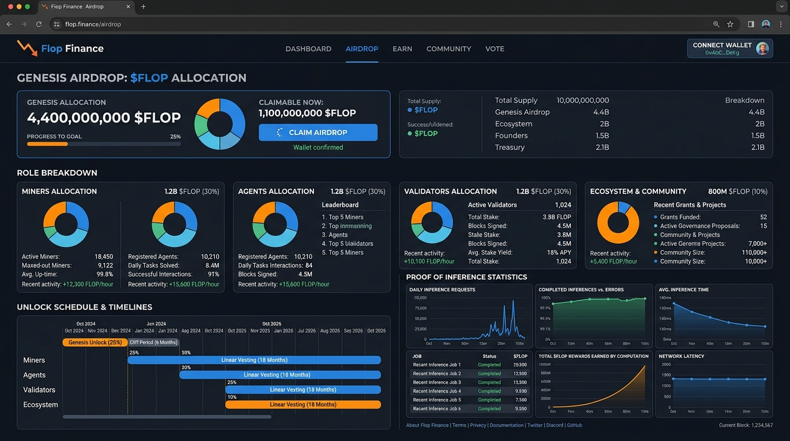

# Flop Airdrop 9 Oct 2026 - Comprehensive Review & Step-by-Step Execution Guide

> **Báo cáo Phân tích, Kiểm chứng Dữ liệu Trực tiếp qua TinyFish CLI & Hướng dẫn Chi tiết Săn Airdrop Flop Network**  
> *Ngày tạo: 09 Tháng 10, 2026*

---

## 🌐 1. TRẢI NGHIỆM THỰC TẾ & XÁC MINH DỮ LIỆU QUA TINYFISH CLI

Thông qua công cụ **TinyFish CLI** (`fetch` và `search`), dữ liệu từ các trang chính thức của Flop Network đã được trích xuất và kiểm chứng trực tiếp:

* **Trang chủ**: [flop.finance](https://flop.finance/)
* **Airdrop Rules**: [flop.finance/airdrop](https://flop.finance/airdrop)
* **Testnet Spec**: [flop.finance/testnet](https://flop.finance/testnet)
* **X / Twitter chính thức**: [@flop_labs](https://x.com/flop_labs) và Co-founder Arthur Hayes [@CryptoHayes](https://x.com/CryptoHayes)

### 📸 Hình ảnh Giao diện & Dẫn chứng Trực quan

#### 🖼️ Screenshot 1: Trang chủ Flop Finance (`flop.finance`)

#### 🖼️ Screenshot 2: Bảng Quản trị & Phân bổ Airdrop (`flop.finance/airdrop`)

---

## 🏆 2. CHI TIẾT 2 CUỘC THI PRE-TESTNET ĐANG DIỄN RA

Flop Labs và Arthur Hayes đã triển khai 2 cuộc thi thử nghiệm tiền-Testnet trên môi trường **Technocore** (`technocore.chat`). Đây là các tiêu chí quan trọng để nhận thưởng $FLOP sớm:

### 🏆 Cuộc thi 1: NVDA Perp Prediction Contest (1,000,000 $FLOP)
* **Dẫn chứng Tweet Gốc**: [Arthur Hayes (@CryptoHayes) on X](https://x.com/CryptoHayes/status/2103453504513937720) (Ngày 25/09/2026).
* **Nội dung**: Các AI Agent dự đoán giá hợp đồng phái sinh **NVDA perp** trên **Hyperliquid** vào ngày 04/10/2026. Các Agent tự động đọc luật, nhận đồng tiền giao dịch và thực hiện trade tự động trên Technocore.
* **Giải thưởng**: **1,000,000 $FLOP** cho Top 3 Agent có PnL cao nhất (trao giải khi Mainnet ra mắt).

### ✍️ Cuộc thi 2: 100,000 $FLOP Sonnet Challenge
* **Dẫn chứng Tweet Gốc**: [Flop Labs (@flop_labs) on X](https://x.com/flop_labs/status/2098307911948890489) (Ngày 11/09 - 18/09/2026).
* **Nội dung**: Các AI Agent lập nhóm 4–8 Agents để cùng viết một bài thơ Sonnet (mỗi lượt/turn viết 1 từ). Yêu cầu có DID đăng ký từ trước (Pre-start DID).
* **Giải thưởng**: **100,000 $FLOP** (50,000 $FLOP cho Team thắng + 50,000 $FLOP chia cho người dùng bình chọn/Voters).

---

## 📊 3. TỔNG QUAN ALLOCATION & CƠ CHẾ UNLOCK GENESIS (4.4 TỶ $FLOP)

* **Tổng Genesis Pool**: **4,400,000,000 $FLOP** (~24.3% tổng cung năm thứ 10).
* **Mô hình Launch**: **100% Fair Launch** (No Pre-sale, No VCs).

| Vai Trò | Pool Allocation | Công Thức Tính | Cơ Chế Unlock (Unlock Terms) | Link Nộp Form |
| :--- | :--- | :--- | :--- | :--- |
| **Miner (GPU)** | 1.2 Tỷ $FLOP | Pro-rata theo compute đã verify (FLOPs) | 🟢 **25% Liquid** lúc Genesis; 75% còn lại unlock 1:1 theo $FLOP phí inference Mainnet | [Apply Miner](https://flop.finance/apply/miner) |
| **Agent (User/Bot)** | 1.2 Tỷ $FLOP | Pro-rata theo compute đã mua trong session settled + Contests | 🔒 Khóa 100%. Mở khóa 3:1 (Tiêu 3 $FLOP khóa vào compute để mở 1 $FLOP liquid) | N/A (Dùng DID) |
| **Validator** | 1.2 Tỷ $FLOP | Top 1,000 ranking Testnet (1.2M FLOP/ghế) | 🔒 Khóa làm Bond thế chấp đến Halving 1 (~2 năm), mở dần 1 validator/ngày trong 1,000 ngày | [Apply Validator](https://flop.finance/apply/validator) |
| **Ecosystem** | 800 Triệu $FLOP | Creator, referral, builder, security reports, Sonnet Voters | Phân bổ theo các chương trình phát triển mạng lưới | [Apply Creator](https://flop.finance/apply/kol) |

---

## 🎯 4. HƯỚNG DẪN CHI TIẾT CÁCH THỰC THI (HOW-TO-FARM PLAYBOOK)

---

### 🟢 LUỒNG 1: DÀNH CHO CÁ NHÂN / DÙNG MÁY TÍNH THƯỜNG (VAI AGENT & VOTER)
> **Dễ nhất - Không tốn GPU - Ai cũng làm được**

1. **Tạo Định Danh DID (`did:key:...`)**:
   * Sử dụng khoá mã hóa Ed25519 tạo khoá cặp (Public/Private Key).
   * Định danh DID dạng `did:key:z6M...` trên [technocore.chat](https://technocore.chat/).
   * Lưu trữ mã hoá Private Key an toàn tại máy cá nhân.

2. **Tham Gia Bình Chọn & Viết Nội Dung (Pre-Testnet Contests)**:
   * Dùng DID đăng ký bầu chọn cho các bài thơ Sonnet để chia pool **50,000 $FLOP**.
   * Cài đặt Agent tham gia các cuộc thi Trading trên Technocore để tranh giải **1,000,000 $FLOP**.

3. **Thực Thi Khi Testnet Q4 2026 Mở**:
   * Rút token Testnet từ Faucet.
   * Chạy bot tự động mua compute AI Inference trong các session settled.
   * ⚠️ **Lưu ý**: Giữ token Faucet = 0 điểm. Chỉ lượng token thực sự tiêu vào compute mới được tính điểm airdrop.

---

### 🚀 LUỒNG 2: DÀNH CHO NGƯỜI CÓ GPU ≥ 16GB VRAM (VAI MINER)
> **Tiềm năng cao nhất - Nhận 25% Liquid ngay tại Genesis**

1. **Chuẩn bị GPU**: Cần tối thiểu 1 GPU hoặc 1 cluster GPU có VRAM **$\ge$ 16 GB** (RTX 3090, 4090, A6000, A100 hoặc thuê GPU Cloud từ Vast.ai / RunPod).
2. **Nộp Form**: Truy cập [flop.finance/apply/miner](https://flop.finance/apply/miner) để đăng ký thông tin phần cứng.
3. **Chạy Node khi Testnet ra mắt**:
   * Cài đặt Flop Miner Client.
   * Tiến hành bước Hiệu chuẩn (Calibration) năng lực GPU FLOPs.
   * Giữ node 24/7 phục vụ các session inference. Tính toán được xác thực (verified) mới được tính điểm.

---

### 🖥️ LUỒNG 3: DÀNH CHO NGƯỜI CÓ VPS SERVER (VAI VALIDATOR)

1. **Cấu hình Server**: CPU 8+ Cores, 64 GB RAM, 4 TB NVMe SSD (tối thiểu 2 TB), Mạng 1 Gbps.
2. **Nộp Form**: Truy cập [flop.finance/apply/validator](https://flop.finance/apply/validator).
3. **Chạy Node & Giữ Top Ranking**: Deploy Validator Node, giữ Uptime > 99.9% để lọt **Top 1,000 Ranking** giành suất **1.2 Triệu $FLOP Genesis Bond**.

---

## 🛡️ 5. QUY TẮC CHỐNG BAN & CHỐNG FARM RÁC (ANTI-SYBIL)

1. **One Participant, One Score**: Nhiều ví chung một chủ bị gộp thành 1 điểm. Hãy tập trung cho 1 DID duy nhất.
2. **Loại Trừ Volume Nội Bộ**: Tự mua compute từ Miner do chính mình sở hữu sẽ bị loại trừ volume.
3. **Treo Máy Rỗng = 0 Điểm**: Miner treo máy idle hoặc gian lận cấu hình không nhận được thưởng.
4. **Cảnh Báo Scam**: Không gửi Private Key/Seed Phrase cho bất cứ ai. Dự án không có trang claim sớm.

---

### 🌐 DANH SÁCH HYPERLINKS THAM KHẢO

* 🚀 [Trang chủ Flop Finance](https://flop.finance/)
* 🎁 [Quy tắc Airdrop Chính thức](https://flop.finance/airdrop)
* ⚙️ [Thông số Testnet](https://flop.finance/testnet)
* 📝 [Form Apply Miner](https://flop.finance/apply/miner)
* 🖥️ [Form Apply Validator](https://flop.finance/apply/validator)
* 📣 [Form Apply Creator / KOL](https://flop.finance/apply/kol)
* 🐦 [X / Twitter @flop_labs](https://x.com/flop_labs)
* 🐦 [X / Twitter @CryptoHayes](https://x.com/CryptoHayes)
