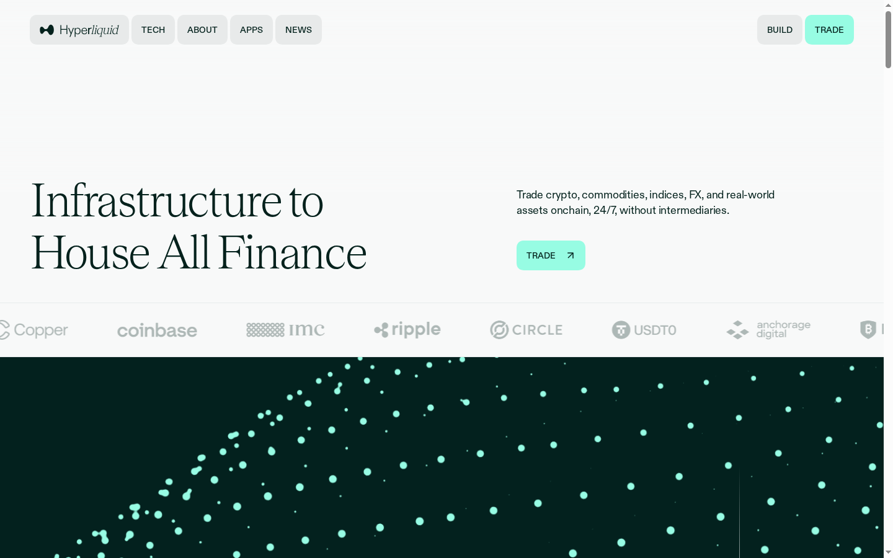
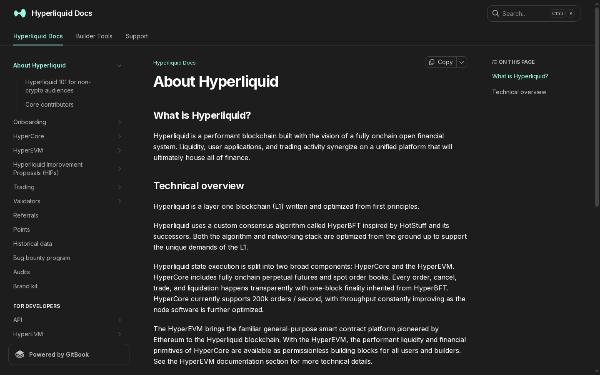
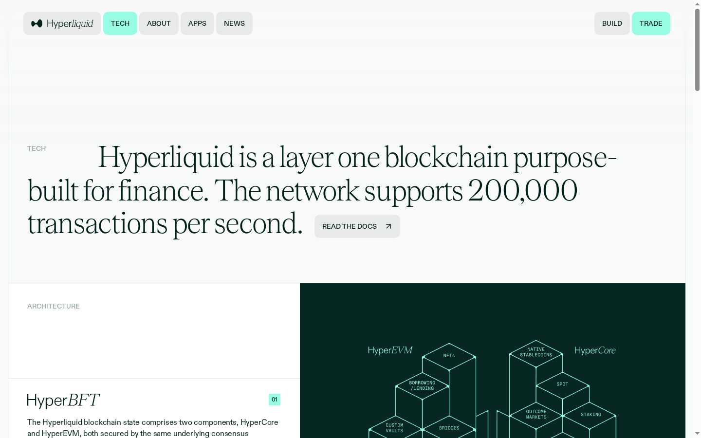
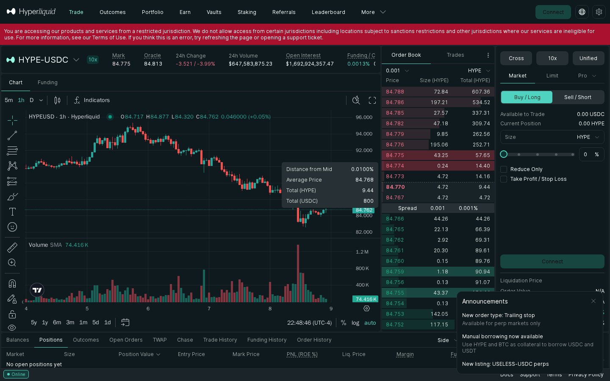
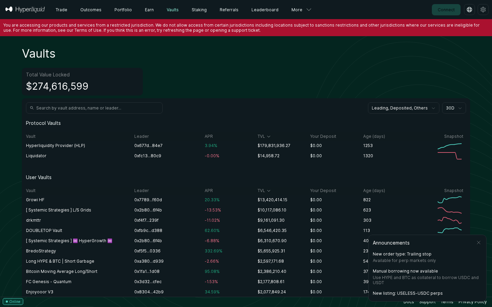
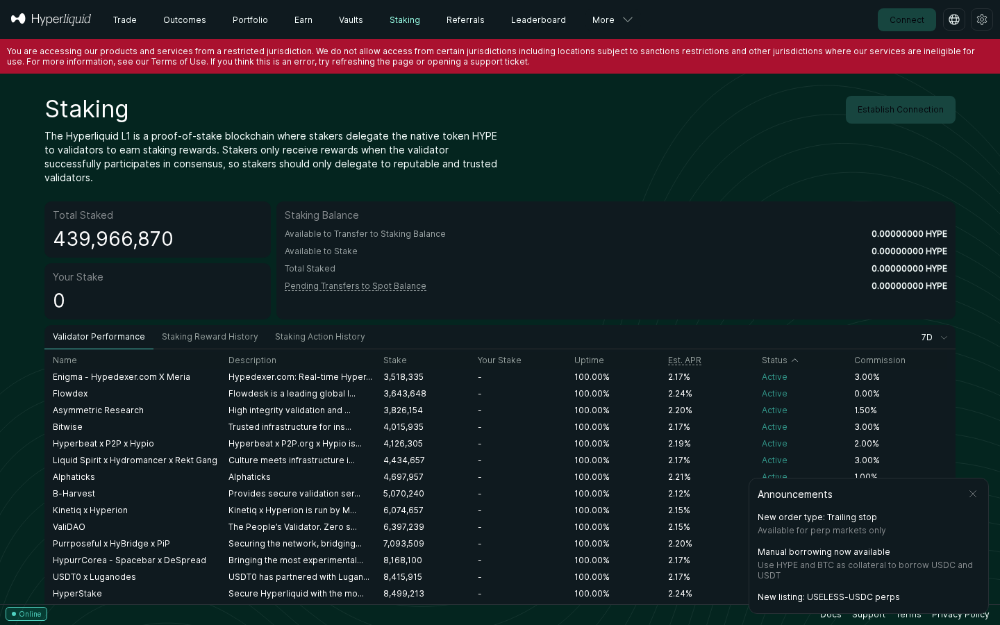
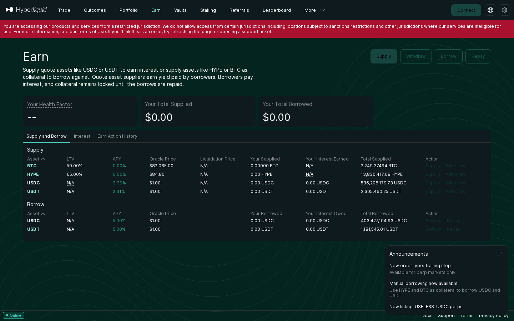
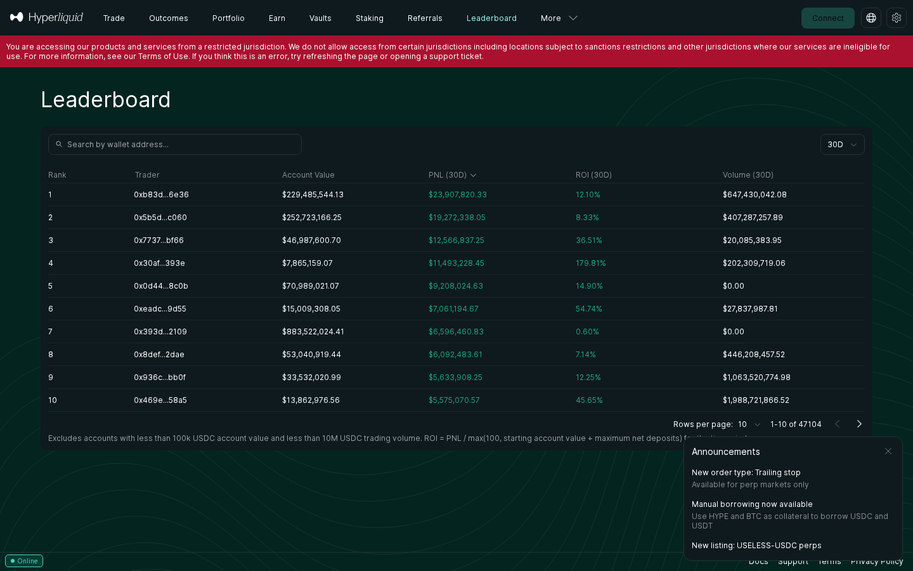
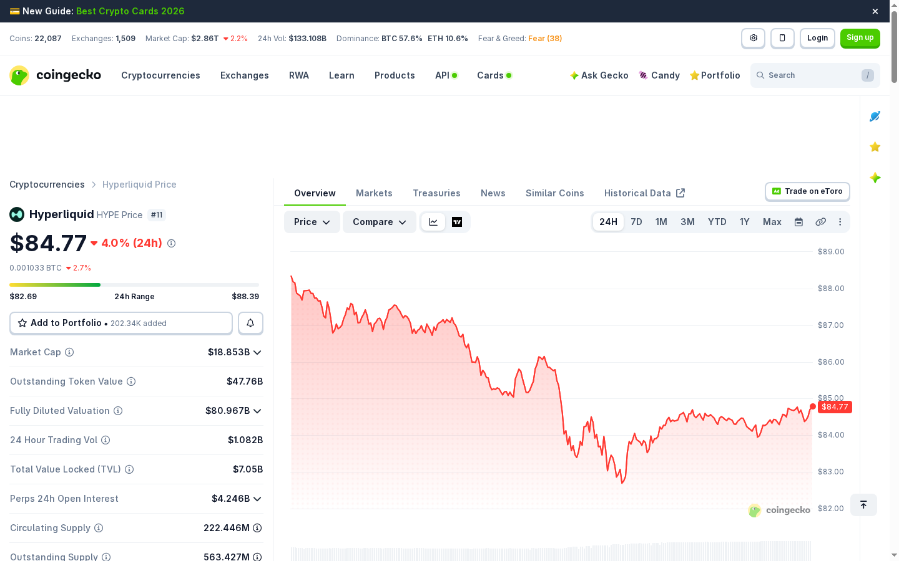
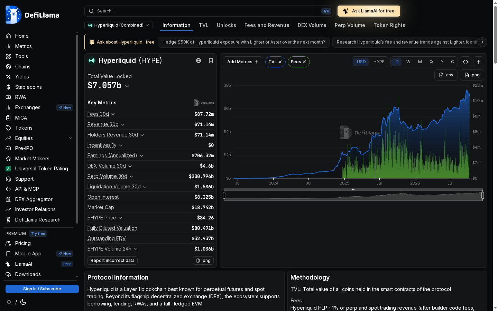

# Hyperliquid () Review 2026: A Real User's Walk Through the Onchain Exchange That Refuses to Be a CEX

*Reviewed October 9, 2026 | Data verified live from hyperliquid.xyz, app.hyperliquid.xyz, DefiLlama, CoinGecko*

---

## First Impression: Clean, Serious, Institutional

The first thing I noticed landing on [hyperliquid.xyz](https://hyperliquid.xyz) was how different it feels from most DeFi projects. No cartoon mascots. No "revolutionary tokenomics" buzzwords. Just a clean, off-white layout with a single headline:

**"Infrastructure to House All Finance"**

The subheading delivers the actual pitch in one sentence: *"Trade crypto, commodities, indices, FX, and real-world assets onchain, 24/7, without intermediaries."*

> **Source:** [hyperliquid.xyz](https://hyperliquid.xyz) — 2026-10-09

Scrolling the homepage reveals a partner strip: Copper, Coinbase, IMC, Ripple, Circle, USDT0, Anchorage Digital. These are serious institutional names — not vaporware partnerships but custodians and market makers that actually route liquidity. That alone signals this isn't a retail-only product.

The navigation is minimal: TECH, ABOUT, APPS, NEWS on the left; BUILD and TRADE on the right. TRADE is highlighted in teal — they want you to use the product, not read marketing pages.

---

## Under the Hood: What Hyperliquid Actually Is

Before opening the app, I went to the docs to understand what I'd be using.

> **Source:** [hyperliquid.gitbook.io](https://hyperliquid.gitbook.io) — 2026-10-09

The technical architecture is unusually transparent. Hyperliquid is a **Layer 1 blockchain written from scratch** — not a rollup, not a fork. Their custom consensus algorithm is **HyperBFT**, inspired by HotStuff, optimized specifically for the demands of an order-book exchange.

The state is split into two parts:
- **HyperCore** — handles perp and spot order books entirely onchain. Every order, cancel, trade, and liquidation has one-block finality. Currently handles **200,000 orders per second**.
- **HyperEVM** — a standard Ethereum-compatible execution environment that sits on top of HyperCore. Smart contracts here can access the liquidity primitives of HyperCore as permissionless building blocks.

The technical page confirms this further:

> **Source:** [hyperliquid.xyz/tech](https://hyperliquid.xyz/tech) — 2026-10-09

What this means practically: the order book is not simulated off-chain and settled onchain like most "DEX" perp platforms. The book *is* the chain. Every level you see in the order book is a real onchain state.

---

## The About Page: Who Runs This?

> **Source:** [hyperliquid.xyz/about](https://hyperliquid.xyz/about) — 2026-10-09

The governance structure is more layered than most DeFi protocols admit. Five entities are named:

1. **The Hyperliquid Community** — token holders and users
2. **Hyperliquid Labs** — the core dev team that built the protocol
3. **HyperFoundation** — the non-profit foundation for protocol stewardship
4. **Hyperliquid Policy Center** — regulatory interface
5. **Builders** — third-party developers on HyperEVM

Having a dedicated policy center is unusual — and tells you the team is thinking about regulatory longevity, not just current launch momentum.

---

## Opening the App: The Geo-Restriction Reality

Hitting [app.hyperliquid.xyz/trade/HYPE](https://app.hyperliquid.xyz/trade/HYPE) immediately surfaces a banner that will be familiar to many users:

> *"You are accessing our products and services from a restricted jurisdiction. We do not allow access from certain jurisdictions including locations subject to sanctions restrictions..."*

> **Source:** [app.hyperliquid.xyz/trade/HYPE](https://app.hyperliquid.xyz/trade/HYPE) — 2026-10-09

The geo-restriction banner persists across every page of the app. You can still *see* the interface and live data — but connecting a wallet to trade is blocked unless you're in a permitted jurisdiction. This is real friction for a significant portion of global users.

**What the trading interface shows:**
- **HYPE-USDC perpetual**: Mark price .775, Oracle .813
- **24h Volume**: ,583,875 (~ — enormous for a DEX)
- **Open Interest**: ,692,924,357 (~.69B OI on HYPE alone)
- **24h Price Change**: -3.521 / -3.99%
- **Spread**: 0.001 / 0.001% — this is tighter than many centralized exchanges
- **Leverage**: Cross 10x available

The UI itself is TradingView-integrated with a full order book, funding history, TWAP, Chase orders, and position management. There's a live announcement panel showing new features: trailing stop orders, manual borrowing using HYPE and BTC as collateral, and a new "USELESS-USDC" perp listing (yes, that's actually a real listing — meme coins are on Hyperliquid too).

---

## Vaults: Passive Yield on a DEX

Instead of just trading, Hyperliquid lets you deposit into vaults — on-chain strategy pods run by other traders or the protocol itself.

> **Source:** [app.hyperliquid.xyz/vaults](https://app.hyperliquid.xyz/vaults) — 2026-10-09

**What I found:**
- **Total Vault TVL**: ,616,599
- **HLP (Hyperliquidity Provider)** — the protocol's own vault: .8M TVL, 3.94% APR, running for 1,253 days
- **Liquidator vault**: .9K TVL, 0.00% APR — tiny, likely operational
- **User vaults**: Several interesting ones:
  - Growi HF: 20.33% APR, .4M
  - DOUBLETOP: 62.60% APR
  - BredoStrategy: 332.69% APR
  - Bitcoin MA: 95.08% APR
  - Enjoyooor V3: 34.59% APR

The extreme APRs on user vaults (332%, 95%) should be read carefully — these are backtested or short-window annualized numbers, and past performance doesn't predict future vault behavior. The HLP vault's 3.94% over 1,253 days of operation is the more conservative and credible benchmark.

The HLP vault functions as the system's market maker and liquidation backstop. Depositors earn fees from every trade processed on the platform.

---

## Staking: Validator Network

> **Source:** [app.hyperliquid.xyz/staking](https://app.hyperliquid.xyz/staking) — 2026-10-09

The staking page shows:
- **Total Staked**: 439,966,870 HYPE
- **Validator APRs**: ranging ~2.12%–2.24%
- Notable validators: Bitwise, Flowdex, B-Harvest, ValiDAO, HyperStake
- **Uptime**: 100% across all listed validators

The validator set includes recognizable institutional names — Bitwise is a major Bitcoin ETF issuer, B-Harvest is a well-known Cosmos validator. This isn't a friends-and-family validator set.

Staking yield at ~2.17% is modest — this isn't a high-yield staking product. It's securing the network.

---

## Earn: The Lending Market

> **Source:** [app.hyperliquid.xyz/earn](https://app.hyperliquid.xyz/earn) — 2026-10-09

The Earn tab is essentially a lending market:

**Supply rates:**
- BTC: LTV 50%, 0% APY
- HYPE: LTV 65%, 0% APY
- USDC: 3.39% APY — ** total supplied**
- USDT: 2.31% APY — **.3B total supplied**

**Borrow rates:**
- USDC: 5.00% at  outstanding
- USDT: 5.00% at .18B outstanding

The stablecoin supply depth is remarkable. .3B in USDT on a DEX lending market is institutional-scale liquidity. The spread between 2.31% supply and 5.00% borrow on USDT is the protocol's margin.

HYPE and BTC can be used as collateral with 0% supply APY — you're essentially lending your collateral to the pool so others can borrow stables against it.

---

## The Leaderboard Problem

> **Source:** [app.hyperliquid.xyz/leaderboard](https://app.hyperliquid.xyz/leaderboard) — 2026-10-09

The leaderboard shows zero results. This is a direct consequence of the geo-restriction — the interface filters out trader data for restricted jurisdictions. It's a minor inconvenience for a curious reviewer but would matter to someone using the leaderboard to find vaults to copy-trade.

---

## On-Chain Verification: The Numbers That Matter

### CoinGecko Market Data

> **Source:** [coingecko.com/en/coins/hyperliquid](https://coingecko.com/en/coins/hyperliquid) — 2026-10-09

### DefiLlama: The Full Protocol Picture

> **Source:** [defillama.com/protocol/hyperliquid](https://defillama.com/protocol/hyperliquid) — 2026-10-09

DefiLlama gives the clearest picture of Hyperliquid's actual scale:

| Metric | Value |
|--------|-------|
| **Total Value Locked** | .057B |
| **30-day Fees** | .72M |
| **30-day Revenue** | .14M |
| **Annualized Earnings** | .32M |
| **30-day Perp Volume** | .796B |
| **Open Interest** | .325B |
| **Market Cap** | .742B |
| **FDV** | .491B |

 in perp volume over 30 days is not a small DEX playing in a niche. That's competing with mid-tier centralized exchanges by volume. The  annualized earnings figure is more than most crypto protocols earn in their entire lifespan.

The gap between Market Cap (.742B) and FDV (.491B) is significant — there is substantial token supply still to be unlocked. This is the key risk to understand before holding HYPE long-term.

---

## What Breaks and What's Frustrating

**Geo-restriction banner** — persistent across every app page. For Vietnam-based users (and many others), this is a constant reminder that you're technically accessing a restricted product. The banner is not a hard block — you can view everything — but connecting to trade requires a VPN or alternative access method. The platform doesn't tell you explicitly *which* jurisdictions are restricted.

**BTC trade page loaded blank** — when I navigated to /trade/BTC, the page rendered as an empty dark frame. Likely a timeout issue on a JS-heavy route, but it adds friction.

**No KYC, but also no recourse** — Hyperliquid is fully non-custodial and has no KYC. This is by design. If you send to the wrong address or get liquidated, there's no support escalation path.

**FDV vs MCap gap** — at  FDV vs .7B MCap, approximately 77% of tokens are not yet circulating. This is a material overhang that anyone holding HYPE for appreciation should factor in.

---

## Market Context

At time of review, HYPE is trading around –85 with:
- **Volume**:  in 24h on its own perp pair
- **Open Interest**: .69B on HYPE-USDC alone (.3B total across all pairs)
- **30-day protocol revenue**:  (real revenue, not token emissions)

Competitors like dYdX, GMX, and Jupiter all operate in the perp DEX space, but none have matched Hyperliquid's volume in recent months. The /month perp volume figure has put it in direct conversation with Binance Futures and OKX as a genuine alternative.

---

## Who Is Hyperliquid For?

**Good fit:**
- Traders who want CEX-quality execution (tight spreads, deep books) without a centralized counterparty
- Yield seekers comfortable with smart-contract risk depositing into HLP (3.94% APR, 1,253 days of track record)
- Developers building financial applications on HyperEVM who want access to native liquidity
- Institutions already using Copper, Coinbase, or Circle custody who want onchain perp exposure

**Not a good fit:**
- Users in restricted jurisdictions who aren't comfortable using a VPN
- Retail users expecting a simple "buy HYPE and hold" experience — this is a trading platform, not a simple wallet
- Anyone who needs KYC compliance for their own regulatory requirements
- Long-term token holders who haven't modeled the FDV/MCap unlock schedule

---

## Verdict

Hyperliquid is the most technically credible attempt to build a fully onchain financial exchange that I've seen. The numbers are real:  TVL,  monthly perp volume,  annualized revenue. The product works. The spreads are genuinely tight. The UI is usable without a tutorial.

The risks are also real: an FDV four times the market cap represents a significant dilution overhang, geo-restrictions limit the addressable market, and the platform is ultimately controlled by Hyperliquid Labs with no fully decentralized governance yet.

But if you're building a mental model of what "DeFi matured" looks like, Hyperliquid is as close as anything running today.

---

*All data captured October 9, 2026. Prices and TVL change continuously — verify at app.hyperliquid.xyz and defillama.com before making any decisions.*

---

## u&#x1F4D6; Giai Thich Thuat Ngu

Danh sach cac thuat ngu ky thuat xuat hien trong bai review nay, giai thich theo ngon ngu don gian:

| Thuat ngu | Giai thich |
|-----------|-----------|
| **Layer 1 (L1)** | Blockchain nen tang co so - lop dau tien va co ban nhat. Hyperliquid xay dung L1 rieng tu dau (khong phai rollup hay fork), toi uu hoa dac biet cho trading. |
| **Perpetual Futures (Perps)** | Hop dong tuong lai khong co ngay dao han - nguoi dung co the giu vi the long/short mai mai. Khac voi futures truyen thong, perps dung "funding rate" de neo gia voi gia spot. |
| **Open Interest (OI)** | Tong gia tri cac vi the hop dong tuong lai dang mo chua dong lai. HYPE-USDC co OI .69B - cho thay muc do cam ket von cua trader vao thi truong nay. |
| **Funding Rate** | Phi dinh ky (thuong 8 gio/lan) tra giua long va short de giu gia perp gan voi gia spot. Khi gia perp cao hon spot, long tra cho short; nguoc lai thi short tra cho long. |
| **Mark Price** | Gia tham chieu duoc tinh tu nhieu nguon du lieu de tranh bi thao tung. Hyperliquid dung Mark Price (.775) de tinh loi/lo cua vi the va xac dinh khi nao bi thanh ly. |
| **Oracle Price** | Gia tu nguon du lieu ben ngoai blockchain (oracle) - phan anh gia spot tren thi truong rong. Oracle Price (.813) dung de dam bao Mark Price khong bi lenh qua xa gia that. |
| **Spread** | Khoang cach giua gia mua tot nhat (bid) va gia ban tot nhat (ask) tren order book. Hyperliquid co spread 0.001/0.001% - rat kenh, cho thay thanh khoan cuc sau. |
| **Order Book** | So lenh dat mua va ban theo gia, theo thoi gian thuc. Tren Hyperliquid, toan bo order book nay la onchain - moi lenh deu la giao dich blockchain that. |
| **Cross Margin** | Che do ky quy dung toan bo so du vi de dam bao cho moi vi the. Neu mot vi the lo, vi the khac co the "bu" de tranh thanh ly som. Khac voi Isolated Margin chi dung von rieng biet cho tung vi the. |
| **Leverage (Don bay)** | Giao dich voi von lon hon von ban co bang cach vay. 10x leverage: ban dat 100 USDC nhung kiem soat vi the 1,000 USDC. Nhuoc diem: lo cung nhan 10x, co nguy co thanh ly. |
| **Liquidation (Thanh ly)** | Khi vi the thua lo den muc ky quy khong du, he thong tu dong dong vi the va thu hoi von. Diem thanh ly duoc hien thi tren Hyperliquid de nguoi dung biet nguong rui ro. |
| **TVL (Total Value Locked)** | Tong gia tri tai san dang bi "khoa" trong cac giao thuc DeFi (vault, lending, liquidity pool...). Hyperliquid co .057B TVL - rat lon cho mot DEX. |
| **Market Cap (Von hoa thi truong)** | Tong gia tri cua tat ca coin dang luu thong = Gia x So coin luu hanh. HYPE: ~.742B tai thoi diem review. |
| **FDV (Fully Diluted Valuation)** | Von hoa tinh theo tong cung toi da (ke ca coin chua phat hanh). HYPE FDV = .491B - gap 4.3 lan MCap, nghia la con ~77% supply chua unlock, se gay anh huong pha loang. |
| **APR (Annual Percentage Rate)** | Lai suat hang nam khong tinh lai kep. HLP vault co APR 3.94%/nam trong hon 1,253 ngay van hanh - day la con so thuc te, khong phai uoc tinh. |
| **HyperBFT** | Thuat toan dong thuan tuy chinh cua Hyperliquid, cam hung tu HotStuff BFT (Byzantine Fault Tolerant). Dam bao finality trong mot block va xu ly duoc 200,000 lenh/giay. |
| **HyperCore** | Lop thuc thi chinh cua Hyperliquid xu ly toan bo order book perps va spot onchain - moi lenh, huy lenh, khop lenh, thanh ly deu co one-block finality. |
| **HyperEVM** | May ao Ethereum tuong thich (EVM) chay tren Hyperliquid blockchain - cho phep developer xay dung smart contract Solidity va truy cap thanh khoan tu HyperCore. |
| **Vault** | Quy dau tu tu dong onchain - ban nap tien vao, vault manager thuc hien chien luoc giao dich, ban huong loi nhuan (hoac chiu lo). Tuong tu hedge fund nhung onchain va phi trung gian. |
| **HLP (HyperLiquidity Provider)** | Vault giao thuc cua chinh Hyperliquid - hoat dong nhu market maker va backstop thanh ly. Nguoi nap vao HLP kieu APR tu phi giao dich cua toan he thong. |
| **TWAP** | Time-Weighted Average Price - lenh dat mua/ban theo khoang thoi gian de tinh gia trung binh, tranh truot gia khi dat lenh lon. Thuong dung boi whale va to chuc. |
| **DEX (Decentralized Exchange)** | San giao dich phi tap trung - khong co cong ty nao giu tien cua ban; moi thu chay tren smart contract. Hyperliquid la DEX nhung co toc do va chieu sau thanh khoan tuong duong CEX. |
| **CEX (Centralized Exchange)** | San giao dich tap trung nhu Binance, OKX - cong ty giu tien cua ban, ban tin tuong ho. CEX nhanh va co thanh khoan sau nhung co rui ro tin nhiemva yeu cau KYC. |
| **KYC (Know Your Customer)** | Quy trinh xac minh danh tinh nguoi dung - CMND/ho chieu + selfie. Hyperliquid khong yeu cau KYC; day la tinh nang va cung la rui ro tuy goc nhin. |
| **Smart Contract** | Chuong trinh tu dong chay tren blockchain, thuc hien quy tac da dinh truoc khong can trung gian. Khong the bi chinh sua sau khi deploy (tru khi co upgrade mechanism). |
| **Finality (One-block finality)** | Thoi diem giao dich duoc xac nhan vinh vien. "One-block finality" nghia la ngay khi block chua giao dich cua ban duoc tao ra, giao dich do khong the bi dao nguoc. |
| **Geo-restriction** | Han che truy cap theo vi tri dia ly. Hyperliquid chan mot so quoc gia vi ly do phap ly - hien thi banner canh bao nhung van cho xem giao dien. |
| **LTV (Loan-to-Value)** | Ti le cho vay so voi gia tri tai san the chap. BTC LTV 50% = ban the chap ,000 BTC thi vay duoc toi da  USDC. Ti le cang cao = rui ro thanh ly cang lon. |

---

## 📖 Giải Thích Thuật Ngữ

Dầnh sách các thuật ngữ kỹ thuật xuất hiện trong bài review này, giải thích theo ngôn ngữ đơn giản:

| Thuật ngữ | Giải thích |
|-----------|----------|
| **Layer 1 (L1)** | Blockchain nền tảng cơ sở — lớp đầu tiên và cơ bản nhất. Hyperliquid xây dựng L1 riêng từ đầu (không phải rollup hay fork), tối ưu hóa đặc biệt cho trading. |
| **Perpetual Futures (Perps)** | Hợp đồng tương lai không có ngày đáo hạn — người dùng có thể giữ vị thế long/short mãi mãi. Dùng **funding rate** để neo giá với giá spot. |
| **Open Interest (OI)** | Tổng giá trị các vị thế hợp đồng đang mở chưa đóng lại. HYPE-USDC có OI ~$1.69B — cho thấy mức độ cam kết vốn của trader. |
| **Funding Rate** | Phí định kỳ (thường 8 giờ/lần) trả giữa long và short để giữ giá perp gần với giá spot. Khi giá perp cao hơn spot, long trả cho short; ngược lại thì short trả cho long. |
| **Mark Price** | Giá tham chiếu được tính từ nhiều nguồn dữ liệu để tránh bị thao túng. Dùng để tính lời/lỗ và xác định khi nào bị thanh lý. |
| **Oracle Price** | Giá từ nguồn dữ liệu bên ngoài blockchain (oracle) — phản ánh giá spot trên thị trường rộng. Đảm bảo Mark Price không bị lệch quá xa giá thực. |
| **Spread** | Khoảng cách giữa giá mua tốt nhất (bid) và giá bán tốt nhất (ask) trên order book. Hyperliquid có spread 0.001/0.001% — rất hẹp, cho thấy thanh khoản cực sâu. |
| **Order Book** | Sổ lệnh đặt mua và bán theo giá, theo thời gian thực. Trên Hyperliquid, toàn bộ order book là onchain — mọi lệnh đều là giao dịch blockchain thật. |
| **Cross Margin** | Chế độ ký quỹ dùng toàn bộ số dư ví để đảm bảo cho mọi vị thế. Khác với **Isolated Margin** chỉ dùng vốn riêng cho từng vị thế. |
| **Leverage (Đòn bẩy)** | Giao dịch với vốn lớn hơn vốn bạn có bằng cách vay. 10x: bạn đặt $100 USDC nhưng kiểm soát vị thế $1,000 USDC. Lỗ cũng nhân 10x, có nguy cơ thanh lý. |
| **Liquidation (Thanh lý)** | Khi vị thế thua lỗ đến mức ký quỹ không đủ, hệ thống tự động đóng vị thế và thu hồi vốn. Điểm thanh lý hiển thị rõ trên UI. |
| **TVL (Total Value Locked)** | Tổng giá trị tài sản đang bị "khóa" trong các giao thức DeFi. Hyperliquid có $7.057B TVL — rất lớn cho một DEX. |
| **Market Cap (Vốn hóa thị trường)** | Tổng giá trị của tất cả coin đang lưu thông = Giá × Số coin lưu hành. HYPE: ~$18.742B tại thời điểm review. |
| **FDV (Fully Diluted Valuation)** | Vốn hóa tính theo tổng cung tối đa (kể cả coin chưa phát hành). HYPE FDV = $80.491B — gấp 4.3 lần MCap, còn ~77% supply chưa unlock, áp lực pha loãng lớn. |
| **APR (Annual Percentage Rate)** | Lãi suất hàng năm không tính lãi kēp. HLP vault có APR 3.94%/năm trong hơn 1,253 ngày vận hành — con số thực tế, không phải ước tính. |
| **APY (Annual Percentage Yield)** | Lãi suất hàng năm có tính lãi kēp — luôn cao hơn APR. Vault user hiển thị APY, HLP hiển thị APR — cần phân biệt khi so sánh. |
| **HyperBFT** | Thuật toán đồng thuận tùy chỉnh của Hyperliquid, cảm hứng từ HotStuff BFT. Đảm bảo finality trong một block và xử lý được 200,000 lệnh/giây. |
| **HyperCore** | Lớp thực thi chính của Hyperliquid xử lý toàn bộ order book perps và spot onchain. Mọi lệnh, hủy lệnh, khớp lệnh, thanh lý đều có one-block finality. |
| **HyperEVM** | Máy ảo Ethereum tương thích (EVM) chạy trên Hyperliquid — cho phép developer xây dựng smart contract Solidity và truy cập thanh khoản từ HyperCore. |
| **Vault** | Quỹ đầu tư tự động onchain — bạn nạp tiền vào, vault manager thực hiện chiến lược giao dịch, bạn hưởng lợi nhuận hoặc chịu lỗ. Tương tự hedge fund nhưng onchain. |
| **HLP (HyperLiquidity Provider)** | Vault giao thức của chính Hyperliquid — hoạt động như market maker và backstop thanh lý. Người nạp vào HLP kiếm APR từ phí giao dịch của toàn hệ thống. |
| **TWAP** | Time-Weighted Average Price — lệnh đặt mua/bán theo khoảng thời gian để tính giá trung bình, tránh trượt giá khi đặt lệnh lớn. Thường dùng bởi whale và tổ chức. |
| **DEX (Decentralized Exchange)** | Sàn giao dịch phi tập trung — không có công ty nào giữ tiền của bạn; mọi thứ chạy trên smart contract. Hyperliquid là DEX nhưng có tốc độ và chiều sâu thanh khoản tương đương CEX. |
| **CEX (Centralized Exchange)** | Sàn giao dịch tập trung như Binance, OKX — công ty giữ tiền của bạn, bạn tin tưởng họ. CEX nhanh và thanh khoản sâu nhưng có rủi ro tin nhiệm và yêu cầu KYC. |
| **KYC (Know Your Customer)** | Quy trình xác minh danh tính người dùng — CMND/hộ chiếu + selfie. Hyperliquid không yêu cầu KYC; đây là tính năng và cũng là rủi ro tùy góc nhìn. |
| **Smart Contract** | Chương trình tự động chạy trên blockchain, thực hiện quy tắc đã định trước không cần trung gian. Không thể bị chỉnh sửa sau khi deploy. |
| **Finality (One-block finality)** | Thời điểm giao dịch được xác nhận vĩnh viễn. "One-block finality" nghĩa là ngay khi block chứa giao dịch được tạo ra, giao dịch đó không thể bị đảo ngược. |
| **Geo-restriction** | Hạn chế truy cập theo vị trí địa lý. Hyperliquid chặn một số quốc gia vì lý do pháp lý — hiển thị banner cảnh báo nhưng vẫn cho xem giao diện. |
| **LTV (Loan-to-Value)** | Tỷ lệ cho vay so với giá trị tài sản thế chấp. BTC LTV 50% = bạn thế chấp $1,000 BTC thì vay được tối đa $500 USDC. Tỷ lệ càng cao = rủi ro thanh lý càng lớn. |
