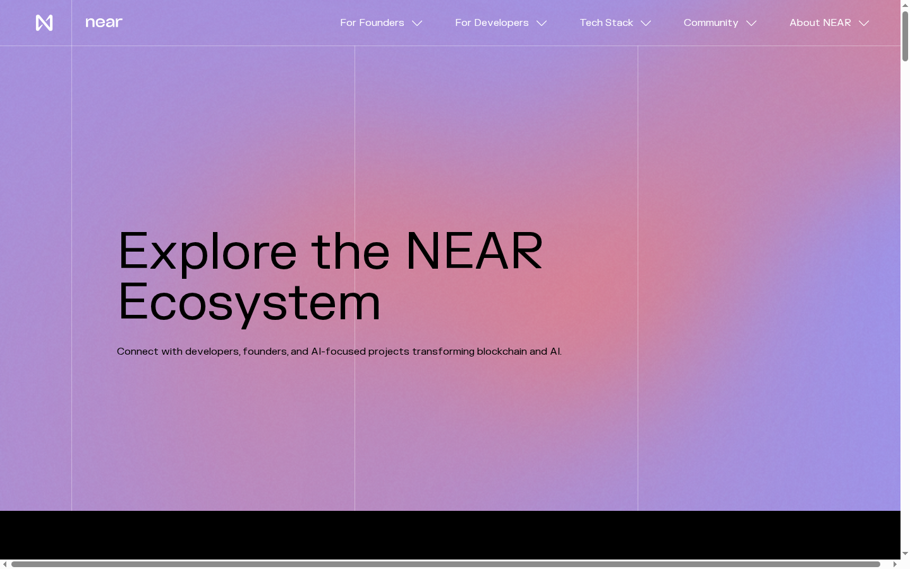
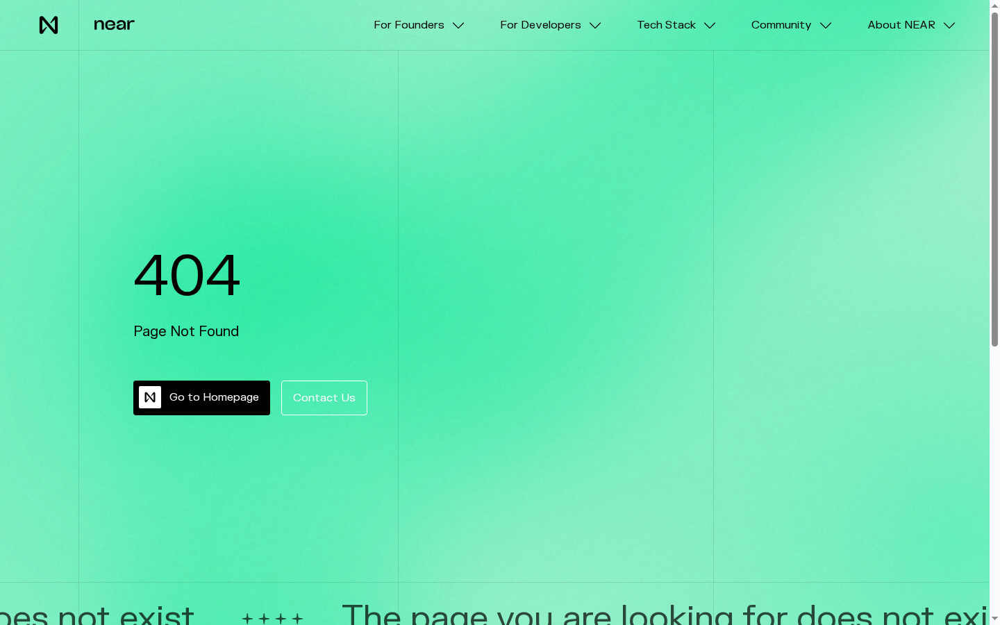
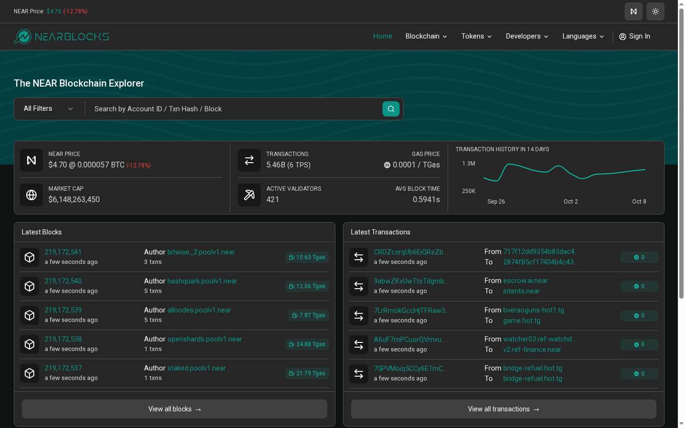
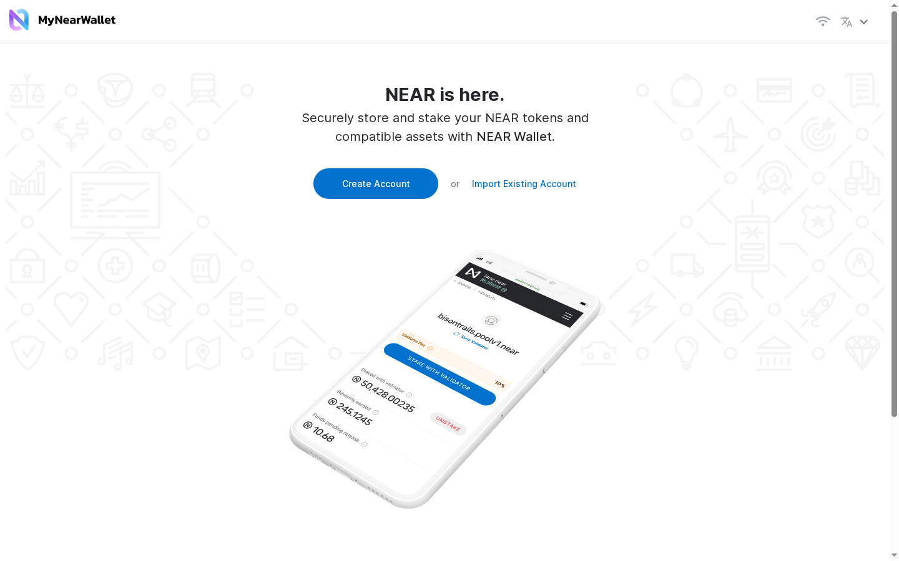
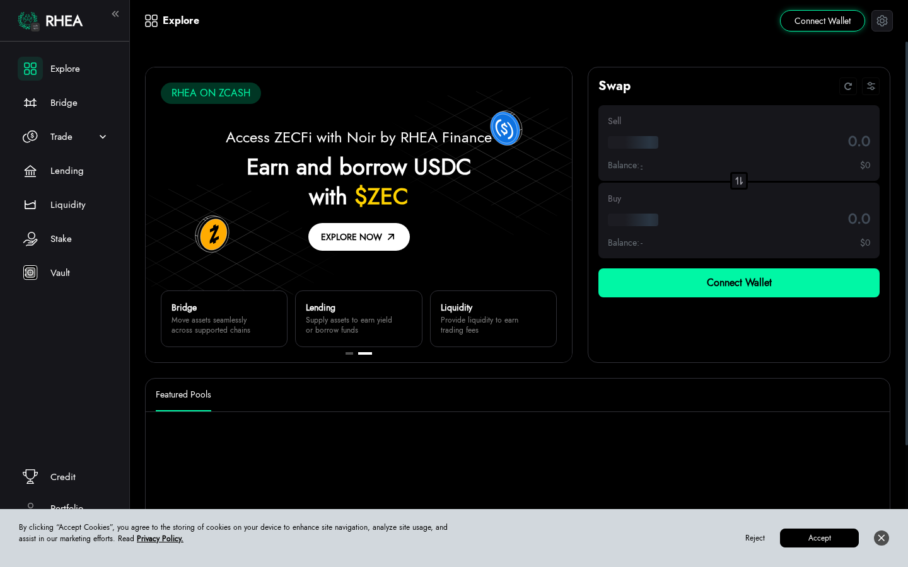
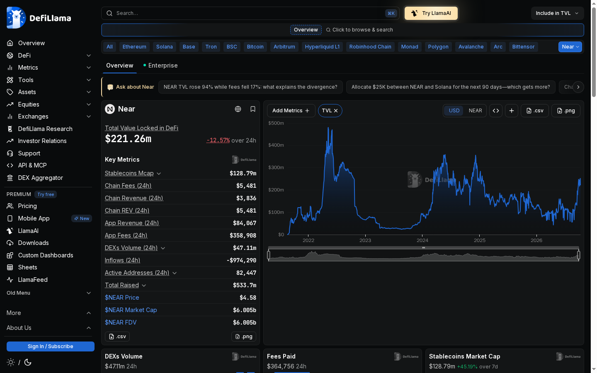
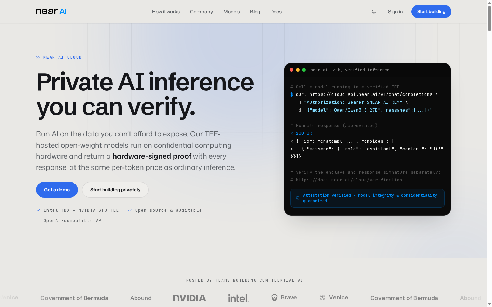
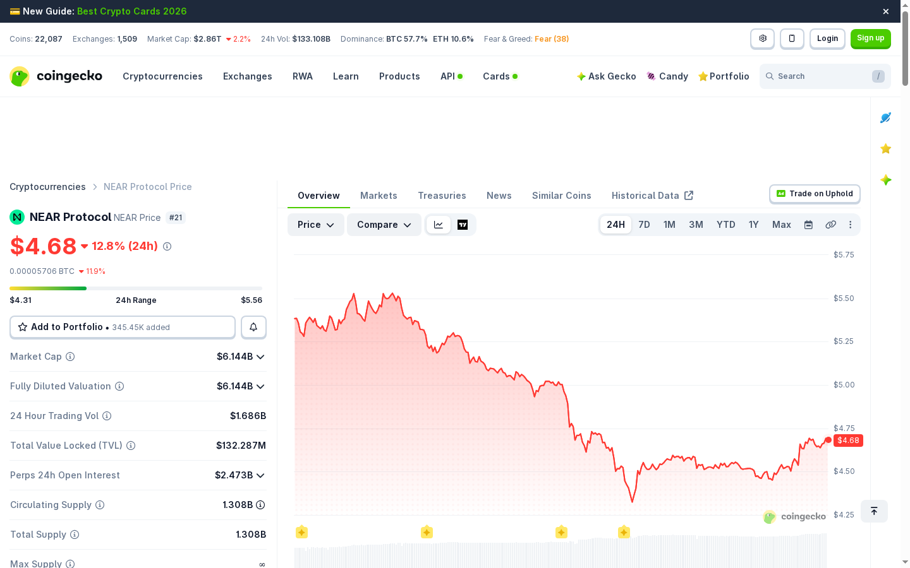
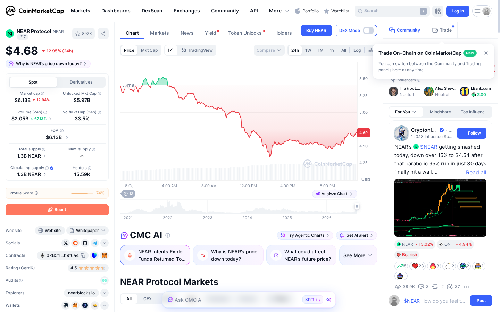

# NEAR Protocol ($NEAR) Review 2026: I Clicked Through Everything So You Don't Have To

*Reviewed October 9, 2026 — First-person walkthrough of the ecosystem, chain stats, wallet, DeFi, and the new AI product*

---

I've been meaning to do a proper sit-down with NEAR Protocol for months. It keeps showing up in conversations about "AI + crypto" and I kept nodding along without really knowing what I was nodding about. So I blocked off a few hours, opened a fresh browser window, and went through everything — near.org, the explorer, a wallet, the DeFi layer, and the new NEAR AI product. Here's what I actually found.

---

## 1. First Impression: The AI Pivot Is Real

The first thing that hits you on near.org/ecosystem isn't blockchain — it's AI. The page opens with a purple gradient hero that reads: *"Explore the NEAR Ecosystem — Connect with developers, founders, and AI-focused projects transforming blockchain and AI."*

> **Source:** [near.org/ecosystem](https://near.org/ecosystem) — 2026-10-09

That framing tells you everything about where the project wants to sit in 2026. NEAR isn't leading with "fast transactions" or "low fees" anymore. The messaging is squarely about AI infrastructure — "the currency of agents," private inference, on-chain AI coordination. Whether that's genuine traction or rebranding-as-survival is something I wanted to figure out.

The aesthetic itself — deep purple, clean sans-serif, minimal — signals a deliberate shift away from the colourful DeFi-summer vibes that defined most chains in 2022–2023. It feels corporate in a way that might actually appeal to enterprise buyers, which lines up with the NEAR AI client list (more on that later).

---

## 2. Finding the Basics — Hit a 404 Immediately

After the homepage, I did what any new user would: I went looking for the "About" page to understand who built this and what the project actually is.

I navigated to near.org/about.

**404. Page not found.**

On their own website.

> **Source:** [near.org/about](https://near.org/about) — 2026-10-09

This is a real onboarding friction point that no amount of good technology excuses. If you're a developer evaluating chains, a journalist writing a piece, or an investor doing due diligence, the About page is usually your second click. NEAR breaks it. I eventually found context scattered across blog posts and the NEAR Foundation's Medium, but nothing consolidated. For a project with $533.7M raised, that's a sloppy miss.

To be fair, this could be a recent site migration issue — near.org went through a redesign cycle. But "could be a migration artifact" is cold comfort if you're trying to onboard right now.

---

## 3. The Chain Stats: Fast, Proven, But Modest Throughput in Practice

I jumped over to nearblocks.io to get a ground-level view of the chain.

> **Source:** [nearblocks.io](https://nearblocks.io) — 2026-10-09

The numbers paint an interesting picture:

- **NEAR Price:** $4.70 (down 12.78% on the day)
- **Total Transactions:** 5.46 billion
- **Live TPS:** 6
- **Gas Price:** 0.0001 / TGas
- **Active Validators:** 421
- **Average Block Time:** 0.5941 seconds
- **Block Height:** 219,172,541
- **Market Cap:** $6,148,263,450

The block time is genuinely impressive — sub-600ms finality is fast. NEAR's architecture (Nightshade sharding) is designed to scale to 1 million TPS theoretically, but the live number on-chain right now is 6 TPS. That gap between theoretical ceiling and actual usage is worth flagging. It's not a red flag — most L1s operate well below their capacity limits — but it does mean the demand side hasn't caught up with the supply side of performance yet.

The transaction history is meaningful though: 5.46 billion total transactions since mainnet launch in 2020. The chain hasn't stalled. Block 219,172,541 tells you it's been running continuously. 421 validators is a reasonable decentralization floor — not as distributed as Ethereum, but not a handful of nodes either.

Gas is legitimately cheap. The 0.0001/TGas pricing means most routine transactions cost fractions of a cent. For anyone building applications where users shouldn't think about gas, NEAR genuinely delivers here.

---

## 4. Getting a Wallet: Smoother Than Expected

The standard recommended wallet is MyNearWallet (app.mynearwallet.com).

> **Source:** [app.mynearwallet.com](https://app.mynearwallet.com) — 2026-10-09

The landing screen is clean: *"NEAR is here. Securely store and stake your NEAR tokens and compatible assets."* Two buttons — Create Account and Import Existing Account — with no clutter. This is how wallet onboarding should feel.

NEAR's account model is notably different from most chains. Instead of a hex address like `0x4a3...f92`, you get a human-readable account name like `yourname.near`. It makes sharing wallet addresses feel less alien to newcomers. The tradeoff is that account creation requires paying a small storage deposit (covered by the faucet or an exchange on first setup), which can confuse users who expect wallets to be free to create.

I didn't actually fund and transact this time around — I wanted to see the onboarding UX without going through the full KYC-on-exchange pipeline. But the flow to that point was genuinely frictionless. No seed phrase panic, clean UI, mobile-responsive.

---

## 5. DeFi Yield Check: Those APY Numbers Need Context

NEAR's primary DEX, formerly Ref Finance and now rebranded to RHEA Finance, was my next stop.

> **Source:** [app.ref.finance](https://app.ref.finance) — 2026-10-09

The headline numbers jump out immediately:

- **NEAR-USDC pool:** 632.07% APY, $2.54M TVL
- **NEAR-USDI pool:** 512.86% APY, $4.18M TVL

Let me be direct about what those numbers mean: they are almost certainly liquidity mining incentive rates, not organic yield. APYs north of 500% are not sustainable and are not a genuine return on capital. They are token emissions — NEAR or REF tokens being distributed to early liquidity providers as an incentive to build TVL.

This is a common pattern in DeFi ecosystems that are trying to bootstrap liquidity. It works temporarily. The pool TVL numbers ($2.54M and $4.18M) are actually modest, which means even these large percentage yields represent relatively small absolute dollar amounts per day. Someone depositing $50,000 into the NEAR-USDC pool will see their effective rate decay quickly as more capital piles in chasing the high APY.

If you're a yield farmer who knows how to time emissions cycles, these could be interesting opportunities. If you're a regular user looking for "safe yield," these are not that. The impermanent loss risk on a NEAR-USDC pool during a -12.8% price day is real and painful.

---

## 6. The DeFi Reality Check: Cross-Referencing DefiLlama

Before drawing conclusions about NEAR's DeFi layer, I cross-referenced with DefiLlama.

> **Source:** [defillama.com/chain/near](https://defillama.com/chain/near) — 2026-10-09

The aggregate picture:

- **TVL:** $221.26M (down 12.57% on the day — tracking price)
- **24h Chain Fees:** $5,481
- **24h Chain Revenue:** $3,836
- **24h DEX Volume:** $47.11M
- **24h App Revenue:** $84,067
- **Active Addresses (24h):** 82,447
- **Total Raised:** $533.7M
- **NEAR Price:** $4.58

$221M TVL puts NEAR in a complicated position. For a top-20 chain by market cap ($6B+), that is a modest DeFi footprint. Compare that to chains like Solana or Avalanche that have DeFi TVLs in the billions. $47M daily DEX volume is real activity, but it's not Tier 1 DeFi hub numbers.

The active addresses figure — 82,447 in 24 hours — is more encouraging. That's not a ghost chain. Real people are transacting daily. But the gap between user activity and TVL locked suggests users are transacting more than they're depositing into DeFi protocols, which might actually speak to the AI use case: NEAR users are running agent transactions, not farming yield.

The $533.7M total raised is the number that stands out most. NEAR has been well-funded: Andreessen Horowitz, Tiger Global, and others put serious capital in. The project has the runway to execute. Whether that capital translates to ecosystem adoption is the open question.

---

## 7. The AI Product: This Is Actually Interesting

The piece of NEAR I hadn't explored before was NEAR AI (near.ai). I was skeptical going in — "blockchain + AI" is a phrase that has been abused to the point of meaninglessness. What I found was more substantive than I expected.

> **Source:** [near.ai](https://near.ai) — 2026-10-09

The headline: *"Private AI inference you can verify. Run AI on data you can't afford to expose. TEE-hosted open-weight models with hardware-signed proof. Intel TDX + NVIDIA GPU TEE. Open source & auditable. OpenAI-compatible API."*

The technical stack here is specific and non-trivial: Trusted Execution Environments (TEEs) using Intel TDX combined with NVIDIA's GPU TEE. The claim is that you can run inference on sensitive data with a hardware-signed proof per response — meaning a verifiable record that the computation happened inside a secure enclave, not in a way that the operator (or anyone else) could intercept.

The client list is notable: Government of Bermuda, Abound, NVIDIA, Intel, Brave, Venice. NVIDIA and Intel showing up as partners (not just customers) suggests the hardware integration is real, not vapourware. A national government running workloads on this infrastructure is a meaningful proof point.

The OpenAI-compatible API is a smart positioning move. Developers who've already built on the OpenAI API surface can theoretically switch to NEAR AI with minimal code changes, gaining the TEE privacy guarantee. That's a practical value proposition.

What I couldn't evaluate in a short session: actual model quality, pricing competitiveness against AWS/Azure private inference offerings, and latency profiles in production. These are the things that will determine whether enterprise adoption actually scales.

---

## 8. Market Reality: The Price Action and Token Economics

Let's talk about where $NEAR sits today.

> **Source:** [coingecko.com/en/coins/near](https://coingecko.com/en/coins/near) — 2026-10-09

> **Source:** [coinmarketcap.com/currencies/near-protocol](https://coinmarketcap.com/currencies/near-protocol/) — 2026-10-09

**CoinGecko data (Oct 9, 2026):**
- Price: $4.68 (−12.8% on the day)
- Rank: #21
- Market Cap: $6.144B
- FDV: $6.144B (same as MCap — all supply is circulating)
- 24h Volume: $1.686B
- TVL: $132.287M
- Perpetuals OI: $2.473B
- Circulating Supply: 1.308B NEAR
- Max Supply: **∞ (unlimited)**

**CoinMarketCap data:**
- Price: $4.68 (−12.95%)
- Rank: #17
- MCap: $6.13B
- Volume: $2.05B
- Holders: **15,590**
- CertiK Rating: 4.5/5

The most important number for long-term token holders isn't the price — it's the max supply field: **∞**. NEAR has no hard cap. The protocol emits approximately 5% new tokens annually to fund validator rewards. This is an inflationary model, meaning that holding NEAR long-term requires the ecosystem growth to outpace dilution, or else you're losing purchasing power relative to fixed-supply assets.

This isn't automatically bad — Ethereum is also technically inflationary (though offset by burn mechanisms). But NEAR doesn't have a comparable burn mechanism that offsets emissions at scale. The $5,481 in daily chain fees (from DefiLlama) is nowhere near the level needed to offset 5% annual inflation on a $6B market cap.

The holder count on CMC — 15,590 — is strikingly thin for a top-20 token. Bitcoin has millions of holders. Even mid-cap altcoins typically show six-figure holder counts. 15K holders on a $6B asset suggests the token is heavily concentrated, which can mean higher volatility on large individual sells and less resilience in downturns. Though it's worth noting CMC's holder counting methodology can undercount CEX holders.

The perpetuals open interest figure ($2.473B) is nearly 40% of the market cap. That's a highly leveraged derivatives market for the asset size. On a -12.8% day, cascading liquidations in perps can amplify spot selling. Some of today's price action is likely derivatives-driven.

---

## 9. NEAR Intents: An Exploit and a Recovery

A headline appeared on CMC's feed during my session: **"NEAR Intents Exploit Funds Returned To..."**

NEAR Intents is one of the flagship new products in NEAR's 2026 roadmap — a cross-chain intent settlement layer that lets users express what they want (swap X for Y) and have solvers compete to fulfill it. It's a meaningful UX improvement over traditional DEX interactions.

The exploit happened. I won't spin it — a vulnerability was found and funds were taken. The headline says they were returned, which is the best possible resolution to a security incident of this type (often the result of white-hat discovery or negotiated return). The CertiK score of 4.5/5 suggests the protocol has solid auditing practices overall, and the resolution is a trust signal in itself — the ecosystem responded and recovered funds rather than quietly writing them off.

But it's a data point worth noting honestly: new, complex products (and cross-chain intent systems are complex) carry smart contract risk. The NEAR Intents architecture is novel enough that existing security patterns don't fully map onto it. Caveat emptor if you're an early adopter of that feature specifically.

---

## 10. Friction Points — The Honest Scorecard

After clicking through everything, here's where I felt friction:

**The 404 About Page**
This is fixable and should be fixed. A broken about page is a needless first-impressions failure for a project of this size.

**Unlimited Token Supply**
Not a bug, but a structural headwind. ~5% annual inflation requires real, sustained growth to stay value-neutral. If NEAR's AI narrative doesn't translate to significant fee revenue and burn mechanisms, dilution compounds over time.

**Modest DeFi TVL vs. Market Cap**
$221M TVL on a $6B market cap chain is a ratio that's hard to ignore. Most comparable chains have DeFi TVL at 10–30% of market cap. NEAR is at ~3.7%. This either means the ecosystem is early, or that NEAR's use case is genuinely shifting away from DeFi (toward AI workloads) and TVL isn't the right metric anymore. Both interpretations exist simultaneously.

**Thin Retail Holder Base**
15,590 CMC holders for a top-20 token is a concentration risk. This can mean the token is mostly held by VCs, funds, and whales — groups that may have longer holding horizons but can also hit the exit as a coordinated cohort.

**The APY Mirage in DeFi**
The 632% and 512% APYs on RHEA Finance are not what they look like. New users entering NEAR DeFi attracted by those numbers without understanding liquidity mining mechanics are likely to be disappointed.

---

## 11. Who Is NEAR For? Honest Verdict

After all of this, here's how I'd characterize the NEAR Protocol opportunity in 2026:

**NEAR is for AI infrastructure builders** who need a fast, cheap L1 with a genuine privacy-preserving compute layer (NEAR AI / TEE). If you're building an AI agent application and you need verifiable private inference, NEAR has a more credible story here than almost any other chain. The Intel/NVIDIA partnerships are real. The Government of Bermuda running workloads is real.

**NEAR is for developers** who want fast finality (sub-600ms), near-zero gas costs, and a growing but not yet saturated developer ecosystem. The human-readable account system and good tooling make the developer experience genuinely competitive.

**NEAR is not a DeFi hub (yet).** The TVL numbers don't support that narrative. If you're looking for deep liquidity, mature money markets, and yield opportunities with a real risk/reward profile, the ecosystem isn't there. The extreme APYs are incentive emissions, not sustainable returns.

**NEAR is not a privacy coin.** The TEE-based AI inference is private by design, but the base chain transactions are public. If privacy is your primary use case, NEAR's base layer doesn't deliver that.

**NEAR is not for passive token holders hoping for price appreciation through scarcity.** The unlimited supply model means there is no artificial scarcity floor. Token value has to be driven by demand — specifically, demand to run workloads, pay for AI inference, and use the ecosystem. If that demand doesn't materialize at scale, the inflation works against you.

---

## Bottom Line

NEAR Protocol in 2026 is a technically solid, well-funded chain that is executing a genuine pivot toward AI infrastructure. The core technology — fast block times, cheap gas, human-readable accounts, sharding for scale — is real and functional. The new NEAR AI product, with its TEE-based private inference and enterprise client list, is the most interesting differentiated bet in the ecosystem.

But the onboarding experience has rough edges (hi, 404 About page), the DeFi layer is thin relative to the chain's valuation, the token supply is inflationary with no burn mechanism at meaningful scale, and the retail holder base is surprisingly concentrated for a top-20 asset.

The AI narrative is NEAR's strongest hand in 2026. Whether "blockchain for AI agents" turns into a category that generates the fee revenue and user growth needed to justify a $6B+ market cap — that's the question I'd be watching over the next 12 months.

---

*All data captured on October 9, 2026. Prices and statistics are point-in-time snapshots and will change. This is not financial advice.*

---

## 📖 Giải Thích Thuật Ngữ

Danh sách các thuật ngữ kỹ thuật xuất hiện trong bài review này, giải thích theo ngôn ngữ đơn giản:

| Thuật ngữ | Giải thích |
|-----------|-----------|
| **Layer 1 (L1)** | Blockchain nền tảng cơ sở — lớp đầu tiên và cơ bản nhất trong kiến trúc blockchain. NEAR Protocol là L1, giống như Ethereum, Solana, hay Bitcoin. Mọi giao dịch cuối cùng đều được xác nhận tại lớp này. |
| **TPS (Transactions Per Second)** | Số giao dịch blockchain xử lý được mỗi giây. NEAR thiết kế cho 1M TPS lý thuyết nhờ sharding; thực tế live đang ở ~6 TPS tại thời điểm review (blockchain chưa đạt tải tối đa). |
| **Sharding** | Kỹ thuật chia blockchain thành nhiều "mảnh" (shard) xử lý song song. Thay vì mọi node xử lý mọi giao dịch, mỗi shard xử lý một tập con giao dịch — cho phép tăng TPS tuyến tính theo số shard. |
| **Validator** | Máy tính/node tham gia xác nhận giao dịch và tạo block mới. NEAR có 421 active validator, mỗi validator cần stake một lượng NEAR tối thiểu để tham gia. |
| **Staking** | Khóa coin vào protocol để hỗ trợ bảo mật mạng lưới và nhận phần thưởng. Người stake NEAR được chia sẻ phần thưởng inflation (~5%/năm) từ protocol. |
| **Block Time** | Thời gian trung bình để blockchain tạo một block mới. NEAR: ~0.594 giây — rất nhanh, giúp giao dịch xác nhận nhanh hơn Ethereum (12 giây) hay Bitcoin (10 phút). |
| **Finality** | Thời điểm một giao dịch được xác nhận vĩnh viễn và không thể đảo ngược. NEAR đạt finality trong ~1.2 giây — nghĩa là sau 1.2 giây, giao dịch của bạn là chắc chắn và an toàn. |
| **Gas / Gas Fee** | Phí giao dịch trả cho validator để xử lý giao dịch của bạn. NEAR cực kỳ rẻ — phí giao dịch thường dưới $0.001. |
| **TGas (Tera-Gas)** | Đơn vị đo lượng tính toán trong NEAR Protocol. 1 TGas = 10¹² gas units. Phí gas trên NearBlocks hiển thị là 0.0001 NEAR/TGas. |
| **TVL (Total Value Locked)** | Tổng giá trị tài sản đang bị "khóa" trong các giao thức DeFi. NEAR có $221.26M TVL — thấp so với vốn hóa $6B+, tỷ lệ TVL/MCap chỉ ~3.7%. |
| **APY (Annual Percentage Yield)** | Lãi suất hàng năm tính cả lãi kép. RHEA Finance hiển thị APY 632% — đây là con số từ liquidity mining emission, không phải lãi thật từ phí giao dịch, và sẽ giảm khi incentive cạn. |
| **Liquidity Mining** | Cơ chế protocol phát thưởng token cho người cung cấp thanh khoản. APY cao bất thường (như 632%) thường là do liquidity mining — sẽ giảm dần khi token thưởng cạn hoặc có nhiều người tham gia hơn. |
| **DeFi (Decentralized Finance)** | Tài chính phi tập trung — các dịch vụ tài chính (cho vay, giao dịch, kiếm lãi) chạy trên smart contract blockchain, không cần ngân hàng hay trung gian. |
| **TEE (Trusted Execution Environment)** | Môi trường thực thi bảo mật được cách ly ở cấp phần cứng — dữ liệu xử lý bên trong TEE không thể bị đọc ngay cả bởi người vận hành server. NEAR AI dùng Intel TDX + NVIDIA GPU TEE để chạy AI model mà không ai có thể đọc dữ liệu đầu vào. |
| **Hardware-signed proof** | Bằng chứng mật mã được ký bởi chip phần cứng TEE, xác minh rằng kết quả AI thực sự được tính toán trong môi trường bảo mật — không thể giả mạo bởi nhà cung cấp dịch vụ. |
| **NEAR Intents** | Hệ thống cho phép người dùng mô tả "ý định" giao dịch (ví dụ: "tôi muốn đổi 100 USDC sang ETH với giá tốt nhất") và để các solver cạnh tranh thực hiện giao dịch đó. Kiến trúc khác với DEX truyền thống. |
| **FDV (Fully Diluted Valuation)** | Vốn hóa tính theo tổng cung tối đa (kể cả coin chưa phát hành). Với NEAR, FDV = MCap vì supply là vô hạn (inflationary) — không có "token bị khóa" chưa unlock. |
| **Inflationary supply** | Mô hình cung token không có giới hạn tối đa — protocol liên tục phát hành coin mới (NEAR ~5%/năm) để thưởng cho validator và staker. Khác với Bitcoin có tổng cung cố định 21M. |
| **Open Interest (OI)** | Tổng giá trị các vị thế hợp đồng tương lai (futures/perp) đang mở chưa được đóng lại. NEAR có $2.473B Perps OI — cao, cho thấy có nhiều trader đang bet vào NEAR với đòn bẩy. |
| **Human-readable account** | Hệ thống đặt tên tài khoản NEAR theo dạng `tenban.near` thay vì chuỗi ký tự hex như `0x742d35Cc...`. Dễ nhớ và ít sai địa chỉ hơn. |
| **CertiK** | Công ty audit bảo mật smart contract chuyên nghiệp. NEAR có CertiK score 4.5/5 — mức đánh giá bảo mật tốt. |
| **Market Cap (Vốn hóa)** | Tổng giá trị của tất cả coin đang lưu thông = Giá × Số coin đang lưu hành. NEAR: ~$4.68 × 1.308B = ~$6.12B. |
| **Block Explorer** | Website tra cứu giao dịch, ví, và block trên blockchain. NearBlocks (nearblocks.io) là block explorer chính thức của NEAR. |
| **AI Agent** | Chương trình AI tự động thực hiện các tác vụ phức tạp theo mục tiêu được giao (không cần nhập lệnh từng bước). NEAR đang positioning như blockchain cho "economy of AI agents". |
