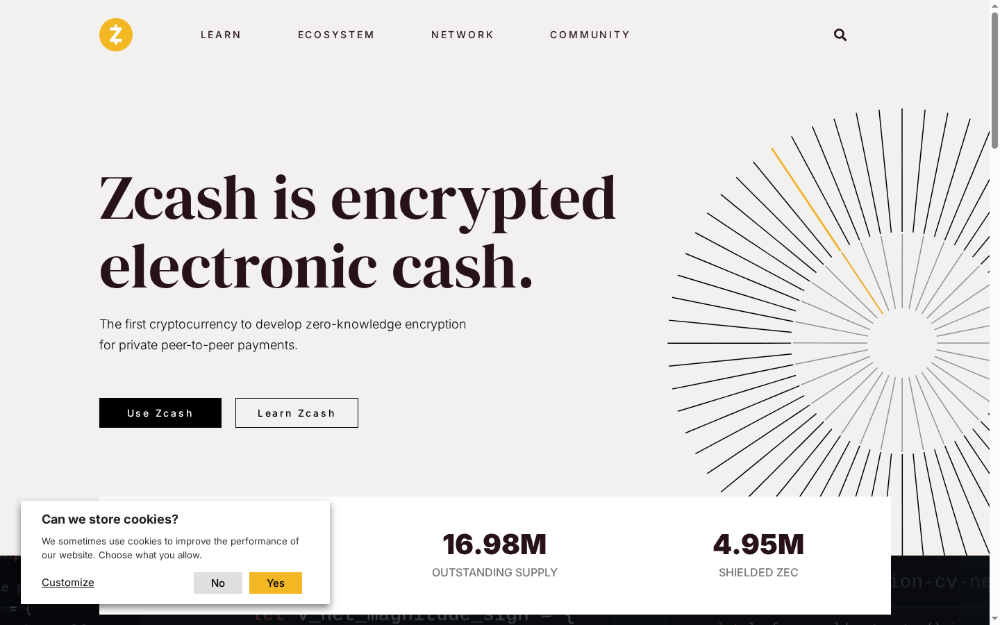
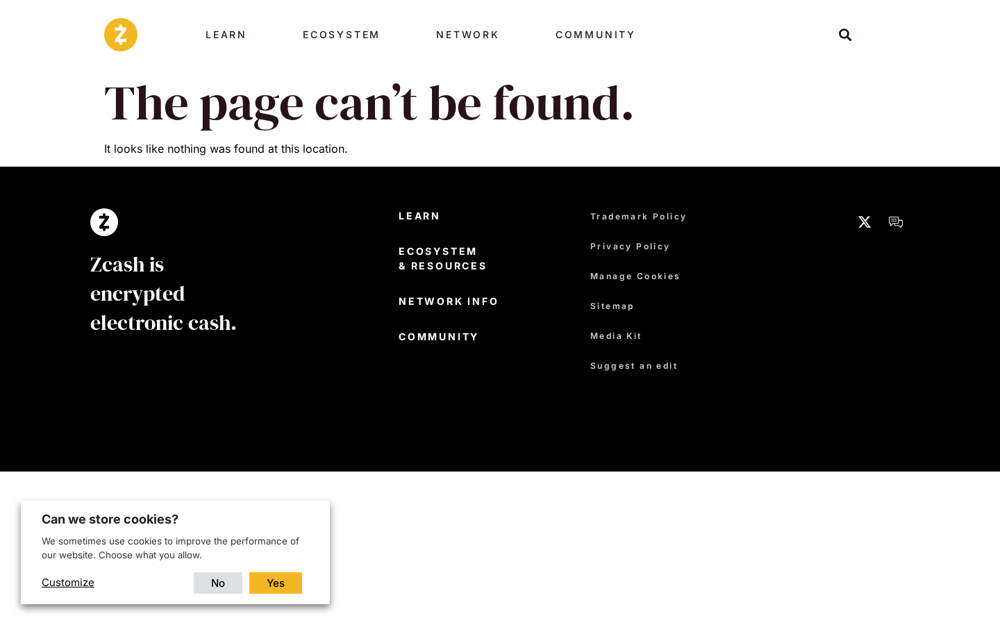
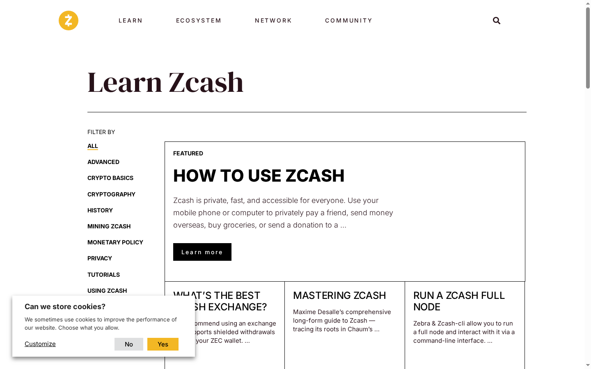
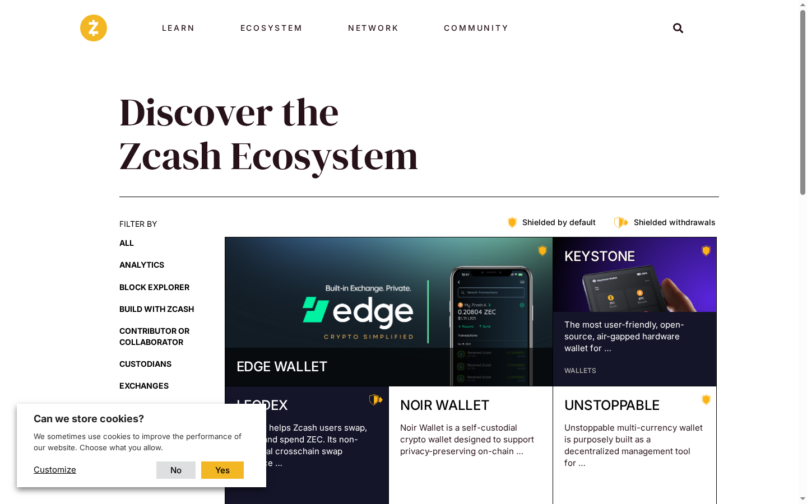
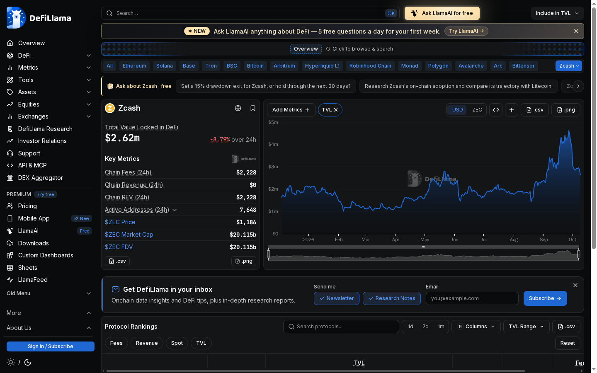
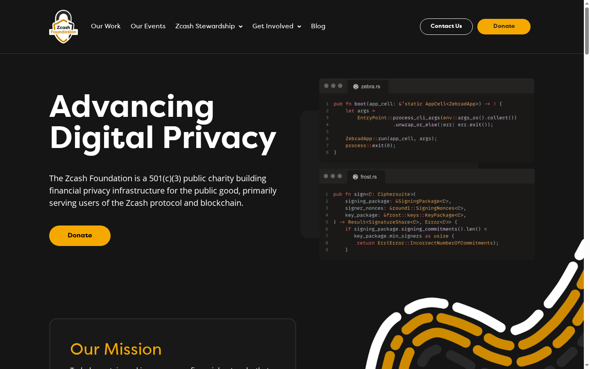
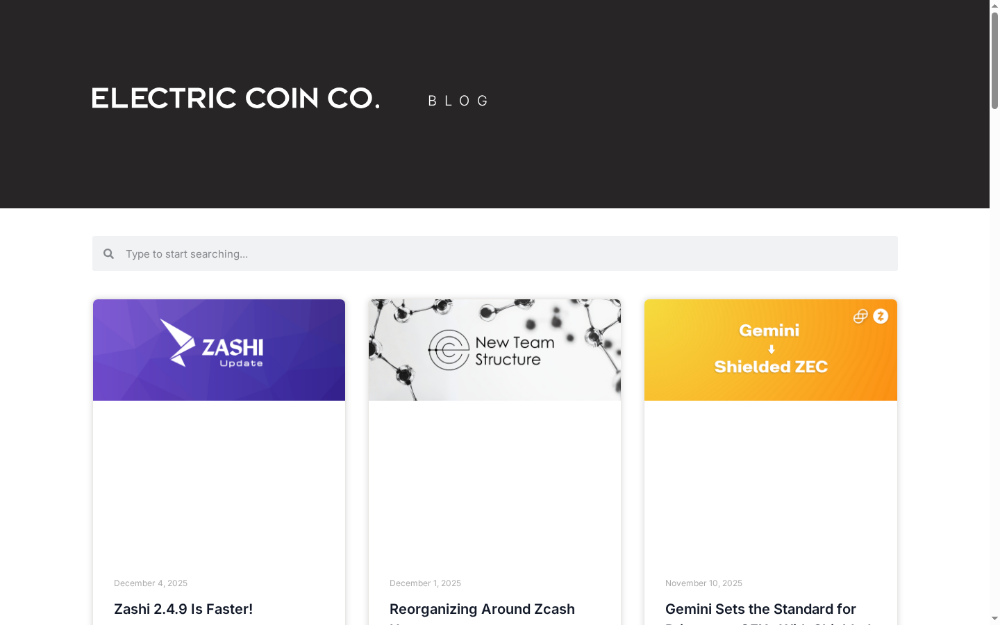
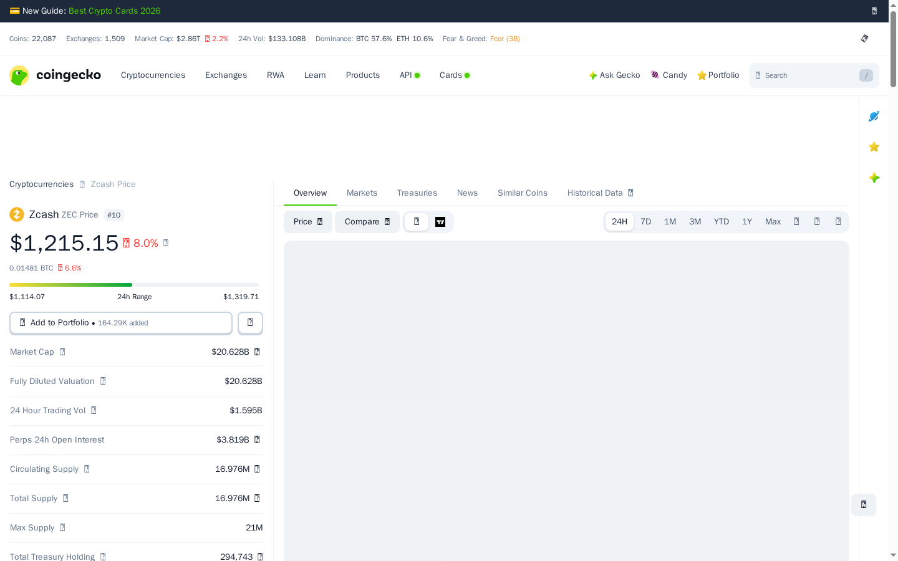

---
title: "ZEC Review 2026: I Spent a Day with Zcash — The Privacy Coin That Invented zk-SNARKs"
slug: "/crypto-reviews/zec-zcash-review-2026/"
primary_keyword: "Zcash ZEC review 2026"
reviewed_on: "2026-10-09"
author: "Crypto Reviewer"
screenshots: 9
---

# ZEC Review 2026: I Spent a Day with Zcash — The Privacy Coin That Invented zk-SNARKs

I went into this review expecting a niche privacy coin with a cult following and a dusty website. What I found was more complicated: a genuinely impressive piece of cryptography, a dual-org governance structure that's both its greatest strength and an ongoing coordination headache, and a $20B market cap sitting on top of a DeFi ecosystem so small it barely registers. Let me walk you through exactly what I found.

---

## 1. First Impression: Landing on z.cash

The homepage loads clean. No aggressive token price ticker, no "Buy now" call-to-action plastered across the hero. Just a stark headline: **"Zcash is encrypted electronic cash."**

> **Source:** [https://z.cash](https://z.cash) — 2026-10-09

Below the fold, two numbers get called out front and center: **16.97M ZEC** in total circulating supply, and **4.95M ZEC** held in shielded addresses. That second number is the whole pitch — Zcash is the only major proof-of-work chain where roughly 29% of the entire circulating supply sits in cryptographically private addresses, invisible to anyone who doesn't hold the viewing key.

The visual design is minimal and confident. It reads less like a DeFi protocol trying to hustle you into a yield farm and more like a protocol that believes it has already won the technical argument and is waiting for the rest of the world to catch up. Whether that confidence is warranted is a different question — I'll get to that.

My first instinct was to click **"The Technology"**. That's where I ran into my first real friction point.

---

## 2. Understanding the Product: The 404 That Tells You Something

The navigation bar on z.cash includes a link to `/the-technology`. I clicked it.

> **Source:** [https://z.cash/the-technology/](https://z.cash/the-technology/) — 2026-10-09

404. Page not found.

This is a meaningful signal, not just a broken link. For a protocol that runs almost entirely on the strength of its cryptography, having the technology explainer page return a 404 is a documentation gap that a first-time visitor will feel immediately. If I'm evaluating Zcash for a personal finance use case — say, private payroll disbursements or confidential business transactions — the first thing I want to understand is *how the privacy actually works*. The front door to that explanation is broken.

I navigated to `/learn` instead, which does exist and is reasonably organized.

> **Source:** [https://z.cash/learn/](https://z.cash/learn/) — 2026-10-09

The Learn section has nine content categories: Advanced, Crypto Basics, Cryptography, History, Mining Zcash, Monetary Policy, Privacy, Tutorials, and Using Zcash. The featured article — *"How to Use Zcash — private, fast, accessible for everyone"* — is a reasonable onboarding piece. But the content here reads like it was written for people who are already broadly interested in privacy rather than engineers evaluating the protocol. For a deeper technical dive, you'll need to go to the [Zcash Protocol Specification](https://zips.z.cash/protocol/protocol.pdf) or the ECC GitHub directly. The website doesn't surface those prominently.

---

## 3. The Privacy Stack: What "Shielded" Actually Means

Here's the part I found genuinely impressive once I dug past the website friction.

Zcash uses **zk-SNARKs** (Zero-Knowledge Succinct Non-Interactive Arguments of Knowledge) — a cryptographic proof system that lets you prove you know something (like a valid spending key) without revealing *what* you know. Zcash was the first major blockchain to deploy zk-SNARKs in production, back in 2016. Every modern privacy-preserving blockchain — Aztec, Tornado Cash's underlying mechanism, StarkNet's privacy work — owes intellectual debt to what Zcash shipped first.

There are two address types on Zcash:
- **Transparent addresses** (t-addresses): function like Bitcoin addresses — all transaction data is on-chain and publicly visible
- **Shielded addresses** (z-addresses): sender, receiver, and amount are all encrypted on-chain; only the parties with viewing keys can see the details

The stat from the homepage is important here: **4.95M ZEC (~29% of total supply)** lives in shielded addresses as of this review. That's a meaningful chunk — but it also means **71% of ZEC is still in transparent addresses**, transacting in full public view. The shielding is opt-in, not default, and most exchanges — including many major ones — only support transparent ZEC. Shielded adoption has grown, but the network is still primarily used in transparent mode.

The exception worth noting: **Gemini** explicitly supports shielded ZEC withdrawals, which is a notable signal that at least one regulated exchange has done the compliance work to handle z-address transactions. That's not nothing.

---

## 4. Getting a Wallet: What Your Options Actually Look Like

Navigating to `/wallets` gives you a short list.

> **Source:** [https://z.cash/wallets/](https://z.cash/wallets/) — 2026-10-09

The wallets page lists five options: **Edge** (mobile), **Keystone** (hardware), **Noir**, **Unstoppable**, and **Leodex**.

For a rank-10 cryptocurrency by market cap, five wallets is a thin roster. Compare this to Ethereum or Solana, where you have dozens of actively maintained options with competing UX. Here you're in a more constrained ecosystem.

A few observations from looking at each:

- **Edge** is a solid mobile wallet with multi-coin support. It supports shielded ZEC, which matters. The UX isn't Zcash-native, but it works.
- **Keystone** covers the hardware wallet use case — important for anyone holding ZEC as a long-term store of value, which seems to be a significant use case given the market data.
- **Noir** and **Leodex** are less widely known; Noir markets itself as ZEC-focused.
- **Unstoppable** is a mobile wallet.

What's notably absent from this list: **Zashi**, the ECC's own first-party wallet. The ECC blog (more on that below) shows active Zashi development — version 2.4.9 shipped in December 2025 with performance improvements. It's not on the official wallets page as of this review, which is either an oversight or a site update that hasn't propagated. Either way, worth checking [electriccoin.co](https://electriccoin.co) directly if you want the first-party option.

Onboarding friction is real here. Unlike Phantom for Solana or MetaMask for Ethereum, there's no single "obvious" wallet that new users default to. The ecosystem asks you to make a choice before you've even used the product.

---

## 5. The Ecosystem Check: The DeFi Reality Is Stark

This is where I need to be completely honest with you about what Zcash is and isn't.

> **Source:** [https://defillama.com/chain/zcash](https://defillama.com/chain/zcash) — 2026-10-09

The DefiLlama numbers for the Zcash chain:

| Metric | Value |
|---|---|
| DeFi TVL | $2.62M (-8.79%) |
| Chain Fees (24h) | $2,228 |
| Chain Revenue (24h) | $0 |
| Active Addresses (24h) | 7,648 |
| ZEC Price | $1,186 |
| Market Cap | $20.115B |

A $20 billion market cap with $2.62 million in DeFi TVL. That's not a rounding error — that's a fundamental statement about what Zcash is used for. **Zcash is not a DeFi chain.** It does not have a meaningful lending protocol, a DEX with real liquidity, or a yield layer. The chain fees being $2,228 in 24 hours against a $20B market cap tells you the network is lightly used for on-chain transactions relative to its valuation.

What this means in practice: **ZEC's value proposition is almost entirely as a store-of-value and private payment rail**, not as infrastructure for smart contracts or DeFi activity. If you're buying ZEC because you expect DeFi to explode on the chain, you're reading the wrong signal. If you're buying it because you believe private, censorship-resistant digital cash is undervalued relative to transparent alternatives, that's the actual thesis.

The **Gemini shielded support** I mentioned earlier is a positive signal in this context. It suggests institutional-adjacent infrastructure is being built around the payment use case. But it's a single data point against a backdrop of limited exchange shielded support overall.

---

## 6. Governance & Trust: Two Orgs, One Chain

Zcash governance is more formalized than most chains — and more complicated.

> **Source:** [https://zfnd.org](https://zfnd.org) — 2026-10-09

There are two governing organizations:

**Electric Coin Company (ECC)** built the protocol and continues to own the primary client implementation. The ECC blog is active — the most recent posts at the time of my review include a Zashi 2.4.9 wallet update (December 4, 2025), a post titled "Reorganizing Around Zcash" (December 1, 2025) that suggests internal restructuring, and a piece about Gemini's shielded ZEC support (November 10, 2025).

**Zcash Foundation (ZFND)** is a 501(c)(3) public charity that operates independently from ECC. Their work focuses on alternative infrastructure: **Zebra** (a Zcash full node written in Rust, as an alternative to ECC's `zcashd`) and **FROST** (Flexible Round-Optimized Schnorr Threshold signatures — a way to do threshold signing for multisig use cases).

The dual-org structure is a feature: it means the protocol has two independent actors who can check each other, reducing single-point-of-failure governance risk. In practice, ECC and ZFND have disagreed publicly on strategic direction in past years, and the "Reorganizing Around Zcash" blog post title suggests the internal dynamics are still being worked out. It's dual governance as a coordination risk as much as a safeguard.

Both organizations are funded by the **Zcash Dev Fund** — a percentage of block rewards that flows to development rather than all going to miners. This is a deliberate design decision to fund ongoing development without a VC token unlock, though it also means miners receive less than they would on Bitcoin.

> **Source:** [https://electriccoin.co](https://electriccoin.co) — 2026-10-09

The fact that the ECC is actively shipping — Zashi wallet updates, blog posts, governance restructuring — tells me this is not an abandoned protocol. The foundation is publishing code. These are living organizations, not stealth-mode ghosts.

---

## 7. Mining: Proof-of-Work, Equihash, ASIC Territory

Zcash is a **Proof-of-Work** chain using the **Equihash** algorithm. This is important to understand for a few reasons:

- Equihash was originally designed to be ASIC-resistant, favoring GPU miners. That resistance eroded over time — Bitmain and others have shipped Equihash ASICs, so the mining landscape today is dominated by dedicated hardware, similar to Bitcoin's SHA-256 economics.
- The **Bitcoin-like halving model** means supply inflation decreases over time. With 16.975M of 21M coins already mined (~81% of max supply), the issuance curve is in its later stages.
- The block reward split goes to miners *and* to the Zcash Dev Fund, unlike Bitcoin where 100% of the block reward goes to miners.

If you're considering mining ZEC: you'll need an Equihash ASIC to compete profitably at current difficulty levels. GPU mining ZEC at scale is not competitive against ASIC farms. The Learn section on z.cash has mining-focused content, but for current profitability data you'll want to cross-reference with [WhatToMine](https://whattomine.com) or similar tools at the time you're reading this.

---

## 8. Market Data Reality Check

Let me put all the market data in one place.

> **Source:** [https://www.coingecko.com/en/coins/zcash](https://www.coingecko.com/en/coins/zcash) — 2026-10-09

| Metric | Value | What It Means |
|---|---|---|
| Price | ~$1,186–$1,205 | Sampled across CoinGecko and DefiLlama |
| CoinGecko Rank | **#10** | Top-10 crypto by market cap |
| Market Cap | ~$20.1–$20.5B | Large-cap territory |
| FDV | **= Market Cap** | No unlock pressure — all tokens are in circulation |
| Circulating Supply | 16.975M / 21M max | 81% of max supply already mined |
| 24h Trading Volume | $957M | Healthy liquidity relative to market cap |
| Perps Open Interest | $3.802B | Significant speculative interest via perpetual futures |
| Shielded Supply | 4.95M ZEC (~29%) | Active private usage — not just theoretical |

The **MCap = FDV** point deserves emphasis. Many tokens in the top 20 have large gaps between circulating supply and fully diluted valuation because significant portions of supply are locked and scheduled to unlock over time — creating constant sell pressure. Zcash doesn't have this problem. Every ZEC that will ever exist is either already mined and circulating, or has yet to be mined on the PoW schedule. There's no VC cliff, no team token unlock at 18 months, no foundation stash waiting to hit the market. This is a clean cap table by crypto standards.

The **$957M in 24h volume** and **$3.802B in perps open interest** tell you this is not a low-liquidity niche asset. People are actively trading and speculating on ZEC, which matters for anyone thinking about position sizing and exit liquidity.

---

## 9. Friction Points: What Doesn't Work

I try to be specific about problems rather than vague about "risks." Here's what I actually ran into:

**The /the-technology 404.** Already mentioned, but it deserves its own bullet. For a protocol whose entire value proposition rests on cryptographic privacy, having the technical explanation page return a 404 is a material gap. New users who want to understand how shielded transactions work hit a dead end on the official site.

**Block explorer certificate error.** When I tried to access `zcashblockexplorer.com` to verify on-chain transaction data, the site returned a certificate error. A block explorer is basic infrastructure — it's how you verify that your transaction actually went through, or check the shielded pool balance, or audit any on-chain claim. Having the primary community block explorer throw a cert warning is the kind of friction that makes a protocol feel unmaintained, even if it isn't. (Note: there are alternative explorers; this isn't fatal, but it is friction.)

**Thin wallet selection.** Five wallets for a top-10 chain is sparse. The Zashi first-party wallet doesn't appear on the official wallets page even though it's under active development. New users have to do additional research to find what the ECC itself recommends.

**Exchange shielded support is limited.** Most exchanges that list ZEC only support transparent addresses. This means most people buying ZEC on an exchange are transacting in fully public mode — which defeats the primary privacy use case until you withdraw to a z-address capable wallet. Gemini's shielded support is genuinely notable precisely because it's an exception, not the rule.

**The DeFi gap.** If you're looking for yield on your ZEC, want to use it in a lending protocol, or want to swap it for other assets on-chain, the ecosystem is nearly empty. $2.62M TVL is not a functional DeFi economy. This isn't necessarily a problem if you're using ZEC as a privacy payment rail, but it's a hard ceiling on "what can I do with my ZEC once I have it" beyond holding it.

---

## 10. Who Is ZEC For? An Honest Verdict

**Zcash makes sense for you if:**

- You want a store-of-value asset with a Bitcoin-like fixed supply and no unlock pressure, but with optional strong privacy guarantees
- You need to make private payments — payroll, donations, transactions you legitimately don't want on a public ledger — and you want cryptographic privacy rather than "privacy by obscurity"
- You're a developer or researcher who cares about the zk-SNARK technology stack and wants exposure to the chain that deployed it first
- You're specifically using Gemini (or another exchange that supports shielded withdrawals) and want to move funds into genuine private custody

**Zcash probably doesn't make sense for you if:**

- You want DeFi yield, on-chain borrowing, liquidity provision, or a smart contract ecosystem — this chain doesn't have it at any meaningful scale
- You expect the "privacy coin" narrative to drive short-term price performance — the regulatory environment around privacy coins remains uncertain globally, and that's a real headwind
- You want a deep wallet ecosystem with multiple well-maintained options and a clear "just use this one" recommendation
- You need a block explorer that loads reliably and without certificate warnings

The honest summary: **Zcash is cryptographically excellent and commercially underbuilt.** The zero-knowledge proof technology is real, battle-tested, and more sophisticated than anything its privacy coin competitors have deployed. The governance structure is legitimate — two active organizations with real funding, publishing code, shipping wallet updates. But the developer ecosystem is thin, the DeFi footprint is nearly nonexistent, and basic infrastructure like the tech documentation page and the block explorer has gaps that a chain this size shouldn't have in 2026.

Rank #10 by market cap is a significant statement of market confidence. Whether the product infrastructure around that rank catches up to the underlying cryptography is the open question heading into the next cycle.

---

*Reviewed on 2026-10-09. All price data is from CoinGecko and DefiLlama at time of capture. Screenshots taken from live sites. This is not financial advice.*
