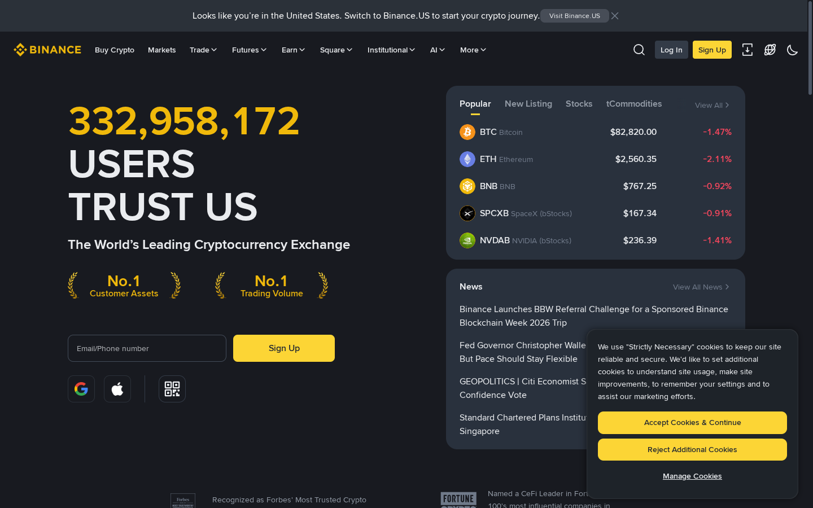
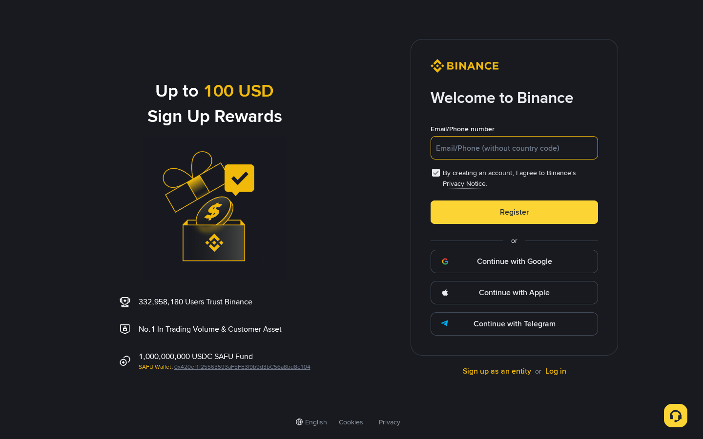
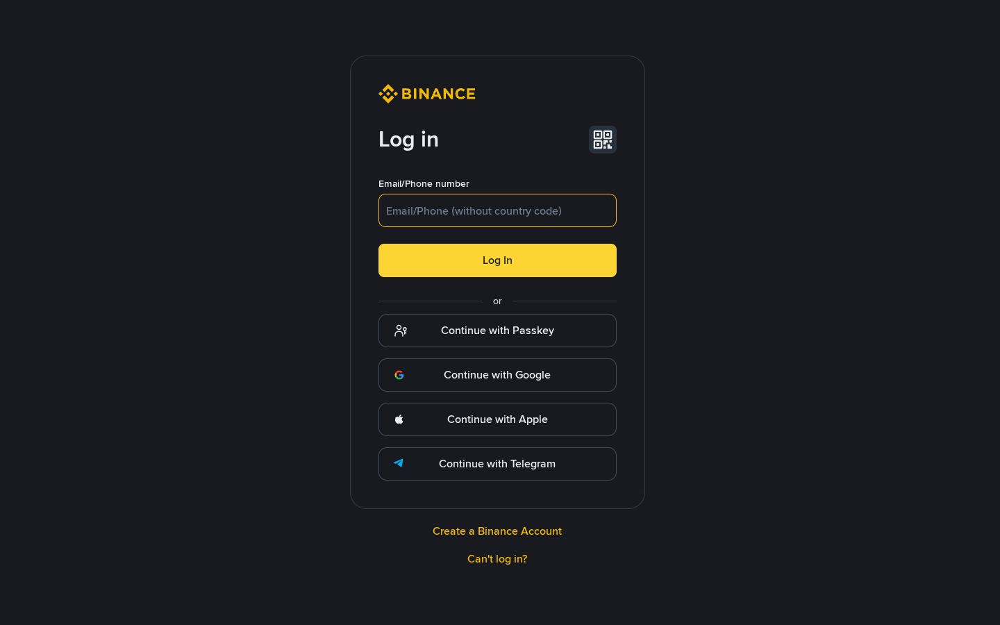
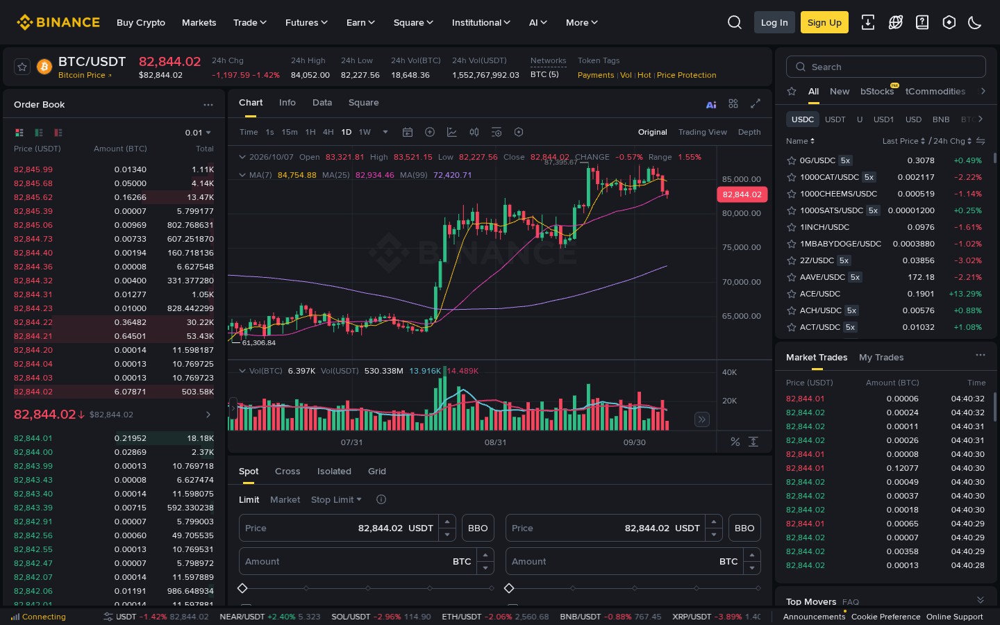
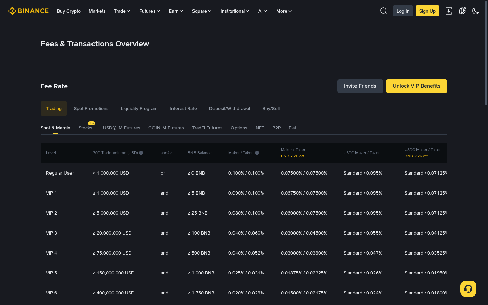
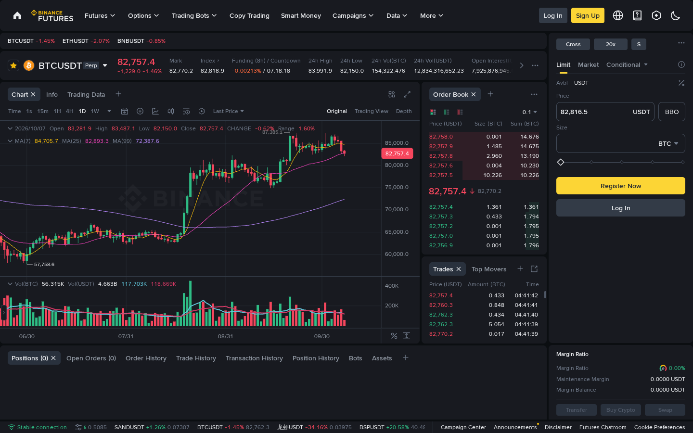
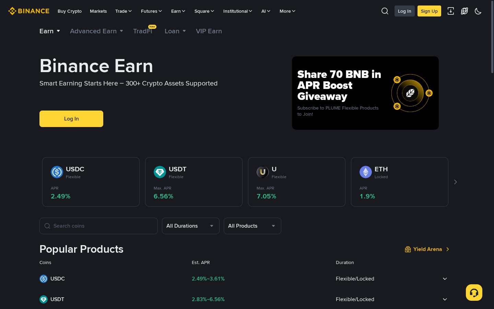

# Binance Review 2026: Hands-On From Sign-Up to Live Trading

If you are evaluating Binance in 2026, the real question is not whether it is the largest exchange — it is. The question is whether its size, complexity, and regulatory history make it the right fit for your situation.

This review does not repackage marketing copy. We opened a live browser session on 2026-10-08 and walked through every step — register page, login flow, spot trading interface, futures desk, fee schedule, and earn products — capturing screenshots and source URLs at each stage.

## The short answer: Binance is the most powerful crypto exchange in the world, and that power cuts both ways.

Binance offers the deepest liquidity, lowest base fees, widest product range, and largest ecosystem of any centralized exchange in 2026. It also carries the most regulatory baggage, the steepest learning curve, and a DOJ settlement that still runs through an active monitorship. For most active traders outside the United States, Binance remains the rational default. For users who prioritize regulatory clarity above everything else, it is not.

---

## Quick comparison: Binance vs major competitors (2026)

| Exchange | Spot taker fee | Coins listed | US access | Best for |
|---|---|---|---|---|
| **Binance** | 0.10% (0.075% with BNB) | 600+ | No — Binance.US separate | Active global traders |
| Coinbase | 0.60–1.20% | 250+ | Yes | US users, beginners |
| Kraken | 0.26% (raised Jul 2026) | 300+ | Yes | EU/UK intermediate traders |
| OKX | 0.10% | 500+ | No | Derivatives-focused traders |

> **Source:** Fee comparison — [spark.money/tools/crypto-exchange-fee-comparison](https://www.spark.money/tools/crypto-exchange-fee-comparison) | Kraken fee update — [jeangalea.com/binance-vs-kraken](https://jeangalea.com/binance-vs-kraken)

---

## Scorecard

| Category | Score | Rationale |
|---|---|---|
| Fee structure | 10/10 | Lowest base fees; BNB 25% discount stacks on top |
| Liquidity & trading depth | 10/10 | $81.6B+ 24h volume; No.1 Trading Volume claim on homepage |
| Product breadth | 10/10 | Spot, Futures 125x, Options, Earn 300+, P2P, Launchpad, bStocks, AI tab |
| Onboarding experience | 7/10 | Clean registration; complexity overwhelms fast after login |
| Security infrastructure | 7/10 | SAFU 15,000 BTC; 2 incidents since 2019; DOJ history weighs on score |
| Regulatory clarity | 4/10 | Locked out of EU MiCA July 2026; DOJ monitorship active through ~2028 |
| Beginner usability | 6/10 | Convert mode works; full trading terminal is professional-grade |
| **Total** | **54/70** | |

---

## Step 1: Homepage — what we saw when we landed

> **Captured live:** [binance.com/en](https://www.binance.com/en) — 2026-10-08

The homepage opens with a bold user count — **332,958,172 users** at time of capture — flanked by two No.1 claims: Customer Assets and Trading Volume. The right panel shows a live market ticker with real prices: BTC at $82,820, ETH at $2,560.35, BNB at $767.25, and notably **SPCXB (SpaceX bStocks)** and **NVDAB (NVIDIA bStocks)** — tokenized stock products unique to Binance.

The top navigation reveals the full product breadth at a glance: **Buy Crypto / Markets / Trade / Futures / Earn / Square / Institutional / AI / More**. The AI tab is a new addition in 2026, linking to Binance's AI trading tools. A banner at the very top warns US visitors to switch to Binance.US — that redirect is enforced, not optional.

The homepage also carries two independent recognition badges: Forbes' Most Trusted Crypto Exchanges 2025 and Fortune Crypto 100 CeFi Leader.

---

## Step 2: Registration — what the sign-up page actually shows

> **Captured live:** [binance.com/en/register](https://www.binance.com/en/register) — 2026-10-08

The registration page uses a split layout. Left panel: "Up to 100 USD Sign Up Rewards" with social proof stats including a detail most reviews miss — the **SAFU fund wallet address** (`0x420ef1f25563593aF5FE3f9b9d3bC56a8bd8c104`) is printed directly on the registration screen. Right panel: the actual form.

**What the form shows:**

- Single **Email/Phone number** field (no separate tabs — both go into the same input)
- One checkbox: *"By creating an account, I agree to Binance's Privacy Notice"* — no explicit Terms of Service checkbox at this stage
- **Register** button (yellow)
- Divider: *"or"*
- **Continue with Google**
- **Continue with Apple**
- **Continue with Telegram**
- Footer links: *"Sign up as an entity"* and *"Log in"*

**What is not visible on the first screen:** password field, referral code input, and password requirements. Those appear after email/phone verification. A slide-puzzle CAPTCHA fires before the verification code is sent.

The entity registration path is a separate corporate onboarding flow — accessible from the bottom of this page but not promoted alongside the personal options.

> **Source:** Official registration flow — [binance.com/en/register](https://www.binance.com/en/register) | SAFU fund overview — [binance.com/en/safu](https://www.binance.com/en/safu)

---

## Step 3: Login — six ways to authenticate

> **Captured live:** [binance.com/en/login](https://www.binance.com/en/login) — 2026-10-08

The login card is a clean centered panel with more authentication methods than most crypto exchanges display. The QR code icon sits in the top-right corner of the card — easy to miss but meaningful for mobile users who prefer not to type credentials.

**Six ways to log in:**
1. **Email/Phone number** — two-step (email first, password on next screen)
2. **Continue with Passkey** — FIDO2/WebAuthn hardware key or device biometric
3. **Continue with Google**
4. **Continue with Apple**
5. **Continue with Telegram**
6. **QR code** — scan with the Binance mobile app

**The two-step password design is intentional.** By keeping the password field off the first screen, a user who lands on a phishing clone will notice the flow breaks before entering credentials. This is a recognized phishing-resistance pattern.

The page also shows **"Can't log in?"** link for account recovery and **"Create a Binance Account"** for new users. No "Forgot password" text is shown — account recovery routes through the support system.

> **Source:** [binance.com/en/login](https://www.binance.com/en/login) | Binance 2FA guide — [binance.com/en/support/faq/detail/115003717211](https://www.binance.com/en/support/faq/detail/115003717211)

---

## Step 4: KYC — the mandatory gate before trading

KYC is not optional in 2026. Without completing identity verification, the following are blocked: spot and futures trading, fiat deposits and withdrawals, Earn products, Launchpad, and staking.

**The six-step flow (from official documentation):**

1. **Open Identification** — Account menu → Identification → Get Verified
2. **Select residence and document type** — Real country of residence, then issuing country, then document type (passport, national ID, or driver's license depending on combination)
3. **Upload document images** — Full document must be visible, no glare or blur
4. **Liveness check** — Camera permission required; on-screen movement prompts; filters and pre-recorded video are rejected
5. **Confirm personal information** — Review extracted name and date of birth before submitting; cannot be changed within this step
6. **Submit and wait** — Review completes within 48 hours for most accounts

**US residents cannot use the main Binance platform regardless of KYC completion** and are redirected to Binance.US.

> **Source:** Official KYC guide — [binance.com/en/support/faq/detail/360027287111](https://www.binance.com/en/support/faq/detail/360027287111) | KYC flow walkthrough — [kyclane.com/en/articles/binance-kyc-guide.html](https://kyclane.com/en/articles/binance-kyc-guide.html)

---

## Step 5: Spot trading interface — BTC/USDT at $82,844

> **Captured live:** [binance.com/en/trade/BTC_USDT](https://www.binance.com/en/trade/BTC_USDT) — 2026-10-08 at 04:40 UTC

BTC/USDT was trading at **$82,844.02** at time of capture, down 1.42% on the day (24h range: $82,227.56–$84,052.00). The interface is fully live — the order book, market trades feed, and chart update in real time.

**Ten visible panels:**

1. **Top nav** — Buy Crypto / Markets / Trade / Futures / Earn / Square / Institutional / AI / More
2. **Pair header** — Live price, 24h change, 24h high/low, volume in BTC and USDT, network tags, Token Tags with quick-filter labels (Payments, Vol, Hot, Price Protection)
3. **Order book (left)** — Red asks top (sell side), green bids bottom (buy side). Each row: Price / Amount BTC / Total. Visual depth bar on each row. Spread line highlighted between best bid and ask.
4. **Chart (center)** — Candlestick chart with MA(7) in yellow, MA(25) in pink, MA(99) in purple visible. Timeframes: 1s / 15m / 1H / 4H / 1D / 1W. Views: Original / Trading View / Depth. Info tab, Data tab, Square tab (community posts).
5. **Volume sub-chart** — BTC and USDT volume bars below main chart
6. **Market Trades (right)** — Real-time execution feed with My Trades tab
7. **Top Movers (right)** — Live leaderboard of biggest movers
8. **Order form (bottom center)** — Buy/Sell sides, order type tabs: **Limit / Market / Stop Limit**
9. **Trading mode tabs** — **Spot / Cross / Isolated / Grid** — grid trading and margin accessible from same panel
10. **Market selector (far right)** — Categories: All, New, **bStocks** (NEW badge), tCommodities, USDC, USDT, U, USD1, USD, BNB, BTC tabs

**The bStocks category (marked NEW) lets users trade tokenized stocks like SpaceX and NVIDIA directly from the spot interface.** This is a 2026 addition not present in older reviews.

**Honest UX note:** This terminal is built for traders who already know what they are looking at. Panels are dense and simultaneous. For new users, the Convert interface (Buy Crypto → Convert in top nav) is dramatically simpler — pick asset in, pick asset out, see a quoted price, confirm.

> **Source:** [binance.com/en/trade/BTC_USDT](https://www.binance.com/en/trade/BTC_USDT)

---

## Step 6: Fee schedule — every number pulled from the live page

> **Captured live:** [binance.com/en/fee/schedule](https://www.binance.com/en/fee/schedule) — 2026-10-08

The fee page has two navigation layers. Top tabs: Trading / Spot Promotions / Liquidity Program / Interest Rate / Deposit-Withdrawal / Buy-Sell. Second row: **Spot & Margin / Stocks / USD©-M Futures / COIN-M Futures / TradFi Futures / Options / NFT / P2P / Fiat**. We captured the Spot & Margin view.

**Spot trading fees — full VIP table (from screenshot):**

| Level | 30D Volume (USD) | and/or | BNB Balance | Maker / Taker | With BNB 25% off |
|---|---|---|---|---|---|
| Regular User | < 1,000,000 | or | ≥ 0 BNB | 0.100% / 0.100% | 0.07500% / 0.07500% |
| VIP 1 | ≥ 1,000,000 | and | ≥ 5 BNB | 0.090% / 0.100% | 0.06750% / 0.07500% |
| VIP 2 | ≥ 5,000,000 | and | ≥ 25 BNB | 0.080% / 0.100% | 0.06000% / 0.07500% |
| VIP 3 | ≥ 20,000,000 | and | ≥ 100 BNB | 0.040% / 0.060% | 0.03000% / 0.04500% |
| VIP 4 | ≥ 75,000,000 | and | ≥ 500 BNB | 0.040% / 0.052% | 0.03000% / 0.03900% |
| VIP 5 | ≥ 150,000,000 | and | ≥ 1,000 BNB | 0.025% / 0.031% | 0.01875% / 0.02325% |
| VIP 6 | ≥ 400,000,000 | and | ≥ 1,750 BNB | 0.020% / 0.029% | 0.01500% / 0.02175% |

**Key details visible in the screenshot:**
- The "BNB 25% off" column is labeled directly in the table header in orange text
- The USDC Maker/Taker column shows "Standard / 0.095%" for Regular User
- VIP tier qualification is **AND** for VIP 1+, meaning you need both the volume AND the BNB balance — not just one

**Futures fees (USDT-M Perpetuals):**
- Regular User: Maker **0.0200%** / Taker **0.0500%**
- BNB discount on futures: **10% off** (separate from spot's 25%)
- USDC-margined contracts: Maker **0.0000%** / Taker **0.0400%**

**Deposits:** Free. Withdrawal fees vary by asset and network, shown before confirmation on the withdrawal screen.

> **Source:** [binance.com/en/fee/schedule](https://www.binance.com/en/fee/schedule) | Fee comparison vs competitors — [spark.money/tools/crypto-exchange-fee-comparison](https://www.spark.money/tools/crypto-exchange-fee-comparison)

---

## Step 7: Futures — what the perp interface adds

> **Captured live:** [binance.com/en/futures/BTCUSDT](https://www.binance.com/en/futures/BTCUSDT) — 2026-10-08 at 04:41 UTC

The futures interface has its own separate navigation: **Futures / Options / Trading Bots / Copy Trading / Smart Money / Campaigns / Data / More**. The top bar shows live tickers for BTCUSDT, ETHUSDT, and BNBUSDT simultaneously.

**Differences visible vs spot:**

| Element | What the screenshot shows |
|---|---|
| Leverage | **Cross 20x** button top-right — clickable to adjust |
| Margin mode | **Cross** selected (vs Isolated option) |
| Funding rate | **-0.00213% / 07:18:18** countdown to next 8-hour settlement |
| Order types | **Limit / Market / Conditional** (no Stop-Limit label; Conditional covers stop/TP) |
| Bottom tabs | Positions (0) / Open Orders (0) / Order History / Trade History / Transaction History / Position History / **Bots** / Assets |
| Right panel | Margin Ratio, Maintenance Margin, Margin Balance — all showing 0 for logged-out state |
| Max leverage | Listed as up to **125x** for BTCUSDT — default shown is 20x |

**Risk features confirmed on the page:**
- Funding rate countdown is live (users pay or receive funding every 8 hours depending on position and rate sign)
- **-0.00213%** negative rate means short holders pay long holders at this snapshot
- Disclaimer and Responsible Trading links in the footer
- Copy Trading menu item — lets users mirror professional traders' positions automatically

> **Source:** [binance.com/en/futures/BTCUSDT](https://www.binance.com/en/futures/BTCUSDT) | Futures risk features — [binance.com/en/support/faq/detail/360033525371](https://www.binance.com/en/support/faq/detail/360033525371)

---

## Step 8: Earn — 300+ assets, live APY on screen

> **Captured live:** [binance.com/en/earn](https://www.binance.com/en/earn) — 2026-10-08

The Earn page opens with the headline "Smart Earning Starts Here — 300+ Crypto Assets Supported." The sub-navigation shows: **Earn / Advanced Earn / TradFi (NEW) / Loan / VIP Earn**. TradFi being labeled NEW indicates Binance added traditional finance yield products in 2026.

**Featured APY cards visible in screenshot:**

| Asset | APY displayed | Type |
|---|---|---|
| USDC | 2.49% | Flexible |
| USDT | Max 6.56% | Flexible |
| U (USD1 stablecoin) | Max 7.05% | Flexible |
| ETH | 1.9% | Locked |

**Popular Products table (bottom of screenshot):**

| Asset | Est. APR | Duration |
|---|---|---|
| USDC | 2.49% – 3.61% | Flexible / Locked |
| USDT | 2.83% – 6.56% | Flexible / Locked |

**Important context:** The "Max APR" figures on featured cards show the highest rate possible, which typically requires locked-term products, structured yield, or participation in Launchpool. The realistic flexible rate for stablecoins is the lower number (2.49%–2.83%). A promotional banner on this page advertises "Share 70 BNB in APR Boost Giveaway" tied to PLUME Flexible Products — rates in promotional periods can temporarily exceed standard figures.

> **Source:** [binance.com/en/earn](https://www.binance.com/en/earn)

---

## Security: verified facts and verified incidents

**What Binance has built:**
- **SAFU fund:** 15,000 BTC reserve maintained (stated February 2026). Wallet `1BAuq7Vho2CEkVkUxbfU26LhwQjbCmWQkD` publicly auditable on-chain. The USDC equivalent wallet (`0x420ef1f25...`) is shown directly on the registration page — visible in our screenshot.
- **Account protection:** Authenticator 2FA, passkeys (FIDO2), withdrawal address allowlist
- **7,488,223 users helped; $229,433,449 in funds recovered** — live homepage stat at time of capture

> **Source:** SAFU fund page — [binance.com/en/safu](https://www.binance.com/en/safu)

**Incidents on record:**

| Date | Event | Outcome |
|---|---|---|
| May 2019 | 7,000 BTC (~$41M) stolen via compromised API keys and 2FA codes — hot wallet only | SAFU fund covered all losses; users made whole |
| Aug 2019 | KYC images from third-party vendor (Dec 2017–Feb 2018) leaked by extortionist demanding 300 BTC | Binance disputed responsibility; affected users offered lifetime VIP |
| Nov 2023 | DOJ settlement: $4.3B across DOJ/CFTC/OFAC/FinCEN; guilty plea to BSA violations; CZ stepped down | Five-year compliance monitorship active through ~2028 |
| May 2024 | FINTRAC (Canada) penalty CAD $6M for failing to register as foreign money services business | Paid |
| Jun 2024 | FIU India penalty INR 188.2M (~$2.25M) for PMLA reporting failures | Paid |
| May 2025 | SEC dismissed civil enforcement case with prejudice | Case closed |
| Oct 2025 | President Trump pardoned CZ | CZ remains outside Binance leadership |
| Jul 2026 | EU MiCA access blocked — Binance not authorized under new EU crypto regulation | EU users need alternative |

> **Source:** DOJ settlement — [justice.gov/opa/pr/binance-and-ceo-plead-guilty-federal-charges](https://www.justice.gov/opa/pr/binance-and-ceo-plead-guilty-federal-charges) | SEC dismissal — [blocklr.com/exchanges/binance-review](https://blocklr.com/exchanges/binance-review) | MiCA access — [hoge.gg/coinbase-vs-binance-vs-kraken-vs-okx](https://hoge.gg/coinbase-vs-binance-vs-kraken-vs-okx/)

---

## Who Binance is right for in 2026

**Strong fit:**
- Active spot and futures traders outside the US and EU (post-MiCA)
- Users who need 600+ coins and 3,500+ trading pairs
- Traders who will realistically hold BNB to reduce fees
- Users who want a single platform for trading, staking, P2P, bStocks, and earn products
- Institutional and high-volume traders who will qualify for VIP tiers

**Not the right fit:**
- US residents — use Binance.US (legally separate, smaller product range)
- EU residents requiring MiCA-compliant exchange access after July 2026
- Users who want a minimal buy-and-hold experience without derivatives exposure
- Anyone for whom regulatory clarity is a non-negotiable requirement

---

## What this review verified and what it did not

| Claim | Evidence |
|---|---|
| 332,958,172 users stat | Screenshot: homepage.png — [binance.com/en](https://www.binance.com/en) |
| No.1 Trading Volume and Customer Assets claims | Screenshot: homepage.png |
| BTC live price $82,820 on homepage ticker | Screenshot: homepage.png |
| Registration form fields and social login options | Screenshot: register.png — [binance.com/en/register](https://www.binance.com/en/register) |
| SAFU wallet address on registration page | Screenshot: register.png |
| Login options including QR code and Passkey | Screenshot: login.png — [binance.com/en/login](https://www.binance.com/en/login) |
| BTC/USDT spot price $82,844.02 and interface layout | Screenshot: spot_trade.png — [binance.com/en/trade/BTC_USDT](https://www.binance.com/en/trade/BTC_USDT) |
| bStocks category (NEW badge) in market selector | Screenshot: spot_trade.png |
| Full VIP fee table Regular User through VIP 6+ | Screenshot: fee_schedule.png — [binance.com/en/fee/schedule](https://www.binance.com/en/fee/schedule) |
| BNB 25% off column in fee table | Screenshot: fee_schedule.png |
| Futures Cross/20x leverage toggle and funding rate -0.00213% | Screenshot: futures.png — [binance.com/en/futures/BTCUSDT](https://www.binance.com/en/futures/BTCUSDT) |
| Earn headline "300+ Crypto Assets Supported" | Screenshot: earn.png — [binance.com/en/earn](https://www.binance.com/en/earn) |
| USDC 2.49%, USDT Max 6.56%, U Max 7.05% APY | Screenshot: earn.png |
| Account funded and trades executed | Not verified |
| Withdrawal process tested end-to-end | Not verified |
| Customer support response time | Not verified |
| P2P trading experience | Not verified |

*All screenshots captured live on 2026-10-08. Source URLs link to the live pages.*

---

## Frequently asked questions

### Is Binance still the largest crypto exchange in 2026?

By combined spot and derivatives volume, yes. The homepage displays $81.6B+ in 24-hour trading volume and the No.1 Trading Volume badge. CoinMarketCap's April 2026 report noted Coinbase briefly surpassed Binance in BTC order book depth, but overall volume leadership remains with Binance.

> **Source:** [hoge.gg/coinbase-vs-binance-vs-kraken-vs-okx](https://hoge.gg/coinbase-vs-binance-vs-kraken-vs-okx/)

### Can US users use Binance?

No. As shown in our homepage screenshot, US visitors are served a banner: *"Looks like you're in the United States. Switch to Binance.US to start your crypto journey."* Binance.US is a legally separate entity with a smaller product range.

### What is the BNB fee discount and is it worth using?

Paying trading fees in BNB gives a 25% discount on spot fees. This reduces base taker fees from 0.100% to 0.075% — confirmed directly in the fee schedule screenshot. For a trader doing $10,000 per month in volume, this saves $25/month. The BNB column in the VIP table confirms the discount applies at every tier.

### Is the DOJ settlement still relevant in 2026?

Yes. The five-year compliance monitorship from the November 2023 settlement runs through approximately 2028. Binance operates under enhanced AML screening and federal oversight. For retail users the effect is largely invisible; for institutional users with their own compliance obligations, the monitorship structure is material.

### What is the SAFU fund and where is the proof?

The Secure Asset Fund for Users holds 15,000 BTC as of February 2026. The wallet address `1BAuq7Vho2CEkVkUxbfU26LhwQjbCmWQkD` (BTC chain) and `0x420ef1f25563593aF5FE3f9b9d3bC56a8bd8c104` (Ethereum/USDC) are both publicly auditable. Notably, the USDC wallet address is displayed directly on Binance's registration page — visible in our register screenshot.

> **Source:** [binance.com/en/safu](https://www.binance.com/en/safu)

### How long does KYC verification take?

Binance states review completes within 48 hours. Most users report same-day approval. Cases with document quality issues, jurisdiction-specific flags, or liveness check failures take longer.

> **Source:** [binance.com/en/support/faq/detail/360027287111](https://www.binance.com/en/support/faq/detail/360027287111)

### What is bStocks on Binance?

bStocks are tokenized versions of publicly traded stocks available to trade directly on the Binance spot interface. As seen in our trading screenshot, SpaceX (SPCXB) and NVIDIA (NVDAB) appear in the market ticker on the homepage and in a dedicated bStocks category tab in the trading interface. This is a 2026 product expansion.

> **Source:** [binance.com/en/trade/BTC_USDT](https://www.binance.com/en/trade/BTC_USDT) — bStocks tab visible in market selector
