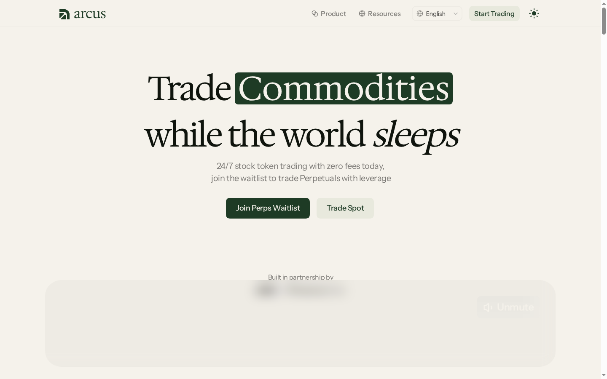
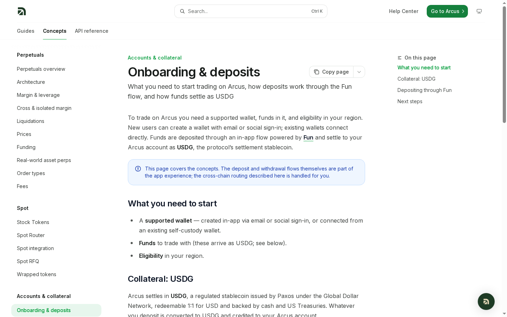
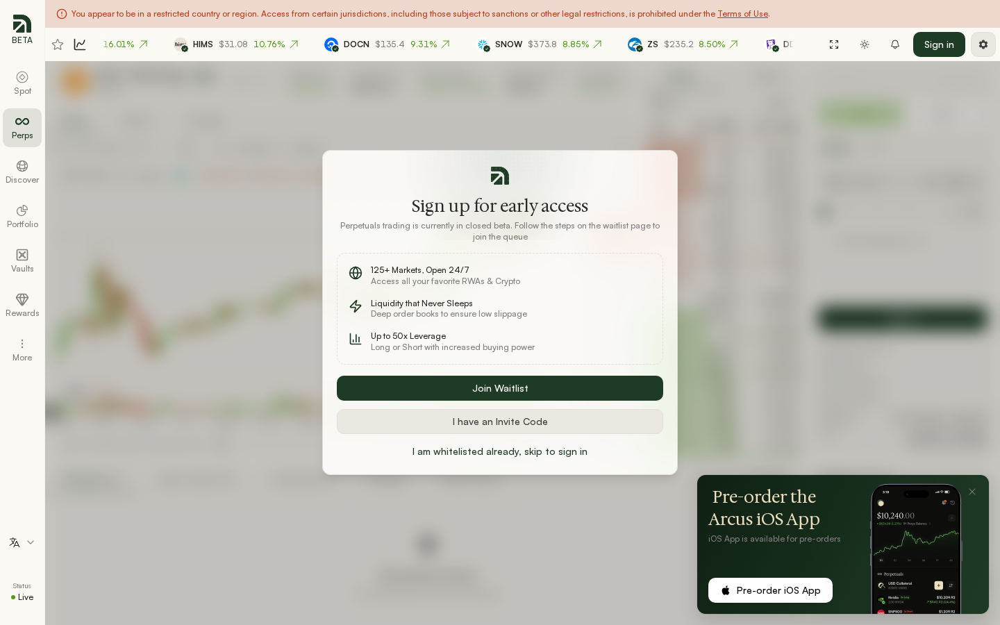
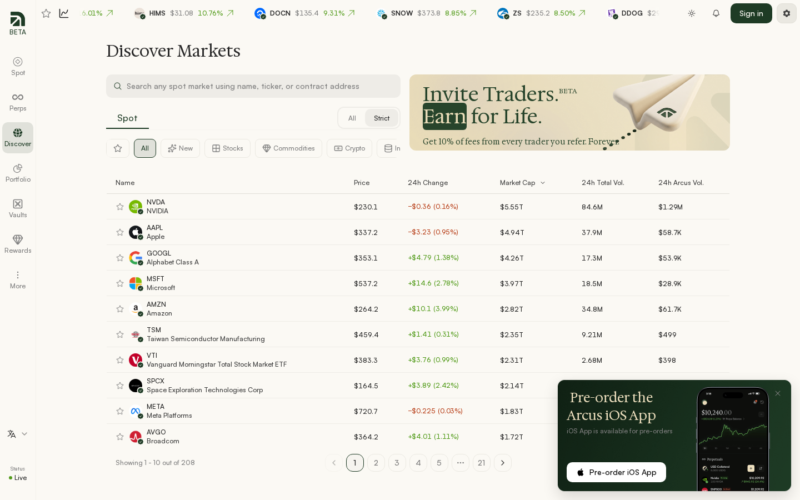
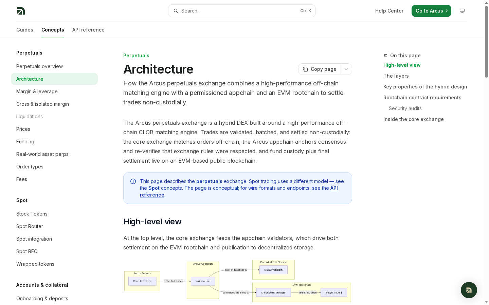
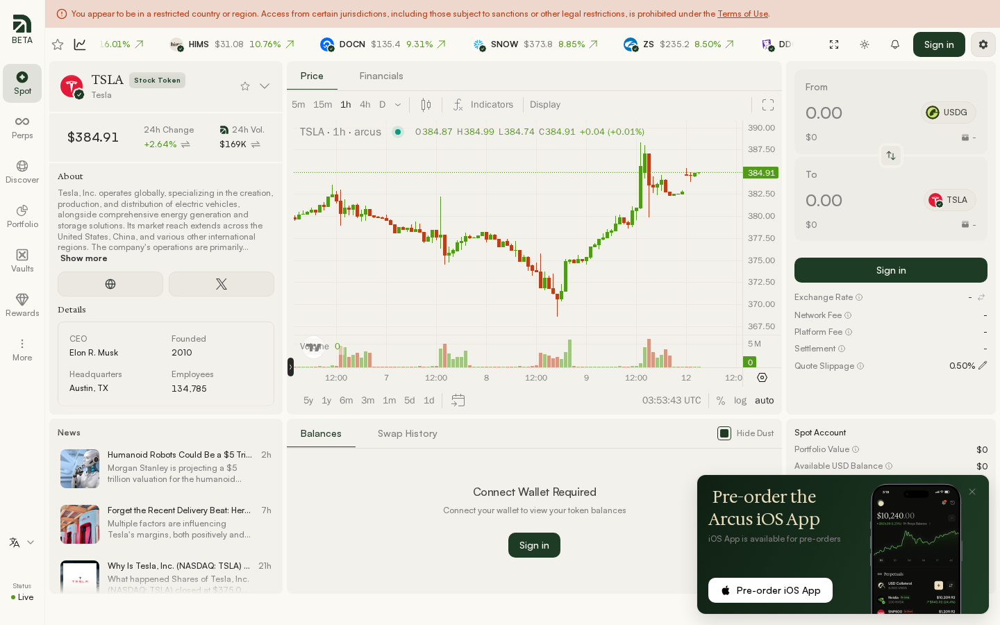

# Arcus Review 2026: Stock Token DEX, Wallet Flow, Perps Gate, and Points Campaign

*Reviewed October 12, 2026 | Public interface tested with TinyFish | Data checked against Arcus Docs and DefiLlama*

---

## First Impression: More Brokerage Than DEX

The [Arcus homepage](https://arcus.xyz/) opens with a large promise: **“Trade commodities while the world sleeps.”** Under it, Arcus advertises 24/7 Stock Token trading with zero fees and a separate waitlist for leveraged Perpetuals.

> **Source:** [arcus.xyz](https://arcus.xyz/) — captured with TinyFish on 2026-10-12

The design is unusually restrained for crypto: cream background, dark green type, no mascot, token price, or oversized APY. The app follows the same approach. Instead of opening with a wall of crypto pairs, it leads with familiar companies, charts, fundamentals, and news. Navigation includes Spot, Perps, Discover, Portfolio, Vaults, Rewards, and a live-status indicator.

Access was the first material concern. A red banner said the TinyFish session appeared to be in a restricted country or region. Public markets remained visible, but Arcus' terms prohibit access from the United States, Canada, the United Kingdom, sanctioned locations, and anywhere use would violate applicable law. They also prohibit using a VPN to bypass the restriction.

Testing was limited to harmless public interactions. No email was entered, wallet connected, message signed, money deposited, code redeemed, or order placed.

---

## Who Built Arcus?

Founder Eddie Zhang previously built Pocket Protector, which dYdX Labs acquired. Arcus launched as a project built by dYdX Labs in partnership with Robinhood Crypto, described by Arcus as a strategic investor.

> **Source:** [Welcome to Arcus](https://arcus.xyz/blog/welcome-to-arcus) — captured with TinyFish on 2026-10-12

The operational structure has several layers. Pocket Protector Labs Inc. operates the interface. Arcus Labs Ltd., a Cayman Islands company, issues the Protocol Terms. Current docs name Bitstamp Global Ltd. as the Stock Token issuer. Privy powers authentication, Fun handles deposit routing, and USDG is the settlement currency.

So “non-custodial” does not mean “dependency-free.” Arcus may not hold wallet keys, but the product still relies on contracts, permissioned validators, an issuer and custody structure, USDG, oracles, bridges, and onboarding providers.

---

## Opening Spot: TSLA, USDG, and Real Market Context

The [TSLA Spot market](https://app.arcus.xyz/trade/spot/TSLA) loaded a live price, 24-hour change, Arcus volume, TradingView chart, company profile, corporate data, and news. The swap form used USDG as the source asset and TSLA as the destination.

> **Source:** [Arcus TSLA Spot](https://app.arcus.xyz/trade/spot/TSLA) — captured with TinyFish on 2026-10-12

A second TinyFish check at approximately 08:14 UTC provided a point-in-time reading of the live page:

| TSLA Spot field | Visible value |
| --- | ---: |
| Price | **$383.99** |
| 24-hour change | **+2.40%** |
| Arcus 24-hour volume | **$186K** |
| Displayed market cap | **$1.51T** |
| Selected chart interval | **1 hour** |
| Current candle — O / H / L / C | **383.97 / 384.25 / 383.81 / 383.99** |
| Quote slippage | **0.50%** |
| Source / destination assets | **USDG / TSLA** |
| Company details | Founded **2010** · Austin, Texas · **134,785 employees** |

The earlier screenshot recorded TSLA at $384.91 with a +2.64% 24-hour move and $169K Arcus volume. The change between the screenshot and the later extraction is expected for live market data and shows why every numerical observation needs a timestamp.

This is Arcus' strongest surface. Most DEXs assume the user already understands the token; Arcus gives the stock a proper research page. The public panel exposed exchange rate, network fee, platform fee, settlement, and quote-slippage fields. Quote slippage displayed 0.50%. Balances and Swap History stopped at “Connect Wallet Required,” while fee and settlement values stayed blank when logged out.

Arcus says Spot is free at launch. That means no Arcus trading fee, not zero economic cost. Spread, slippage, gas, bridging, card processing, or currency conversion may still apply. The final USDG amount, received token amount, route, and approval should be inspected before treating any quote as free.

A Stock Token is also not an ordinary brokerage share. It gives contractual economic exposure to the linked security. Voting rights do not pass through, and dividends are reflected through reinvestment and token accounting rather than normal cash payments.

The execution model is also different from both a broker and a normal DEX pool. Arcus does not maintain one Spot order book. Its router compares available on-chain AMMs with quotes from professional makers in an RFQ network, then selects the better execution. The user signs a slippage-bounded intent and the maker signs the quote; the trade settles atomically on-chain.

When native liquidity is available, the wallet receives the real Stock Token. For a long-tail market, the docs say a whitelisted maker may mint a wrapped placeholder such as `wTSLA`, later settled into the native token on the maker's cadence. That distinction should be visible before confirmation. A buyer needs to know whether the output is the native instrument or a temporary claim, who performs conversion, and how long it normally takes.

The current docs name Bitstamp Global Ltd. as issuer and describe backing through underlying shares, or cash and equivalents when shares are on loan. A separate Arcus article describes Robinhood Assets Jersey Limited and Bitstamp in different program roles. That may reflect a changed structure, so the current terms for each asset should be checked rather than assuming every Stock Token has identical issuance and redemption rights.

---

## Wallet and Deposits: Clean Start, Untested Last Mile

Clicking **Sign in** opened a Privy modal with email, Google, and wallet choices.

> **Source:** [Arcus sign-in surface](https://app.arcus.xyz/trade/spot/TSLA) — captured with TinyFish on 2026-10-12

The modal looked clean and never requested a seed phrase or private key. Testing stopped before an authentication method was selected, so the wallet list, network prompt, signature wording, token approvals, recovery, and embedded-wallet export were not verified. Those are the details that matter after a good-looking modal.

Arcus' onboarding docs explain the expected next steps:

> **Source:** [Onboarding & Deposits](https://docs.arcus.xyz/concepts/onboarding) — captured with TinyFish on 2026-10-12

1. Choose **USDG (Spot)** or **USDG (Perps)**.
2. Fund from crypto, a supported exchange balance, or cash through Apple Pay, card, Google Pay, or AstroPay.
3. Review the route, processing cost, and estimated time.
4. Fun swaps and bridges the deposit into USDG.

Arcus charges no deposit or withdrawal fee of its own and says native USDG transfers are free. Third-party conversion, card, bridge, and network costs can still apply. The docs mention Bitcoin, Ethereum, Solana, Base, Arbitrum, and other routes, but the live list can change.

A complete test should include a minimal deposit, one small Spot swap, and a withdrawal. Quoted costs should be compared with USDG received, and every signature should be inspected. Until that loop works, easy onboarding is only partly proven.

---

## Perpetuals: Professional Terminal, Invite Gate

The [BTC-USD Perpetuals page](https://app.arcus.xyz/trade/perpetuals/BTC-USD) loaded a TradingView chart, order book, trades, Market and Limit tabs, Long and Short controls, TP/SL, funding history, positions, and account-risk fields.

> **Source:** [BTC-USD Perpetuals](https://app.arcus.xyz/trade/perpetuals/BTC-USD) — captured with TinyFish on 2026-10-12

TinyFish extracted the following values at approximately 08:14 UTC without joining the waitlist or signing in:

| BTC-USD Perp field | Visible value |
| --- | ---: |
| Price | **$83,682.00** |
| 24-hour change | **+0.91%** |
| 24-hour volume | **$162,484,195.55** |
| Open interest | **$40,270,086.53** |
| Funding | **0.0013%** |
| Displayed market leverage | **40x** |
| Maximum leverage claim | **Up to 50x** |
| Market-count claim | **125+ markets** |

BTC-USD showed 40x beside the market name; Arcus markets up to 50x depending on the contract. Mark price, oracle price, open interest, funding, liquidation price, maintenance margin, and margin ratio were visible.

But the early-access modal blocked the order panel. It offered Join Waitlist, “I Have an Invite Code,” or sign-in for whitelisted users. The public session allowed evaluation of layout, not execution. Fills, signing, cancellation, realized slippage, liquidation, and withdrawals were not tested.

Funding is hourly. Crypto Perps have a documented 0.01% per-eight-hour base before premium adjustments. RWA Perps use SOFR plus 0.5% annually as the base. Overnight and weekend behavior differs because the underlying stock market closes even though Arcus stays open. Price bands, higher initial margin, and locked off-hours funding reduce risk but do not create underlying liquidity.

The difference between the displayed prices matters. The **oracle price** represents the external market. The **mark price** is the risk reference used for margin, PnL, and liquidation. Funding measures the Perp's premium or discount to the oracle and transfers value between long and short traders. A positive rate means longs pay shorts; a negative rate reverses that flow.

For RWA Perps, Arcus suspends the live premium calculation when the underlying is fully closed outside 04:00–20:00 ET and locks funding to the base rate. Price bands widen gradually rather than allowing an unrestricted weekend move. These controls reduce liquidation cascades but cannot eliminate them. A large or sustained move can still push account equity below maintenance margin.

| Perps risk | What to check before entry |
| --- | --- |
| Leverage | Effective position size and distance to liquidation, not merely the maximum allowed |
| Funding | Current hourly rate, next payment, and expected holding duration |
| Off-hours RWA | Price band, spread, higher initial margin, and when the underlying reopens |
| Cross margin | Whether one losing position can consume collateral supporting other positions |
| Oracle/mark divergence | How far execution price sits from the references used for liquidation |
| Exit liquidity | Price impact of closing the whole position, not just the best bid or ask |

---

## Fees: Cheap During Beta, Not Fixed Forever

Arcus cut beta Perps taker fees by 50% and maker fees to zero for Tiers 0–4.

> **Source:** [Perpetuals Taker Fees](https://arcus.xyz/blog/arcus-perpetuals-taker-fees-halved-for-beta) — captured with TinyFish on 2026-10-12

| Tier | 30-day volume | Taker | Maker |
| --- | ---: | ---: | ---: |
| 0 | $0+ | 0.0225% | 0.000% |
| 1 | $5M+ | 0.0190% | 0.000% |
| 2 | $20M+ | 0.0160% | 0.000% |
| 3 | $100M+ | 0.0135% | 0.000% |
| 4 | $400M+ | 0.0115% | 0.000% |
| 5 | $1B+ | 0.0100% | -0.002% rebate |
| 6 | $3B+ | 0.0095% | -0.003% rebate |

At Tier 0, a $10,000 taker order costs about $2.25. Entering and closing the same notional as a taker costs roughly $4.50 before spread, slippage, funding, and PnL. Arcus says standard rates return after beta, so the live Portfolio page or fee API—not this snapshot—is the source of truth.

---

## Discover: The Strongest Research Page

Discover showed 208 Spot markets with filters for stocks, commodities, crypto, and more. Columns included price, 24-hour change, market cap, total volume, and Arcus volume.

> **Source:** [Arcus Discover](https://app.arcus.xyz/discover) — captured with TinyFish on 2026-10-12

The 08:15 UTC re-check returned the following first-page rows. These figures are useful because they show the difference between total underlying-market activity and volume actually routed through Arcus.

| Market | Price | 24h change | Market cap | 24h total volume | 24h Arcus volume |
| --- | ---: | ---: | ---: | ---: | ---: |
| NVDA | $230.00 | -0.22% | $5.55T | 84.6M | **$2.29M** |
| AAPL | $337.20 | -0.96% | $4.94T | 37.9M | **$52.2K** |
| GOOGL | $353.50 | +1.49% | $4.26T | 17.3M | **$79.1K** |
| MSFT | $536.20 | +2.61% | $3.97T | 18.5M | **$31.1K** |
| AMZN | $263.90 | +3.88% | $2.82T | 34.8M | **$62.0K** |
| TSM | $457.60 | -0.08% | $2.35T | 9.21M | **$2.36K** |
| VTI | $398.80 | +5.08% | $2.31T | 2.68M | **$1.45K** |
| SPCX | $164.20 | +2.26% | $2.14T | 93M | **$26.8K** |
| META | $726.40 | +0.76% | $1.83T | 12.6M | **$5.49K** |
| AVGO | $362.40 | +0.63% | $1.72T | 16.8M | **$0** |

NVDA accounted for roughly 90% of the Arcus volume shown across these ten rows ($2.29M out of approximately $2.55M). At the other extreme, AVGO displayed no Arcus volume and TSM only $2.36K. This snapshot supports a more cautious conclusion than the 208-market headline: breadth is strong, but venue activity is highly uneven by asset.

This makes Arcus broader than a TSLA swap app. But a long list does not prove deep liquidity in every market. Long-tail names may use wrapped placeholders before delivery of the native token. Order size, quote expiry, output, and price impact should be inspected asset by asset.

Robinhood advertises 190+ Stock Tokens, Ondo 450+ tokenized stocks and ETFs, and Ostium 70+ RWA Perps markets. Arcus' differentiator is not the largest asset count; it is combining routed self-custodied Spot tokens and cross-asset Perps in one interface.

---

## Rewards and Points: Real Program, No Airdrop Promise

Rewards loaded publicly with Points, Trading, and Referrals tabs, a Season 1 countdown, and a leaderboard. Personal data required sign-in.

> **Source:** [Arcus Rewards](https://app.arcus.xyz/rewards) — captured with TinyFish on 2026-10-12

At approximately 08:15 UTC, the public leaderboard showed:

| Rank | Public alias | Tier | Season 1 Points |
| ---: | --- | --- | ---: |
| 1 | Rustic Owl | Diamond | **8,100.93** |
| 2 | Brave Heron | Diamond | **5,445.87** |
| 3 | Topaz Hawk | Diamond | **3,186.06** |
| 4 | Crimson Magpie | Diamond | **3,027.87** |
| 5 | Atomic Lynx | Diamond | **2,744.55** |

The first-ranked account held 2,655.06 more Points than second place and almost three times the fifth-ranked balance. The page showed **$0 Total Fees Earned** and **$0 Claimable Fees** in the unsigned session, while personal Points and distribution history remained behind wallet authentication. The countdown displayed 2 days, 10 hours, and 44 minutes until the next drop during the re-check.

Season 0 covered July 1–September 30, 2026. Season 1 distributes **250,000 Points weekly** every Wednesday at 19:00 UTC and should end no later than the first half of 2027.

Officially described inputs include genuine trading, tight and consistent market making, retained deposits, referrals, and referred-user activity. Boosts include RWA trades, RWA Perps outside regular U.S. hours, and eligible Robinhood Wallet Spot swaps routed through Arcus.

Invite codes require serious volume: one code per $1 million of personal qualifying Perps volume and another per $1 million from direct referrals. At the base beta taker rate, $1 million of one-way volume implies about $225 in fees before funding, slippage, and losses. Chasing a code can easily cost more than it is worth.

The Terms are explicit: Points are not cash, ownership, or a token/airdrop promise. They can be recalculated, reduced, frozen, canceled, or forfeited. Wash trading, self-trading, wallet splitting, circular trades, referral rings, and artificial volume are prohibited.

---

## How to Evaluate the Points Campaign

Eligible users already interested in Arcus can treat Points as a four-week product experiment.

**Week 1:** use a dedicated wallet, make the smallest practical deposit, inspect every signature, place one minimal Spot trade, and withdraw. Stop for any unclear approval, unexplained fee, or failed exit.

**Week 2:** make only a trade that would still be justified without Points. Record notional, fee, spread, slippage, gas, funding, and realized PnL.

**Week 3:** calculate total cost per Point. If fees are $18, funding $7, slippage $10, and trading loss $15, total cost is $50. Receiving 500 Points means a $0.10 break-even cost per Point. It does not mean a Point is worth $0.10.

**Week 4:** continue only if the product itself remains useful. Retained deposits and off-hours RWA boosts add stablecoin, issuer, liquidity, and opportunity-cost risk.

Participation should stop if costs rise faster than Points, activity exists only to generate volume, leverage exceeds the original trading plan, or eligibility is unclear. Invite codes should not be purchased, and linked wallets, self-referrals, or location-control bypasses should be avoided.

A weekly log provides a clearer record than relying on the Rewards dashboard alone:

| Metric | Why it matters |
| --- | --- |
| Gross notional | Shows how much volume was required to earn the weekly allocation |
| Maker/taker fees | Direct venue cost using the live tier rather than an old promotional rate |
| Funding paid or received | Captures the carry cost hidden outside the trade fee |
| Spread and slippage | Measures the difference between the screen price and actual execution |
| Realized PnL | Prevents a losing position from looking successful because it earned Points |
| Deposited USDG and days retained | Measures capital tied up and stablecoin exposure |
| Points received | Allows week-to-week efficiency comparison |
| Total cost per Point | Provides a break-even figure without pretending a future token exists |

Market making is not a low-risk shortcut. Arcus says it considers tightness, depth, and consistency, meaning occasional passive orders may not score like professional quoting. A maker faces adverse selection, inventory risk, oracle moves, cancellation latency, and the possibility that rebates or Points do not cover trading losses.

Referrals are not free either. The public Discover page advertised a share of referred-user fees, while the Referral Terms allow rates and eligibility to change. Anyone publishing a code should disclose the financial interest, avoid earnings promises, and never encourage an ineligible person to access the protocol.

---

## Under the Hood: Fast but Hybrid

Arcus Perps uses a centralized off-chain matching engine, a permissioned appchain validator set, EVM rootchain contracts, and decentralized data availability.

> **Source:** [Exchange Architecture](https://docs.arcus.xyz/concepts/exchange-architecture) — captured with TinyFish on 2026-10-12

The core sequences and matches orders. Validators re-check signatures, margin, fills, oracle prices, and state transitions. Rootchain contracts custody Perps collateral, settle withdrawals, and provide an emergency path. Arcus claims more than 100,000 orders per second and roughly 20 ms confirmations.

Performance comes with trust assumptions. Validators are permissioned, and users depend on the sequencer, data availability, oracles, rootchain contracts, and escape hatch. The docs say contracts were independently reviewed, but the page visible in this session did not expose an auditor name or report link. The report, deployed addresses, upgrade controls, and emergency-withdrawal instructions should be checked before committing serious capital.

---

## On-Chain Reality Check

DefiLlama showed $53.76M TVL, $75.99M 30-day DEX volume, $7.562B 30-day Perps volume, $105.07M open interest, $1.28M 30-day fees, and $1.16M 30-day revenue.

> **Source:** [DefiLlama Arcus](https://defillama.com/protocol/arcus) — captured with TinyFish on 2026-10-12

That is meaningful activity, not an empty beta. But protocol-wide volume does not prove depth for a specific Stock Token at a specific hour. A small TSLA swap and a large weekend order can have very different execution.

The mix is revealing. The captured 30-day Perps volume was **99.5 times** Spot DEX volume ($7.562B versus $75.99M). Open interest was about **1.95 times** TVL ($105.07M versus $53.76M), while reported 30-day revenue represented roughly **90.6%** of fees ($1.16M versus $1.28M). Arcus may market Spot and Perps together, but current activity is primarily a derivatives story. That matters for Points participants because incentives can pull users toward the higher-risk side of the platform.

Fees and revenue also should not be confused with profit. Maker rebates, referrals, Points incentives, infrastructure, oracle costs, and development expenses sit below those topline numbers. DefiLlama is useful confirmation that users and volume exist; it is not a complete financial statement or proof that every market is healthy.

---

## What Broke or Felt Frustrating

The restriction banner persisted throughout the app. Perps remained invite-gated. A mobile-app preorder popup repeatedly covered the terminal's lower-right area.

The `/vaults` route also redirected back to TSLA Spot while logged out instead of showing a Vaults product.

> **Source:** [Arcus Vaults](https://app.arcus.xyz/vaults) — captured with TinyFish on 2026-10-12

Finally, the documentation is good but fragmented. Understanding one trade requires separate pages for issuance, RFQ routing, wrapped tokens, USDG, funding, liquidation, architecture, Points, and legal terms. More of that context should appear directly beside the final signature.

---

## Who Is Arcus For?

**Good fit:** eligible experienced traders seeking stocks, commodities, indices, and crypto in one on-chain interface; users who understand Stock Tokens versus shares and Perps; self-custody users comfortable checking signatures and issuers; Points participants who measure costs honestly.

**Not a good fit:** restricted users; beginners seeking conventional broker protection and voting rights; anyone expecting a guaranteed airdrop; traders tempted by 40x–50x leverage without a liquidation plan; users unwilling to depend on USDG, issuers, oracles, permissioned validators, and onboarding providers.

---

## Verdict

Arcus is one of the more polished attempts to combine tokenized equities and crypto-style Perpetuals. Spot research is genuinely useful, Discover gives the venue breadth, and the project has credible lineage through dYdX Labs and Robinhood Crypto. DefiLlama also shows meaningful activity.

But the test stopped at the most important boundary. Funding, trading, fill quality, and withdrawals were not tested. Perps remained gated, the session was geo-restricted, and an audit report could not be independently verified from the Architecture page. Points are documented but discretionary.

Arcus earns **7.8/10** for its public product, documentation, and visible activity. It is worth watching for experienced eligible traders who want on-chain Stock Tokens and RWA Perps. Leverage or paid Points farming should be avoided until a minimal deposit-trade-withdrawal test works end to end.

---

## What Was and Was Not Verified

| Item | Result |
| --- | --- |
| Homepage, Spot, Discover, Rewards, and public data | Verified with TinyFish screenshots |
| Email, Google, and wallet choices | Verified up to the Privy modal |
| Perps terminal and invite gate | Verified without ordering |
| Fees, funding, deposits, architecture, Points | Checked against official sources |
| DefiLlama snapshot | Independently captured |
| Wallet signature, deposit, trade, close, withdrawal | **Not tested** |
| Realized spread, slippage, fill quality | **Not tested** |
| Audit report and deployed-contract scope | **Not independently verified** |
| Future token or airdrop | **Not promised** |

---

## Key Terms

| Term | Plain-English meaning |
| --- | --- |
| Stock Token | On-chain contractual exposure to a stock or ETF; not the same legal asset as a brokerage share. |
| Perpetual | Leveraged derivative with no expiry. |
| USDG | Arcus' launch settlement and collateral stablecoin. |
| RFQ | Market makers return signed quotes for a Spot trade. |
| CLOB | Price-and-time-ranked order book. |
| Funding | Hourly payment between long and short traders. |
| Mark price | Reference used for PnL, margin, and liquidation. |
| Oracle | External price anchoring the market. |
| Liquidation | Forced closure after equity reaches maintenance margin. |
| Wrapped placeholder | Temporary token used before delivery of the native Stock Token. |
| Points | Discretionary participation score with no guaranteed token value. |

---

## Sources

[Arcus app](https://app.arcus.xyz/) · [Homepage](https://arcus.xyz/) · [Launch article](https://arcus.xyz/blog/welcome-to-arcus) · [Points](https://arcus.xyz/blog/introducing-arcus-points) · [Invite codes](https://arcus.xyz/blog/arcus-invite-codes-are-live) · [Beta fees](https://arcus.xyz/blog/arcus-perpetuals-taker-fees-halved-for-beta) · [Interface Terms](https://arcus.xyz/legal/terms) · [Protocol Terms](https://arcus.xyz/legal/protocol-terms) · [Onboarding](https://docs.arcus.xyz/concepts/onboarding) · [Stock Tokens](https://docs.arcus.xyz/concepts/spot-overview) · [Architecture](https://docs.arcus.xyz/concepts/exchange-architecture) · [Funding](https://docs.arcus.xyz/concepts/perpetuals/funding) · [Fees](https://docs.arcus.xyz/concepts/perpetuals/fees) · [DefiLlama](https://defillama.com/protocol/arcus) · [Robinhood Stock Tokens](https://robinhood.com/rhj/stocktokens/) · [Ondo Stocks](https://ondo.finance/ondo-stocks) · [Ostium](https://www.ostium.com/)

*Disclosure: Public-interface review only. No wallet was connected and no financial transaction was performed.*
