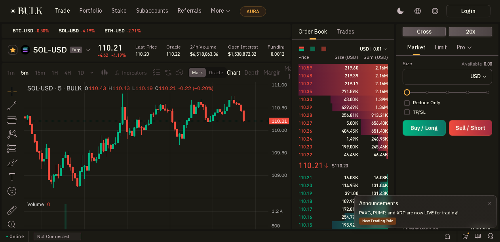
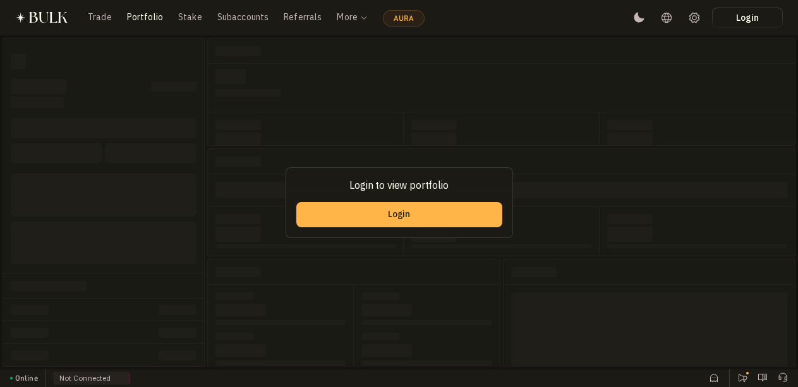
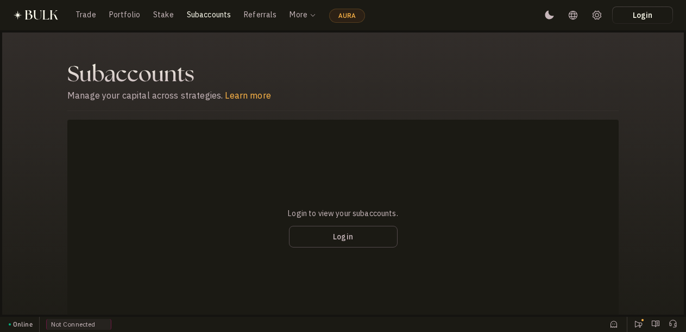
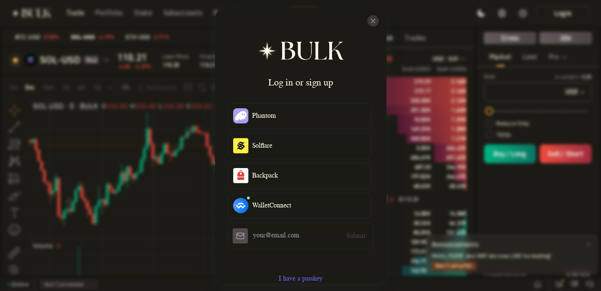
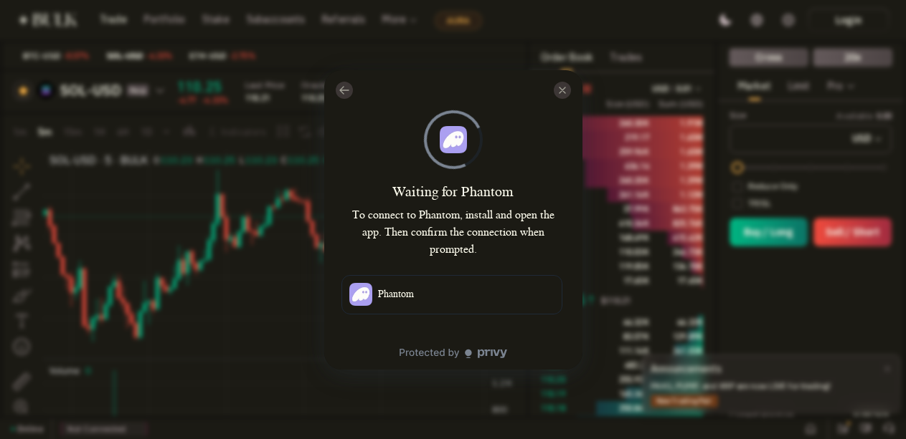
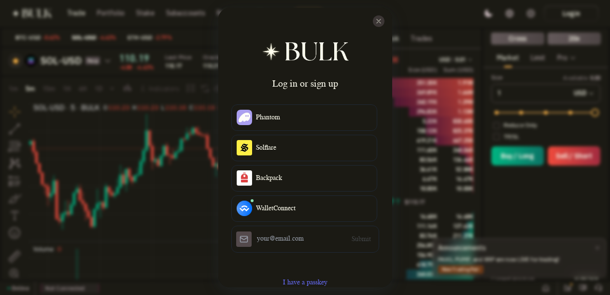
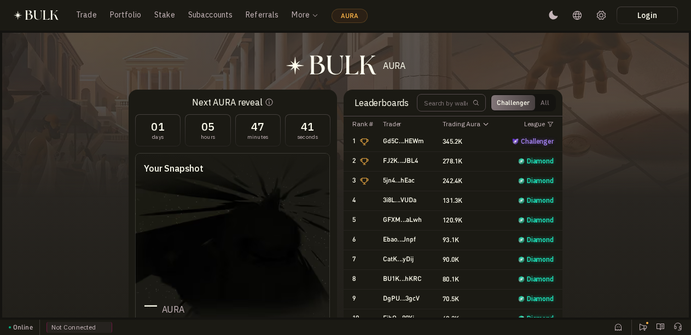
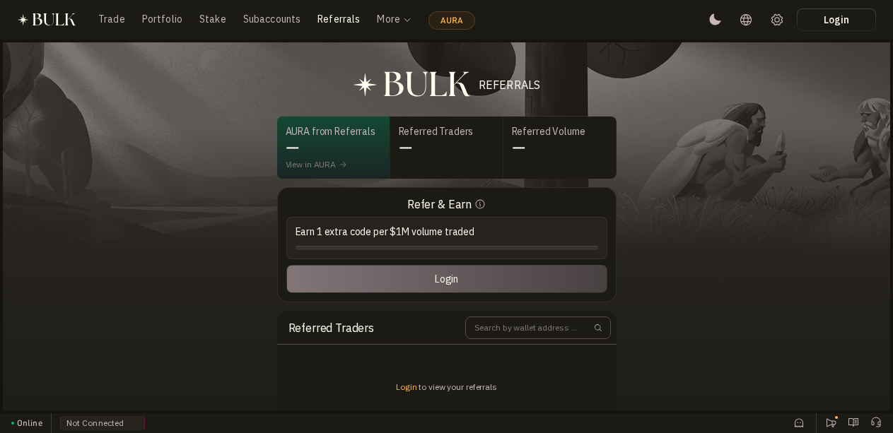
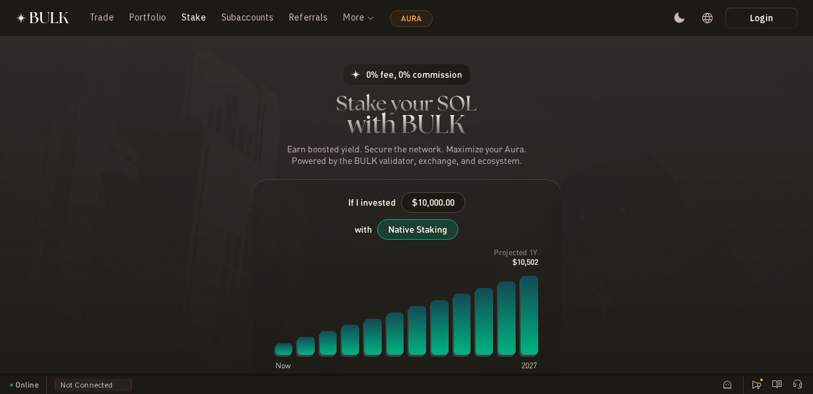

# BULK Trade Review 2026: Wallet Connection, Trading Experience, and AURA Farming Strategy

*A hands-on product review covering wallet onboarding, order entry, and practical ways to earn AURA*

**Updated October 9, 2026**

---

## Bottom Line

BULK is a perpetual DEX on Solana with a fast interface, a clear order book, and a notable portfolio-margin system. AURA currently operates as the platform's points and trading-leaderboard system. The project has not announced an official token contract, an AURA-to-token conversion rate, a snapshot, or a claim page. Because paper trading has ended and the platform is now on mainnet, this test stopped at the login gate and order-form validation. No real wallet, real funds, or mainnet order was used.

| Category | Rating |
| --- | --- |
| Product and interface | 8.4/10 |
| Trading mechanics | 8.2/10 |
| Transparency and security | 7.4/10 |
| Wallet connection experience | 7.6/10 |
| Potential AURA opportunity | 7.2/10 |
| Overall score | 7.8/10 |

---

## Review Scope

This report combines a live TinyFish walkthrough, browser-based interface checks, BULK's technical documentation and Terms of Use, the Zellic audit, and selected independent sources. Publicly accessible actions included opening a market, switching tabs, entering a $1 test order, opening the login modal, selecting Phantom until the connection waiting screen appeared, and reviewing the AURA leaderboard, Stake, Referrals, Portfolio, and Subaccounts pages.

- No seed phrase, private key, email address, or verification code was entered.

- No real wallet was connected, no USDC was deposited, no transaction was signed, and no mainnet order was submitted.

- Paper trading was not used because the May 2026 program has ended. The early.bulk.trade page now states that mainnet trading is live.

- Prices, volume, AURA figures, and leaderboard data are point-in-time captures and may change.

**Quick verification links:** [Trade SOL-USD](https://app.bulk.trade/trade/SOL-USD) · [AURA](https://app.bulk.trade/aura) · [Stake](https://app.bulk.trade/stake) · [Referrals](https://app.bulk.trade/referrals)

---

## Quick Summary

| Question | Verified conclusion |
| --- | --- |
| What is BULK? | An order-book perpetual DEX with settlement and custody on Solana, while execution and risk management run on the BULK network. |
| Is mainnet live? | Yes. early.bulk.trade states that pre-deposit has closed, margin has been converted, and mainnet trading is live. |
| Can the app be viewed without logging in? | Yes. The chart, order book, market data, order form, AURA leaderboard, and Stake calculator are publicly visible. |
| Is paper trading or a faucet available? | No active paper mode, testnet, or faucet was found in the current app. |
| Has an airdrop been confirmed? | No official source currently shows a token contract, TGE date, snapshot, claim page, or AURA-to-token conversion rate. |
| How can users officially earn AURA? | Trading generates Ranked Aura, and referrers receive weekly AURA allocations. The Stake page promotes maximizing Aura but does not publish a formula. |

---

## Project Overview

BULK combines a central limit order book with a specialized execution layer that runs alongside Solana. A Solana program holds assets and processes deposits and withdrawals, while the BULK network handles the order book, matching, and risk management. The homepage advertises 20 ms block times, up to 40x leverage, margin savings of up to 70%, and capacity for one million actions per second. These are project claims rather than independently verified benchmarks.

An $8 million seed round was announced in September 2025 and led by 6th Man Ventures and Robot Ventures. SolanaFloor also named Wintermute, Big Brain Holdings, and Anatoly Yakovenko among the disclosed investors or supporters.

### Trading and Risk Management

| Component | How BULK works | What it means for users |
| --- | --- | --- |
| Contracts | USDC-margined and settled perpetuals with hourly funding. | There is no expiry date, but funding can increase the cost of holding a position. |
| Margin | Cross margin is the default; portfolio margin considers correlation and market impact. | Hedged positions may use capital more efficiently, but liquidation is harder to estimate with a simple formula. |
| Order types | Market, Limit, GTC, IOC, ALO, Reduce Only, and conditional orders. | Experienced traders have enough tools to control execution price and position management. |
| Liquidation | The system cancels open orders, estimates closeout impact, and reduces positions based on margin-recovery efficiency. | This does not eliminate slippage, bad debt, or ADL risk. |
| Leverage | The homepage advertises up to 40x, while Contract Specifications mentions up to 100x depending on the instrument. | Users must verify each market because the public materials are not fully consistent. |

---

## Hands-On Interface Review

The app loaded successfully and did not require login to view the market. Its familiar three-panel layout places the chart on the left, the order book in the center, and the order form on the right. Chart, Depth, Margin, and Market Info tabs sit alongside Last Price, Oracle, volume, open interest, and funding data, allowing users to assess the market without opening another page.

> **Source:** [BULK Trade SOL-USD](https://app.bulk.trade/trade/SOL-USD) — 2026-10-09

### Portfolio and Subaccounts Before Login

Both account-management areas display a login gate. No portfolio, balance, or subaccount data was accessed during the review.

> **Source:** [BULK Portfolio](https://app.bulk.trade/portfolio) — 2026-10-09

> **Source:** [BULK Subaccounts](https://app.bulk.trade/subaccounts) — 2026-10-09

### Interface Strengths

- Guests can view the chart, order book, and real-time market data.

- Market, Limit, Pro, Reduce Only, and TP/SL controls are located in one area and are easy for experienced traders to find.

- When data is available, the form shows order value, required margin, estimated slippage, liquidation price, and fees.

- AURA, Stake, and Referrals have dedicated pages rather than being hidden in secondary menus.

### Areas for Improvement

- No prominent risk warning appears on the trading screen even though the default display shows Cross and 20x.

- Fees appear as dashes before login, so new users must consult the documentation to understand the fee schedule.

- The interface is information-dense and lacks a short onboarding flow explaining portfolio margin or liquidation.

- Maximum-leverage claims are inconsistent between the homepage and the documentation.

---

## Wallet Connection Review

The Login button opens a Privy-powered modal. It offers Phantom, Solflare, Backpack, WalletConnect, email login, and passkeys. The modal does not visibly include a Terms acceptance checkbox or a leveraged-trading warning. Multiple sign-in methods make onboarding flexible, but users should verify the domain before continuing.

> **Source:** [BULK wallet connection modal](https://app.bulk.trade/trade/SOL-USD) — 2026-10-09

### Phantom Test Result

When Phantom was selected in a TinyFish session without the wallet extension, the modal changed to Waiting for Phantom and instructed the user to install or open the app and approve the connection. The website did not ask for a seed phrase. This is the correct behavior: approval should take place inside the Phantom app or extension.

> **Source:** [BULK Phantom connection flow](https://app.bulk.trade/trade/SOL-USD) — 2026-10-09

| Criterion | Result |
| --- | --- |
| Direct wallet methods | 4: Phantom, Solflare, Backpack, WalletConnect |
| Extension-free methods | Email and passkey through Privy |
| Terms displayed in the modal | Not observed |
| Leverage warning displayed in the modal | Not observed |
| Successful wallet connection during the review | No. The TinyFish session did not have a user wallet available for approval. |

---

## Order Entry Review

The safe test entered a $1 Market order size on SOL-USD while logged out. The form defaulted to Cross and 20x. After entry, the app calculated a $1 order value, approximately $0.05 in required margin, and estimated two-sided slippage of roughly 0.0021% and 0.0046% in the first capture. The displayed slippage limit was 1%. These figures change with the order book. Fees remained blank because no account was connected.

Clicking Buy / Long did not submit an order. The login modal reopened and requested a wallet connection. No signature, balance change, or on-chain transaction was created during the test.

> **Source:** [BULK order form login gate](https://app.bulk.trade/trade/SOL-USD) — 2026-10-09

### Observed Market Order Flow

1. Select a market, such as SOL-USD.

1. Choose Cross or Isolated margin and set leverage.

1. Keep the Market tab selected, choose USD as the unit, and enter a size or use the slider.

1. Enable Reduce Only or TP/SL if needed.

1. Review order value, required margin, liquidation price, slippage, and fees.

1. Click Buy / Long or Sell / Short. If the user is logged out, the app opens the wallet connection modal instead of submitting the order.

### Observed Limit Order Flow

1. Select the Limit tab.

1. Choose the margin mode and leverage.

1. Enter the limit price and size.

1. Select Reduce Only or TP/SL where appropriate.

1. Review the order summary, then click Buy / Long or Sell / Short.

1. The account must be logged in and have an available balance before an order can be signed or submitted.

### Limits of the Trading Test

Fill speed, actual fees, signing experience, deposits, withdrawals, and post-trade PnL cannot be verified without using a funded mainnet wallet. The May 2026 paper-trading campaign has ended, and early.bulk.trade now states that mainnet trading is live. Any end-to-end test should be supervised, use a burner wallet, and involve only a small amount of USDC that the owner is prepared to lose entirely.

---

## Security and Audit

BULK states that assets are held in a Solana program, while withdrawals require network consensus and FROST threshold signatures. The current documentation says upgrade authority and network administration use a 3-of-5 multisig with a timelock. One community source mentioned 5-of-8, but that figure did not match the official documentation checked on October 9, 2026, so this review uses 3-of-5.

The Zellic audit dated July 23, 2026 assessed the Solana custody program over four days with 1.2 person-weeks of effort. Its overall findings included no Critical issue, one High-impact issue, one Medium-impact issue, one Low-impact issue, and three Informational issues. The High-impact finding showed that an admin key could replace the FROST key and withdraw assets from the vault; the report states that BULK remediated it in commit `f958edc2`. The front end, infrastructure, and key custody were outside the audit scope.

---

## AURA and Airdrop Status

AURA is live on mainnet with a public leaderboard. The capture shows Challenger and Trading Aura filters, leagues, and 1,796 ranked addresses. The page also displays a countdown to the next AURA reveal. Users must log in to view their personal snapshot.

> **Source:** [BULK AURA leaderboard](https://app.bulk.trade/aura) — 2026-10-09

### What Is Confirmed

- Trading activity generates Ranked Aura, and Ranked Aura determines Challenger standings.

- Rankings are reviewed weekly, with promotion and demotion. Playoffs apply to the Challenger group.

- AURA from pre-deposit or BulkSOL does not count toward league rank. Only AURA earned from trading is used for ranking.

- Referrers receive AURA from a separate weekly pool.

- The Stake page uses the message Maximize your Aura, but no staking-points formula is published.

### Visual Evidence for Referrals and Staking

> **Source:** [BULK Referrals](https://app.bulk.trade/referrals) — 2026-10-09

> **Source:** [BULK Stake](https://app.bulk.trade/stake) — 2026-10-09

### What Is Not Confirmed

- No official BULK token contract is linked from the website or documentation.

- There is no confirmed TGE date, airdrop snapshot, claim page, or AURA-to-token conversion rate.

- No public formula is available for Trading Aura, Maker Aura, referral Aura, or staking Aura.

- The Terms state that Points have no intrinsic value, do not guarantee money or benefits, and may be modified, canceled, or reset.

### AURA Sources and Confidence Levels

| Activity | Available evidence | Confidence |
| --- | --- | --- |
| Trading | Challenger documentation confirms that trading generates Ranked Aura, and the app includes a Trading Aura leaderboard. | High |
| Referrals | Documentation confirms weekly AURA allocations for referrers. | High |
| BulkSOL and staking | The official X account previously stated that BulkSOL holders continue to earn AURA, while the Stake page says Maximize your Aura. | Medium |
| Maker activity | YetiScan observed a weekly Maker bucket, but the documentation does not publish an Aura formula. | Medium-low |
| Validator stake and DeFi partners | YetiScan observed Bulk Validator Stake, Exponent, Loopscale, and P0 buckets. | Low to medium |
| Pre-deposit | This was a historical program. Mainnet is live and pre-deposit has closed. | No longer available |

---

## Practical AURA Farming Strategy

A reasonable objective is to build a history of genuine use while keeping costs and risk controlled. Users should not maximize volume with high leverage or wash trading because BULK does not disclose its points formula, and the Terms allow the company to cancel Points at its discretion.

### Phase 1: Safe Setup

1. Create a dedicated burner wallet for BULK. Do not use a wallet holding long-term assets or valuable NFTs.

1. Access only app.bulk.trade, bulk.trade, and docs.bulk.trade through bookmarks you have verified yourself.

1. Keep a small amount of SOL for network fees and a separate USDC balance for the campaign. Do not sign transactions you cannot understand.

1. Enable transaction warnings in the wallet. Never enter a seed phrase on a website or in a support message.

1. Before increasing capital, test a small deposit, place and close one small position, and withdraw part of the balance to verify the full lifecycle.

### Phase 2: Trading Aura

- Favor consistent activity across multiple weeks instead of generating large volume in one day. Rankings update weekly.

- Start at 1x to 2x. The interface's 20x default is not appropriate for a low-risk test.

- Use limit orders when the strategy allows to control price and reduce slippage. Maker fees may be lower than taker fees depending on the tier.

- Close positions according to a plan. Do not keep a trade open merely to extend activity if funding or volatility makes the cost exceed the expected benefit.

- Do not self-match between two wallets, wash trade, or create artificial volume. BULK has self-trade prevention and may cancel points or disqualify users who violate its rules.

- Track Trading Aura, league, volume, fees, realized PnL, and liquidation history each week to determine which activity is genuinely efficient.

### Phase 3: Referrals and the Ecosystem

- Share referral links only with genuine users and explain the risks clearly. The documentation confirms a weekly AURA pool for referrers.

- Do not attempt to generate $1 million in volume merely to receive another access code. Trading costs and risk can easily exceed the code's value.

- Stake SOL or use BulkSOL only if you understand validator, smart-contract, liquidity, and depeg risks. The AURA formula has not been published.

- Use Exponent, Loopscale, or partner protocols only after checking the official source for each campaign. YetiScan observations do not create an entitlement to an airdrop.

### Estimated Cost of Volume

Using the lowest tier in the public fee schedule as an illustration, a 3.5 bps taker fee per fill equals roughly 7 bps for one open-and-close cycle, excluding slippage and funding. Generating $10,000 in round-trip notional may cost about $7 in taker fees. If the Phase 2 maker fee is 2 bps per fill, the same volume may cost about $4. Fees and campaign phases can change, so users should check the live fee state before setting a budget.

| Illustrative scenario | Round-trip notional | Estimated fee | Excluded risks |
| --- | --- | --- | --- |
| Lowest-tier taker | $10,000 | About $7 | Slippage, funding, PnL, and liquidation |
| Lowest-tier Phase 2 maker | $10,000 | About $4 | No guarantee of a fill; adverse selection |
| Lowest-tier taker | $100,000 | About $70 | Risk rises sharply if leverage is used to create volume |

### Suggested Four-Week Farming Schedule

| Week | Activity | Test objective | Stop condition |
| --- | --- | --- | --- |
| 1 | Connect a burner wallet, make a small deposit, open one 1x-2x position, close it, and test a withdrawal. | Verify the complete lifecycle and record the first AURA allocation. | Stop if withdrawals fail, fees are abnormal, or the signature request is unclear. |
| 2 | Run two or three small trading sessions, favoring limit orders. | Compare volume, fees, and Trading Aura after the reveal. | Stop if cost per AURA exceeds the budget. |
| 3 | Maintain a steady trading pattern and test a legitimate referral if a real user is available. | Check league movement and referral Aura. | Do not create fake accounts or circular volume. |
| 4 | Review total cost, realized PnL, funding, Aura, and rank. | Decide whether to continue, reduce size, or stop. | Stop if airdrop expectations are the only reason to offset losses. |

### Weekly Tracking Table

| Review date | Trading Aura | Total Aura | League | Volume | Fees | Realized PnL | Notes |
| --- | --- | --- | --- | --- | --- | --- | --- |
| | | | | | | | |
| | | | | | | | |
| | | | | | | | |
| | | | | | | | |

---

## Risks to Control

| Risk | Impact | Mitigation |
| --- | --- | --- |
| Liquidation | Loss of part or all of the margin, especially at high leverage. | Start at 1x-2x, use a small position, and define a loss limit. |
| Portfolio margin | Correlation and market impact can change margin requirements in ways that are difficult to predict. | Separate strategies with subaccounts and do not treat a hedge as absolute protection. |
| Smart contract and validator | Code, consensus, or signing failures may affect deposits and withdrawals. | Use limited capital, test withdrawals, and monitor audits and incidents. |
| Admin and upgrade | The multisig remains a trust point and can change the program. | Follow official documentation and do not ignore upgrade announcements. |
| Uncertain points | AURA may never convert into a token or may be worth less than the participation cost. | Set a maximum budget and treat farming as a marketing expense, not guaranteed profit. |
| Phishing | Users can lose a wallet by signing on the wrong domain or revealing a seed phrase. | Bookmark the domain, use a burner wallet, and never enter a seed phrase on the web. |

---

## Verdict

BULK has a functioning mainnet product, a strong interface, and an AURA system that is transparent enough to monitor through public data. Trading Aura has the strongest evidence as an earning path, followed by referrals. Staking and partner protocols appear to receive Aura allocations, but the formulas remain unclear, so users should not increase capital based only on community data.

The practical approach is to use a burner wallet, limited capital, low leverage, and genuine activity spread across several weeks while tracking total fees against the AURA earned. Any plan that requires large volume to chase points with no published conversion rate has a meaningful chance of producing a negative expected return.

BULK receives an editorial score of 7.8 out of 10. It is worth monitoring for traders who already understand perpetuals, but it is not suitable for beginners or users participating only because they expect an airdrop.

---

## Sources

**BULK Trade application:** [Open source](https://app.bulk.trade/)

**AURA page:** [Open source](https://app.bulk.trade/aura)

**Introduction documentation:** [Open source](https://docs.bulk.trade/)

**Challenger Series:** [Open source](https://docs.bulk.trade/bulk-exchange/points.md)

**Referrals:** [Open source](https://docs.bulk.trade/bulk-exchange/referral.md)

**Fees:** [Open source](https://docs.bulk.trade/bulk-exchange/fees)

**Margin:** [Open source](https://docs.bulk.trade/bulk-exchange/Margin)

**Liquidations:** [Open source](https://docs.bulk.trade/bulk-exchange/Liquidations)

**Contract Specifications:** [Open source](https://docs.bulk.trade/bulk-exchange/Contract-Specifications)

**Security Practices:** [Open source](https://docs.bulk.trade/architecture/security)

**Terms of Use:** [Open source](https://www.bulk.trade/terms)

**Zellic audit report:** [Open source](https://github.com/Zellic/publications/blob/master/Bulk%20Trade%20-%20Zellic%20Audit%20Report.pdf)

**Funding report from SolanaFloor:** [Open source](https://solanafloor.com/news/bulk-raises-8m-seed-round-amidst-solana-perps-drought)

**YetiScan Aura Guide:** [Open source](https://yetiscan.com/aura/guide/)

**Warning:** This report evaluates the product and participation process. It is not investment advice. Perpetual trading, staking, and DeFi protocols can result in the loss of some or all funds.
