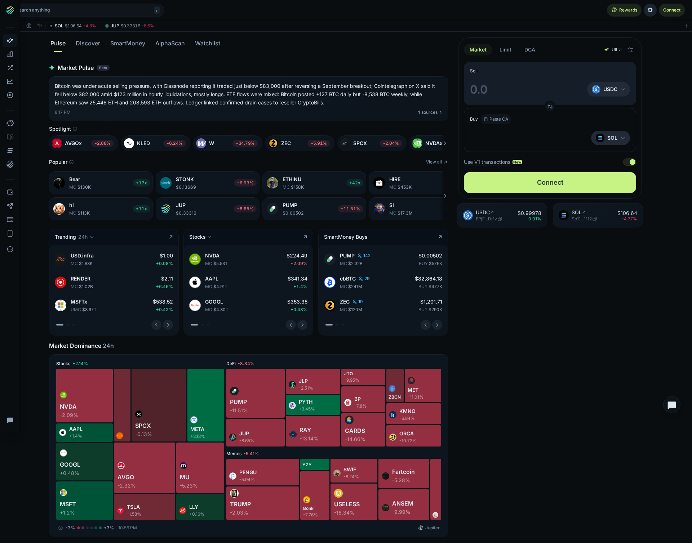
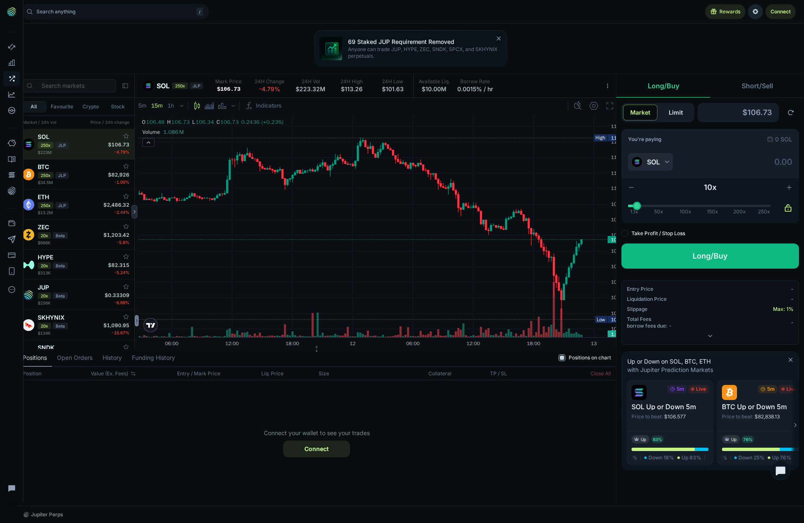
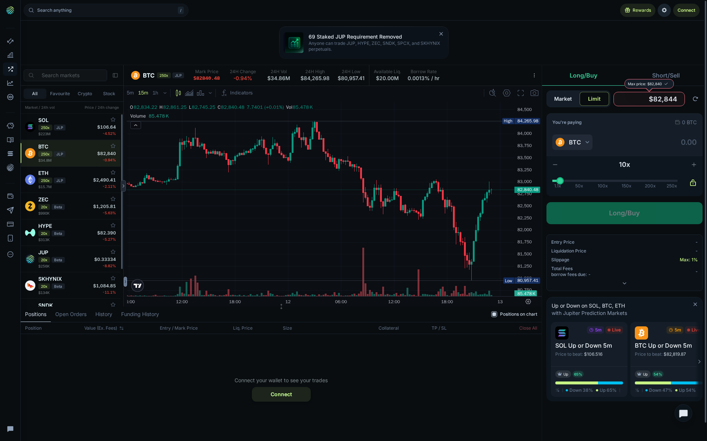
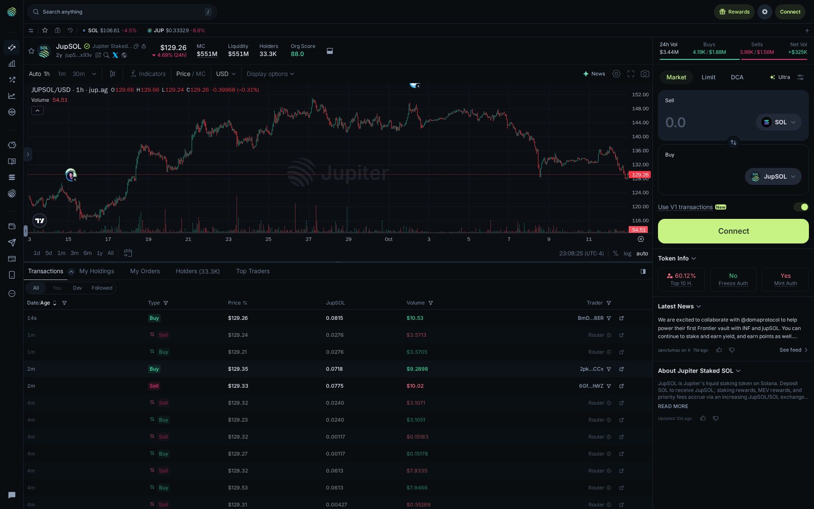
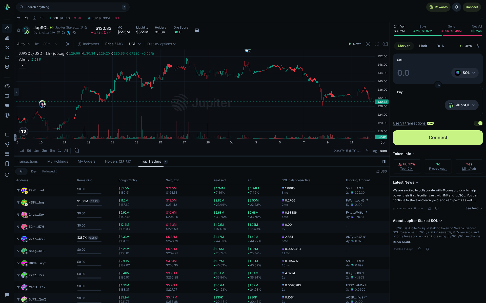
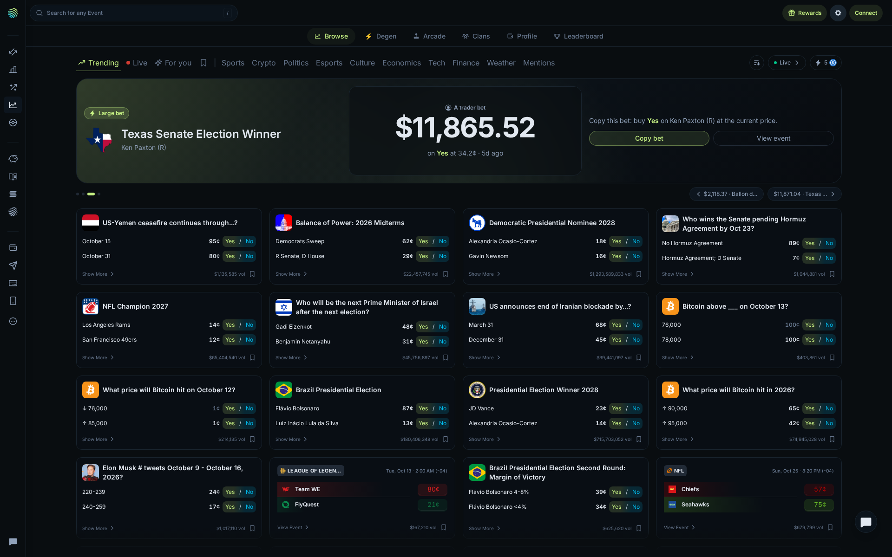
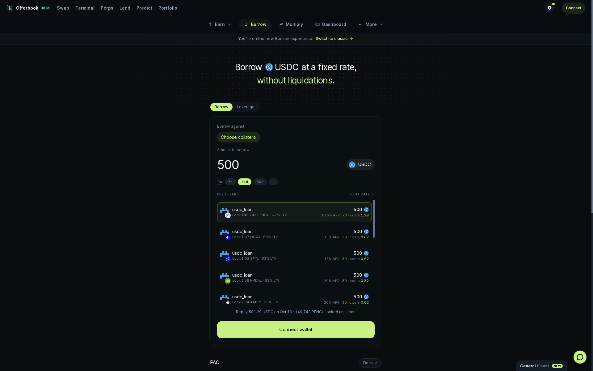
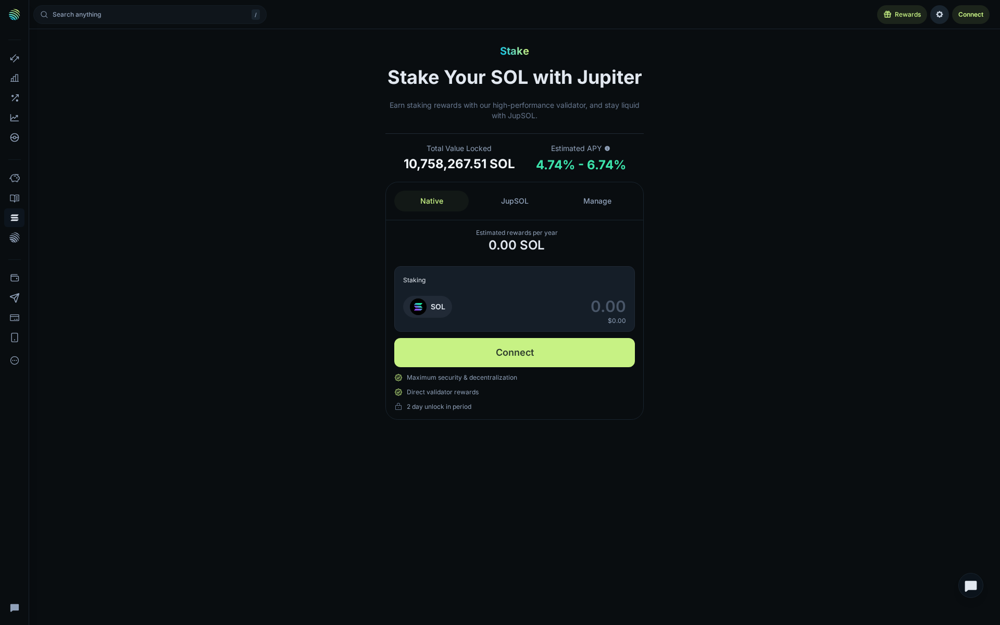
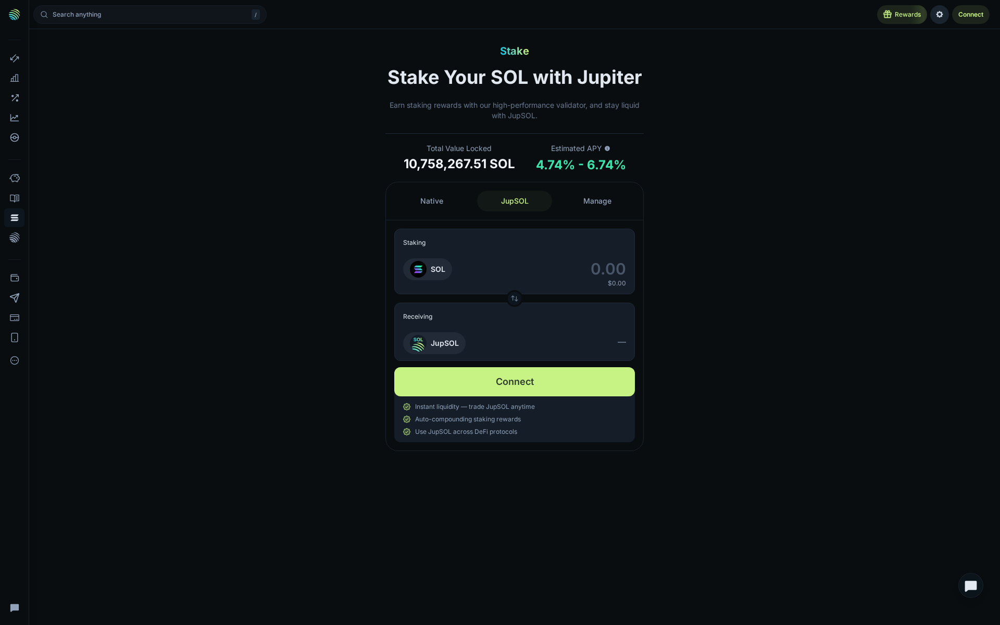

# Jupiter Review 2026: One Solana Front Door, Six Very Different User Journeys

*Public product walkthrough completed October 13, 2026 through TinyFish. No wallet was connected and no signature, swap, borrow, stake, deposit, or order was submitted.*

## Quick Verdict

**Jupiter feels less like a single DEX and more like a Solana operating system. That is its biggest advantage and its first usability problem.**

The public application offers an unusually broad path without a wallet: discover tokens, inspect a token’s on-chain activity, browse perpetuals, compare fixed-rate borrow offers, explore prediction markets, and choose between native SOL staking and liquid staking. The first visit is not slow or empty; it is crowded. The strongest screens explain a decision before asking for connection. The weakest point is context switching: each product has a distinct vocabulary, risk model, and layout.

This review follows the product in the order a real visitor encounters it—Spot, Perps, token research, Prediction, Offerbook, and Stake—and records the actual controls opened on each route.

## First Impression: Jupiter Does Not Behave Like a Swap Widget

The opening [Spot screen](https://jup.ag/spot) makes Jupiter’s ambition clear. It does not start with one oversized “Swap” box. Market Pulse, Spotlight, Popular, Trending, Stocks, SmartMoney Buys, and a market-dominance heatmap occupy most of the screen; the USDC-to-SOL form is docked at the side.

> **Live capture — Jupiter Spot, October 13, 2026.** SOL: **$106.64 (-4.8%)**; JUP: **$0.33316 (-8.6%)**; PUMP: **$0.00502**; cbBTC: **$82,864.18**; ZEC: **$1,201.71**. SmartMoney Buys showed **$576K**, **$477K**, and **$290K** on the visible rows.

This layout has a practical benefit: market research and the next action happen without a tab change. Market, Limit, DCA, Ultra, Paste CA, V1 transactions, and Connect are exposed before a wallet is involved. A trader can look at a token move, open its detail page, and return to a prepared swap surface quickly.

The trade-off is cognitive load. A newcomer arrives to price changes, news, token categories, stock-like assets, wallet controls, and trade modes simultaneously. Jupiter is not trying to teach the basics. It assumes the visitor wants breadth first.

That assumption becomes visible in the token cards. A Popular tile can show a low-cap asset with a large multiple, while the SmartMoney area uses a different vocabulary: wallets, purchase size, and market cap. Neither surface tells a new user which signal should matter more. The app gives fast raw context, but the judgment layer is left to the user.

The top navigation reinforces the same personality. Spot, Stocks, Perps, Predict, Gacha, Lend, Offerbook, Stake, Portfolio, Send, and Deposit all sit close together. That is efficient for an experienced Solana user who already knows which route they need. For everyone else, it makes the first question “what should be done here?” harder than “where is the button?”

### What Changed When Limit Was Selected

Clicking **Limit** changed the right-hand panel from an immediate-swap mode into a target-price flow while preserving the pair context. That small interaction matters: it shows that recurring and price-directed orders are built into the primary interface, rather than buried in a separate product. No amount was entered and no order was created, so quote quality and execution are intentionally not claimed. Jupiter’s [Spot documentation](https://docs.jup.ag/user-docs/trade/spot) describes the Market, Limit, and DCA mechanics and its multi-source routing model.

## Product Screens: What the Public Walkthrough Actually Shows

### Perps: The Screen Does a Good Job Showing Risk Before the Wallet Prompt

The [SOL Perps route](https://jup.ag/perps/long/SOL-SOL) is a full trading terminal rather than a simplified leverage card. The top line, chart, market list, order form, positions area, and prediction cross-sell are all visible before connection.

> **Live capture — SOL Perps, October 13, 2026.** Mark: **$106.73**; 24h change: **-4.79%**; 24h volume: **$223.32M**; high/low: **$113.26 / $101.63**; available liquidity: **$10.00M**; borrow rate: **0.0015% per hour**.

The first usable insight is not the 250x headline; it is how much context Jupiter places beside it. The default was **10x**, but the slider visibly extended from **1.1x** to **250x**. Market and Limit sat alongside Long/Buy and Short/Sell. Take Profit/Stop Loss, entry price, liquidation price, total fees, borrow fees, and maximum **1%** slippage were visible before any size was entered.

That is better risk disclosure than a terminal that only advertises maximum leverage. It does not make 250x sensible. The screen is built for people who already understand why entry, liquidation, borrow, and slippage need to be read together.

The market selector makes the difference between instruments visible without making the comparison simplistic. In the same public list, SOL, BTC, and ETH were marked 250x, while ZEC, HYPE, and JUP carried 20x labels. That tells a visitor that Jupiter is applying different market constraints. It does not tell them that a lower leverage label is safer; volatility, liquidity, and collateral still matter.

### Changing SOL to BTC and Opening Limit

The next action was selecting BTC, then **Limit**.

> **Live capture — BTC Perps, October 13, 2026.** Mark: **$82,840.48**; 24h change: **-0.94%**; 24h volume: **$34.86M**; high/low: **$84,265.98 / $80,957.41**; available liquidity: **$20.00M**; borrow rate: **0.0013% per hour**.

The terminal retained its layout but changed the relevant market context. Selecting Limit revealed a target-price field of **$82,844**, while order size remained **0 BTC**. That is a useful interface distinction: the user sees the intended entry price before deciding on quantity. No Long/Buy or Short/Sell submission occurred. [Jupiter Perps](https://jup.ag/perps) is the source for the live route.

The SOL-to-BTC switch also showed why a terminal should not be judged by one headline number. BTC’s visible liquidity was **$20M**, double the SOL capture’s **$10M**, but its displayed 24-hour volume was **$34.86M** versus SOL’s **$223.32M** at the two capture points. Those figures are snapshots, not an execution benchmark, yet they make the comparison more concrete than a generic claim that Jupiter has “deep liquidity.”

### Token Research: JupSOL Gives More Than a Price Chart

Opening the [JupSOL token page](https://jup.ag/tokens/jupSoLaHXQiZZTSfEWMTRRgpnyFm8f6sZdosWBjx93v) moved the journey from broad discovery to asset-specific research. The page layered a chart, transaction feed, token data, holder concentration, news, swap controls, and multiple research tabs into one screen.

> **Live capture — JupSOL, October 13, 2026.** Price: **$129.26**; 24h: **-4.69%**; market cap: **$551M**; liquidity: **$551M**; holders: **33.3K**; Org Score: **88.0**; 24h volume: **$3.44M**.

The visible transaction stream contained buys and sells at **$129.26**, **$129.24**, and **$129.21**. The information panel showed **60.12% Top 10 Holders**, **No Freeze Auth**, and **Yes Mint Auth**. Those are useful prompts for research, not pass/fail safety badges: concentration and mint authority must be interpreted in the context of the asset.

The page also illustrates a meaningful product choice. A user can stay on the chart and transaction feed, or move down into holder and trader analysis without leaving Jupiter. The cost is visual overload: price, market cap, liquidity, holders, Org Score, transaction data, wallet tags, news, and a swap form all compete for the same screen. For an active researcher this is efficient. For someone trying to buy a first token, it is probably too much.

### Transactions to Top Traders

Clicking **Top Traders** replaced the transaction feed with a table of remaining position, bought/entry, sold/exit, realised value, PnL, SOL activity, and funding.

> **Live capture — JupSOL Top Traders, October 13, 2026.** Price: **$130.33**; 24h volume: **$3.32M**; buys: **4.2K / $1.82M**; sells: **3.9K / $1.49M**; displayed net volume: **+$324K**.

The leading rows displayed realised/PnL figures of **$4.94M**, **$2.50M**, **$2.68M**, and **$1.92M**. This is strong tooling for studying token flow. It is not copy trading: the table cannot show an address’s external hedges, transfer history, or future risk.

There was a small but useful proof of liveness while switching this tab: the JupSOL price changed from **$129.26** on the transaction screen to **$130.33** on Top Traders, while 24-hour volume moved from **$3.44M** to **$3.32M**. That does not validate every data point, but it does show the page was not a frozen presentation image.

### Prediction: The Real Surface Is Broader Than Crypto

The first brief visit to Prediction did not finish loading. A longer revisit did, and the difference changes the assessment. [Jupiter Prediction](https://jup.ag/prediction) loaded a proper browse grid across politics, crypto, sports, culture, economics, tech, finance, weather, and more.

> **Live capture — Jupiter Prediction, October 13, 2026.** Featured trade card: **$11,865.52**. Visible markets included 95¢/80¢, 18¢/16¢, and 89¢/7¢ outcomes; card volumes included **$1.044M**, **$45.756M**, **$65.404M**, and **$180.406M**.

The featured-bet carousel was advanced. The card changed from a **$11,865.52 Yes** bet on Ken Paxton to a **$11,871.04 No** bet on James Talarico. That verifies the browse component is interactive and live-updating. Copy bet, Yes, and No were deliberately not selected; this review cannot claim order routing, price locking, or settlement quality.

The important experiential change is that Prediction stopped feeling like a crypto-only add-on once the grid finished loading. Political, sports, macro, weather, entertainment, and crypto contracts use the same compact Yes/No card format. That makes discovery fast, but the design encourages rapid scanning of probabilities without presenting much explanatory context alongside a market. A visitor needs to open the event before treating a price as a complete view of the underlying question.

### Offerbook: The Strongest Pre-Commitment Lending Disclosure

[Offerbook](https://offerbook.jup.ag) was the most convincing lending-style route because it showed actual offer terms before the wallet barrier.

> **Live capture — Jupiter Offerbook, October 13, 2026.** Default borrow amount: **500 USDC**; available offers: **652**; selectable tenors: **7d, 14d, 30d**.

With **14d** selected, the top PENGU-collateral offer displayed **42% LTV**, **13.5% APR**, **cost 1.29**, and **149,743 PENGU** locked. Other visible rows displayed **63% LTV** at **15% APR / 3d / cost 0.62**, and **20% APR / 3d / cost 0.82**.

This is a clear improvement over a generic “connect wallet to see rates” flow. The visitor can compare duration, collateral profile, borrowing rate, and cost before choosing collateral. The journey stopped at **Choose collateral** and **Connect wallet**; no loan was accepted.

The fixed-term presentation is one of the better moments of product clarity in the walkthrough. “14d,” “13.5% APR,” and “cost 1.29” sit together, so the visitor does not have to translate an annualised rate into the immediate cost alone. The remaining ambiguity is collateral risk: the screen gives LTV and locked collateral, but does not make the consequences of a missed repayment as immediately prominent as the “without liquidations” promise.

### Stake: Jupiter Makes the Native-versus-Liquid-Staking Choice Explicit

The [Stake page](https://jup.ag/stake) started on Native, then switched to JupSOL. The difference is meaningful rather than cosmetic.

> **Live capture — Jupiter Native Stake, October 13, 2026.** TVL: **10,758,267.51 SOL**; estimated APY: **4.74%–6.74%**; stated unlock: **2 days**.

Native highlights direct validator rewards, maximum security/decentralization, and a disclosed unlock period.

> **Live capture — Jupiter JupSOL tab, October 13, 2026.** The panel changed to receiving JupSOL, “Instant liquidity,” “Auto-compounding staking rewards,” and use across DeFi protocols.

This is a real product fork: Native prioritises validator rewards and an exit delay; JupSOL prioritises liquidity after staking. The public page explains this choice well. It cannot validate reward accrual or actual unstaking time without a connected wallet and funds.

The language change between the two tabs is useful because it prevents them from being mistaken for the same product with different branding. Native frames the position around validator security and direct rewards. JupSOL frames it around using the received asset elsewhere after staking. The visible APY range is the same page-level reference point, but the liquidity trade-off—not the headline yield—is the decision a user actually has to make.

## Three Real User Journeys Jupiter Handles Well

The strongest way to judge Jupiter is not by asking whether every tab is useful to every person. It is by following the paths that naturally connect.

### 1. The Token Researcher

The practical path is **Spot → token page → Transactions → Top Traders**. The opening dashboard supplies discovery signals; the JupSOL page then supplies price, liquidity, holder concentration, live prints, token flags, and trader-flow data. No external tab was required to move from “this asset is moving” to “who is trading it and how concentrated is it?”

This path is Jupiter at its best. It shortens research without pretending that a signal is a conclusion. The card on Spot might attract attention, but the token page supplies the facts that should slow down a decision: **$551M** liquidity, **33.3K** holders, **60.12%** held by the top ten, and the changing buy/sell flow. The weak point is interpretability. Jupiter surfaces the inputs; it does not tell the user how much concentration is acceptable or whether a high-PnL wallet took risk elsewhere.

### 2. The Active Perps Trader

The practical path is **Perps → select market → compare header data → choose Market or Limit → decide whether the position is worth connecting a wallet for**. The SOL-to-BTC switch demonstrated that this is not a cosmetic market list. Price, volume, available liquidity, borrow rate, chart, and entry control changed together while the risk controls remained in place.

For this user, the strongest feature is not “250x.” It is the fact that Jupiter puts borrow rate, max slippage, TP/SL, liquidation context, and limit price close to the action. That makes a quick pre-trade checklist possible. The friction is that the page expects literacy: a trader who cannot explain the relationship between leverage, liquidation price, and position size receives the same dense interface as an expert.

### 3. The SOL Holder Choosing Yield or Liquidity

The practical path is **Stake → Native versus JupSOL**, with **Offerbook** as a separate route for fixed-term collateralised borrowing. The Stake tabs make the first decision direct: use a native route with a stated **two-day unlock**, or receive JupSOL for liquidity and other DeFi uses. Offerbook then shows the different decision involved in borrowing: collateral, LTV, term, APR, and cost.

These screens avoid a common DeFi weakness: marketing yield before showing the mechanism. Jupiter showed the lockup before staking and showed **42% LTV**, **13.5% APR**, and a stated cost before a 14-day loan could progress. The limitation is not hidden: all meaningful capital movement begins after a wallet is connected.

## The Pre-Wallet Decision Checklist

Before connecting a wallet, the live public screens made the following checks possible:

| Decision | What Jupiter showed publicly | What still needs a wallet test |
| --- | --- | --- |
| Spot swap | Pair, Market/Limit/DCA modes, transaction options | Quote route, final fee, signed transaction, fill |
| Perps | Price, volume, liquidity, borrow rate, leverage, TP/SL, max slippage | Margin calculation, signature, execution, liquidation behaviour |
| Token research | Chart, prints, holders, concentration, trade flow | None needed for research; trading still needs connection |
| Prediction | Event cards, prices, volume, interactive carousel | Price lock, trade confirmation, settlement |
| Offerbook | Offer count, LTV, APR, term, estimated cost | Collateral transfer, loan acceptance, repayment |
| Stake | TVL, APY range, Native/JupSOL distinction, unlock period | Reward accrual, stake/unstake timing, received asset |

This distinction raises the credibility of the review. A public application can be assessed deeply without claiming that a financial transaction occurred. The boundary is not a missing paragraph; it is the exact point where the product changes from information and configuration into fund movement.

## Where Jupiter Frustrates

The product’s breadth creates three recurring frictions.

**Too much interface for a new user.** Spot and Perps expose valuable information, but their density assumes familiarity with slippage, liquidity, liquidation, LTV, and funding. There is little progressive onboarding between discovery and a risk-bearing control.

**Each product is a distinct mental model.** Spot is an aggregator, Perps is a leveraged terminal, Offerbook is fixed-term lending, Prediction is event pricing, and Stake is a capital-allocation decision. Jupiter connects them in navigation, not in a unified explanation of when one should be used instead of another.

**The public boundary is firm.** The app supplies substantial pre-wallet data, yet final experience—signature wording, swaps, fills, collateral movement, staking rewards, and withdrawals—only begins after a wallet connection. That is an unavoidable line for a self-custody product, but it means a public walkthrough should never pretend to be a trade-execution review.

One additional friction is product naming. “Lend,” “Offerbook,” “Native,” “JupSOL,” “Ultra,” and “V1 transactions” appear quickly in the flow, but the app rarely pauses to distinguish which choice changes price, which changes risk, and which changes the transaction path. The result is powerful once the vocabulary is familiar and intimidating before it is.

## Who Jupiter Is For

**A strong fit for:**

- Solana users who want token discovery, swapping, perpetuals, lending-style offers, prediction markets, and staking routes in one environment;
- active traders who read liquidity, borrow rate, leverage, and liquidation information before acting;
- researchers who want a token’s transactions, holder metrics, and Top Traders table alongside trading controls.

**A weak fit for:**

- new crypto users looking for a guided first purchase;
- users who want one simple mental model for every financial action;
- anyone who cannot evaluate leverage, collateral terms, or token-risk indicators independently.

## Final Verdict

**Jupiter earns its “everything exchange” positioning at the interface level: the product routes are real, public data is unusually deep, and the path from research to action is short.**

The same scope creates the cost. Jupiter is not calm or instructional; it is a busy professional toolbox. Spot, Perps, Offerbook, Prediction, and Stake all worked as accessible public surfaces, but they serve different types of decisions. The best reason to use Jupiter is not that it makes DeFi simple. It is that it puts many Solana decisions within one fast, data-rich front door.

## Sources

- [Jupiter Spot](https://jup.ag/spot)
- [Jupiter Perps](https://jup.ag/perps)
- [JupSOL token page](https://jup.ag/tokens/jupSoLaHXQiZZTSfEWMTRRgpnyFm8f6sZdosWBjx93v)
- [Jupiter Prediction](https://jup.ag/prediction)
- [Jupiter Offerbook](https://offerbook.jup.ag)
- [Jupiter Stake](https://jup.ag/stake)
- [Jupiter Spot documentation](https://docs.jup.ag/user-docs/trade/spot)

*Disclaimer: This independent public-interface review is not financial, legal, or tax advice. All dynamic values were captured on October 13, 2026 and can change immediately.*
