# Lighter Review 2026: What the Trading Experience Actually Feels Like

*Tested October 12, 2026 | Public walkthrough performed with TinyFish | No wallet, signature, deposit, or order was used*

## Quick Verdict After Using the Public App

**Lighter feels fast, information-dense, and built for traders who already understand perpetuals. The trading screen is the strongest part of the product; the wallet-gated staking, portfolio, and referral pages are much harder to evaluate before signing in.**

Three public walkthroughs covered approximately **25 interface actions** across the trading terminal, Public Pools, staking, referrals, and portfolio. The experience was not limited to reading documentation: markets were changed, order tabs and advanced controls were opened, pool rows and detail tabs were inspected, history pages were switched, and the wallet modal was opened and closed.

The largest practical problem appeared immediately: a red warning said the session was in a restricted jurisdiction, while the lower status bar showed **GEO BLOCKED**. Market data remained usable, but trading could not be completed.

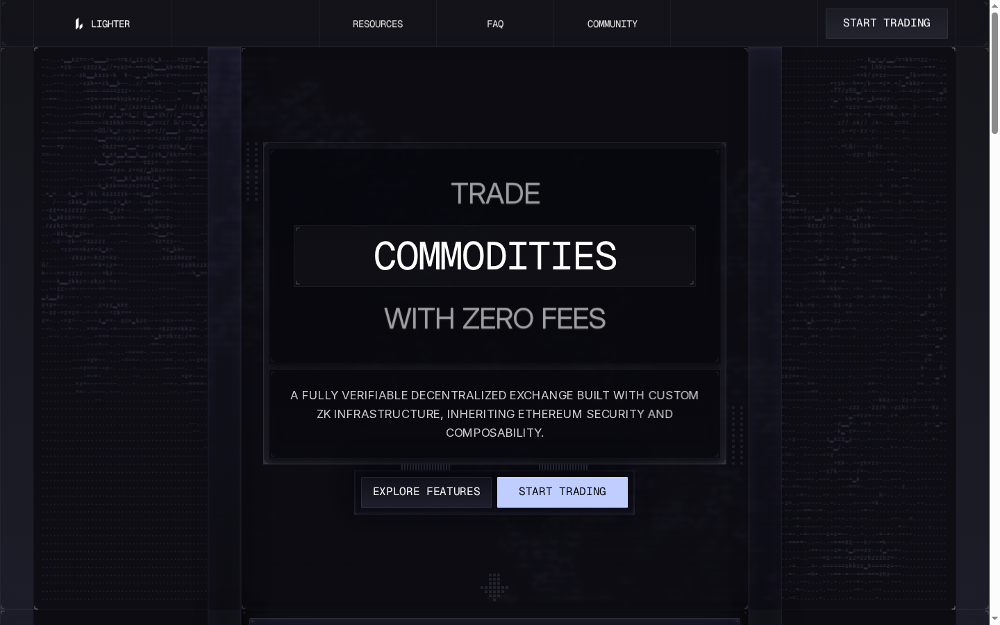
> **Capture:** [Lighter homepage](https://lighter.xyz/) - TinyFish, 2026-10-12.

### Test Scope: What Was Clicked and What Was Not

**The review exercised every safe logged-out control that could be reached, but stopped before any financial or identity action.**

| Walkthrough | Approximate actions | What was tested |
| --- | ---: | --- |
| Trading terminal | **15** | LIT to BTC switch, Market/Limit tabs, Advanced panel, funding display, wallet modal |
| Public Pools | **5** | Search/sort surface, LLP detail, Guinea Pool detail, breadcrumb, wallet gate |
| Staking, referrals, portfolio | **5** | Public tabs, About/Details, history tabs, empty states, Connect Wallet gate |

No email was entered, wallet provider selected, signature approved, funds deposited, order placed, position opened, referral created, or pool joined. Statements about those steps are marked as unverified.

## Trading Terminal Experience

### Opening the LIT Market

**The LIT market loads directly into a usable trading layout without requiring an account. Price, order book, chart, funding, volume, open interest, and the entire order form are visible immediately.**

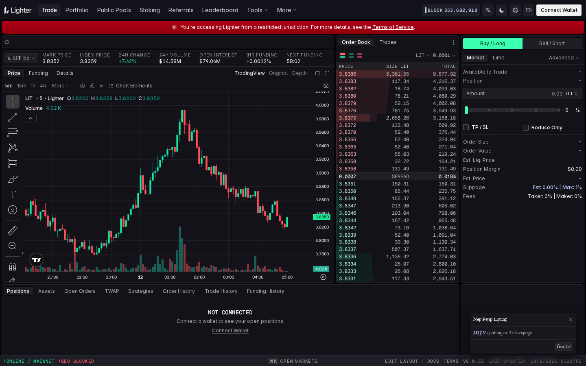
> **Capture:** [LIT perpetual market](https://app.lighter.xyz/trade/LIT) - TinyFish, 2026-10-12.

The captured screen showed:

| Field | Screenshot value |
| --- | ---: |
| Mark / index price | **3.8352 / 3.8359** |
| 24-hour change | **+7.62%** |
| 24-hour volume | **$14.58M** |
| Open interest | **$79.06M** |
| One-hour funding | **+0.0012%** |
| Spread | **0.0007 / 0.018%** |
| Maximum displayed leverage | **5x** |
| Maker / taker fee | **0% / 0%** |
| Default maximum slippage | **1%** |

A later live revisit showed LIT at **3.7897**, +6.32% over 24 hours, $15.26M volume, and $78.52M open interest. The changing values made the terminal feel live rather than like a static product demo.

The useful part is data placement. Mark and index prices sit beside funding and OI, so the user does not need to open separate panels before sizing a trade. The weakness is visual density: a new perpetual trader receives almost no explanation of why mark price, index price, and funding matter.

### Switching From LIT to BTC

**Changing from LIT to BTC was quick, and the full terminal updated without forcing a new page flow. BTC immediately showed a much deeper market and 50x leverage instead of LIT’s 5x.**

The BTC screen displayed a mark price of **83,523.5**, index price of **83,554.3**, +0.49% daily change, **$677.33M** 24-hour volume, **$348.55M** open interest, and +0.0012% one-hour funding. Roughly 30 bid and ask rows were visible.

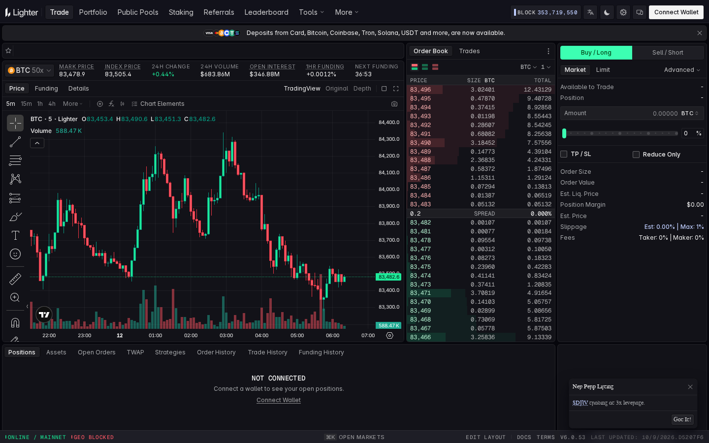
> **Capture:** [Lighter BTC market](https://app.lighter.xyz/trade/BTC) - captured through a TinyFish browser session on 2026-10-12.

The market selector was less convincing than the resulting screen. An **Open Markets** shortcut appeared at the bottom with `⌘K`, but the walkthrough did not expose a clear filter panel with five comparable market rows. The current market button works, yet discovery is not as obvious as the terminal itself.

### Trying Market, Limit, and Advanced Controls

**The order form is easy to understand for an experienced trader, but only Market and Limit were clearly discoverable while logged out. Stop, Trigger, and TWAP were not visible from the tested panel.**

The Market form exposed:

- Buy/Long and Sell/Short sides;
- an amount field;
- a percentage slider with 25%, 50%, and 75% markers;
- TP/SL and Reduce Only options;
- estimated slippage and maximum slippage;
- maker and taker fees.

Selecting Limit added price-based order entry. Opening **Advanced** exposed order size, order value, estimated liquidation price, position margin, estimated price, slippage, and fees. It did not reveal additional order types during the walkthrough.

This was the clearest product-level disappointment. A sophisticated perpetual terminal should make conditional orders easy to find. Either those order types are unavailable while logged out or the interface hides them too deeply.

## Wallet and Portfolio Experience

### Opening the Wallet Modal

**The wallet gate is clean but adds an account-style “Log in or sign up” step before trading. Direct wallet users may find the email-first framing unnecessary.**

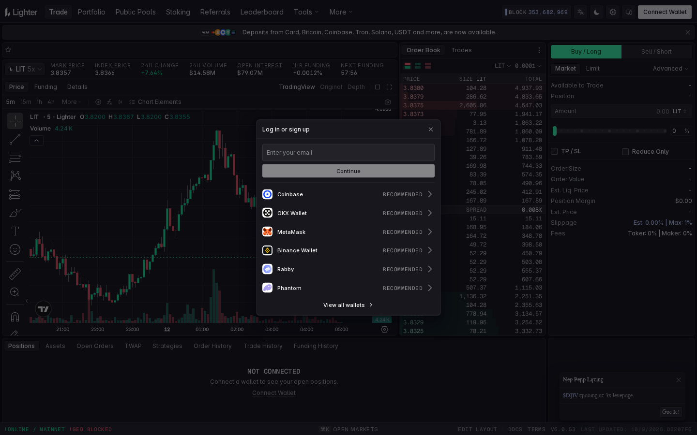
> **Capture:** [Lighter app](https://app.lighter.xyz/trade/LIT) - wallet modal opened with TinyFish on 2026-10-12.

Opening Connect Wallet produced an email field and six recommended providers: Coinbase, OKX Wallet, MetaMask, Binance Wallet, Rabby, and Phantom. A **View all wallets** link was also available. Closing the modal returned to the BTC terminal without losing the selected market.

The modal never requested a seed phrase. Testing stopped before provider selection, so network switching, signature wording, token allowances, recovery, deposits, and order confirmation remain unverified.

### Does “Zero Fee” Feel Real?

**Yes, the Standard order panel visibly reports 0% maker and 0% taker fees. However, funding and slippage are displayed beside those fees, making it clear that a trade can still have a real cost.**

The tested BTC screen showed estimated slippage of 0.00% and maximum slippage of 1% while no amount was entered. Funding was positive, meaning longs would pay shorts at the next settlement if the rate remained positive.

The [official fee table](https://docs.lighter.xyz/trading/trading-fees) explains why some users still pay:

| Account | Maker | Taker | Taker latency |
| --- | ---: | ---: | ---: |
| Standard | **0%** | **0%** | **300 ms** |
| Premium, no LIT staked | 0.0040% | 0.0280% | 140 ms |
| Premium, 500,000 LIT staked | 0.0028% | 0.0196% | 140 ms |
| Plus | 0.5 bps | 0.5 bps | 300 ms |

The experience supports the zero-fee claim for Standard accounts, not the broader idea of cost-free trading.

### Portfolio Experience While Logged Out

**The portfolio navigation is comprehensive, but every tab becomes an empty shell without a connected wallet. It explains what exists without showing what the finished account experience looks like.**

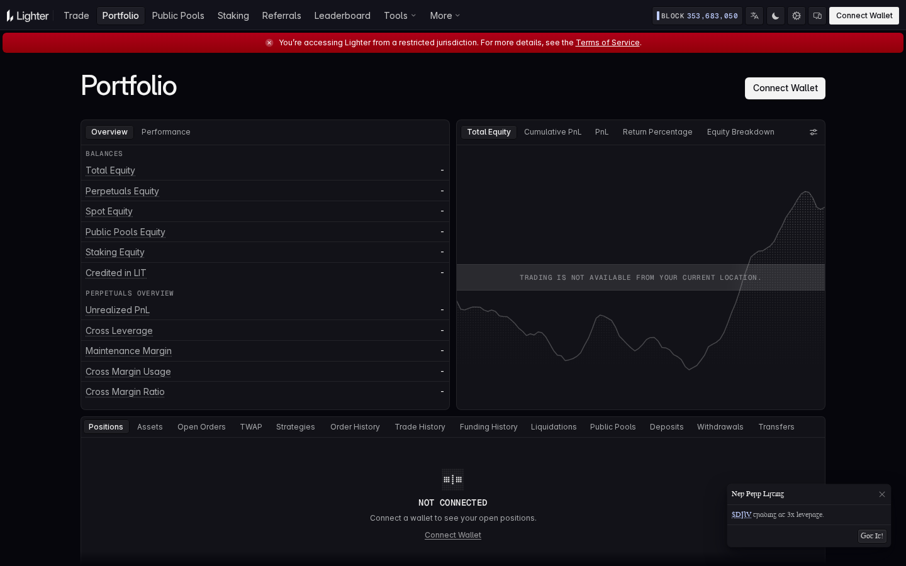
> **Capture:** [Lighter portfolio](https://app.lighter.xyz/portfolio) - TinyFish, 2026-10-12.

The walkthrough switched among Order History, Trade History, Funding History, and other account tabs. Each returned a **Not Connected** state. Deposits, Withdrawals, Transfers, Liquidations, TWAP, Strategies, Open Orders, and Public Pools were all present in navigation, but no sample rows or column previews were provided.

A banner advertised deposits from card, Bitcoin, Coinbase, Tron, Solana, USDT, and other routes. That breadth looks useful, although fees, minimums, settlement time, and bridge behavior could not be seen before wallet connection.

## Browsing Public Pools

**Public Pools are easy to compare from the list, but important decision data disappears after opening a pool. The list is more informative than the detail page.**

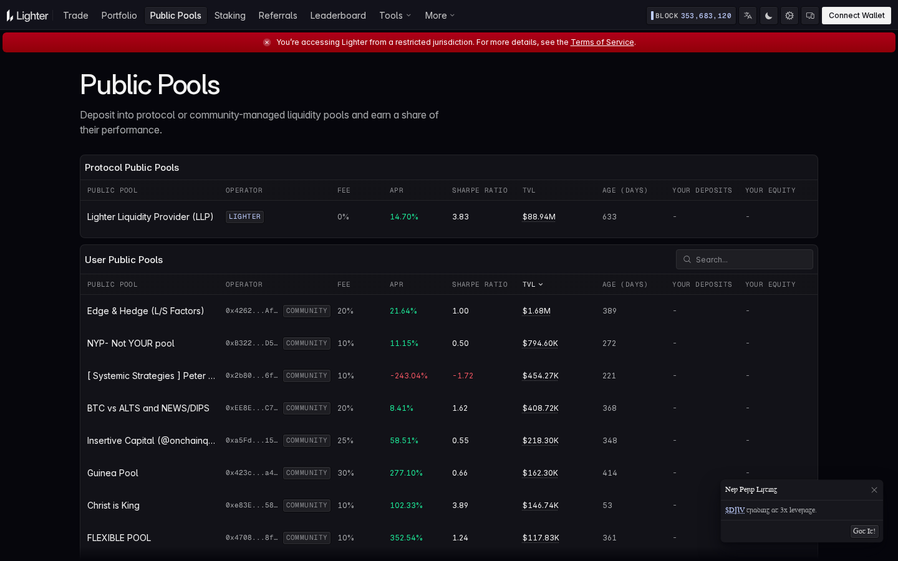
> **Capture:** [Lighter Public Pools](https://app.lighter.xyz/public-pools) - TinyFish, 2026-10-12.

The page loaded one protocol pool and 18 community pools. A search box filtered community pools, while APR, TVL, and Sharpe headers acted as sort controls. The selected sort direction was not visually obvious, and there were no filters for fee, pool age, TVL range, or risk.

The list made comparison fast:

| Pool | Fee | APR | Sharpe | TVL |
| --- | ---: | ---: | ---: | ---: |
| LLP | 0% | 14.70% | 3.83 | $88.94M |
| Guinea Pool | 30% | 277.10% | 0.66 | ~$161.54K |
| Peter Schiff’s vault | 10% | -243.04% | -1.72 | ~$459.23K |

One screen is enough to see that the highest APR is not automatically the strongest risk-adjusted result.

### Opening LLP and Guinea Pool

**LLP feels institutional and data-rich; Guinea Pool feels experimental and openly high-risk. Both detail pages still omit basic deposit terms before wallet connection.**

LLP opened in one click and showed **14.70% APR**, **$88.94M TVL**, 0% operator fee, and a description of market-making and liquidation activity. Tabs included Overview, Stats, Margin, Strategies, and Returns. The page exposed **171 positions and assets**, which is useful evidence of what the pool is actually doing.

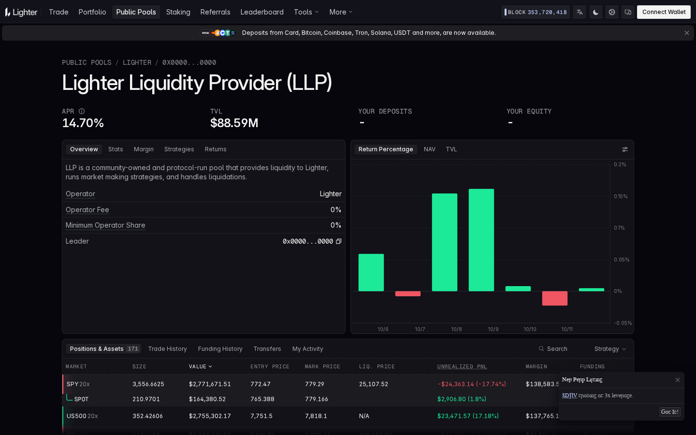
> **Capture:** [Lighter Liquidity Provider](https://app.lighter.xyz/public-pools) - opened from the pool list and captured through TinyFish on 2026-10-12.

Guinea Pool also opened in one click. It displayed **277.10% APR**, about **$161.54K TVL**, a 30% operator fee, 414 days of age, and eight active positions. Its own strategy description warned of “high risk, high volatility” and “large swings,” which is more honest than the headline APR.

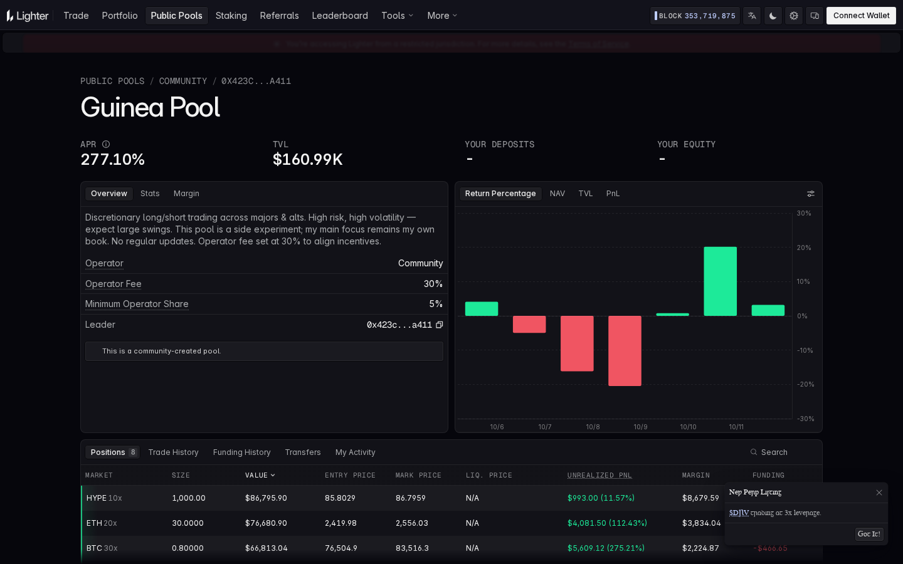
> **Capture:** [Guinea Pool](https://app.lighter.xyz/public-pools) - captured through a TinyFish browser session on 2026-10-12.

The missing details mattered more than the navigation:

- no minimum deposit was visible;
- no lockup or withdrawal terms were visible;
- Sharpe appeared on the list but not the detail page;
- chart-period controls were not obvious;
- the deposit action did not appear until wallet connection.

## Staking, Referrals, and Leaderboard

### Staking Experience

**The staking page communicates the headline reward well but does not explain the complete staking transaction before login.**

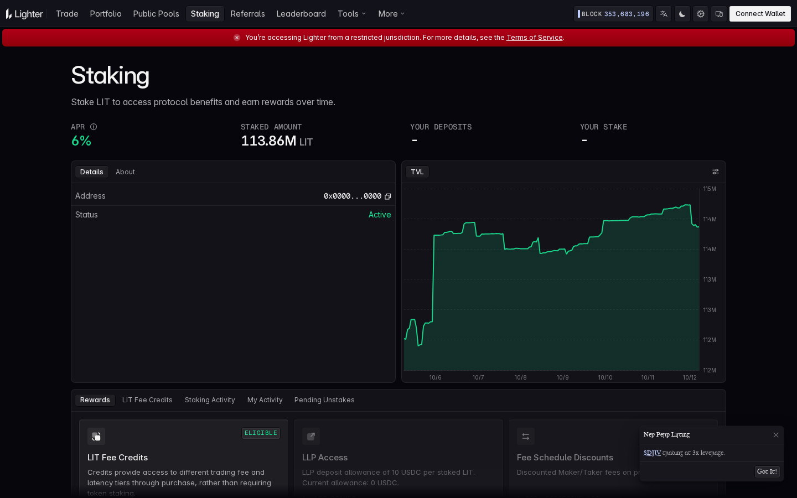
> **Capture:** [LIT staking](https://app.lighter.xyz/staking) - TinyFish, 2026-10-12.

The screen showed **6% APR**, approximately **113.86M LIT staked**, and an Active status. A public TVL chart moved between roughly 113M and 115M LIT over the displayed period. Details and About tabs were available, together with Rewards, LIT Fee Credits, Staking Activity, My Activity, and Pending Unstakes.

What was missing was the action itself. No Stake or Unstake form appeared while logged out, and the three-day unstaking period was not visible on the main page. It had to be confirmed in the [LIT utility documentation](https://docs.lighter.xyz/about-lighter/lit-utility). The page sells the benefit before showing the full commitment.

### Referral Experience

**The referral page is simple, but it cannot be meaningfully evaluated without a wallet because the code, sharing flow, tier progress, and payout history are hidden.**

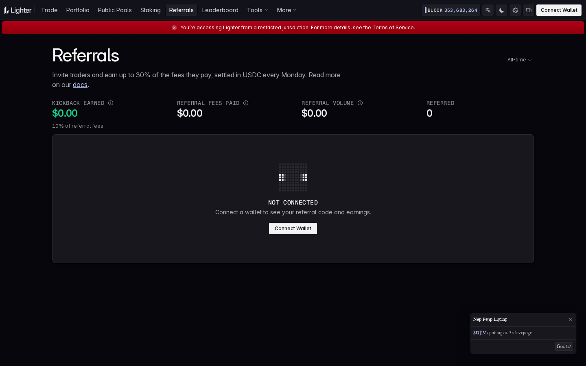
> **Capture:** [Lighter referrals](https://app.lighter.xyz/referrals) - TinyFish, 2026-10-12.

Logged out, the screen showed a **10%** fee-share rate, $0 earned, $0 paid, $0 referral volume, and zero referred users. It also advertised earnings “up to 30%,” settled in USDC every Monday.

The [current referral rules](https://docs.lighter.xyz/referral-program) publicly define Bronze at 10% and Silver at 20%, with Silver requiring at least 15 unique referrals active on five separate days. The walkthrough did not find a public explanation for the advertised 30% tier. That mismatch creates unnecessary doubt at the exact point where the page is asking users to promote the product.

### Is the Leaderboard Useful?

**The leaderboard is useful for measuring activity, but it is not useful as a copy-trading guide.**

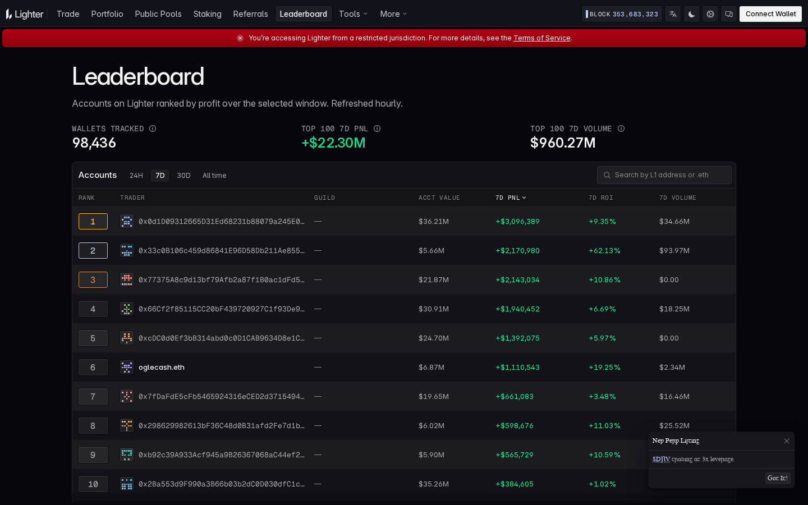
> **Capture:** [Lighter leaderboard](https://app.lighter.xyz/leaderboard) - TinyFish, 2026-10-12.

The page tracked **98,436 wallets** and showed **+$22.30M** seven-day PnL plus **$960.27M** seven-day volume for the top 100. Rank one displayed $36.21M account value and +$3.10M PnL; rank two showed $5.66M account value and +62.13% ROI.

The table was easy to scan and claimed hourly refreshes. Its limitation is selection bias: it shows winners without maximum drawdown, external hedges, deposits, withdrawals, or the losing population.

## Security, Architecture, and Scale

### What the Architecture Adds to the Experience

**The architecture does not change how the interface feels, but it explains why Lighter can offer an order book while still settling state through Ethereum.**

The practical point is short: the sequencer handles fast ordering, proofs validate operations, and Ethereum stores the canonical state. An Escape Hatch is designed to let users exit through Ethereum if priority requests are not processed. That emergency path was not tested, so it remains a documented safeguard rather than a verified user experience.

### Security Evidence Available Before Depositing

**Lighter makes multiple audit reports easy to find, which is better than hiding security material in announcements or repositories.**

The page listed work covering Lighter Core, the EVM deposit bridge, spot contracts, wrappers, and exit logic, including reports from Nethermind and Block. The audit library is a positive part of the pre-deposit experience, although the interface does not summarize unresolved findings or map each report to the currently deployed version.

## Points Experience and Airdrop Reality

**The points rules are detailed enough to show what matters, but not detailed enough to estimate a reliable return. No official page guarantees another airdrop.**

Season 2 distributes **200,000 points every Friday** for Wednesday-to-Tuesday activity. Volume, open interest, funding, liquidations or deleverages, PnL, and trading quality can affect the result. Scoring is non-linear and different markets carry different weights.

LIT already launched in December 2025, with [contemporary reporting](https://www.coindesk.com/markets/2025/12/30/lighter-dex-launches-lit-token-with-25-airdrop) describing a 25% supply distribution against 12.5 million historical points. The practical farming rule is therefore simple: trade only when the trade itself makes sense, then treat points as uncertain upside.

### Scale Check Against DefiLlama

**The interface does not feel empty because independent activity data shows meaningful capital, volume, and open interest.**

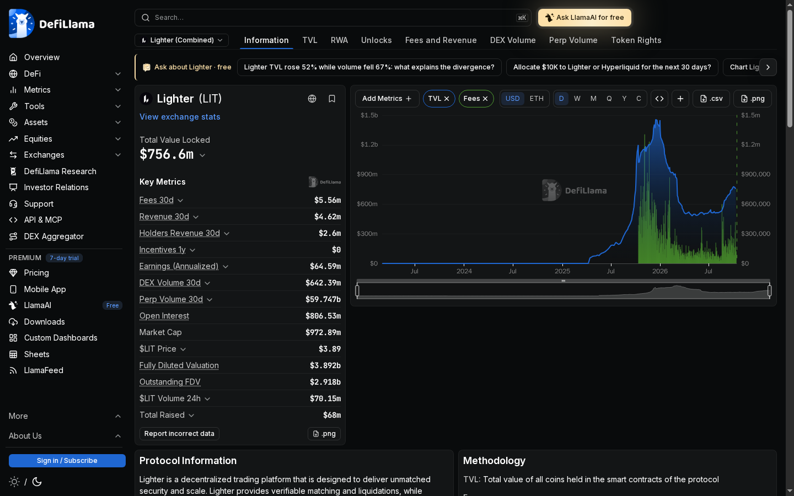
> **Capture:** [DefiLlama - Lighter](https://defillama.com/protocol/lighter) - TinyFish, 2026-10-12.

| Metric | Captured value |
| --- | ---: |
| TVL | **$756.6M** |
| Fees / revenue, 30 days | **$5.56M / $4.62M** |
| Perpetual volume, 30 days | **$59.747B** |
| Open interest | **$806.53M** |
| Active addresses, 24 hours | **16,885** |
| Transactions, 24 hours | **1.41M** |
| LIT price / market cap | **$3.89 / $972.89M** |

These values support the impression of an active venue. They do not prove that liquidity will remain available during volatility or that every market has equally strong execution.

## Usability Findings

### What Worked Well

**The trading terminal worked better than the surrounding rewards pages.**

- Market data and the order book loaded without authentication.
- Switching from LIT to BTC preserved a consistent layout.
- Fees, funding, slippage, and leverage were visible before trading.
- The wallet modal opened and closed without losing the selected market.
- Public Pool positions and strategy descriptions were readable before depositing.
- Pool comparison required little navigation.

### What Felt Frustrating

**Most frustration came from missing previews and inconsistent disclosure, not from page speed.**

- The region warning made the entire trading journey non-actionable.
- Market discovery and advanced order types were less obvious than expected.
- Portfolio tabs showed empty states without sample columns.
- Pool detail pages hid Sharpe and did not show minimum deposit or lockup terms.
- Staking emphasized 6% APR before showing the unstaking commitment.
- Referral copy advertised up to 30%, while the public rules explained only 10% and 20% tiers.
- Repeated listing notifications distracted from the main workflow.

## Final Review

**Lighter delivers a convincing public trading terminal but an incomplete logged-out evaluation of its supporting products.**

For active perpetual traders, the LIT-to-BTC switch, dense order book, visible funding, and zero-fee Standard form make a strong first impression. Public Pools are also unusually inspectable because positions and strategy text are visible.

The weakest part is the transition from browsing to commitment. Portfolio, staking, referrals, pool deposits, wallet approvals, and settlement reveal too little before connection. The product is therefore easiest to recommend for experienced traders who already understand what they are looking at, not for users who need the interface to teach them how risk and account flows work.

## Verification Matrix

| Area | Result |
| --- | --- |
| LIT and BTC public terminals | Interacted with and compared |
| Market/Limit/Advanced controls | Opened and inspected |
| Wallet modal | Opened and closed; no provider selected |
| Portfolio history tabs | Opened; all wallet-gated |
| LLP and Guinea Pool | Detail pages opened and compared |
| Staking and referral public tabs | Inspected; actions wallet-gated |
| Wallet signatures, deposits, withdrawals | **Not tested** |
| Order submission and fills | **Not tested** |
| Pool deposit, staking, referral payout | **Not tested** |
| Escape Hatch and liquidation | **Not tested** |

## Sources

- [Lighter app](https://app.lighter.xyz/)
- [Lighter trading fees](https://docs.lighter.xyz/trading/trading-fees)
- [LIT utility](https://docs.lighter.xyz/about-lighter/lit-utility)
- [Referral program](https://docs.lighter.xyz/referral-program)
- [Retail points rules](https://docs.lighter.xyz/points-program/retail)
- [Lighter architecture](https://docs.lighter.xyz/about-lighter/technical-architecture-lighter-core)
- [Security audits](https://docs.lighter.xyz/security/security-audits)
- [DefiLlama - Lighter](https://defillama.com/protocol/lighter)

*Disclaimer: This independent review is not financial, legal, or tax advice. Market data, fees, rewards, and regional availability can change.*
