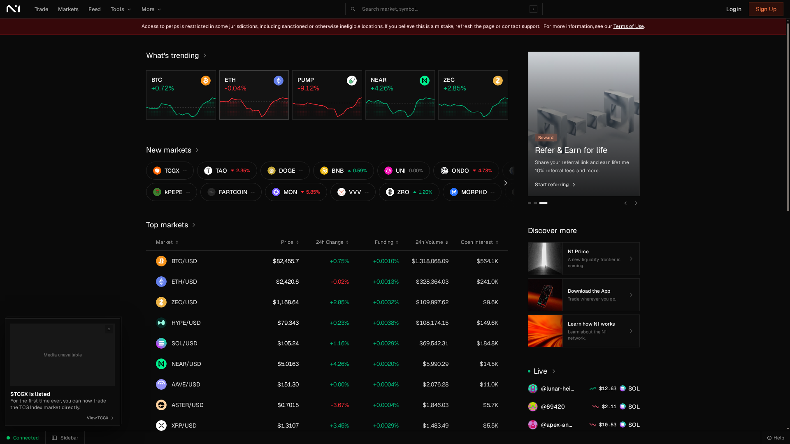
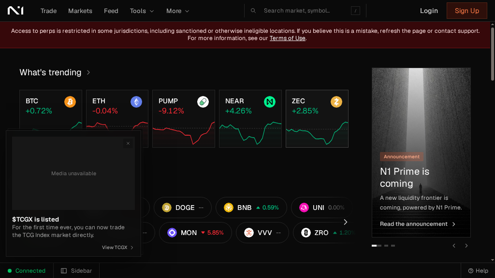
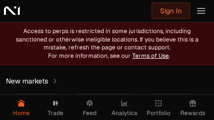
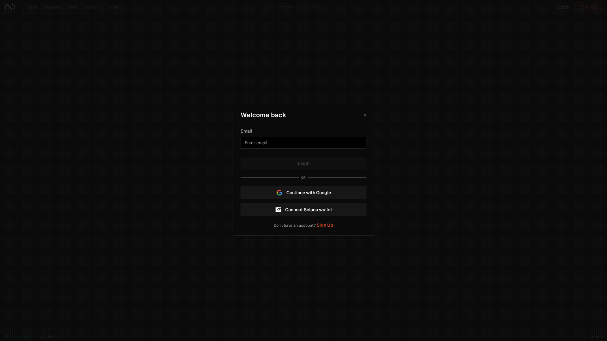
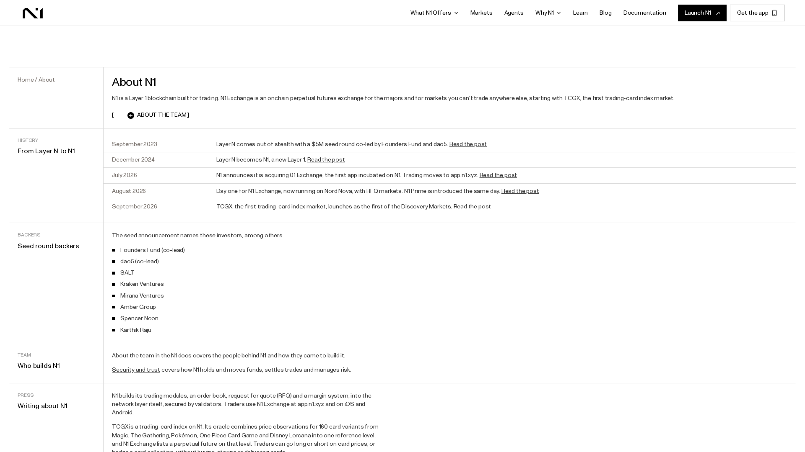
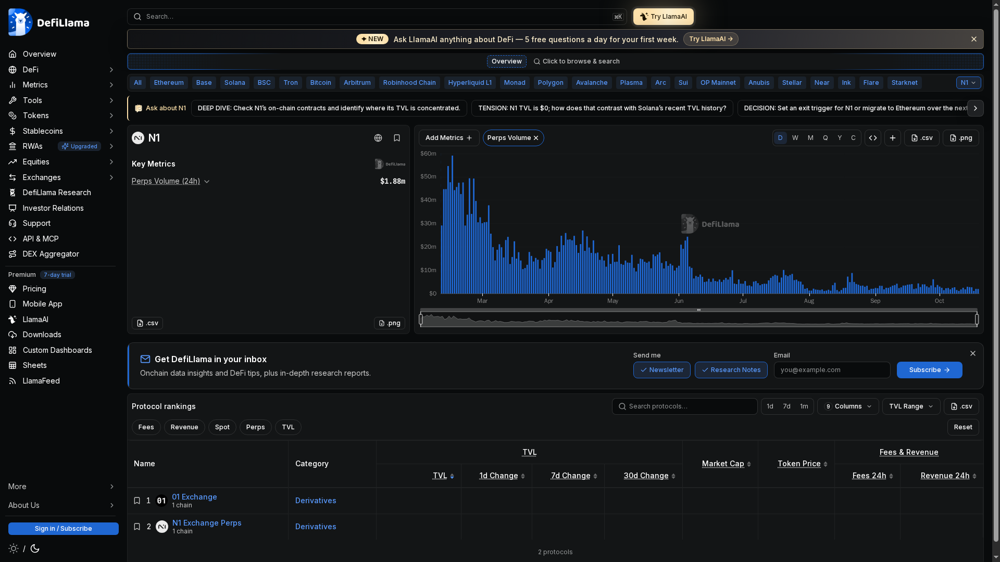
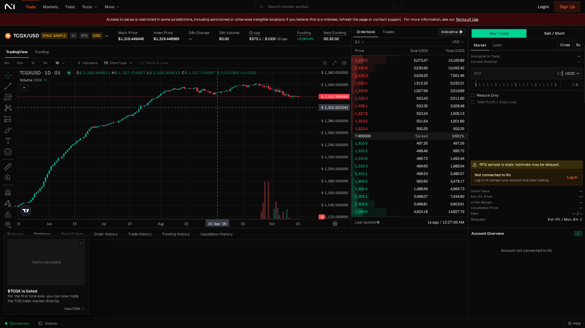

DEX Reviews · Hands-on review

# N1 Exchange Review 2026: Complete Beginner's Guide — Trade Perps on a Trading-Focused L1

 Published: 18 October 2026Author: Editorial TeamLast verified: 18 October 2026

A practical review of N1 Exchange: its trading-focused Layer 1, live orderbook interface, markets, fees, margin, security model, points and beginner workflow.

 **Who this guide is for:** Traders who want an onchain perpetual venue with a native orderbook, and beginners who want to understand N1 before connecting a wallet or funding an account.

> **In this guide:** [device experience](#device) · [features](#features) · [markets](#markets) · [fees](#fees) · [tutorial](#tutorial) · [security](#security) · [conclusion](#conclusion)

## What Is N1 Exchange?

N1 is a Layer 1 blockchain built specifically for trading. N1 Exchange is its onchain perpetual futures venue, with a native orderbook, RFQ markets and margining embedded at the network layer rather than assembled only from application contracts.

The practical result is a trading terminal that looks closer to a professional derivatives exchange than to a simple swap page. You trade price exposure, not the underlying asset, and your account still depends on collateral, funding, margin, oracle data and liquidation rules.

N1 began as Layer N in 2023, became N1 in December 2024 and announced the 01 Exchange acquisition in July 2026. The official history is documented in [About N1 ↗](https://www.n1.xyz/about).

N1's official site reports more than $3.7B in volume processed and more than 24,000 active traders at the time of review. These are platform-reported counters, so treat them as changing dashboard metrics rather than independently audited performance.

## How N1 Looks on Your Device

### On a Desktop — 1440 × 810

The desktop homepage shows the top navigation, trending cards, new markets, an announcement rail and a market table. A red eligibility banner remains visible across the top.

The desktop layout uses the available width well: market cards sit above the table, while the right column carries announcements and discovery links. It feels like a market terminal rather than a single-purpose trade form.

**Best for:** First-time research, scanning markets and comparing price, funding, volume and open interest before opening a trading screen.

### On a Tablet — 1024 × 576

At tablet width, the same dashboard remains usable, but the market table and announcement column compete for horizontal room.

The navigation stays visible and the trending cards remain readable. The main compromise is density: some tables require more scrolling, and the announcement rail takes space that could otherwise show market data.

**Best for:** Monitoring a shortlist of markets or checking a position away from a desk, not reviewing a complex order under time pressure.

### On a Phone — 430 × 242

The phone view collapses into a compact navigation bar with Home, Trade, Feed, Analytics, Portfolio and Rewards.

The mobile layout is clean, but the capture is dominated by the restricted-access message. The bottom navigation is easy to understand, while market comparison and order review need more space than this viewport provides.

**Best for:** Quick status checks and navigation. Use a larger screen before reviewing leverage, margin or liquidation details.

> **Access limitation observed:** The live app displayed that perpetual access is restricted in some jurisdictions. No wallet was connected, no funds were deposited and no order was submitted.

## Core Features

### 1. Native central limit orderbook

N1's CLOB markets use price-time priority. Resting orders provide liquidity, incoming orders take liquidity, and the orderbook exposes price, size and total notional on both sides.

### 2. RFQ execution

RFQ markets work differently: a trader sends a request with side, size, price bound and optional timeout, then designated market makers can return firm quotes. The two execution modes are documented in the [Execution Modes guide ↗](https://docs.n1.xyz/trading/markets/execution-modes).

### 3. Network-native margining

N1 accounts are cross-margin portfolios. The network calculates initial and maintenance requirements across positions, and the official docs describe up to eight separate trading accounts per wallet.

### 4. Discovery markets

N1 is not limited to major crypto pairs. TCGX is a trading-card index perpetual covering 160 card variants from Magic: The Gathering, Pokémon, One Piece Card Game and Disney Lorcana.

### 5. Session keys and mobile access

The connected Solana wallet authorizes a session key so traders do not need to sign every order manually. N1 also advertises dedicated iOS and Android apps through its [download page ↗](https://app.n1.xyz/download).

## Supported Markets

The official markets page showed 39 perpetual markets at review time. Maximum leverage varies by market, and the app makes funding, volume and open interest visible beside the trading interface.

 <table><thead><tr><th>Market group</th><th>Examples</th><th>Observed maximum leverage</th><th>Execution note</th></tr></thead><tbody>
 <tr><td>Major crypto</td><td>BTC, ETH</td><td>Up to 50×</td><td>Displayed in the CLOB terminal</td></tr>
 <tr><td>Large-cap crypto</td><td>SOL, HYPE, BNB, UNI</td><td>Up to 20×</td><td>Market-specific limits</td></tr>
 <tr><td>Altcoins and newer assets</td><td>SUI, XRP, ZEC, ONDO, MON</td><td>3×–10×</td><td>Liquidity and risk limits vary</td></tr>
 <tr><td>Discovery market</td><td>TCGX-USD</td><td>6×</td><td>RFQ; index methodology applies</td></tr>
 </tbody></table>

The [official markets page ↗](https://www.n1.xyz/perps) is the right place to check current listings. Market data changes, and the page itself labels the quotes as indicative rather than executable.

## Fee Schedule

N1 charges per fill, using the account's fee tier, the market type, the execution mode and whether the account is maker or taker. Do not assume that one CLOB rate automatically applies to RFQ trading.

 <table><thead><tr><th>Tier</th><th>Maker volume qualification</th><th>Maker fee</th><th>Taker fee</th></tr></thead><tbody>
 <tr><td>T1</td><td>≤ $5M</td><td>0.010%</td><td>0.035%</td></tr>
 <tr><td>T2</td><td>&gt; $5M or ≥ 0.5% maker share</td><td>0.005%</td><td>0.030%</td></tr>
 <tr><td>T3</td><td>&gt; $25M or ≥ 2.5% maker share</td><td>0%</td><td>0.025%</td></tr>
 <tr><td>T4</td><td>&gt; $100M or ≥ 10% maker share</td><td>0%</td><td>0.023%</td></tr>
 <tr><td>T5</td><td>&gt; $1B</td><td>0%</td><td>0.020%</td></tr>
 </tbody></table>

The published schedule is dated 15 August 2026 and notes that RFQ rates may differ. An external withdrawal normally costs 1 USDC, while internal transfers between N1 trading accounts do not incur that fee. See the [official fee documentation ↗](https://docs.n1.xyz/trading/orders/fees).

### Worked example: a 10,000 USDC fill

At Tier 1, a 10,000 USDC taker fill costs 3.50 USDC. The same notional as a maker costs 1.00 USDC. This excludes funding, slippage, withdrawal costs and any RFQ-specific rate.

## Order Types and Execution

 <table><thead><tr><th>Order type</th><th>What happens</th><th>Best use</th></tr></thead><tbody>
 <tr><td>Limit</td><td>Trades at the limit price or better; remaining quantity can rest</td><td>Controlled entry</td></tr>
 <tr><td>Post-only</td><td>Posts only if it would not execute immediately</td><td>Maker-only execution</td></tr>
 <tr><td>IOC</td><td>Executes immediately up to constraints and cancels the rest</td><td>Fast partial fill</td></tr>
 <tr><td>FOK</td><td>Fills the entire requested amount immediately or cancels</td><td>All-or-nothing entry</td></tr>
 <tr><td>Reduce-only</td><td>Can reduce but cannot increase or flip an existing perp position</td><td>Safer exit management</td></tr>
 </tbody></table>

The [Order Types documentation ↗](https://docs.n1.xyz/trading/orders/order-types) explains the mechanics. The live BTC/USD terminal also exposed Buy/Long, Sell/Short, Market, Limit, Atomics, Cross and 20× controls before login.

## Funding, Accounts and Points

Deposits from Solana use the Proton bridge, while other supported routes can use Unifold. Deposits credit the wallet's default trading account; moving funds to a subaccount requires a separate internal transfer.

N1 supports up to eight trading accounts per wallet, each with separate balances, positions, orders, margin and fee tier. This separation is useful for strategy isolation, but it adds account-management overhead for beginners.

N1 Points are distributed weekly during Season 1. The published program describes a fixed total of 1,987,000,000 Points, with Levels and Momentum showing progression. The rules and boost parameters are still subject to change, so points should not be treated as guaranteed financial value.

Read the official guides for [deposits and withdrawals ↗](https://docs.n1.xyz/trading/accounts/deposits-and-withdrawals), [subaccounts ↗](https://docs.n1.xyz/trading/accounts/subaccounts) and [N1 Points ↗](https://docs.n1.xyz/trading/points).

## Funding and Backers

Layer N, the project's former name, announced a $5M seed round in September 2023. The official announcement says it was co-led by Founders Fund and dao5, with participation from Amber Group, Kraken Ventures, SALT, Mirana Ventures, GSR and others.

Independent project databases report a broader $7M total raise, including a later $2M community sale. Because that figure is not stated in the official seed announcement, it should be treated as a secondary-source estimate rather than a single confirmed financing total.

 <table><thead><tr><th>Item</th><th>What the sources say</th><th>How to read it</th></tr></thead><tbody>
 <tr><td>Public seed announcement</td><td>$5M, September 2023</td><td>Primary-source figure</td></tr>
 <tr><td>Named backers</td><td>Founders Fund, dao5, Amber, Kraken Ventures, SALT, Mirana, GSR</td><td>Reported participation, not a guarantee of future performance</td></tr>
 <tr><td>Broader project total</td><td>CoinLaunch reports $7M including a $2M 2025 sale</td><td>Secondary-source figure; verify terms independently</td></tr>
 </tbody></table>

See the [official seed announcement ↗](https://www.n1.xyz/blog/seed) and compare it with the [independent CoinLaunch project analysis ↗](https://coinlaunch.space/projects/n1-chain/).

## Team and Company Background

Null Studios is described as a core contributor to N1. The official team page says its founders have known each other since high school, entered crypto in 2019 and have built low-latency onchain trading and orderbook systems since 2020.

The founding team publicly associated with Layer N includes Dima Romanov, David Cao and Sheheryar Parvaz. N1's security page also names Null Studios as the core contributor and lists Founders Fund, IMC, Amber and GSR among the backers.

This background is relevant to product fit: N1 is not presenting itself as a general-purpose chain with a trading app added later. Its team history and architecture are both centered on execution, liquidity and margining.

Read [About the team ↗](https://docs.n1.xyz/learn/about-the-team) and [N1's project history ↗](https://www.n1.xyz/about).

## Token Status and Points Reality Check

N1 has not publicly confirmed a native token, TGE date or final tokenomics in the sources checked for this review. N1 Points are a live participation program, but Points are not the same thing as a token, an equity claim or a guaranteed airdrop.

The live Rewards page did not expose a public points balance: it showed “Sign in required” before rewards could be viewed. This is consistent with the documentation describing a private user Points balance rather than a public leaderboard.

The official Points documentation describes 1,987,000,000 Season 1 Points: 75M distributed over 26 live weeks plus 37M across two retroactive weeks. The launch announcement says the program is intended to unlock future rewards, but it does not publish a token conversion ratio.

Independent airdrop trackers also label any N1 airdrop as unconfirmed. That is the correct risk framing: trade or provide liquidity only for the product itself, not because a future token distribution is assumed.

Check the [official Points rules ↗](https://docs.n1.xyz/trading/points) and the more cautious [independent airdrop status page ↗](https://airdrops.io/n1/) before assigning monetary value to Points.

## Roadmap and Delivery Status

 <table><thead><tr><th>Milestone</th><th>Status or source statement</th><th>Review implication</th></tr></thead><tbody>
 <tr><td>Layer N → N1</td><td>Renamed in December 2024</td><td>Current product is the continuation of the former Layer N project</td></tr>
 <tr><td>01 Exchange acquisition</td><td>Announced July 2026</td><td>Exchange and network were brought under one product direction</td></tr>
 <tr><td>Nord Nova / N1 Exchange</td><td>Launched August 2026 with RFQ markets and Points</td><td>Public trading product is still in an expansion phase</td></tr>
 <tr><td>Equity perps, Vaults, portfolio margin</td><td>Announced for gradual public release</td><td>Roadmap items should not be counted as live until independently visible</td></tr>
 <tr><td>N1 Mobile and deeper liquidity</td><td>Announced as staged rollout and ramp-up work</td><td>Access and execution quality may vary by user and market</td></tr>
 </tbody></table>

The official launch post frames the roadmap around RFQ markets, Points, deeper liquidity and future products. The page is a roadmap statement, so individual items should still be checked against the live app.

The roadmap is ambitious: N1 wants one balance to support more markets through CLOB, RFQ, portfolio margining and Vaults. The important distinction is between what the launch post promised and what a user can access today.

Read the [Day One launch post ↗](https://www.n1.xyz/blog/n1x) alongside the live [N1 app ↗](https://app.n1.xyz/). In our capture, perp access was still restricted by jurisdiction.

## Independent Onchain Data

Official dashboards and independent analytics measure different scopes, so the numbers should not be combined. N1's homepage displayed $3.72B volume processed, while DeFiLlama's N1 chain page showed approximately $1.3M in 24-hour perp volume and $15.37M over seven days when checked.

[DeFiLlama's live N1 dashboard ↗](https://defillama.com/chain/n1) showed $1.14M in 24-hour perps volume in this capture and plotted the recent volume history. The metric is time-sensitive, so the screenshot is evidence of the observed snapshot rather than a permanent figure.

DeFiLlama's separate 01 Exchange page reported $2.832B cumulative perp volume on N1. That is a historical protocol metric, not the same as the N1 homepage's current counter or the chain page's recent window.

 <table><thead><tr><th>Metric</th><th>Observed figure</th><th>Source and caveat</th></tr></thead><tbody>
 <tr><td>N1 homepage volume processed</td><td>$3.72B</td><td>Official product counter; scope and update timing are not independently audited</td></tr>
 <tr><td>N1 perps volume, 24h</td><td>About $1.3M</td><td>DeFiLlama snapshot; recent-window metric</td></tr>
 <tr><td>N1 perps volume, 7d</td><td>About $15.37M</td><td>DeFiLlama snapshot; not cumulative lifetime volume</td></tr>
 <tr><td>01 Exchange cumulative perp volume</td><td>$2.832B</td><td>DeFiLlama protocol page; historical 01 Exchange metric</td></tr>
 </tbody></table>

The gap between lifetime counters and recent volume is not automatically a contradiction: the products, time windows and data definitions differ. Still, it shows why a serious review should publish both official claims and independent snapshots instead of repeating one headline number.

Track the live [DeFiLlama N1 dashboard ↗](https://defillama.com/chain/n1) and its [01 Exchange methodology page ↗](https://defillama.com/protocol/01-exchange) for updated data.

## How to Use N1 Exchange: Step-by-Step Tutorial

### Step 1 — Open the app and check eligibility

Go to [app.n1.xyz ↗](https://app.n1.xyz/). Before connecting a wallet, read the eligibility banner and open the Terms of Use. Availability is jurisdiction-dependent.

The homepage gives a useful market overview, but the access banner appears before any trading action.

### Step 2 — Choose a market

Open Markets or search a symbol such as BTC/USD. Compare mark price, index price, funding, 24-hour volume, open interest and the market's maximum leverage before opening the trade terminal.

The BTC/USD terminal combines chart, orderbook, trades, funding, open interest and account controls on one screen.

### Step 3 — Choose direction, execution mode and leverage

Select Buy/Long or Sell/Short, then review Market, Limit, Atomics, Cross and the leverage selector. The live BTC/USD screen showed 20× in the order ticket, but each market has its own limit.

This close capture isolates the decision controls for Step 3: direction, execution mode and leverage.

### Step 4 — Review margin and risk fields

Before signing, check size, reduce-only, take-profit/stop-loss availability, order value, initial margin, liquidation price, fees and slippage. If the account is not connected, the terminal leaves these fields blank.

The risk panel is where a trader should verify margin and liquidation information before committing collateral.

### Step 5 — Log in, connect and confirm

Only after checking the market and risk fields should you click Log in and authorize the wallet/session key. Confirm the account, network, size and fees. In this review, the jurisdiction restriction prevented the login flow from continuing.

The final observed state was “Not connected to N1”: Login was available, but no account, margin or liquidation price was populated.

## Margin and Liquidation: The Risk You Must Understand

N1's margin system defines initial, cancel and maintenance fractions. The docs give a 10× illustrative column: 10% initial margin, 6.25% cancel margin and 5% maintenance margin.

 <table><thead><tr><th>Risk level</th><th>10× illustrative fraction</th><th>Meaning</th></tr></thead><tbody>
 <tr><td>Initial margin</td><td>10%</td><td>Required to open or increase exposure</td></tr>
 <tr><td>Cancel margin</td><td>6.25%</td><td>Risk-increasing open orders may be cancelled below this level</td></tr>
 <tr><td>Maintenance margin</td><td>5%</td><td>Positions become eligible for liquidation below this level</td></tr>
 </tbody></table>

Liquidation begins by cancelling orders that increase risk and reducing positions. More distressed accounts can have positions transferred to the backstop near the index price, and liquidated users pay a liquidation fee.

These are account-level rules, not a promise that a position can tolerate a fixed percentage move. Funding, fees, index price changes, market liquidity and the market's own margin fraction all affect the result. Read the [margin guide ↗](https://docs.n1.xyz/trading/margining/margin) and [liquidation guide ↗](https://docs.n1.xyz/trading/margining/liquidations).

## Security and Trust: What N1 Discloses

N1's security model is different from a typical smart-contract DEX. The official security page says the orderbook, RFQ and margin system are native modules secured by validators, while today the network runs on Proton with a curated operator.

 <ul><li>**Wallet control:** a Solana wallet owns the trading accounts and authorizes actions.</li><li>**Session-key risk:** a session key can act without signing every order until it expires or is revoked.</li><li>**Settlement risk:** validators monitor proposed blocks and can halt withdrawals after a bad update.</li><li>**Oracle risk:** index prices, confidence bounds and outage behavior affect margin and liquidation.</li><li>**Leverage risk:** perpetuals can lose all collateral when adverse movement reaches the account's risk limits.</li></ul>

N1's own disclosure says the network is still moving toward future shared security and a native validator set. That is important context: “validator-secured” does not mean the system has the same maturity or decentralization profile as a long-running public chain.

Read [N1 Security and Trust ↗](https://www.n1.xyz/security) and the [settlement documentation ↗](https://docs.n1.xyz/learn/protocol/settlement) before funding an account.

## For Builders: APIs and Agent Access

N1 exposes REST and WebSocket APIs, signed actions, a TypeScript client and a Nord Agent Kit. Developers can read markets, orderbooks, trades and account state, then place and manage orders programmatically.

The agent tooling is a notable differentiator, but it increases the importance of session security and action scoping. Start with read-only market data, protect signing keys and test on devnet before submitting live actions. The [developer guide ↗](https://docs.n1.xyz/developers/guide) is the best starting point.

## N1 vs Competitors

This comparison uses four named alternatives: Hyperliquid for a crypto-native orderbook, dYdX for an appchain derivatives venue, Ostium for broader real-world-asset perpetual exposure, and a centralized exchange for account-based access.

 <table><thead><tr><th></th><th>N1</th><th>Hyperliquid</th><th>dYdX</th><th>Ostium</th><th>Centralized exchange</th></tr></thead><tbody>
 <tr><td>Core model</td><td>Trading-focused L1 + perps</td><td>Crypto-native perp venue</td><td>Appchain derivatives venue</td><td>Onchain RWA and crypto perps</td><td>Custodial exchange account</td></tr>
 <tr><td>Execution</td><td>CLOB and RFQ</td><td>Orderbook</td><td>Orderbook</td><td>Protocol-specific execution</td><td>Centralized matching engine</td></tr>
 <tr><td>Distinctive market</td><td>TCGX trading-card index</td><td>Crypto markets</td><td>Crypto markets</td><td>Stocks, commodities, forex and crypto</td><td>Varies by venue</td></tr>
 <tr><td>Custody</td><td>Wallet-controlled accounts</td><td>Wallet / protocol accounts</td><td>Wallet / appchain accounts</td><td>Wallet and smart contracts</td><td>Exchange custody</td></tr>
 <tr><td>Best for</td><td>Traders who want native market infrastructure</td><td>Deep crypto-native activity</td><td>Appchain derivatives users</td><td>Macro and RWA exposure</td><td>Convenience, fiat rails and support</td></tr>
 </tbody></table>

N1's strongest differentiation is not simply “another perp DEX.” It is the attempt to make orderbook, RFQ and margining network-native, while adding unusual discovery markets such as TCGX. The trade-off is a younger ecosystem, jurisdiction restrictions and a more complex account model.

## Conclusion

N1 is an ambitious trading-focused Layer 1 with a serious terminal, native orderbook, RFQ execution and unusual markets such as TCGX. The interface exposes the information active traders expect: orderbook, funding, volume, open interest, margin and liquidation fields.

The experience is not frictionless for beginners. Wallet/session-key permissions, cross-margin accounts, market-specific leverage and liquidation rules require more understanding than a simple swap. The live app also restricted perp access in the tested jurisdiction.

N1 is worth exploring if you want infrastructure built around trading rather than a general-purpose chain. Start with read-only research, use modest leverage and confirm eligibility, fees, margin and withdrawal terms before depositing funds.

## FAQ — Straight Answers for New Traders

### Is N1 Exchange a centralized exchange?

**No.** N1 Exchange is an onchain perpetual futures venue built on the N1 network, with wallet-controlled trading accounts. The current network still uses a curated operator, which is a separate decentralization consideration.

### What is the difference between CLOB and RFQ markets?

**CLOB matches against resting orders.** RFQ sends a private request to designated market makers for a firm quote. A market uses one execution mode at a time.

### How much does N1 charge?

**Tier 1 CLOB rates start at 0.01% maker and 0.035% taker.** RFQ rates can differ by tier and execution mode, and external withdrawals normally cost 1 USDC.

### Can beginners trade TCGX safely?

**Only after understanding the risk.** TCGX is a leveraged perpetual on a trading-card index, not ownership of cards. Index methodology, liquidity, funding and liquidation risk all apply.

## Quick Links

[N1 app](https://app.n1.xyz/)[Markets](https://www.n1.xyz/perps)[Security](https://www.n1.xyz/security)[N1 Docs](https://docs.n1.xyz/learn/introduction-to-n1)[Fees](https://docs.n1.xyz/trading/orders/fees)[Order types](https://docs.n1.xyz/trading/orders/order-types)[Developer guide](https://docs.n1.xyz/developers/guide)

## Quick links

Last verified: 18 October 2026. Screenshots show the public N1 app and terminal. No wallet connection, deposit, order or transaction was performed.
