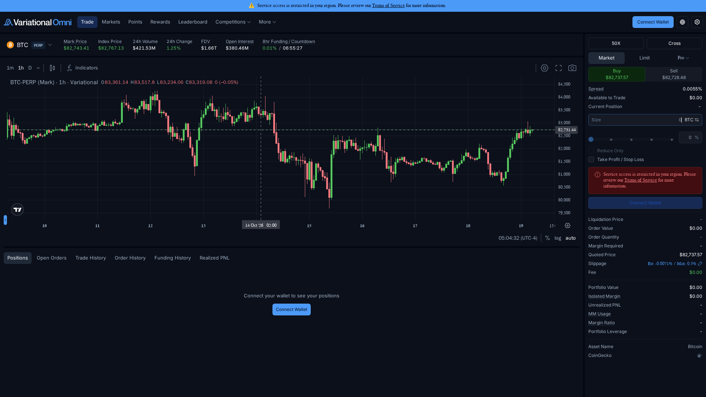
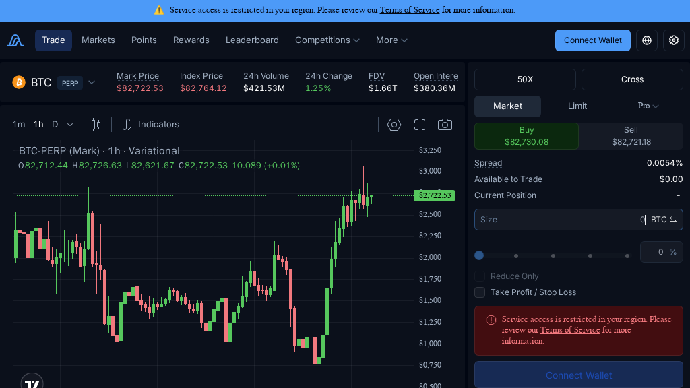
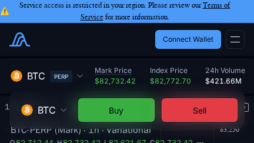
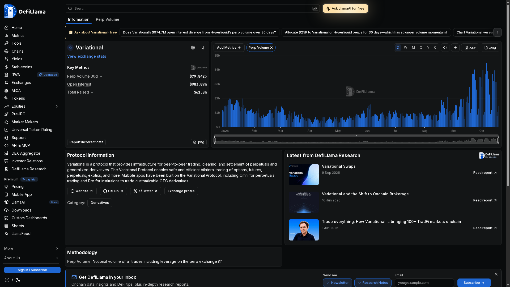
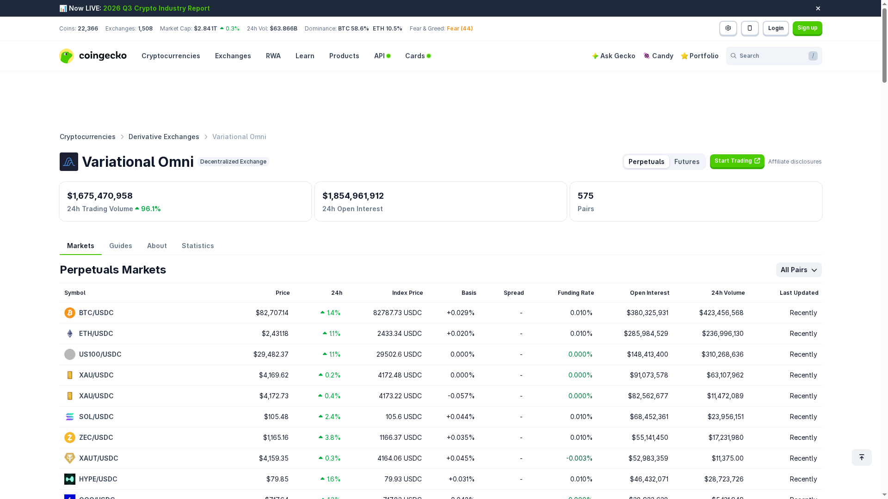

Hands-on review · 2026

# Omni by Variational Review 2026: Complete Beginner's Guide

Omni is an onchain perpetuals venue built around RFQ quotes instead of a traditional order book. It aims to put crypto, equities, commodities, FX, indices and pre-IPO markets behind one cross-margined account.

 Reviewed from the live Omni interface and official Variational documentation · Last checked October 18, 2026 · Beginner-friendly guide

Omni has an unusually ambitious pitch: trade more than 500 markets, use up to 50x leverage, and pay no maker or taker trading fee. The interesting question is not whether the interface looks polished; it is whether the RFQ model, risk display and access conditions are clear enough for real users.

This review covers the product’s actual interface, supported markets, fee mechanics, order flow, rewards, security posture and the practical limits I found during the walkthrough. The live page exposed a regional access restriction, so no wallet connection, deposit or trade was submitted.

<strong>Quick take:</strong> Omni is compelling for traders who want broad perpetual exposure and a quote-based execution model. Its biggest friction today is access: the docs describe a private beta with an access code, while the live terminal may also block users by region.

## What Is Omni?

Omni is the first application built on the Variational Protocol. The official documentation describes a single cross-margined account for perpetual contracts across crypto and traditional-asset markets, with settlement on Arbitrum and liquidity supplied by the Omni Liquidity Provider, or OLP.

Unlike Hyperliquid or GMX, Omni does not present a conventional order book or pool interface as its core execution surface. A user requests a quote, reviews the quoted price, spread, slippage and margin requirement, then confirms the order if the account is eligible.

That design can simplify markets that are difficult to support with a standard crypto order book. It also makes the quote, the OLP relationship and the platform’s risk controls more important than a visible bid-and-ask ladder. <a href="https://docs.variational.io/omni/about-omni">Read the official Omni overview</a>.

## How Omni Looks on Your Device

The responsive layout keeps the same dark terminal language across screen sizes. The desktop view gives the order form a dedicated right rail; tablet compresses the chart and controls; mobile prioritizes the instrument and navigation, which is useful for checking markets but less comfortable for leveraged execution.

*Desktop: BTC perpetual, live metrics and right-side order panel.*

*Tablet: the same terminal compressed into a narrower workspace.*

*Phone: compact access to the terminal and account controls.*

The most important visual detail is not cosmetic: the live terminal shows a top warning that service access is restricted in the current region. The order panel remains visible, but the account has no available balance and the connect action is not usable from this environment.

## Core Features

### RFQ execution instead of an order book

Omni’s OLP is the sole market maker for the application, while its pricing system aggregates liquidity from major crypto exchanges and traditional dealers. Users therefore see a quoted price and execution information rather than a public order-book queue.

### One account, broad collateral use

The account is designed to cross-margin positions, so collateral can support multiple markets. The interface also exposes a Cross selector, while the documentation describes isolated settlement as a separate capability and roadmap area; check the current account options before assuming every mode is enabled.

### More than crypto majors

Variational advertises 500+ live markets spanning crypto, equities, commodities, FX and pre-IPO assets. That breadth is Omni’s clearest differentiator, although availability, quote quality and trading hours can vary by instrument.

### Risk controls inside the order ticket

The terminal exposes market, limit and Pro order modes, leverage, Buy/Sell, spread, size, reduce-only, take-profit/stop-loss and a trade-information block. This is a good layout choice because the user can inspect execution and liquidation context before submitting.

## Supported Markets

 <table>
 <thead><tr><th>Market family</th><th>What Omni says it supports</th><th>What to check before trading</th></tr></thead>
 <tbody>
 <tr><td>Crypto</td><td>Major and long-tail crypto perpetuals, with the live terminal opening on BTC PERP.</td><td>Mark/index divergence, funding, quoted spread and liquidity at your size.</td></tr>
 <tr><td>Equities</td><td>Perpetual exposure to selected equity names without traditional market hours.</td><td>Reference pricing, weekend behavior and product-specific risk limits.</td></tr>
 <tr><td>Commodities</td><td>Commodity-linked perpetual markets are part of the broader Omni catalogue.</td><td>Underlying reference, volatility and whether the quote is currently live.</td></tr>
 <tr><td>FX and indices</td><td>FX pairs and index-style markets are included in Variational’s 500+ market claim.</td><td>Funding, session liquidity and the exact contract specification.</td></tr>
 <tr><td>Pre-IPO</td><td>Selected pre-IPO perpetuals are described in the official trading docs.</td><td>Very high gap risk, quote availability and platform risk limits.</td></tr>
 </tbody>
 </table>

The app’s live BTC panel showed mark price, index price, 24-hour volume, open interest, funding and countdown in one header. Those fields are useful for a fast market read, but they are dynamic values, not permanent product specifications; confirm them immediately before execution.

For the product-level market claim, see <a href="https://docs.variational.io/omni/getting-started-with-omni">Omni Getting Started</a> and the broader <a href="https://www.variational.io/en">Variational product page</a>.

## Independent Market Data Snapshot

The product UI is only one side of the review. To cross-check scale, I compared the live terminal with independent dashboards and recorded the values on October 18, 2026. These numbers are snapshots: derivatives dashboards refresh continuously and can disagree by a small amount between captures.

*DefiLlama snapshot: perp volume history, open interest and funding context.*

*CoinGecko snapshot: exchange-level volume, open interest and market count.*

 <table>
 <thead><tr><th>Metric</th><th>Snapshot</th><th>Source and interpretation</th></tr></thead>
 <tbody>
 <tr><td>Perpetual volume, 30d</td><td>$81.583B</td><td><a href="https://defillama.com/protocol/variational">DefiLlama</a> dashboard snapshot, October 18, 2026. The page also shows Arbitrum as the tracked chain.</td></tr>
 <tr><td>Open interest</td><td>$988.63M</td><td>DefiLlama dashboard snapshot. CoinGecko’s exchange view showed a higher $1.868B figure at its own refresh, illustrating data-source timing differences.</td></tr>
 <tr><td>24h volume</td><td>$850.713M</td><td><a href="https://www.coingecko.com/en/exchanges/variational-omni">CoinGecko</a> snapshot; the page displayed a 68.2% 24-hour change.</td></tr>
 <tr><td>Pairs</td><td>574</td><td>CoinGecko snapshot across the perpetuals market list.</td></tr>
 <tr><td>TVL / value locked</td><td>$100M</td><td>Reported in CoinGecko’s October 4, 2026 case study, not exposed as a live TVL card in the exchange snapshot. Treat it as a dated third-party report.</td></tr>
 <tr><td>Trading rewards</td><td>$6M returned</td><td>Reported in the same <a href="https://www.coingecko.com/learn/variational-case-study">CoinGecko case study</a>; it is a cumulative historical claim, not a current weekly payout.</td></tr>
 </tbody>
 </table>

The important takeaway is not one “correct” number. DefiLlama and CoinGecko use different refresh cycles and methodologies, so the article preserves both readings instead of silently selecting the larger one. Readers should use the timestamp and source when comparing Omni with Hyperliquid, GMX or Ostium.

## Fees and Real Execution Cost

Omni advertises zero maker and taker trading fees. That is attractive, but it should not be read as zero cost: an RFQ trade can still have spread, slippage and funding, and moving USDC into or out of the account carries a flat transfer charge.

 <table>
 <thead><tr><th>Cost item</th><th>Published or observed detail</th><th>How to interpret it</th></tr></thead>
 <tbody>
 <tr><td>Trading fee</td><td>0% maker/taker fee in the official Omni materials.</td><td>No explicit commission line, but execution quality still matters.</td></tr>
 <tr><td>Deposit</td><td>Flat 0.1 USDC deducted from the deposit.</td><td>A small fixed cost that matters more on small accounts.</td></tr>
 <tr><td>Withdrawal</td><td>Flat 0.1 USDC according to the Getting Started guide.</td><td>Budget it separately from PnL and funding.</td></tr>
 <tr><td>Spread/slippage</td><td>The live BTC ticket showed a spread and an estimated/max slippage field.</td><td>Review the quote at your actual order size.</td></tr>
 <tr><td>Funding</td><td>The terminal displays an 8-hour funding rate and countdown.</td><td>Holding cost can dominate a “zero-fee” trade over time.</td></tr>
 </tbody>
 </table>

<strong>Example:</strong> a 10,000 USDC notional position shows 0 USDC in explicit trading commission under the published schedule. It can still cost more through the quote spread, realized slippage, funding and a 0.1 USDC transfer fee if the account was just funded.

Omni’s official fee documentation is the right place to re-check changes: <a href="https://docs.variational.io/omni/trading/fees">Trading fees</a> and <a href="https://docs.variational.io/omni/getting-started-with-omni">deposit/withdrawal instructions</a>.

## Order Types and Risk Display

 <table>
 <thead><tr><th>Control</th><th>Purpose</th><th>Beginner note</th></tr></thead>
 <tbody>
 <tr><td>Market</td><td>Request immediate execution against the current quote.</td><td>Fastest, but price impact and slippage deserve attention.</td></tr>
 <tr><td>Limit</td><td>Set a desired price for the order.</td><td>Execution is not guaranteed; check how the quote is maintained.</td></tr>
 <tr><td>Pro / trigger</td><td>Advanced execution and conditional controls.</td><td>Understand trigger basis and whether the order is live before relying on it.</td></tr>
 <tr><td>TP/SL</td><td>Attach take-profit and stop-loss instructions.</td><td>Use only after confirming the trigger price reference.</td></tr>
 <tr><td>Reduce only</td><td>Prevent an order from increasing the position.</td><td>Useful when closing or trimming leveraged exposure.</td></tr>
 </tbody>
 </table>

*Live BTC terminal: quote fields, leverage controls and the order ticket are visible in one view.*

The terminal’s trade-information section includes quoted price, order value, order quantity, margin required, liquidation price, slippage and fee. That is a stronger pre-trade surface than a simple Buy button, especially when an account has no position and the user needs to understand what the ticket will calculate.

Leverage is shown as high as 50x in the live panel. The official docs cover <a href="https://docs.variational.io/omni/trading/margin">margin</a>, <a href="https://docs.variational.io/omni/trading/liquidation">liquidation</a> and <a href="https://docs.variational.io/omni/trading/slippage">slippage</a>; read those pages before treating the displayed estimate as a guarantee.

## How to Trade on Omni: Step-by-Step

This walkthrough follows the actual terminal layout. Because access was restricted in the live session, the final authentication and submission step is described from the official onboarding flow rather than represented as a completed trade.

### Before you start: wallet and network basics

A wallet is the signing tool that controls your account address; it is not an Omni username or a password stored by the platform. An EVM-compatible wallet such as MetaMask, Rabby or Coinbase Wallet signs the login message and transaction approvals. Never paste a seed phrase into Omni or into a website claiming to be an Omni helper.

Omni runs on Arbitrum, so the balance you use for trading must be USDC on Arbitrum. USDC held on Ethereum, Base or another network is not automatically available until it is bridged or transferred through a route you trust. The docs say ETH is not required for Omni deposits, withdrawals or authentication because those actions are gasless.

There are two separate gates before a trade can happen: eligibility and funding. Private-beta users need an access code, must accept the Terms of Use and must not be a restricted person or located in a restricted jurisdiction. A connected wallet alone does not guarantee that a portfolio will be created or that the order ticket will become active.

### Open Omni and confirm eligibility

*Step 1: open the app, check the access notice and confirm that wallet onboarding is available in your region.*

Go to <a href="https://omni.variational.io/">omni.variational.io</a>. Check the region notice, then confirm whether your account has private-beta access. The official guide says an access code may be required and restricted persons cannot use the platform.

### Choose a market and read the header

*Step 2: select BTC PERP and read the market header before opening the order ticket.*

Open the Markets view or select a listed perpetual such as BTC. Before entering size, read mark price, index price, 24-hour volume, open interest and funding. These fields frame the trade better than price alone.

### Choose side, leverage and order mode

*Step 3: select leverage, margin mode, order type and direction.*

Set leverage conservatively, choose Cross or the available margin mode, then select Market, Limit or Pro. Pick Buy or Sell only after checking the displayed quote and spread.

### Review the trade information

*Step 4: inspect liquidation, margin, quoted price and slippage fields.*

Review order value, quantity, margin required, quoted price, estimated/max slippage, liquidation price and funding context. If any field is blank or changes materially after editing size, stop and re-check the quote.

### Connect, authenticate and submit only when ready

*Step 5: connect wallet and authenticate only after eligibility is confirmed.*

Connect an EVM wallet holding USDC on Arbitrum, accept the terms and sign the gasless authentication message. The live terminal used for this review showed a regional restriction, so no wallet or order was submitted.

Official onboarding says deposits and withdrawals do not require ETH gas, while the account uses USDC on Arbitrum. The practical checklist is: confirm eligibility, use the correct network, test with a small balance, then verify the quote and margin fields again before pressing Buy or Sell.

### After the trade: manage positions and portfolio risk

Once a position exists, use the lower account panel rather than relying only on the chart. Omni documents tabs for Positions, Open Orders, Trade History, Order History, Funding History and Realized PNL; this is where you check whether the account state matches the order you intended to send.

*Position-management view: the account tabs remain visible below the chart, including Positions, Open Orders, Trade History, Order History, Funding History and Realized PNL.*

 <table>
 <thead><tr><th>Management task</th><th>What to check</th><th>Why it matters</th></tr></thead>
 <tbody>
 <tr><td>Monitor a position</td><td>Market, quantity, mark price, entry price, liquidation price, margin, funding and unrealized PNL.</td><td>Shows whether price movement or funding is driving the account result.</td></tr>
 <tr><td>Reduce or close</td><td>Use Close or a Reduce Only order; verify the quote and final quantity first.</td><td>Prevents accidentally flipping a long into a short, or adding to exposure.</td></tr>
 <tr><td>Adjust protection</td><td>Add or edit TP/SL and confirm whether triggers use quoted or mark price.</td><td>The trigger reference can change when fast markets move.</td></tr>
 <tr><td>Check portfolio health</td><td>Portfolio Value, Isolated Margin, Unrealized PNL, MM Usage, Margin Ratio and Portfolio Leverage.</td><td>Portfolio-wide risk can rise even when one individual position looks manageable.</td></tr>
 </tbody>
 </table>

The live session could not display an active position because the account was restricted and had no connected wallet. The workflow above follows the current <a href="https://docs.variational.io/omni/getting-started-with-omni#managing-open-positions">official position-management guide</a>, while the screenshot preserves what is visibly available before authentication.

## Rewards, Points and the OLP

Omni’s reward system is still evolving. The official rewards page explicitly says the programme is a work in progress, with some benefits not implemented and additional rewards planned.

Current documentation describes activity tiers based on 30-day total volume. The published tiers run from Iron to Infinity, with points boosts increasing by tier; several non-point benefits are marked “coming soon.” Treat points as a programme mechanic, not as guaranteed token value.

The OLP is central to both execution and economics. It supplies the quote and receives the platform’s market-making yield, while Omni shares revenue through trader rewards. That can produce a clean interface, but it also concentrates liquidity and counterparty dependence in one platform-managed venue. See <a href="https://docs.variational.io/omni/rewards">Rewards</a> and <a href="https://docs.variational.io/omni/the-omni-liquidity-provider-olp">OLP documentation</a>.

## Funding, Team, Token and Roadmap

Variational says it was co-founded by Lucas Schuermann and Edward Yu, who previously worked at Genesis after building Qu Capital. The official contributor page says the development and quant teams include experience from Google, Meta, Virtu, IMC and Jane Street.

The project’s own docs say $VAR is planned for Q4 2026, with 32% allocated to a genesis distribution, 18% to an ecosystem reserve and 50% reserved for team and investors. Until launch and distribution rules are independently observable, points should not be valued as a liquid asset.

Roadmap status is mixed: Omni has moved from testnet and private mainnet milestones into a live product, while public mainnet, API trading, improved mobile experience, isolated margin and the $VAR launch remain listed as planned or undated items. The roadmap itself warns that it is not a commitment. Sources: <a href="https://docs.variational.io/getting-started/core-contributors">team</a>, <a href="https://docs.variational.io/token/usdvar">token</a>, <a href="https://docs.variational.io/getting-started/roadmap">roadmap</a>.

## Security and Trust

Variational’s technical documentation lists public audits from Spearbit and Zellic, and says the bug-bounty programme is run with Immunefi. Those are useful trust signals, but audits do not remove smart-contract, oracle, liquidity or operational risk.

Omni’s architecture creates a different risk profile from a purely pool-based DEX: the OLP, quote engine, oracle and settlement layer all matter. Users should also account for restricted jurisdictions, private-beta access, possible downtime and the fact that broad market coverage does not guarantee uniform liquidity.

Before depositing, read the <a href="https://docs.variational.io/legal/terms-of-use">Terms of Use</a>, <a href="https://docs.variational.io/legal/restricted-persons">Restricted Persons policy</a>, <a href="https://docs.variational.io/technical-documentation/audits">audit page</a> and <a href="https://immunefi.com/bug-bounty/variational/information/">Immunefi programme</a>.

## Omni vs Named Competitors

 <table>
 <thead><tr><th>Venue</th><th>Execution model</th><th>Where Omni differs</th></tr></thead>
 <tbody>
 <tr><td><a href="https://hyperliquid.xyz/">Hyperliquid</a></td><td>Onchain order-book style perpetual trading.</td><td>Omni uses RFQ/OLP quotes and targets a much wider traditional-asset catalogue.</td></tr>
 <tr><td><a href="https://gmx.io/">GMX</a></td><td>Pool-based liquidity with crypto-focused markets.</td><td>Omni concentrates liquidity in the OLP and emphasizes cross-asset perpetuals.</td></tr>
 <tr><td><a href="https://ostium.io/">Ostium</a></td><td>Onchain synthetic exposure to real-world markets.</td><td>Both broaden beyond crypto, but Omni’s interface is explicitly RFQ-driven and tied to Variational’s OLP.</td></tr>
 <tr><td>Centralized derivatives venues</td><td>Custodial accounts and conventional exchange infrastructure.</td><td>Omni keeps wallet-based settlement and Arbitrum rails, but may have more onboarding and access friction.</td></tr>
 </tbody>
 </table>

Omni is strongest when the user values cross-asset breadth, quote-based execution and a single account. Hyperliquid is the cleaner benchmark for visible market-driven execution, while GMX is the more obvious comparison for pool-based DeFi liquidity. The right choice depends on market availability, quote quality and jurisdiction.

## Conclusion

Omni’s product direction is clear: one wallet-based account, broad perpetual coverage and a quote-first interface that hides much of the complexity of an order book. The live terminal presents the right risk fields, and the zero trading-fee model is genuinely attractive on paper.

The trade-off is concentration and access. Liquidity comes through the OLP, rewards are still evolving, $VAR is planned rather than live, and the interface can be unavailable by region or private-beta status. Those details matter more than the headline market count.

For eligible users who understand leverage, funding and RFQ execution, Omni is worth testing with a small balance. For everyone else, the best next step is to read the onboarding and risk docs first, then wait until access and market conditions are clear in your jurisdiction.

## FAQs

### Is Omni a crypto exchange?

It is a wallet-based perpetuals trading application on Arbitrum. Its catalogue is designed to include crypto and selected traditional-asset markets, not only spot crypto.

### Does Omni really have zero fees?

Official materials describe zero maker and taker trading fees. You can still pay a 0.1 USDC transfer fee and face spread, slippage and funding costs.

### Do I need ETH to use Omni?

The Getting Started guide says deposits, withdrawals and authentication are gasless, but you still need an EVM wallet and USDC on Arbitrum.

### Can everyone access Omni?

No. The docs describe private-beta access codes and restricted-person rules, while the live terminal may show a region restriction before wallet connection.

 <strong>Quick links:</strong> <a href="https://omni.variational.io/">Omni app</a> · <a href="https://docs.variational.io/omni/about-omni">About Omni</a> · <a href="https://docs.variational.io/omni/getting-started-with-omni">Getting Started</a> · <a href="https://docs.variational.io/omni/trading">Trading docs</a> · <a href="https://docs.variational.io/omni/rewards">Rewards</a> · <a href="https://docs.variational.io/technical-documentation/audits">Audits</a> 
 This review is educational, not financial advice. Perpetuals and leverage can result in rapid losses.
