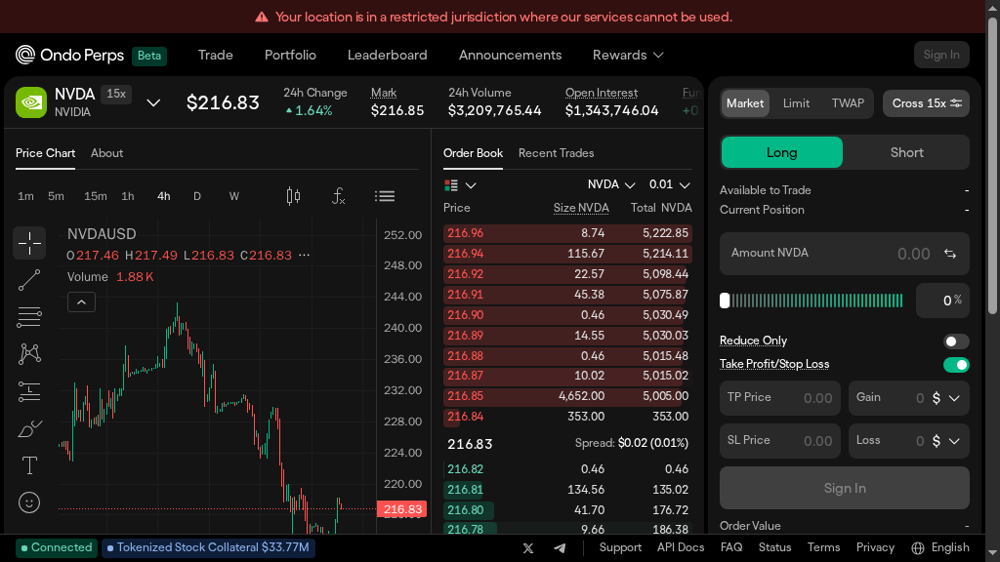
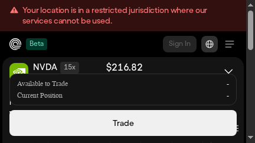
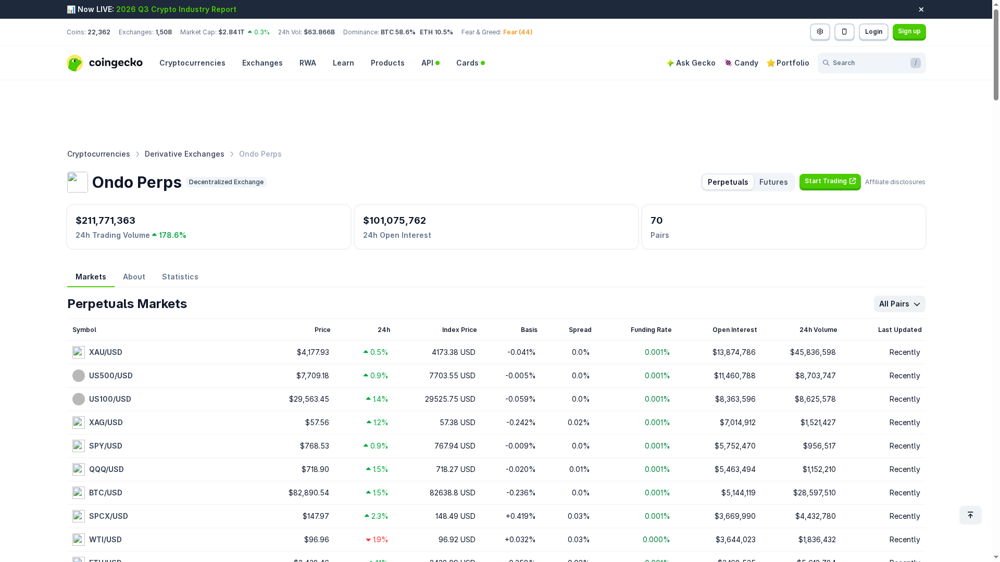
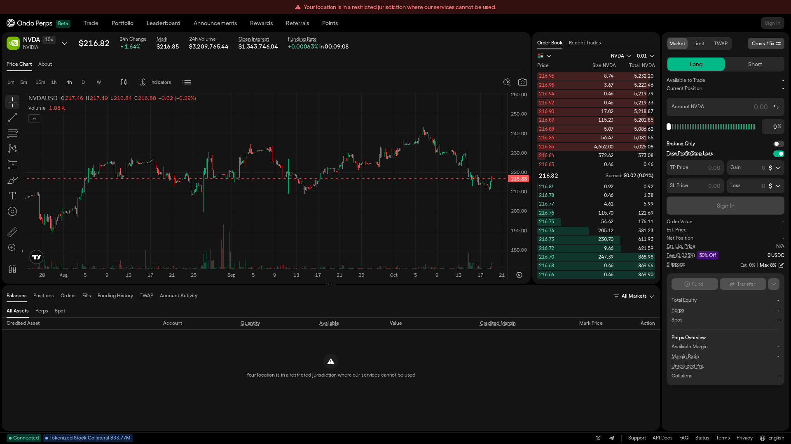
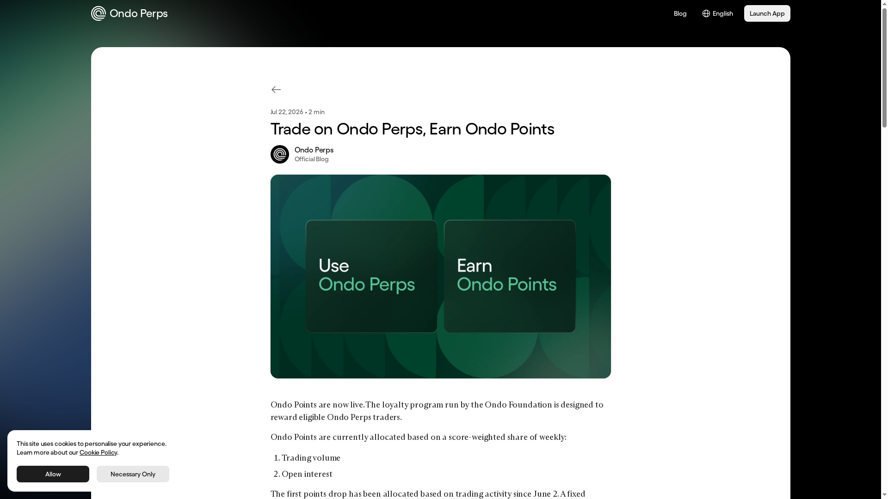
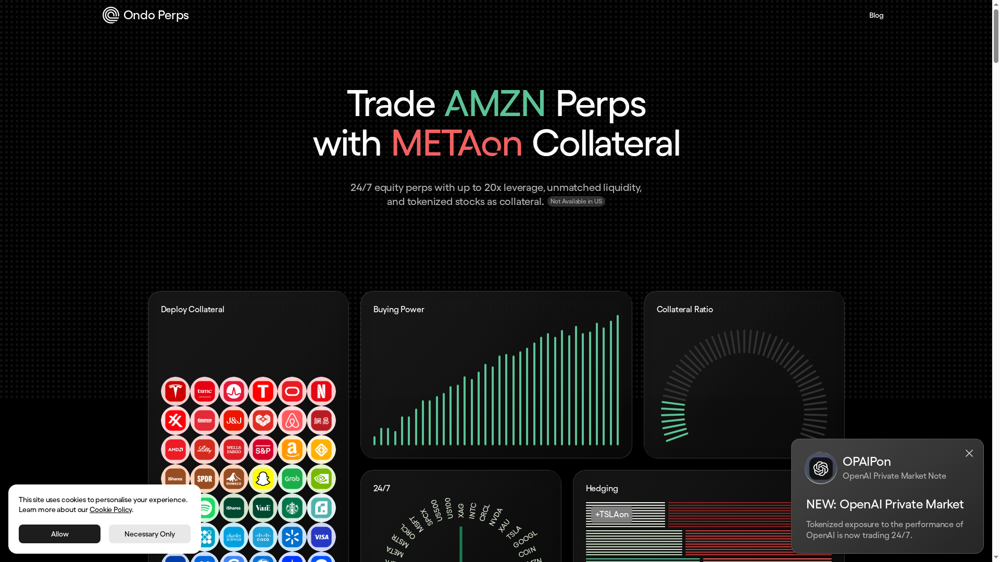

Hands-on review · 2026

# Ondo Perps Review 2026: Fees, Markets, Liquidity and How to Trade

Ondo Perps is a 24/7 perpetual-futures venue focused on tokenized U.S. equities, ETFs and commodities, with up to 20x leverage and a distinctive pitch: use tokenized stocks and ETFs as collateral instead of stablecoins alone.

 Reviewed from the live interface, official Ondo pages and independent market data · Last checked October 18, 2026 · Beginner-friendly guide

Ondo Perps is built for traders who want synthetic exposure to markets such as NVDA, TSLA, gold and broad equity indices outside traditional market hours. The platform combines a CEX-like order ticket with non-custodial, peer-to-peer perpetual contracts.

The live terminal rendered real NVDA market data, an order book, funding, margin controls and TP/SL fields. It also showed a jurisdiction restriction, so no wallet connection, deposit or order submission was completed during this review.

<strong>Quick take:</strong> Ondo Perps is compelling for eligible RWA traders who value 24/7 equity exposure and tokenized collateral. The main caveats are jurisdictional access, early-stage liquidity validation, variable funding and the risk of treating reward programmes as guaranteed returns.

## At a Glance

 <table>
 <thead><tr><th>Category</th><th>Answer</th><th>Source</th></tr></thead>
 <tbody>
 <tr><td>Best for</td><td>24/7 equity, ETF and commodity perps with RWA collateral</td><td><a href="https://ondoperps.xyz/us">Official product page</a></td></tr>
 <tr><td>Trading model</td><td>Peer-to-peer perpetual contracts with a live order-book interface</td><td><a href="https://ondoperps.xyz/legal/terms-of-use">Terms of Use</a></td></tr>
 <tr><td>Leverage</td><td>Up to 20x, with the live NVDA ticket showing Cross 15x</td><td><a href="https://ondoperps.xyz/us">Product page</a></td></tr>
 <tr><td>Collateral</td><td>Stablecoins plus selected tokenized stocks and ETFs</td><td><a href="https://ondoperps.xyz/blog/tokenized-stock-collateral">Collateral article</a></td></tr>
 <tr><td>Main strength</td><td>RWA exposure and hedging in a single 24/7 venue</td><td><a href="https://ondoperps.xyz/us">Official product page</a></td></tr>
 <tr><td>Main weakness</td><td>Restricted jurisdictions and a shorter execution track record</td><td><a href="https://ondoperps.xyz/legal/terms-of-use">Terms of Use</a></td></tr>
 <tr><td>Token / points status</td><td>Ondo Points and weekly USDC/referral programmes; no confirmed perps token airdrop</td><td><a href="https://ondoperps.xyz/blog/earn-ondo-points">Official Points post</a></td></tr>
 </tbody>
 </table>

## Table of Contents

<a href="#what-is">What is it?</a> · <a href="#how-it-works">How it works</a> · <a href="#live-ui">Live interface</a> · <a href="#markets">Markets and liquidity</a> · <a href="#fees">Fees and real cost</a> · <a href="#tutorial">Tutorial</a> · <a href="#rewards">Points</a> · <a href="#security">Security and risks</a> · <a href="#competitors">Competitors</a> · <a href="#conclusion">Conclusion</a> · <a href="#faqs">FAQs</a>

## What Is Ondo Perps?

Ondo Perps is a derivatives platform for perpetual futures on tokenized equities, ETFs and commodities. Its official product page positions the venue around 24/7 access, up to 20x leverage, tokenized stock collateral and portfolio-level margin.

The distinction matters. A trader can potentially keep exposure to an Ondo tokenized stock while using that asset as collateral for a perp position. That is different from a stablecoin-only venue, although the collateral still carries market, oracle, protocol and liquidation risk.

Ondo’s legal page says contracts are entered peer-to-peer and that Ondo Global Panama does not act as a broker, exchange, market maker or custodian. It also excludes the United States, Panama and other restricted jurisdictions, so eligibility is a first-order product feature.

## How the Protocol Works

### RWA perp architecture

The live interface presents an exchange-style order book with price, size, total and spread, while the product thesis is synthetic leverage on real-world markets. The app exposed NVDA, funding and open interest without requiring a traditional brokerage account.

The official site describes tokenized equities as collateral and portfolio margin that considers net risk across positions. That can improve capital efficiency, but it also makes collateral valuation and liquidation rules more important than in a simple one-asset trade.

### Margin and order controls

The live NVDA ticket showed Cross 15x, Long/Short, Market/Limit/TWAP, Reduce Only and Take Profit/Stop Loss controls. The visible fee was 0.025%, the maximum slippage field showed 8% and the estimated liquidation price was unavailable while the account was restricted.

### Wallet and network flow

Ondo’s public materials describe a non-custodial design, but the exact wallet and collateral flow should be verified in the eligible app before depositing. Never send assets until the app displays the supported network, asset, destination and final withdrawal conditions.

Read the <a href="https://ondoperps.xyz/legal/terms-of-use">Terms of Use</a>, <a href="https://ondoperps.xyz/blog/tokenized-stock-collateral">tokenized collateral explanation</a> and the current in-app deposit screen before funding an account.

## How Ondo Perps Looks on Your Device

The desktop terminal puts the chart on the left, order book in the centre and order ticket on the right. The lower panel exposes balances, positions, orders, fills, funding history, TWAP and account activity.

*Desktop: NVDA chart, market metrics, order book, spread, Cross 15x ticket and risk controls.*

*Tablet: the core chart and order workflow remain visible, but the ticket has less room for risk review.*

*Phone: useful for monitoring, but a larger screen is safer for leveraged order entry.*

The live capture showed the red warning “Your location is in a restricted jurisdiction where our services cannot be used.” Market data still rendered: NVDA mark $213.40, 24-hour volume $549,586.09, open interest $1,395,067.77 and funding at -0.00199% with a countdown.

The supplied HTTPS URL returned an SSL protocol error in the browser session, while the same app host rendered the live terminal over HTTP. That difference is documented here because users should not confuse a successful screenshot with completed account access.

## Markets, Liquidity and Execution

 <table>
 <thead><tr><th>Visible area</th><th>What it shows</th><th>Why it matters</th></tr></thead>
 <tbody>
 <tr><td>Market header</td><td>Price, mark, 24-hour change, volume, open interest and funding countdown.</td><td>Lets traders check activity and carry before entering.</td></tr>
 <tr><td>Chart</td><td>Timeframes, indicators, drawing tools and price history.</td><td>Useful for planning entries and stops on markets that trade around the clock.</td></tr>
 <tr><td>Order book</td><td>Bid/ask levels, size, totals and live spread.</td><td>Shows whether the intended order can cross the book without excessive impact.</td></tr>
 <tr><td>Order ticket</td><td>Market, Limit, TWAP, Cross 15x, Long/Short, Reduce Only and TP/SL.</td><td>Controls exposure and makes the trade assumptions visible before submission.</td></tr>
 </tbody>
 </table>

CoinGecko’s independent snapshot showed 68 listed pairs, 24-hour trading volume of $77.35M and 24-hour open interest of $99.64M at capture. The visible markets included XAU/USD, US500/USD and US100/USD, reinforcing that Ondo is targeting RWA-style markets rather than only crypto majors.

*Independent snapshot captured October 18, 2026: 68 pairs, $77.35M 24-hour volume and $99.64M open interest. <a href="https://www.coingecko.com/en/exchanges/ondo-perps">Source</a>.*

Volume is not the same as executable depth. Compare the visible spread and order-book levels for the exact pair, especially when trading less familiar stocks or commodities. Ondo’s product thesis is attractive, but its liquidity should be validated market by market rather than inferred from aggregate activity.

## Independent Market Data Snapshot

 <table>
 <thead><tr><th>Metric</th><th>October 18, 2026 snapshot</th><th>Interpretation</th></tr></thead>
 <tbody>
 <tr><td>Listed pairs</td><td>68</td><td>Broad RWA/perps surface; pair quality will not be uniform.</td></tr>
 <tr><td>24-hour volume</td><td>$77.35M</td><td>Aggregate notional activity; not a guarantee of deep execution.</td></tr>
 <tr><td>24-hour open interest</td><td>$99.64M</td><td>Capital committed to open positions at the snapshot.</td></tr>
 <tr><td>Live NVDA spread</td><td>$0.05 / 0.02%</td><td>Observed on the live screen, not a persistent average.</td></tr>
 <tr><td>Live NVDA funding</td><td>-0.00199%</td><td>Observed rate at capture; funding changes over time.</td></tr>
 </tbody>
 </table>

The data suggests a meaningful early market rather than an empty demo, but the gap between aggregate volume and pair-level depth remains the key execution question. Refresh the CoinGecko page before publication because these values are dynamic.

## Fees and Real Trading Cost

The live ticket displayed a 0.025% fee at capture. A launch report from KuCoin cited a 0.015% maker fee and 0.035% taker fee, so traders should verify the current in-app fee schedule and any referral discount before sizing a position.

 <table>
 <thead><tr><th>Cost component</th><th>Illustrative $10,000 notional</th><th>What is known</th></tr></thead>
 <tbody>
 <tr><td>Live displayed fee</td><td>$2.50 one-way / $5 round trip</td><td>Based on the 0.025% fee shown in the live ticket.</td></tr>
 <tr><td>Reported maker fee</td><td>$1.50 one-way / $3 round trip</td><td>0.015% figure cited in the launch coverage; confirm current terms.</td></tr>
 <tr><td>Reported taker fee</td><td>$3.50 one-way / $7 round trip</td><td>0.035% figure cited in the launch coverage; confirm current terms.</td></tr>
 <tr><td>Funding</td><td>Variable</td><td>Funding can be paid or received and should be checked before holding.</td></tr>
 <tr><td>Slippage</td><td>Variable</td><td>Depends on pair, book depth, order size and the ticket’s max-slippage setting.</td></tr>
 <tr><td>Bridge / withdrawal</td><td>Verify in the eligible app</td><td>No unsupported fixed amount is assumed in this review.</td></tr>
 </tbody>
 </table>

The main lesson is that low displayed fees do not make a leveraged trade cheap. Funding, price impact, collateral volatility and liquidation distance can dominate a small maker/taker difference. Calculate the full round trip before treating any reward programme as positive expected value.

See the <a href="https://www.kucoin.com/news/flash/ondo-perps-launches-trade-u-s-stocks-gold-and-oil-with-tokenized-assets-as-collateral">launch fee coverage</a> and verify the fee shown in the current app before trading.

## Common Mistakes and Risk Controls

 <table>
 <thead><tr><th>Mistake</th><th>Why it matters</th><th>Safer habit</th></tr></thead>
 <tbody>
 <tr><td>Using Cross by default</td><td>Portfolio collateral can expose more of the account to one position.</td><td>Use isolated or the smallest deliberate allocation while learning.</td></tr>
 <tr><td>Taking 15x–20x because it is available</td><td>Funding, spread and a small market move can compress liquidation distance quickly.</td><td>Choose leverage from stop distance and collateral volatility.</td></tr>
 <tr><td>Ignoring tokenized collateral risk</td><td>The collateral itself can move while the perp position moves against you.</td><td>Track collateral value and margin ratio, not only the underlying perp.</td></tr>
 <tr><td>Treating Reduce Only as a stop</td><td>Reduce Only controls direction; it does not create an exit trigger.</td><td>Pair it with TP/SL or a conditional order and verify the trigger.</td></tr>
 <tr><td>Ignoring the jurisdiction banner</td><td>Access restrictions are legal and operational constraints, not UI noise.</td><td>Do not bypass restrictions or deposit from an ineligible location.</td></tr>
 </tbody>
 </table>

## How to Trade on Ondo Perps: Step-by-Step

This walkthrough follows the live terminal. Market data and the order interface were visible, but the restriction warning prevented wallet access, funding and order submission. The collateral and rewards details below come from official Ondo materials.

### Check eligibility and open the app

*Step 1: the live app shows the jurisdiction warning before trading access.*

Open <a href="https://app.ondoperps.xyz/">app.ondoperps.xyz</a> only after checking the eligibility language in the <a href="https://ondoperps.xyz/legal/terms-of-use">Terms of Use</a>. The official site excludes the United States, Panama and other restricted jurisdictions.

### Select an RWA market and read the header

*Step 2: inspect price, mark, volume, open interest and funding before choosing size.*

The live NVDA header showed mark $213.40, 24-hour volume $549,586.09, open interest $1,395,067.77 and a negative funding rate. Use these fields to decide whether the pair is active enough for your intended order.

### Read the order book and choose the order type

*Step 3: compare visible levels and select Market, Limit or TWAP.*

The ticket supports Market, Limit and TWAP. Compare the spread, visible depth and max slippage before crossing the book. A market order is convenient, but it makes the actual fill dependent on available liquidity.

### Review balances, positions and funding history

*Step 4: use the lower account panel to monitor positions, fills, funding and activity.*

After entry, monitor Positions, Orders, Fills and Funding History. Do not rely on the chart alone: margin, funding and collateral changes determine whether the position remains safe.

### Set risk controls before submitting

*Step 5: verify margin mode, leverage, Reduce Only, TP/SL and the regional warning.*

Choose Cross only with an account-level plan, set conservative leverage and configure TP/SL deliberately. The live ticket showed a jurisdiction restriction, so no transaction was submitted in this review.

## Points, Rewards and Token Status

Ondo’s official blog says Ondo Points are allocated as a score-weighted share of weekly trading volume and open interest. The first drop was backdated to activity from June 2, and 5 million points are distributed each week while the programme runs.

*Official Ondo Points post captured live. <a href="https://ondoperps.xyz/blog/earn-ondo-points">Source</a>.*

The same official post describes weekly USDC rewards, fee discounts and referrals as separate programmes with their own dashboards and payout history. It also excludes U.S., Panama and other non-eligible users from Ondo Points participation.

 <table>
 <thead><tr><th>Programme</th><th>Confirmed rule</th><th>Caveat</th></tr></thead>
 <tbody>
 <tr><td>Ondo Points</td><td>5M weekly; weighted by trading volume and open interest; first activity backdated to June 2.</td><td>Mechanics may evolve; no per-dollar conversion is promised.</td></tr>
 <tr><td>USDC rewards</td><td>Weekly trading rewards with a dashboard and payout history.</td><td>Eligibility, pool size and distribution rules must be checked in-app.</td></tr>
 <tr><td>Referrals</td><td>Additional rewards and fee discounts may be available through referrals.</td><td>Referral claims are not a substitute for official terms.</td></tr>
 <tr><td>Perps token airdrop</td><td>Not confirmed by the official Points post.</td><td>Do not trade solely for an assumed token allocation.</td></tr>
 </tbody>
 </table>

### Points versus the cost of $1M volume

Ondo does not publish a fixed points-per-dollar formula in the official announcement. That means points earned from $1M of volume cannot be calculated honestly, and no break-even reward can be promised.

At the live displayed fee of 0.025%, $1M of one-way notional would imply about $250 before funding and slippage, or about $500 for a round trip if both sides paid the same rate. The reward value is unknown, so points should be treated as an uncertain incentive rather than a rebate.

## Security, Funding and Delivery Context

Ondo Perps is presented as part of the wider Ondo Finance ecosystem, with tokenized stocks and ETFs used as the core collateral narrative. The official product page says the platform uses non-custodial infrastructure, multi-layer authentication and regular third-party security audits.

*Official product positioning: 24/7 equity perps, up to 20x leverage and tokenized collateral. <a href="https://ondoperps.xyz/us">Source page</a>.*

A live Cantina bug-bounty programme provides a useful security signal because it defines in-scope production assets and financial-impact severity. It is not the same as a public audit report, so users should still verify smart-contract, oracle, frontend and withdrawal assumptions before depositing.

Ondo’s legal language also makes the counterparty model explicit: Ondo Global Panama says it is not the counterparty, custodian or broker for user contracts. Read the <a href="https://cantina.xyz/bounties/5ffa2a58-2121-4986-b318-43f8ba9a559e">Cantina programme</a> and <a href="https://ondoperps.xyz/legal/terms-of-use">Terms of Use</a>.

## Ondo Perps vs Competitors

Ondo should not be compared only with crypto-native perp DEXs. Its closest product question is whether traders want RWA exposure and tokenized collateral, while its closest execution benchmarks remain Hyperliquid, Jupiter and dYdX.

 <table>
 <thead><tr><th>Venue</th><th>Model / focus</th><th>Liquidity read</th><th>Best use case</th><th>Main trade-off</th></tr></thead>
 <tbody>
 <tr><td><strong>Ondo Perps</strong></td><td>RWA equity, ETF and commodity perps</td><td>Validate pair-level depth; independent snapshot shows $77.35M 24h volume and $99.64M OI</td><td>24/7 synthetic stock exposure and RWA collateral</td><td>Restricted access and shorter live track record</td></tr>
 <tr><td><a href="https://www.coingecko.com/en/exchanges/hyperliquid">Hyperliquid</a></td><td>Large crypto perp and spot order-book venue</td><td>Deepest benchmark for major crypto pairs</td><td>Large-size crypto perp execution</td><td>Different chain and less direct RWA collateral thesis</td></tr>
 <tr><td><a href="https://www.coingecko.com/en/exchanges/jupiter-perpetual-exchange">Jupiter Perps</a></td><td>Solana-native perp liquidity stack</td><td>Strong Solana ecosystem access; compare exact pair depth</td><td>Users already holding Solana assets</td><td>Different liquidity and collateral model</td></tr>
 <tr><td><a href="https://www.coingecko.com/en/exchanges/dydx-chain">dYdX</a></td><td>Mature crypto derivatives venue</td><td>Established derivatives benchmark, but market mix differs</td><td>Crypto-native perpetual trading</td><td>No Ondo-style tokenized-equity collateral thesis</td></tr>
 <tr><td><a href="https://www.coingecko.com/en/exchanges/gmx-perpetuals-v2-arbitrum">GMX</a></td><td>Pool/oracle-based perpetuals</td><td>Pool depth is not directly comparable to an order book</td><td>Oracle-priced crypto exposure and DeFi composability</td><td>Different execution and LP risk model</td></tr>
 </tbody>
 </table>

Ondo’s differentiation is product exposure, not proven depth leadership. Hyperliquid remains the more obvious benchmark for large crypto notional, while Ondo is more interesting when the trade itself requires equities, ETFs, commodities or tokenized collateral.

<strong>Data note:</strong> CoinGecko’s exchange pages and rankings update continuously. Refresh the linked pages before publication and do not compare aggregate volume without checking the exact market and liquidity model.

## Who Should Use It?

<strong>Good fit:</strong> eligible traders who want 24/7 equity or commodity exposure, understand perpetual funding and can validate collateral and withdrawal rules before trading.

<strong>Skip it if:</strong> you are in a restricted jurisdiction, need deep large-size crypto execution, cannot tolerate variable funding or are trading only because points might convert into a future token.

## Conclusion

Ondo Perps is one of the more differentiated new perp venues because it brings tokenized equities, ETFs and commodities into a 24/7 leveraged interface. The live screen shows a serious trading workflow with order-book data, funding, margin, TWAP and TP/SL controls.

The trade-off is that the most important questions are still market-specific: how much depth survives at size, how collateral is valued during stress and how funding behaves across a full holding period. The jurisdiction warning also makes eligibility part of the product experience.

For eligible RWA traders, Ondo Perps is worth testing with small size and conservative leverage. It is not yet a reason to abandon deeper crypto venues, and its points programme should be treated as an uncertain bonus rather than a justification for expensive volume.

## FAQs

### What is Ondo Perps?

Ondo Perps is a perpetual-futures platform focused on tokenized stocks, ETFs and commodities with 24/7 trading and leverage.

### What are Ondo Perps’ fees?

The live ticket displayed a 0.025% fee at capture. Current maker/taker terms should be verified in the eligible app before trading.

### Does Ondo Perps have an airdrop?

Ondo Points and weekly USDC/referral programmes are active, but the official Points post does not confirm a dedicated perps token airdrop.

### Can users in the United States trade Ondo Perps?

No. The official product and legal pages state that the platform is not available to U.S. persons or users in other restricted jurisdictions.

 <strong>Quick links:</strong> <a href="https://app.ondoperps.xyz/">App</a> · <a href="https://ondoperps.xyz/us">Homepage</a> · <a href="https://ondoperps.xyz/blog/earn-ondo-points">Points</a> · <a href="https://www.coingecko.com/en/exchanges/ondo-perps">Market data</a> · <a href="https://ondoperps.xyz/legal/terms-of-use">Terms</a> This review is educational, not financial advice. Perpetuals and leverage can result in rapid losses.
