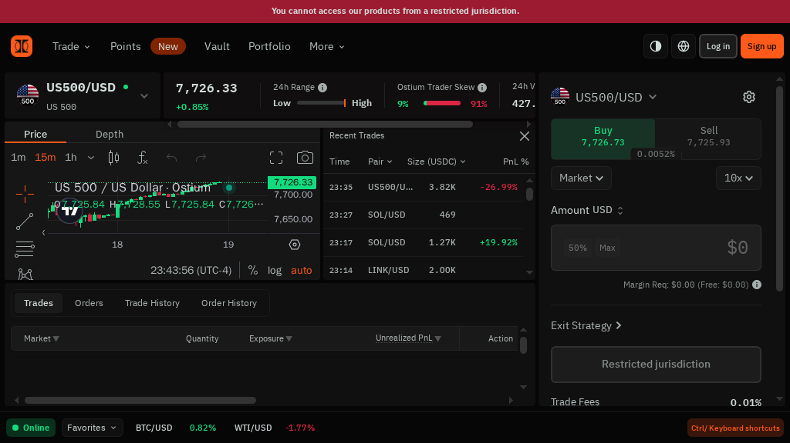
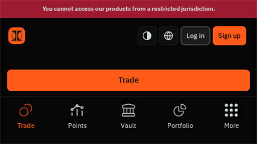
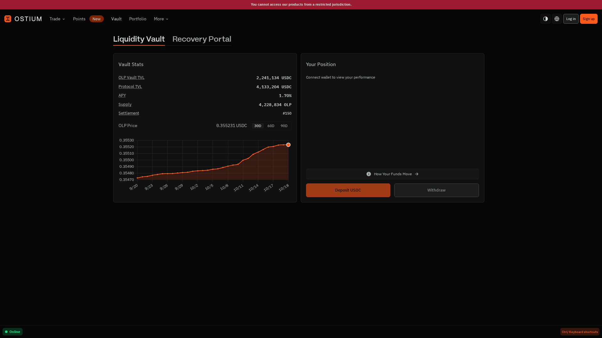
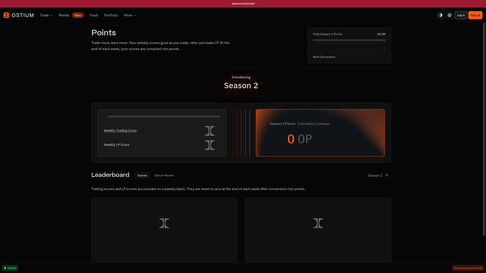
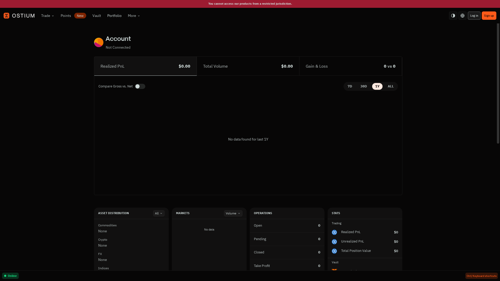
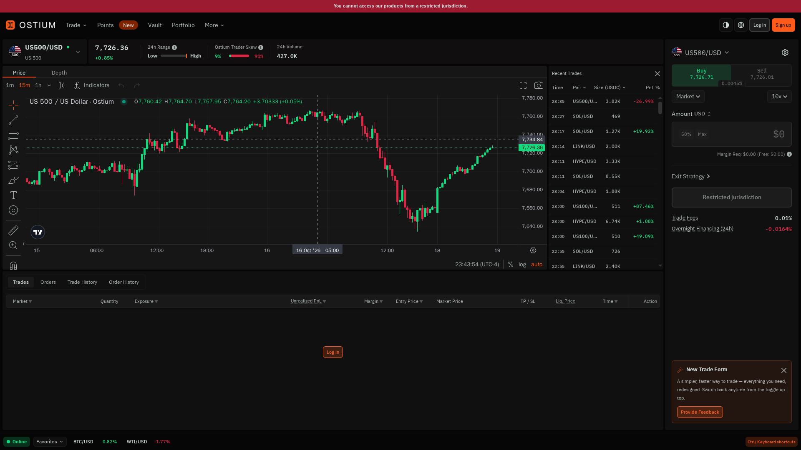

DEX Reviews · Hands-on review

# Ostium Review 2026: Complete Beginner's Guide — Trade Global Markets Onchain

 Published: 18 October 2026Author: Editorial TeamLast verified: 18 October 2026

A practical guide to Ostium's perpetual trading platform for stocks, ETFs, commodities, indices, forex and crypto. We tested the public trading interface live, recorded the actual UI at three screen sizes, and verified the fee and market details against Ostium's documentation.

 **Who this guide is for:** Traders who want leveraged exposure to traditional and crypto markets through a self-custodial wallet, and beginners who want to understand what Ostium shows before they connect funds.
 **In this guide:** [device experience](#device) · [features](#features) · [markets](#markets) · [fees](#fees) · [tutorial](#tutorial) · [security](#security) · [conclusion](#conclusion)

## What Is Ostium?

Imagine you want price exposure to gold, the S&amp;P 500, Tesla or BTC, but you do not want to open a traditional brokerage account. Ostium lets you trade a perpetual instrument representing the price movement of that asset.

You deposit USDC, choose a long or short direction, select leverage, and settle the position through an Arbitrum-based onchain system.

Ostium is not a spot exchange. You do not receive the underlying stock, barrel of oil or index constituent. You trade a leveraged price position, so profit and loss, financing and liquidation rules matter more than they do in a simple spot swap.

 **In plain terms:** Ostium is a self-custodial onchain venue for leveraged exposure to global markets, accessed through a crypto wallet and settled in USDC.

Ostium's official documentation lists **75 perpetual instruments** across six asset classes: Stocks, ETFs, Commodities, Indices, Forex and Crypto. Leverage ranges from 5× to 200× depending on the pair. See the [official trader overview](https://docs.ostium.com/traders/welcome) and the complete [Markets reference](https://docs.ostium.com/traders/reference/markets).

## How Ostium Looks on Your Device

The interface follows a three-column trading layout rather than a simplified swap form. The left side is the chart and market-analysis area, the middle column lists recent trades, and the right rail is the execution panel.

That arrangement is appropriate for active trading because the trader can see price, liquidity context and order parameters without leaving the page.

Ostium on desktop — 1440 × 810. The live capture shows the restricted-jurisdiction banner, US500/USD chart, recent trades, order form, 10× leverage, margin requirement and fee fields.

At the top, the market header shows US500/USD, its status, current price, 24-hour range, trader-skew indicator and volume. The chart toolbar exposes 1m, 15m and 1h intervals, Price/Depth tabs, indicators and drawing controls.

The recent-trades panel lists timestamp, pair, size in USDC and PnL percentage. On the right, Buy/Sell, Market, leverage, Amount USD, 50%/Max shortcuts, Margin Required, Exit Strategy, Restricted jurisdiction, Trade Fees and Overnight Financing are visible in one vertical sequence.

**Best for:** First-time users and active traders who want the chart, market data and trade controls visible at once. The tradeoff is density: there is a lot to read before the first click.

### On a Tablet — 1024 × 576

On tablet, the interface remains usable but becomes horizontally constrained. The chart, recent-trades panel and order form compete for space, so the desktop layout is easier to scan.

The tablet view keeps the same information architecture, but the chart loses horizontal room and the order rail becomes narrower. The top market summary also compresses, and a horizontal scrollbar appears in the lower trading area.

This is acceptable for monitoring, but it is not the ideal viewport for comparing several fields before signing.

**Best for:** Occasional monitoring when a desktop is unavailable. Expect more scrolling and tighter panels.

### On a Phone — 430 × 242

The phone capture is deliberately kept at 16:9 to match the requested screenshot ratio. At this width, the app collapses into a compact navigation view with Trade, Points, Vault, Portfolio and More.

The phone layout is the clearest weakness. The navigation survives, but the chart and execution details are not presented as a comfortable mobile trading flow in this capture. A user would need to move to a larger screen before reviewing leverage, financing and liquidation information with confidence.

**Best for:** Quick status checks, not a first leveraged trade or a rushed wallet confirmation.

 **Access limitation observed:** The live page displayed “You cannot access our products from a restricted jurisdiction.” No wallet was connected, no funds were deposited and no order was submitted.

## Core Features

### 1. Exposure to traditional and crypto markets

Ostium's main differentiator is breadth. The same product covers US equities, indices, commodities, forex and crypto. That makes it more interesting for macro traders than a crypto-only perpetual venue.

### 2. Long and short positions

The live order form showed Buy and Sell controls, Market as the selected order type and 10× leverage. The pair-specific maximum can be much higher, but maximum leverage is not the same thing as sensible leverage.

### 3. Onchain USDC settlement

Ostium describes a two-layer system: onchain settlement through smart contracts and offchain hedging through institutional liquidity partners. Its documentation states that collateral remains in segregated contracts and that the interface is a frontend for the underlying protocol. Read [How Ostium Works ↗](https://docs.ostium.com/protocol/how-ostium-works).

### 4. Exit strategy controls

The live form exposed an Exit Strategy control. Ostium documents take-profit, stop-loss and liquidation automation, which are essential controls when leverage is involved.

### 5. Research and developer links

The More menu exposed Research, Builder SDK setup, Docs, Stats and Ostiscan, along with Discord, Telegram and X. This is a useful sign for advanced users who want to inspect data or build on top of the protocol.

## Ostium Ecosystem: Vault, OLP and Points

Ostium is more than the trading screen. The protocol has a Vault settlement layer, an OLP liquidity token and a Points program. These pieces matter because they explain where trader collateral sits, how liquidity providers participate and what the platform rewards.

### Vault and OLP

Liquidity providers deposit USDC into the Ostium Vault and receive OLP tokens. The official Vault documentation describes OLP as the senior-loss tranche, while a junior buffer from affiliates and strategic partners absorbs trader PnL first.

OLP deposits are not insured, and an extreme event that depletes the buffer can still affect OLP holders.

The Vault is also the instant-settlement layer: when a trader closes profitably, the Vault pays USDC onchain while the matching hedge is settled offchain. Intraday USDC movement is therefore not automatically the same thing as Vault PnL. OLP price updates at daily settlement, which is the number liquidity providers should track.

The live Vault screen exposes OLP Vault TVL, Protocol TVL, APY, supply, settlement number and the OLP price chart in one view. At capture time it showed 2,241,921 USDC OLP Vault TVL, 4,155,655 USDC Protocol TVL, 1.63% APY and an OLP price of 0.355209 USDC; these values are time-sensitive, not promises.

Read the [official Vault overview ↗](https://docs.ostium.com/vault/overview) before treating OLP as passive yield. The screen also includes a Recovery Portal and separate Deposit USDC/Withdraw controls, so liquidity provision should be evaluated as a risk-bearing position rather than as a savings account.

### Points

Points are an engagement system rather than a live token. The live Points page describes weekly Trading Score and LP Score, with points compiled after each week; it also shows a Season 2 total and a weekly conversion date.

Trading, referrals and liquidity provision can affect participation scores, but points should not be treated as ownership, guaranteed rewards or a substitute for trading performance.

The live Points page separates weekly Trading Score, Weekly LP Score and Season 2 Points, and includes a leaderboard. In this restricted, unconnected state both weekly scores were 0 while the page displayed 25.0M total Season 2 points and a weekly conversion date.

That distinction matters: a points dashboard can show program mechanics without proving that points have monetary value. Check the current program terms and eligibility before changing trading or LP behavior for points alone.

## Funding, Managing and Closing a Position

The complete user journey has four parts: obtain eligible USDC, fund the trading account, manage an open position and close it. A good review should explain all four because the risk does not stop at the first order.

### Funding

Ostium uses USDC on Arbitrum as trading collateral. Before opening, confirm the network and token contract, then verify that the deposited balance is visible in the app. Do not send unsupported assets directly to a contract address.

### Managing an open trade

From the Positions panel, traders can set or adjust Take-Profit and Stop-Loss levels, add collateral, remove collateral where permitted and monitor PnL, rollover and liquidation distance. Adding collateral reduces effective leverage; removing it can move liquidation closer.

### Closing

A position can be fully closed, partially closed, closed automatically by TP/SL or closed by liquidation. A successful full close refunds the opening oracle fee; a partial close carries its own oracle fee. After closing, the resulting USDC and PnL should be checked in the wallet and Portfolio history.

Portfolio is the post-trade verification screen: it exposes Realized PnL, Total Volume, Gross-vs-Net comparison and time ranges, with tabs for Positions, Trades, Orders and history. The restricted capture showed an unconnected account and no data, but it makes clear where a completed trade should be audited.

See the official guides for [funding ↗](https://docs.ostium.com/traders/getting-started/fund-account), [managing positions ↗](https://docs.ostium.com/traders/trading/managing-positions) and [closing trades ↗](https://docs.ostium.com/traders/trading/closing-a-trade).

## Supported Markets

Ostium's market list is broader than a typical crypto perpetual venue. The important detail is that every asset class has its own leverage cap, fee and trading schedule.

 <table><thead><tr><th>Asset class</th><th>Pairs</th><th>Typical maximum leverage</th><th>Opening fee</th><th>Trading schedule</th></tr></thead><tbody>
 <tr><td>Stocks</td><td>35</td><td>Up to 100×</td><td>6 bps</td><td>Mon–Fri, 9:30 AM–4:00 PM ET</td></tr>
 <tr><td>ETFs</td><td>8</td><td>Up to 75×</td><td>5 bps</td><td>Follows underlying exchange</td></tr>
 <tr><td>Commodities</td><td>7</td><td>Up to 50×</td><td>3–5 bps</td><td>Generally futures hours with daily break</td></tr>
 <tr><td>Indices</td><td>7</td><td>Up to 200×</td><td>3 bps</td><td>Extended futures-style hours</td></tr>
 <tr><td>Forex</td><td>9</td><td>Up to 200×</td><td>3–5 bps</td><td>Sun–Fri, 24/5</td></tr>
 <tr><td>Crypto</td><td>9</td><td>Up to 200×</td><td>10 bps</td><td>24/7</td></tr>
 </tbody></table>

Representative pairs include **US500/USD**, **EUR/USD**, **XAU/USD**, **AAPL/USD**, **BTC/USD** and **ETH/USD**. The complete list, pair-specific leverage and fees are maintained in the [official Markets reference ↗](https://docs.ostium.com/traders/reference/markets).

 **Market-hours trap:** Crypto is 24/7, but stocks are not. When a traditional market is closed, market orders can be rejected while limit and stop orders may queue for the next session.

## How Order Types Work

Ostium supports seven order types: three for opening a position and four for closing one. This matters because the trigger price and the actual execution price are not always the same.

 <table><thead><tr><th>Order type</th><th>Purpose</th><th>Trigger / execution</th><th>Cost note</th></tr></thead><tbody>
 <tr><td>Market</td><td>Open immediately</td><td>Executes at bid/ask</td><td>$0.10 oracle fee at open</td></tr>
 <tr><td>Limit</td><td>Open at a target price</td><td>Bid/ask reaches the limit</td><td>$0.10 to place; $0.10 to cancel</td></tr>
 <tr><td>Stop</td><td>Open after a breakout</td><td>Mid-price triggers, then market execution</td><td>$0.10 to place; $0.10 to cancel</td></tr>
 <tr><td>Close Market</td><td>Exit immediately</td><td>Executes at bid/ask</td><td>Full successful close can refund oracle fee</td></tr>
 <tr><td>Take-Profit</td><td>Lock in a target profit</td><td>Bid/ask reaches TP</td><td>No oracle fee on automated execution</td></tr>
 <tr><td>Stop-Loss</td><td>Limit downside</td><td>Mid-price triggers, then market execution</td><td>Free to set and adjust</td></tr>
 <tr><td>Liquidation</td><td>Forced close</td><td>Mid-price crosses liquidation price</td><td>Remaining collateral is retained</td></tr>
 </tbody></table>

Remember the three prices: **bid** is where you can sell, **ask** is where you can buy, and **mid** is the reference price used for some triggers. You never execute at mid-price. See the [official Order Types guide ↗](https://docs.ostium.com/traders/trading/order-types).

## Fee Schedule

Ostium's cost structure is more nuanced than a single headline trading fee. The official [Fees page ↗](https://docs.ostium.com/traders/reference/fees) lists the following:

 <table><thead><tr><th>Fee</th><th>When it applies</th><th>Rate / rule</th></tr></thead><tbody><tr><td>Opening fee</td><td>When a position opens</td><td>3–10 bps, depending on asset</td></tr><tr><td>Oracle fee</td><td>Each price request</td><td>$0.10 USDC; successful full closes may refund it</td></tr><tr><td>Rollover fee</td><td>While a position is held</td><td>Variable; tied to carry, term structure and/or funding data</td></tr><tr><td>Early-close fee</td><td>Profitable close within 15 seconds</td><td>Decays from 40 bps and is capped by realized profit</td></tr><tr><td>Liquidation</td><td>When margin is wiped out</td><td>Remaining collateral may be retained</td></tr></tbody></table>

In the live US500/USD interface, we saw **Trade Fees: 0.01%** and **Overnight Financing (24h): −0.0164%**. These are observed values for that market and moment, not a universal platform-wide rate.

### Worked example: a 10,000 USDC position

Suppose you deposit **1,000 USDC** and use 10× leverage. Your notional position is 10,000 USDC. At a 3 bps opening fee, entry costs approximately **3 USDC**. Add the **0.10 USDC oracle fee**, and your effective collateral starts near 996.90 USDC before rollover.

If the position is held overnight, the live financing number and the pair's documented rollover formula determine the next cost. This is why “low trading fee” is not enough: entry fee, oracle fee, spread and holding cost all affect the break-even point.

Ostium's documentation also gives an early-close example: a profitable position closed 10 seconds after opening has a 13.33 bps early-close rate, capped by the realized profit. Read the full [fee worked example ↗](https://docs.ostium.com/traders/reference/fees#worked-example).

## Step-by-Step Tutorial

### Step 1 — Open Ostium

Go to [app.ostium.com/trade ↗](https://app.ostium.com/trade). Before connecting a wallet, check that the product is available in your jurisdiction.

The first screen shows the market chart and trade form before a wallet is connected.

### Step 2 — Select a market

Choose a pair such as US500/USD. Check leverage cap, opening fee, trading hours and rollover basis in the [Markets reference ↗](https://docs.ostium.com/traders/reference/markets). Do not assume every pair trades on the same schedule.

The market and chart area remain visible on tablet, but the order panel becomes tighter.

### Step 3 — Choose direction, order type and leverage

Choose Buy or Sell, review Market, Limit or Stop order behavior, and set leverage conservatively. The live interface visibly showed Buy, Sell, Market and 10× controls. A Stop order triggers on mid-price but executes at bid/ask; a Limit order waits for the actual execution price to reach its level.

Step 3 focuses on the decision controls: Buy/Sell direction, Market order type and 10× leverage are visible before an amount is entered.

### Step 4 — Review the order panel

Check Amount USD, Margin Required, fee reserve, Exit Strategy, Trade Fees and Overnight Financing. A profitable direction can still lose money if financing, spread and liquidation distance are ignored.

Step 4 isolates the order details that should be checked before signing: Amount USD, Margin Required and Exit Strategy.

### Step 5 — Connect and sign

Only after reviewing the wallet prompt should you connect and sign. Confirm the chain, spender, amount and transaction fee in the wallet. In this review, the action button was replaced by “Restricted jurisdiction”, so the correct next step was to stop rather than attempt to bypass the restriction.

Step 5 ends at the real pre-connection state: Restricted jurisdiction blocks the action, while Trade Fees and Overnight Financing remain visible for review.

## Security: What You Need to Know

Self-custody reduces dependence on a centralized account, but it does not eliminate risk. You still rely on smart contracts, oracle pricing, automated execution, liquidity providers and the offchain hedging layer.

 <ul><li>**Leverage risk:** small price moves can materially change collateral.</li><li>**Rollover risk:** holding costs accrue continuously and vary by market.</li><li>**Oracle risk:** the protocol uses an in-house consensus oracle for price discovery.</li><li>**Market-hours risk:** stocks and other traditional assets are not always 24/7.</li><li>**Eligibility risk:** restricted jurisdictions may be unable to access the product.</li></ul>

Read the [Terms of Use ↗](https://docs.ostium.com/legal/terms-of-use) before depositing. This review does not independently audit Ostium's contracts or legal status.

### Audit and transparency signals

Ostium publishes mainnet contract addresses and links to smart-contract reviews by **Zellic**, **ThreeSigma** and **Pashov**. It also documents economic-risk research with **Chaos Labs**, including work around imbalance monitoring and parameter risk.

These are useful transparency signals, not a guarantee that funds are safe. Audits are point-in-time reviews, while contracts, parameters, oracles, keeper infrastructure and market conditions can change. Verify the current reports through the [Smart Contract Audits page ↗](https://docs.ostium.com/security/smart-contract-audits) and [Economic Audit page ↗](https://docs.ostium.com/security/economic-audit).

### Security incident disclosure

Public reporting in July 2026 described an oracle/keeper exploit affecting the Ostium liquidity vault. [CoinDesk reported approximately $18 million in USDC drained](https://www.coindesk.com/business/2026/07/15/ostium-suffers-usd18-million-exploit-as-oracle-attack-wave-continues-to-hit-defi), while [Galaxy estimated $23.75 million](https://www.galaxy.com/insights/research/ostium-left-an-opening-for-exploiters-and-24m-went-out-the-door).

Reporting described manipulated, future-dated oracle messages and a registered PriceUpKeep/forwarder path being used to manufacture profitable trades and trigger payouts.

[Halborn’s technical summary](https://www.halborn.com/blog/post/explained-the-ostium-hack-july-2026) described compromised signing infrastructure and fake price reports, after which trading was halted.

This does not by itself prove that the current deployment is unsafe, but it materially changes the risk assessment. Smart-contract audits do not automatically cover oracle keys, keeper permissions, offchain hedging or every operational boundary.

A serious review must disclose the incident and verify the platform’s current remediation and reopening status before depositing funds.

## For Builders: SDK and API Access

Ostium also offers a TypeScript Builder SDK for applications that need market data, previews and trading actions programmatically. The current SDK documentation describes read-only clients, live price and position streams and order previews.

It also covers liquidation-price calculations, transaction builders and write methods for opening, modifying, closing and cancelling orders.

That gives Ostium a second audience beyond discretionary traders: developers can build their own order ticket, dashboard, bot or risk monitor instead of depending entirely on the hosted frontend. Start with the [official SDK overview ↗](https://docs.ostium.com/developer/sdk/overview) and use read-only previews before submitting transactions.

## Liquidation: The Risk You Must Understand

Ostium uses a margin-based liquidation system with no margin call. The official explanation describes a 25% collateral backstop. At the pair's maximum leverage, liquidation begins after a 75% collateral loss; at lower leverage, the position can tolerate a larger adverse price move.

 <table><thead><tr><th>Leverage</th><th>Approx. collateral loss threshold</th><th>Approx. adverse price move</th></tr></thead><tbody><tr><td>5×</td><td>99.375%</td><td>~19.9%</td></tr><tr><td>10×</td><td>98.75%</td><td>~9.9%</td></tr><tr><td>20×</td><td>97.5%</td><td>~4.9%</td></tr><tr><td>50×</td><td>93.75%</td><td>~1.9%</td></tr><tr><td>100×</td><td>87.5%</td><td>~0.9%</td></tr><tr><td>200×</td><td>75%</td><td>~0.4%</td></tr></tbody></table>

These are approximations. Rollover fees reduce effective collateral over time, so the actual liquidation price can move closer to entry. Use a stop-loss, lower leverage and additional collateral when appropriate. See the [official liquidation guide ↗](https://docs.ostium.com/traders/trading/liquidation).

## Ostium vs Competitors

This review compares Ostium with three named alternatives: **Hyperliquid** for crypto-native perpetuals, **GMX** for onchain crypto trading, and a **traditional broker** for regulated account-based access to underlying markets.

 <table><thead><tr><th></th><th>Ostium</th><th>Hyperliquid</th><th>GMX</th><th>Traditional broker</th></tr></thead><tbody><tr><td>Exposure</td><td>Stocks, ETFs, commodities, indices, forex and crypto perps</td><td>Primarily crypto perps and spot</td><td>Primarily crypto perps and spot</td><td>Underlying securities or broker products</td></tr><tr><td>Custody</td><td>Wallet and smart contracts</td><td>Wallet and smart contracts</td><td>Wallet and smart contracts</td><td>Broker account</td></tr><tr><td>Settlement</td><td>USDC on Arbitrum</td><td>Hyperliquid network</td><td>Arbitrum / Avalanche deployments</td><td>Broker ledger and fiat rails</td></tr><tr><td>Hours</td><td>Depends on asset class</td><td>Crypto markets generally 24/7</td><td>Crypto markets generally 24/7</td><td>Usually follows exchange hours</td></tr><tr><td>Best advantage</td><td>Broader macro exposure in one onchain venue</td><td>Deep crypto-native trading workflow</td><td>Onchain crypto liquidity and composability</td><td>Familiar account, support and compliance workflow</td></tr></tbody></table>

## Conclusion

Ostium remains compelling for experienced DeFi traders who want onchain exposure to stocks, commodities, indices, forex and crypto in one interface. The broad market menu, self-custody model and detailed pre-trade panel are its clearest strengths.

It is not a beginner-safe shortcut: leverage, rollover, oracle execution, liquidation and market hours all matter. The live Vault/Points/Portfolio screens add useful transparency, but the phone experience is weak and regional restrictions can block access.

Most importantly, the reported 2026 oracle/vault exploit means audits and published metrics should not be read as a safety guarantee. Consider Ostium only after checking current remediation status, using modest leverage and planning an exit before signing.

## FAQ — Straight Answers for New Traders

### Can I trade stocks 24/7?

**No.** Stocks generally follow Monday–Friday, 9:30 AM–4:00 PM ET. Crypto is 24/7 and forex is 24/5. Always check the pair's schedule before using a market order.

### Is Ostium a spot exchange?

**No.** It offers perpetual price exposure. You do not receive the underlying stock, ETF, commodity or currency.

### What is the difference between a Stop and a Stop-Loss?

**A Stop opens a new position; a Stop-Loss closes an existing one.** Both can use mid-price as the trigger, but execution happens at bid/ask.

### Can I get collateral back after liquidation?

**No, according to the liquidation documentation.** Remaining collateral is retained as part of settlement. The safest defense is lower leverage, a planned stop-loss and enough margin buffer.

## Quick Links

[Trade app](https://app.ostium.com/trade)[Trader docs](https://docs.ostium.com/traders/welcome)[Markets](https://docs.ostium.com/traders/reference/markets)[Fees](https://docs.ostium.com/traders/reference/fees)[Architecture](https://docs.ostium.com/protocol/how-ostium-works)[Order types](https://docs.ostium.com/traders/trading/order-types)[Liquidation](https://docs.ostium.com/traders/trading/liquidation)

## Quick links

Last verified: 18 October 2026. Screenshots taken live from Ostium. No wallet connection, deposit, order or transaction was performed.
