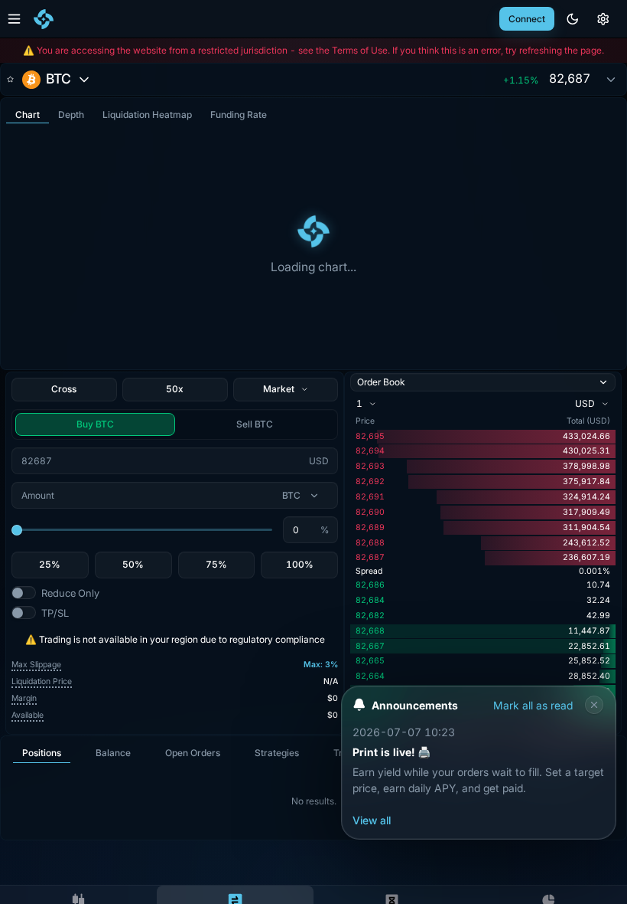
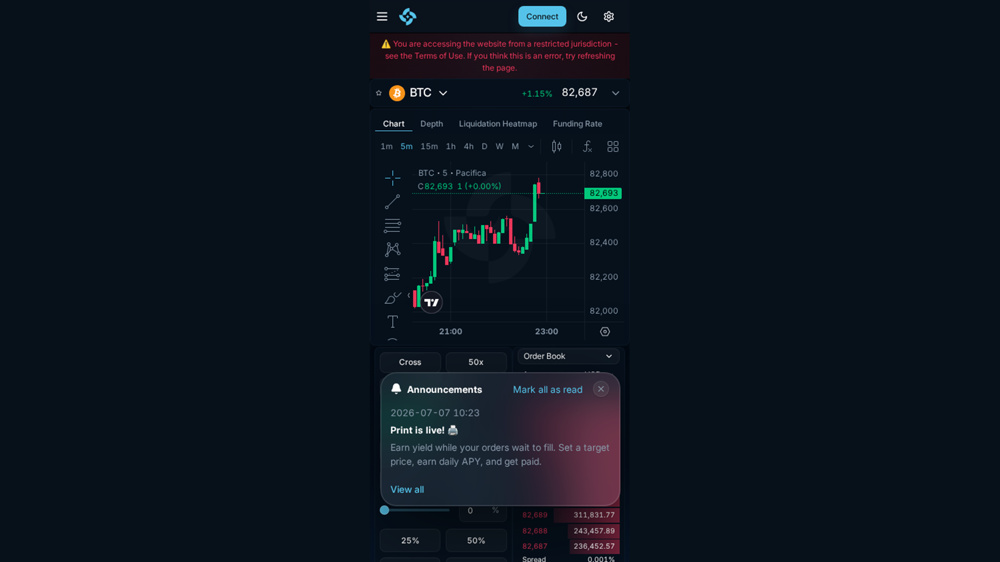
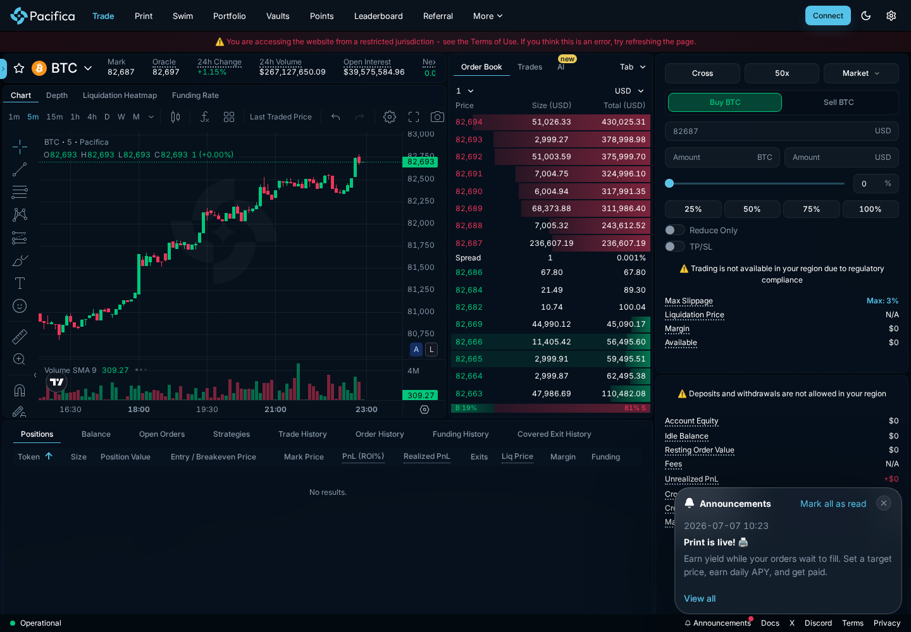
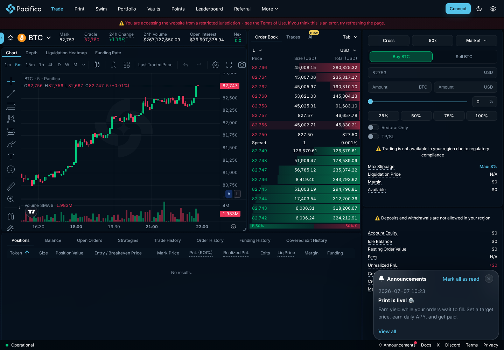
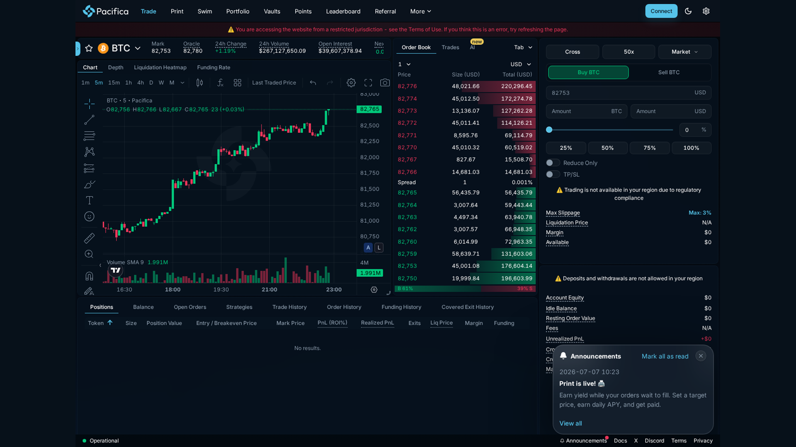
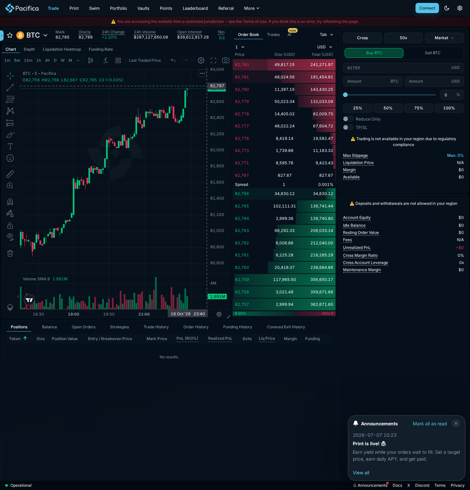
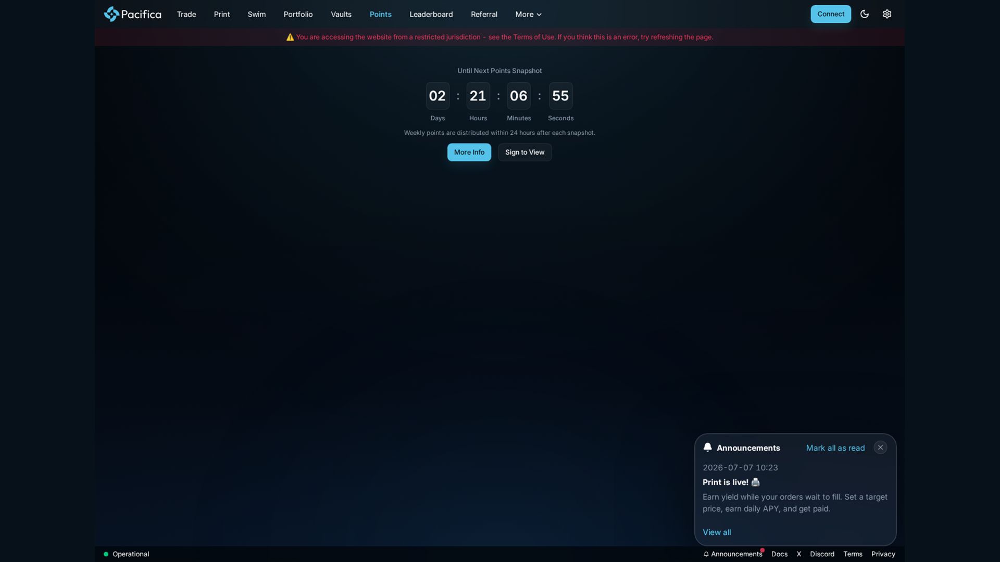
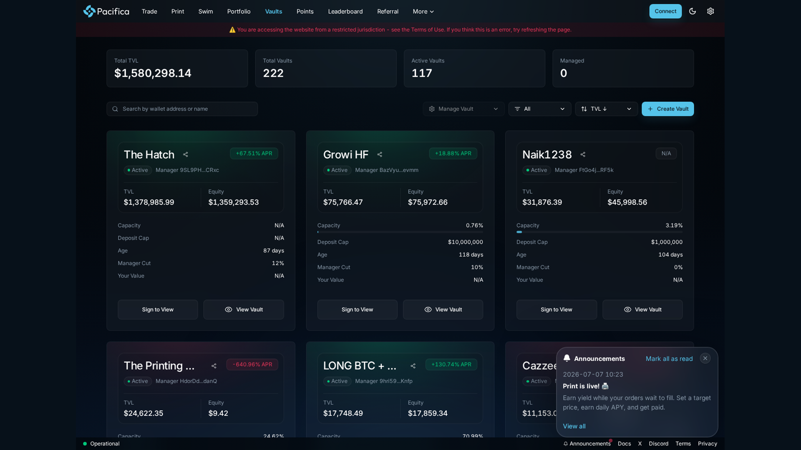
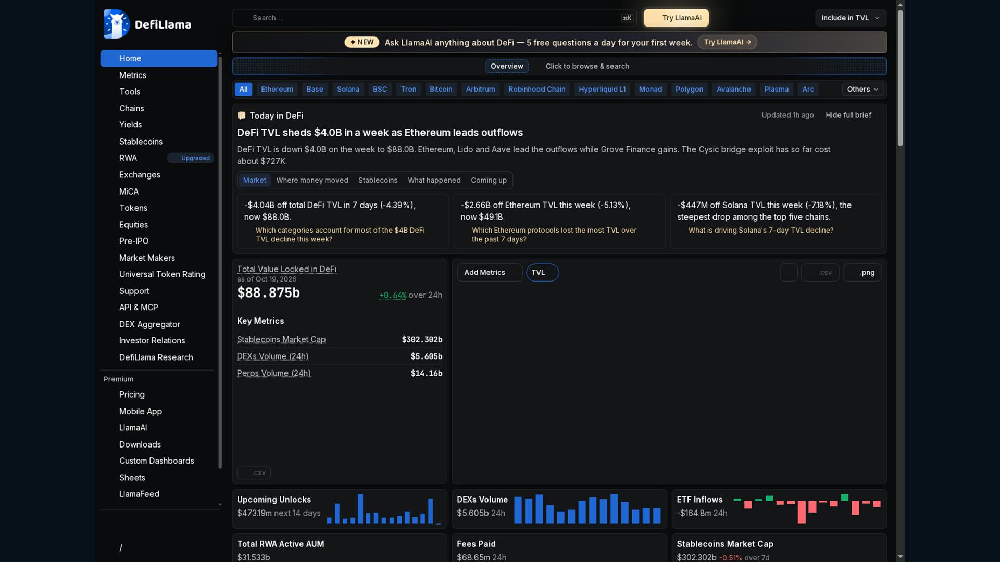

> Hands-on review · 2026

# Pacifica Review 2026: Complete Beginner's Guide to the Solana Perps DEX

Pacifica is a hybrid perpetuals and spot trading platform built around Solana, combining a fast trading interface with self-custody, cross and isolated margin, points and a growing set of automated strategies.

  Reviewed from the live Pacifica interface and official documentation · Last checked October 18, 2026 · Beginner-friendly guide

Pacifica is not just a simple perp terminal. Its product surface includes perpetuals, spot markets, Print, Swim, Vaults, points, leaderboards and advanced order strategies such as TWAP, OCO, trailing stop and Atomic.

The live app loaded the trade interface, but it displayed a restricted-jurisdiction warning before wallet connection. No wallet, deposit or order was submitted, so the article clearly separates live UI evidence from documented mechanics.

> **Quick take:** Pacifica is compelling for Solana traders who want broad market coverage, a CEX-like order ticket and a serious points programme. The main caveats are jurisdictional access, closed-beta limits, dynamic point rules, liquidation complexity and the difference between an interface that looks liquid and liquidity that holds at your size.

## What Is Pacifica?

Pacifica describes itself as a high-performance decentralized trading platform launched in June 2025. The official docs position it as a wider trading ecosystem spanning crypto, real-world assets and pre-IPO markets, with perpetuals and spot as the core products.

Trading uses a hybrid architecture: the order book is designed for fast execution while deposits, withdrawals and account settlement use Solana infrastructure. Pacifica supports cross margin by default, isolated margin for perps and unified spot collateral. [Read the official trading overview](https://docs.pacifica.fi/trading-on-pacifica/overview).

The project says its team includes experience from Binance, FTX, Coinbase, Jane Street, OpenAI, DeepMind and MIT, and that Pacifica has been self-funded since inception. That gives the project a different profile from a purely anonymous points farm, but it does not remove smart-contract, oracle, liquidity or liquidation risk.

## How Pacifica Looks on Your Device

The desktop terminal puts the chart on the left, order book in the centre and the order ticket on the right. Tablet compresses the same workflow, while the phone view is better for checking market state than managing a complex leveraged position.

*Desktop: chart, BTC market metrics, order book, order ticket and positions panel in one view.*

*Tablet: the terminal remains usable but the chart, book and ticket have less room to breathe.*

*Phone: useful for monitoring prices and funding; larger screens are safer for order entry.*

The most important live detail is the red restricted-jurisdiction banner and the warning inside the ticket that trading is unavailable in the current region. Market data still rendered, including BTC mark/oracle price, 24-hour volume, open interest and funding.

## Core Features

### Perpetuals and spot in one account

Pacifica supports perpetuals and spot quoted in USDC. The trading overview lists more than 35 perpetual markets, while the broader About page claims 65+ pairs across crypto majors, altcoins, RWAs, FX and pre-IPO markets. That documentation mismatch is worth checking before relying on a market-count headline.

### Advanced order strategies

Beyond Market and Limit, Pacifica documents Stop Market, Stop Limit, TWAP, Scale, Chase, Conditional orders, OCO, Trailing Stop, Swarm, Trigger Swarm and Atomic. This is a stronger order-toolkit story than a basic perp interface, especially for traders who split entries or manage paired exposure.

### Print, Swim, Vaults and Neptune

The broader ecosystem includes Print for yield-like structured exposure, Swim for simplified trading experiences, Vaults for managed or automated strategies and Neptune, an agentic harness intended to turn trading ideas into executable workflows. These products expand the surface area but also create more product-specific risks to evaluate.

## Markets and Trading Surface

  <table>
    <thead><tr><th>Visible area</th><th>What it shows</th><th>Why it matters</th></tr></thead>
    <tbody>
      <tr><td>Market header</td><td>Mark price, oracle price, 24-hour change, volume, open interest and next funding.</td><td>Lets you check activity, price reference and carry before entering.</td></tr>
      <tr><td>Chart</td><td>Timeframes, indicators, drawing tools, depth, liquidation heatmap and funding-rate views.</td><td>Supports both basic analysis and more structured execution planning.</td></tr>
      <tr><td>Order book</td><td>Price, size, totals and spread across visible bids and asks.</td><td>Shows whether your intended order is likely to move through the book.</td></tr>
      <tr><td>Order ticket</td><td>Cross/isolated margin, leverage, Market/Limit, buy/sell, amount, slippage, Reduce Only and TP/SL.</td><td>Controls exposure and makes the risk assumptions visible before submission.</td></tr>
      <tr><td>Portfolio</td><td>Positions, balances, open orders, strategies, trade history and funding history.</td><td>Provides the controls needed to manage open risk after entry.</td></tr>
    </tbody>
  </table>

Pacifica’s market surface is broader than the live BTC screen alone suggests. The docs cover crypto, RWAs, FX and pre-IPO markets, but every additional market adds oracle, liquidity and liquidation questions. Treat the market list as a starting point, not proof of equal execution quality.

Read the [contract specifications](https://docs.pacifica.fi/trading-on-pacifica/contract-specifications) and [market specifications](https://docs.pacifica.fi/trading-on-pacifica/contract-specifications/market-specifications) before sizing beyond the most liquid pairs.

## Fee Schedule

Pacifica uses volume-based maker and taker fees. Tiers update daily from the account’s trailing 30-day volume, and subaccounts share the master account’s fee tier.

  <table>
    <thead><tr><th>Tier</th><th>30-day rolling volume</th><th>Maker</th><th>Taker</th></tr></thead>
    <tbody>
      <tr><td>1</td><td>$0</td><td>0.015%</td><td>0.040%</td></tr>
      <tr><td>2</td><td>&gt; $5M</td><td>0.012%</td><td>0.038%</td></tr>
      <tr><td>3</td><td>&gt; $10M</td><td>0.009%</td><td>0.036%</td></tr>
      <tr><td>4</td><td>&gt; $25M</td><td>0.006%</td><td>0.034%</td></tr>
      <tr><td>5</td><td>&gt; $50M</td><td>0.003%</td><td>0.032%</td></tr>
      <tr><td>VIP 1–3</td><td>&gt; $100M to &gt; $500M</td><td>0%</td><td>0.030% to 0.028%</td></tr>
    </tbody>
  </table>

**Example:** a $10,000 Tier 1 taker entry implies about $4.00 in opening trading fees before funding, slippage and network costs. The same notional executed as maker implies about $1.50, but a maker fill is never guaranteed.

See the current [Pacifica fee schedule](https://docs.pacifica.fi/trading-on-pacifica/trading-fees) before trading because volume tiers and product-specific costs can change.

## Real Cost of Trading: A $1M Notional Example

Trading cost is not just the headline maker/taker rate. The table below separates documented Pacifica charges from variable execution costs, so a points strategy is not mistaken for free volume.

  <table>
    <thead><tr><th>Cost component</th><th>Illustrative $1M notional</th><th>What is known</th></tr></thead>
    <tbody>
      <tr><td>Tier 1 taker fee</td><td>$400 one-way / $800 round trip</td><td>0.040% per executed side; official fee schedule.</td></tr>
      <tr><td>Tier 1 maker fee</td><td>$150 one-way / $300 round trip</td><td>0.015% per executed side; a maker fill is not guaranteed.</td></tr>
      <tr><td>Funding</td><td>Variable; +0.01% = $100 per hourly payment</td><td>Funding is applied hourly and can be positive or negative; this is an example, not a current quote.</td></tr>
      <tr><td>Slippage / spread</td><td>Not fixed</td><td>Depends on market depth, order size, price impact and whether the order crosses the book.</td></tr>
      <tr><td>Deposit / withdrawal</td><td>Deposit: network gas; withdrawal: $1</td><td>Official USDC rules; withdrawal caps and available margin can also apply.</td></tr>
      <tr><td>Bridge to Solana</td><td>External and variable</td><td>Not a Pacifica fee. It depends on the route used to move USDC onto Solana.</td></tr>
    </tbody>
  </table>

For a Tier 1 taker, a $1M round trip already costs about $800 before funding and slippage. That is why points should be evaluated against the full round-trip cost, not against the fee table alone. See the [deposit and withdrawal rules](https://docs.pacifica.fi/trading-on-pacifica/deposits-and-withdrawals).

## Margin, Funding and Liquidation

Pacifica offers cross margin by default and isolated margin for perpetuals. Leverage ranges from 3x to 50x depending on the market, while spot is cross-only. Cross margin can use unified spot collateral, which increases flexibility but also links more account equity to one risk engine.

Funding updates every hour. Pacifica samples the estimate every five seconds, uses a one-hour TWAP and caps the hourly funding rate at plus or minus 4%. The funding calculation uses the premium index, oracle price and impact prices based on a $20,000 BTC impact notional or $6,000 for other assets.

Liquidation has three layers: market liquidation into the order book, backstop liquidation when equity falls below two-thirds of maintenance margin, and auto-deleveraging if equity becomes negative. That structure is more sophisticated than a single liquidation threshold, but it also makes conservative leverage and position monitoring essential. Read the [funding](https://docs.pacifica.fi/trading-on-pacifica/funding-rates) and [liquidation](https://docs.pacifica.fi/trading-on-pacifica/liquidations) docs.

## Common Margin and Order Mistakes

  <table>
    <thead><tr><th>Mistake</th><th>Why it matters</th><th>Safer habit</th></tr></thead>
    <tbody>
      <tr><td>Choosing Cross by default</td><td>Shared collateral can let one position consume more account equity than expected.</td><td>Use Isolated while learning, then move to Cross only with a deliberate account-level risk plan.</td></tr>
      <tr><td>Using maximum leverage</td><td>Small mark-price moves, funding and slippage can push liquidation closer than the chart suggests.</td><td>Set leverage from stop distance and liquidation buffer, not from the maximum shown in the ticket.</td></tr>
      <tr><td>Confusing Reduce Only with a protective stop</td><td>Reduce Only limits the direction of an order; it does not create an exit by itself.</td><td>Pair the intended exit with TP/SL or a conditional order and verify the trigger.</td></tr>
      <tr><td>Ignoring hourly funding</td><td>Funding can compound while a position is open and changes the isolated liquidation price.</td><td>Check the displayed funding rate and funding history before holding through multiple intervals.</td></tr>
    </tbody>
  </table>

The practical rule is simple: isolate learning positions, use less leverage than the interface permits and treat every order field as a risk control. Pacifica’s [margin documentation](https://docs.pacifica.fi/trading-on-pacifica/margin-and-leverage) should be read before using shared collateral.

## How to Trade on Pacifica: Step-by-Step

This walkthrough follows the live terminal. The market screen was available for inspection, but the restricted-jurisdiction warning prevented wallet connection, deposit and order submission. The final onboarding details below come from Pacifica’s official documentation.

### Open the app and check eligibility

*Step 1: open the terminal and verify that your jurisdiction is supported.*

Go to [app.pacifica.fi](https://app.pacifica.fi/). Check the top banner and Terms of Use before connecting a wallet. Pacifica documents programmatic restrictions for several jurisdictions, so do not try to bypass the warning.

### Select a market and read the header

*Step 2: compare mark/oracle price and read volume, open interest and next funding.*

Choose a market and inspect mark price, oracle price, 24-hour volume, open interest and the next funding value. Use the chart, depth and liquidation heatmap views to understand whether the market fits your intended size.

### Choose margin, leverage and order type

*Step 3: choose margin mode, leverage, order type, direction and size.*

Start with Cross or Isolated only after understanding how collateral is shared. Select Market, Limit or an advanced strategy, set a conservative leverage level, then enter amount and maximum slippage.

### Review position and liquidation fields

*Step 4: use the positions panel to monitor PnL, liquidation price, margin and funding.*

After entry, the Positions panel is the control centre for mark price, unrealized PnL, liquidation price, margin and funding. Use Reduce Only when reducing exposure and check funding history before holding a position across multiple hourly settlements.

### Connect Solana wallet, deposit USDC and submit carefully

*Step 5: the live ticket shows the regional restriction before wallet access.*

Pacifica’s docs support Solana wallets such as Phantom, Solflare, Backpack and Ledger via browser extension. Deposit USDC, confirm the balance and review fee, slippage, leverage and liquidation price before submitting. The documented minimum deposit is $10; no transaction was submitted in this review.

## Wallet and Network Flow After Connection

Pacifica uses Solana for wallet access, USDC deposits and withdrawals. Supported options include Phantom, Solflare, Backpack, Ledger through a browser extension and WalletConnect-compatible wallets; the live app must first allow access in your jurisdiction.

After connecting, approve the wallet prompt, choose the deposit action and send USDC on Solana to the displayed account route. Pacifica credits the balance after on-chain confirmation; deposits have a $10 minimum and network gas is the documented charge.

Once the balance is credited, choose Cross or Isolated, select the market and confirm the available margin before placing an order. Withdrawals are bounded by available-to-withdraw rules, the closed-beta limits and a documented $1 withdrawal fee, so do not assume all displayed equity is immediately withdrawable.

This flow is different from a simple wallet swap: the wallet handles the on-chain funding action, while the trading account manages margin, positions, funding and order state. Read the [official wallet and network guide](https://docs.pacifica.fi/trading-on-pacifica/deposits-and-withdrawals) before moving USDC.

## Points, Rewards and Product Programs

Pacifica’s Points Program launched on September 4, 2026. The documented weekly allocation is 10,000,000 points, with snapshots every Thursday at 00:00 UTC and distributions within 24 hours.

*Live Points page: weekly snapshot countdown, points timing and wallet-gated account data.*

Points are based on organic trading through the GUI or API. Pacifica says the formula is dynamic and intentionally opaque, and that self-trading, sybil activity and manipulation do not qualify. There is no confirmed token, TGE date or conversion ratio in the official points documentation.

The referral programme activates after $10,000 of volume. Referrers receive 10% of points generated by referred users, while referees receive a 5% points bonus. Print, Swim and Vaults also create separate participation paths, but their economics should be read independently from the core trading points.

  <table>
    <thead><tr><th>Programme</th><th>Current rule</th><th>Risk or caveat</th></tr></thead>
    <tbody>
      <tr><td>Pacifica Points</td><td>10M points weekly; Thursday snapshots; distribution within 24 hours.</td><td>Dynamic formula; no official token conversion.</td></tr>
      <tr><td>Referrals</td><td>10% of referred-user points for referrers; +5% points for referees after signup.</td><td>Referral link unlocks after $10,000 volume.</td></tr>
      <tr><td>Print / Swim / Vaults</td><td>Separate product programmes with their own mechanics and possible rewards.</td><td>Do not treat product yield or points as guaranteed returns.</td></tr>
    </tbody>
  </table>

### Points versus the cost of $1M volume

Pacifica documents a weekly allocation of 10,000,000 points, but it does not publish a fixed points-per-dollar formula. Therefore, points earned from $1M of volume cannot be calculated honestly from official data and should not be presented as a guaranteed return.

  <table>
    <thead><tr><th>Scenario</th><th>Documented trading cost</th><th>Points conclusion</th></tr></thead>
    <tbody>
      <tr><td>$1M Tier 1 taker, one-way</td><td>About $400 before funding and slippage</td><td>Points per $1M are undisclosed; no break-even claim is possible.</td></tr>
      <tr><td>$1M Tier 1 taker, round trip</td><td>About $800 before funding and slippage</td><td>Any future reward must exceed the full cost to be economically positive.</td></tr>
      <tr><td>$1M Tier 1 maker, round trip</td><td>About $300 if both sides fill as maker</td><td>Lower fee does not guarantee execution or points eligibility.</td></tr>
    </tbody>
  </table>

The official formula is dynamic and opaque, and the docs do not confirm a token, conversion ratio or TGE. Treat the 10M weekly allocation as a programme fact, not as a price for your trading volume. See the [Points Programme](https://docs.pacifica.fi/programs/points-program).

Read the official [Points Programme](https://docs.pacifica.fi/programs/points-program) and [Referral Programme](https://docs.pacifica.fi/programs/referral-and-affiliate-program). Third-party airdrop guides may describe potential upside, but they are not confirmation of a token launch.

## Funding, Team and Delivery Context

Pacifica’s official About page says it launched in June 2025 and has been entirely self-funded since inception. The team profile cites backgrounds across traditional finance, crypto, high-frequency trading and AI, including Binance, FTX, Coinbase, Jane Street, OpenAI, DeepMind and MIT.

*Official delivery context: Pacifica’s About page describes the June 2025 launch and its broader trading ecosystem. [Source page](https://docs.pacifica.fi/pacifica/readme).*

The product roadmap is visible in the surface area already shipped: perpetuals, spot, Print, Swim, Vaults, points, leaderboards and Neptune. This is a broader delivery footprint than a single perp terminal, but it also means the review should distinguish mature trading mechanics from newer strategy products.

Pacifica publishes a [BlockSec audit report](https://raw.githubusercontent.com/blocksecteam/audit-reports/main/rust/blocksec_pacifica_fi_perp_contracts_signed_20250424.pdf) through its documentation. An audit is evidence of review, not a guarantee against smart-contract, oracle, custody or liquidation failures.

## Independent Onchain Data Snapshot

DefiLlama provides an independent protocol-level view. The screenshot below was captured on October 18, 2026; dashboards refresh continuously, so the date is part of the evidence.

*Independent snapshot: TVL, 30-day fees, revenue, DEX volume, perp volume and open interest.*

  <table>
    <thead><tr><th>Metric</th><th>October 18, 2026 snapshot</th><th>Source note</th></tr></thead>
    <tbody>
      <tr><td>TVL</td><td>$24.18M</td><td>Protocol value tracked by DefiLlama.</td></tr>
      <tr><td>Perp volume, 30d</td><td>$10.375B</td><td>Notional volume including leverage.</td></tr>
      <tr><td>Open interest</td><td>$59.94M</td><td>Protocol-level open interest snapshot.</td></tr>
      <tr><td>Fees, 30d</td><td>$3.68M</td><td>Fees tracked by DefiLlama.</td></tr>
      <tr><td>Revenue, 30d</td><td>$3.65M</td><td>Protocol revenue tracked by DefiLlama.</td></tr>
      <tr><td>DEX volume, 30d</td><td>$1.84M</td><td>Spot DEX volume, separate from perps.</td></tr>
    </tbody>
  </table>

These numbers place Pacifica above a small experimental venue but below the largest order-book leaders. Volume alone is not enough: compare open interest, book depth, fees and liquidation behaviour before treating the headline activity as executable liquidity.

**Method:** Pacifica’s figures come from the dated DefiLlama snapshot above. Competitor values in the comparison table use the same dashboard family where available and should be refreshed before publication.

## Security and Account Controls

Pacifica combines self-custody with a centralised-feeling account interface. Deposits require a Solana-compatible wallet and USDC, while the docs describe minimum deposit and withdrawal amounts, closed-beta account caps and an exchange-wide withdrawal cap as risk controls.

The most important operational risk is liquidation design. Market liquidation can cancel orders and send IOC chunks into the book, backstop liquidation can transfer positions and collateral to a backstop liquidator, and auto-deleveraging can close opposing profitable positions if equity becomes negative.

Read the [deposit and withdrawal rules](https://docs.pacifica.fi/trading-on-pacifica/deposits-and-withdrawals), [margin documentation](https://docs.pacifica.fi/trading-on-pacifica/margin-and-leverage) and [audit page](https://docs.pacifica.fi/other/audits) before depositing.

## Pacifica vs Competitors

Pacifica is best compared with Solana-native venues and high-volume perp DEXs, but the liquidity models differ. Hyperliquid and dYdX are order-book benchmarks; GMX is a pool-based comparison; Jupiter and Drift are closer Solana ecosystem alternatives.

  <table>
    <thead><tr><th>Venue</th><th>Model / ecosystem</th><th>TVL</th><th>Perp volume, 30d</th><th>Open interest</th><th>How it compares with Pacifica</th></tr></thead>
    <tbody>
      <tr><td>[**Pacifica**](https://defillama.com/protocol/pacifica)</td><td>Hybrid perp/spot venue on Solana</td><td>$24.18M</td><td>$10.375B</td><td>$59.94M</td><td>Broad markets, points and advanced strategies; restricted access and higher liquidation complexity.</td></tr>
      <tr><td>[Hyperliquid](https://defillama.com/protocol/hyperliquid)</td><td>Onchain order book on its own chain</td><td>$6.99B</td><td>$209.53B</td><td>$7.77B</td><td>Much deeper order-book benchmark, but less Solana-native.</td></tr>
      <tr><td>[GMX](https://defillama.com/protocol/gmx)</td><td>Pool-based, oracle-driven liquidity</td><td>$242.88M</td><td>$28.476B</td><td>$255M</td><td>Different liquidity model; pool depth is not directly comparable to an order book.</td></tr>
      <tr><td>[dYdX](https://defillama.com/protocol/dydx)</td><td>Order-book derivatives venue</td><td>$108.53M</td><td>$1.194B</td><td>Not exposed</td><td>More mature derivatives product, but a different chain and ecosystem trade-off.</td></tr>
      <tr><td>[Jupiter](https://defillama.com/protocol/jupiter) / [Drift](https://www.drift.trade/)</td><td>Solana-native trading and liquidity stack</td><td>Varies</td><td>Varies</td><td>Varies</td><td>Closer wallet and chain context; compare actual pair depth and costs, not brand familiarity.</td></tr>
    </tbody>
  </table>

Pacifica’s strongest differentiator is breadth inside a Solana-native trading account: perps, spot, points, strategies and adjacent products. Its main disadvantage versus the largest venues is that access restrictions and account-state limitations make it harder to validate execution personally from every region.

### Execution depth and liquidity risk

The same DefiLlama snapshot gives Pacifica $10.375B in 30-day perp volume and $59.94M in open interest. Hyperliquid is in a different liquidity class at $209.533B volume and $7.773B open interest, while Jupiter reports $5.616B and $39.9M; dYdX reports $1.194B in volume, with open interest not exposed in the snapshot.

  <table>
    <thead><tr><th>Venue</th><th>30d perp volume</th><th>Open interest</th><th>Execution / liquidity read</th></tr></thead>
    <tbody>
      <tr><td>[Pacifica](https://defillama.com/protocol/pacifica)</td><td>$10.375B</td><td>$59.94M</td><td>Meaningful activity, but depth should be checked pair by pair; order size can matter more than headline volume.</td></tr>
      <tr><td>[Hyperliquid](https://defillama.com/protocol/hyperliquid)</td><td>$209.533B</td><td>$7.773B</td><td>Deepest benchmark here; likely better for larger orders, but it uses a separate L1 rather than Solana.</td></tr>
      <tr><td>[Jupiter](https://defillama.com/protocol/jupiter)</td><td>$5.616B</td><td>$39.9M</td><td>Closer Solana comparison, but the protocol aggregates several products; isolate the perp venue when comparing execution.</td></tr>
      <tr><td>[dYdX](https://defillama.com/protocol/dydx)</td><td>$1.194B</td><td>Not exposed</td><td>Older derivatives benchmark with lower current volume in this snapshot; venue architecture and chain differ.</td></tr>
    </tbody>
  </table>

Volume is not the same as executable depth. Before using size, compare the visible spread, order-book levels, expected price impact and liquidation path on the exact pair. Pacifica may be attractive for Solana-native access, but Hyperliquid remains the safer depth benchmark for large notional execution.

**Snapshot date:** October 18, 2026. DefiLlama metrics are live and can change; see the linked protocol pages for current values and methodology.

## Conclusion

Pacifica is a serious Solana trading product with more depth than a simple points-farming interface. The live terminal exposes charting, order-book data, risk fields, portfolio controls and advanced order types, while the docs cover margin, funding, liquidation and withdrawals in unusual detail.

The trade-off is complexity. Cross margin, hourly funding, dynamic points, advanced strategies and multi-product rewards create more ways to manage risk—and more ways to misunderstand it. The restricted-jurisdiction warning also means access must be verified before any deposit.

For eligible Solana users, Pacifica is worth testing with small size and conservative leverage. The strongest case is broad market access plus a transparent points programme; the strongest objection is that a high volume headline does not guarantee a deep, safe exit at the size you plan to trade.

## FAQs

### What is Pacifica?

Pacifica is a decentralized perpetuals and spot trading platform built around Solana, with cross and isolated margin, advanced order strategies and self-custody.

### What are Pacifica’s trading fees?

Tier 1 fees are 0.015% maker and 0.040% taker, with lower rates at higher 30-day volume tiers.

### Does Pacifica have an airdrop?

Pacifica has an active points programme, but its official docs do not confirm a token, TGE date or conversion ratio. Treat points as speculative.

### What wallet and network does Pacifica use?

Pacifica uses Solana and supports wallets such as Phantom, Solflare, Backpack, Ledger browser extension and WalletConnect-compatible wallets.

## Quick links

**Quick links:** [Pacifica app](https://app.pacifica.fi/) · [Homepage](https://pacifica.fi/) · [Docs](https://docs.pacifica.fi/) · [Points](https://docs.pacifica.fi/programs/points-program) · [Fees](https://docs.pacifica.fi/trading-on-pacifica/trading-fees) · [Liquidations](https://docs.pacifica.fi/trading-on-pacifica/liquidations)
This review is educational, not financial advice. Perpetuals and leverage can result in rapid losses.
