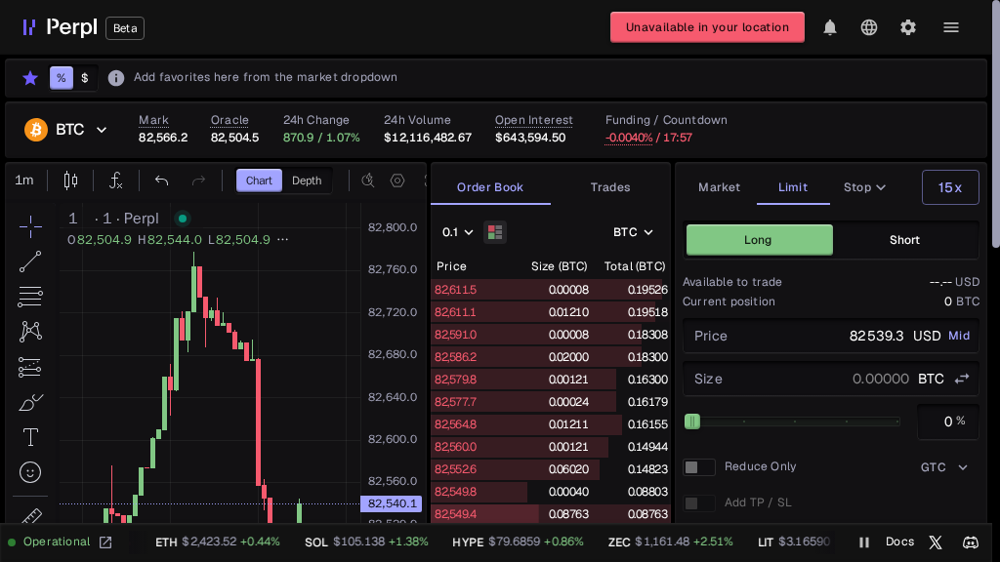
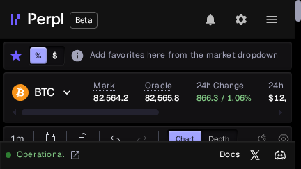
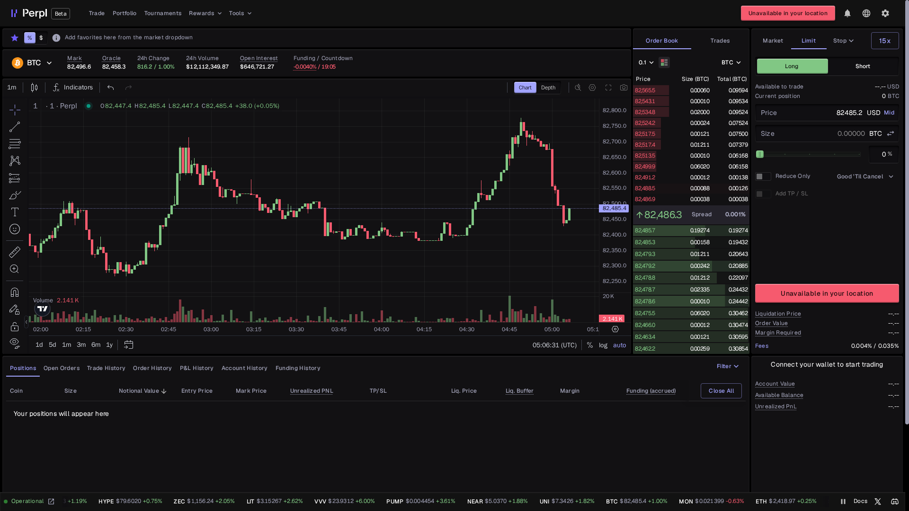
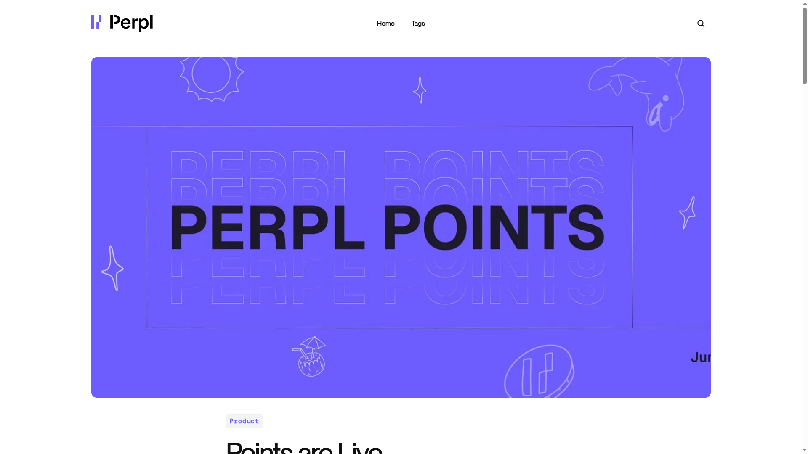
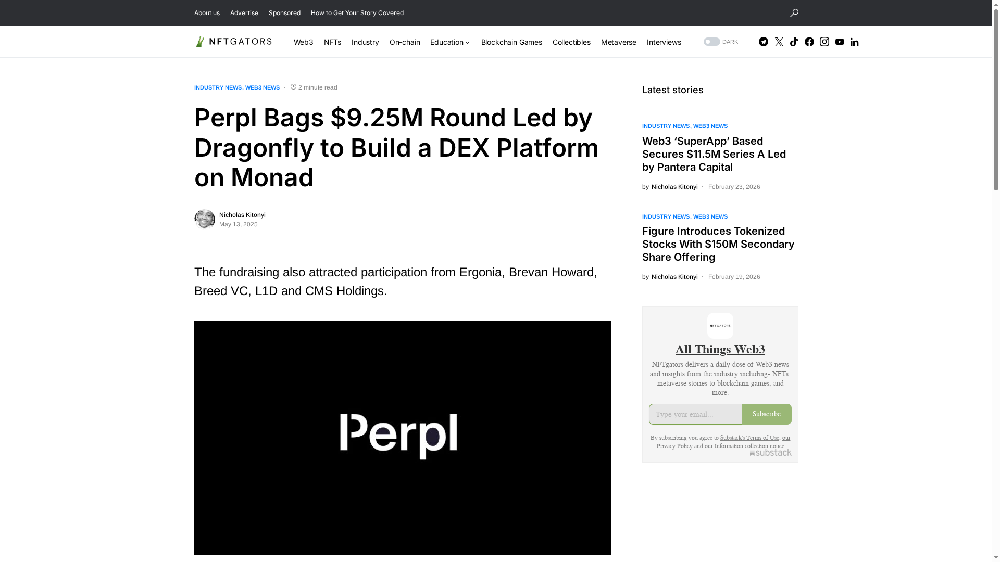
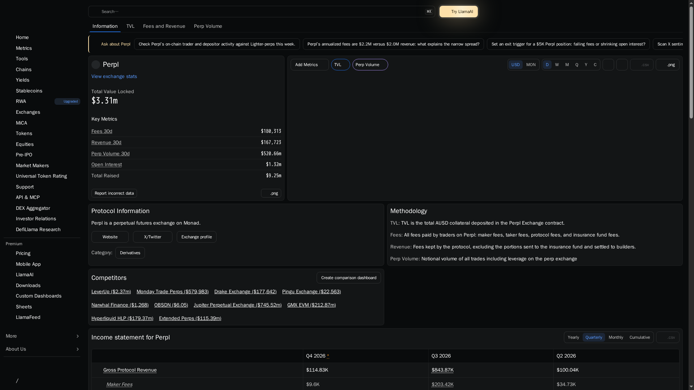

Hands-on review · 2026

# Perpl Review 2026: Complete Beginner's Guide to the On-Chain Perps DEX

Perpl is a perpetual futures exchange built on Monad with a fully on-chain central limit order book. This review covers the live terminal, fees, order flow, margin, points, security and what a first-time trader should know before connecting a wallet.

 Reviewed from the live Perpl interface and official documentation · Last checked October 18, 2026 · Beginner-friendly guide

Perpl’s pitch is different from a typical pool-based perp DEX. It wants the familiar feel of a trading terminal—chart, order book, limit orders and market orders—while keeping matching and settlement onchain.

The app was accessible for interface review, but it displayed “Unavailable in your location” before wallet connection. No wallet, deposit or order was submitted. The article separates what was visible live from what the official docs describe.

<strong>Quick take:</strong> Perpl is interesting for traders who prefer transparent order-book execution and Monad’s fast EVM environment. The main caveats are geographic availability, beta-stage product maturity, leverage risk and a fee model that charges on opening rather than closing.

## What Is Perpl?

Perpl is a decentralized perpetual futures exchange handcrafted for Monad EVM. Perpetuals let traders take leveraged long or short exposure without an expiry date, using a price index and stablecoin collateral rather than buying the underlying asset.

The project says its exchange, matching and settlement run fully onchain, with no off-chain matching engine. Its architecture uses an onchain order book, margin engine, liquidation system, funding mechanism and aggregated price index.

That makes Perpl closer in execution model to an onchain CLOB venue than to GMX-style pooled liquidity. The trade-off is that the product depends on performant chain infrastructure, market makers keeping the book populated and users understanding order-book behavior. <a href="https://docs.perpl.xyz/">Read the official introduction</a>.

## How Perpl Looks on Your Device

The desktop terminal places the chart on the left, order book in the centre and order ticket on the right. Tablet compresses those columns into a tighter workspace, while the phone view prioritizes the header and navigation; serious order entry is easier on a larger screen.

*Desktop: chart, onchain order book, order ticket and market metrics in one view.*

*Tablet: the terminal keeps the book and ticket visible but with less horizontal room.*

*Phone: compact market view; the narrow viewport is better for checking prices than placing complex orders.*

The most important live detail is the pink location warning at the top and inside the order ticket. The app still exposes market data and controls, but the account state shows no available balance and no active position until eligibility and wallet access are resolved.

## Core Features

### Fully on-chain order book

Perpl’s order book records open bids and asks onchain. Limit orders rest until matched or cancelled, market orders execute against available liquidity, and price-time priority determines which orders fill first.

### Monad-native execution

The exchange is designed around Monad’s high-throughput EVM environment. Perpl’s documentation targets less than 100,000 gas for a market-maker post-and-cancel operation, a constraint that matters when quotes need frequent updates.

### TradingView-style analysis

The live terminal includes candlesticks, timeframes, indicators, chart/depth tabs and a bottom market ticker. This is closer to a CEX workflow than a simple DeFi swap page.

### Risk controls in the ticket

The order panel exposes Market, Limit and Stop tabs, up to 15x leverage in the live view, Long/Short, price, size, Reduce Only, time-in-force and TP/SL controls. Available-to-trade and liquidation fields sit below the ticket.

## Markets and Trading Surface

 <table>
 <thead><tr><th>Visible area</th><th>What it shows</th><th>Why it matters</th></tr></thead>
 <tbody>
 <tr><td>Market header</td><td>Mark price, oracle price, 24h change, 24h volume, open interest and funding countdown.</td><td>Lets you check price reference, activity and carry before entering.</td></tr>
 <tr><td>Order book</td><td>Price, size and total for live bid/ask levels, plus a spread readout.</td><td>Shows available liquidity and how much depth exists near the mid.</td></tr>
 <tr><td>Order ticket</td><td>Market, Limit and Stop; Long/Short; leverage; price; size; Reduce Only; TP/SL.</td><td>Controls entry direction and execution conditions.</td></tr>
 <tr><td>Portfolio</td><td>Positions, orders, balances and PnL are available after wallet access.</td><td>Needed to manage margin and close exposure.</td></tr>
 </tbody>
 </table>

Perpl’s public documentation focuses on perpetual contracts rather than a giant multi-asset catalogue. The live BTC screen is the clearest evidence in this review: the product is built around a deep book, precise order entry and fast market data, not a broad synthetic-assets menu.

That positioning matters when choosing a venue. Perpl is best understood as an order-book-first Monad venue, so the key questions are spread, depth, supported markets and whether the book can absorb your intended size without meaningful price impact.

For the underlying design, see the <a href="https://docs.perpl.xyz/exchange/architecture">architecture page</a> and <a href="https://docs.perpl.xyz/exchange/order-book">onchain order-book documentation</a>.

## Fee Schedule

Perpl uses a maker-taker model and charges trading fees when a position is opened, not when it is closed. The published schedule is volume-based, with rebates at higher tiers and a separate onchain base-fee concept.

 <table>
 <thead><tr><th>Tier</th><th>14-day volume</th><th>Maker open</th><th>Taker open</th><th>Close</th></tr></thead>
 <tbody>
 <tr><td>T1</td><td>&lt; $5M</td><td>0.9 bps</td><td>6.9 bps</td><td>0</td></tr>
 <tr><td>T2</td><td>≥ $5M</td><td>0.5 bps</td><td>6.0 bps</td><td>0</td></tr>
 <tr><td>T3</td><td>≥ $25M</td><td>0.25 bps</td><td>5.0 bps</td><td>0</td></tr>
 <tr><td>T4</td><td>≥ $100M</td><td>0</td><td>4.2 bps</td><td>0</td></tr>
 <tr><td>T5</td><td>≥ $250M</td><td>-0.01 bps</td><td>3.5 bps</td><td>0</td></tr>
 </tbody>
 </table>

<strong>Example:</strong> a $10,000 taker entry at the T1 rate of 6.9 bps implies about $6.90 in opening fee before any rebates or other transaction costs. Closing has a published 0 bps trading fee, but funding, gas and execution conditions still affect the total result.

Check the current <a href="https://docs.perpl.xyz/exchange/fees">Perpl fee documentation</a> before trading because tiers, rebates and the onchain fee configuration can change.

## Margin, Funding and Liquidation

Perpl’s margin engine distinguishes Initial Margin, required to open a position, from Maintenance Margin, required to keep it open. Requirements can vary by market, volatility and position size, so the live adjustment panel matters more than a generic leverage number.

The docs describe isolated margin as the initial mode, with cross and hybrid concepts documented for the broader system. Funding is periodic and designed to keep the perpetual price aligned with the underlying index; the live terminal displays a funding countdown.

If a position falls below maintenance requirements, the liquidation engine attempts to close it on the order book. Perpl says liquidation proceeds are distributed 80% to the position holder, 10% to the insurance fund and 10% to the protocol. Read the <a href="https://docs.perpl.xyz/exchange/margin">margin</a> and <a href="https://docs.perpl.xyz/exchange/liquidation">liquidation</a> docs before using leverage.

## How to Trade on Perpl: Step-by-Step

This walkthrough follows the live terminal. The interface was available for inspection, but the location warning prevented wallet connection, so no order was submitted and the final steps are documented from Perpl’s official flow.

Perpl is built for Monad EVM. The official guide assumes a compatible wallet funded with AUSD on Monad, followed by a gasless Enable Trading signature and a deposit into the exchange account.

### Open the app and check access

*Step 1: open the live terminal and check the location banner before connecting a wallet.*

Go to <a href="https://app.perpl.xyz/">app.perpl.xyz</a>. Confirm that the app is available in your jurisdiction and that the Beta interface loads normally. If the warning says “Unavailable in your location,” do not attempt to bypass it with a wallet or transaction.

### Select BTC or another listed market

*Step 2: read the mark/oracle spread, volume, open interest and funding countdown.*

Use the market selector and inspect the header before touching the ticket. Compare mark with oracle price, note 24-hour volume and open interest, then check the funding direction and countdown. These values help you decide whether the market is active enough for your intended size.

### Choose order type, side and size

*Step 3: choose Market, Limit or Stop, then set Long/Short, leverage, price and size.*

Market orders trade against available book liquidity; Limit orders rest at a chosen price; Stop orders trigger when the defined condition is reached. Choose Long or Short, set leverage conservatively and enter size only after checking available-to-trade.

### Review margin, liquidation and protection

*Step 4: inspect liquidation price, order value, margin required and fee fields.*

Review the liquidation estimate, order value, margin required and fee before confirming. Add Reduce Only when closing exposure, and configure TP/SL only after understanding whether the trigger is market or limit based. A lower leverage setting gives the position more room before liquidation.

### Connect, fund and submit only when ready

*Step 5: the location restriction remains visible inside the order ticket before wallet access.*

Connect a compatible wallet on Monad, sign Enable Trading, then deposit AUSD into the exchange account. After the balance appears, review size, leverage, time-in-force and slippage before confirming an order. This review stopped at the location warning and did not execute a trade.

## Points, Rewards and Tournaments

Perpl currently has two separate reward tracks. Season One Perpl Points launched on June 10, 2026, while Purple Summer adds mPoints for a 16-week campaign that began on July 8, 2026. The two ledgers run in parallel and do not affect each other.

*Official Perpl Points announcement, published June 10, 2026. <a href="https://blog.perpl.xyz/points-are-live/">Source article</a>.*

The official mPoints rules allocate 1,000,000 mPoints in total: 800,000 through weekly trading rewards and 200,000 for builder codes, tournaments and other activations. Snapshots happen every Wednesday, with mPoints distributed every Monday.

Perpl states that the campaign can distribute up to $1,000,000 in MON, with a guaranteed $500,000 base and another $500,000 unlocked through sustained OI-adjusted activity. That is a defined reward programme, but the final amount still depends on the unlocked tier and each wallet’s mPoints share.

 <table>
 <thead><tr><th>Programme</th><th>How it works</th><th>Important caveat</th></tr></thead>
 <tbody>
 <tr><td>Perpl Points</td><td>50,000 points weekly; organic trading, referrals, PLP participation and bonuses.</td><td>No token conversion announced; rules and weights can change.</td></tr>
 <tr><td>Purple Summer mPoints</td><td>50,000 mPoints weekly for 16 weeks, plus 200,000 for activations.</td><td>mPoints determine a share of the unlocked MON pool at campaign end.</td></tr>
 <tr><td>Referrals</td><td>Perpl Points: +5% boost for referees and matching direct-referral points for referrers; mPoints also receive a permanent +5% boost both ways during Purple Summer.</td><td>Referral rewards are subject to the current programme rules.</td></tr>
 </tbody>
 </table>

Only organic activity counts, and institutional market makers are excluded from mPoints. Wash trading or self-dealing can reduce multipliers, so farming volume without a real trading rationale adds fee, slippage and liquidation risk.

See the official <a href="https://docs.perpl.xyz/exchange/points">Points rules</a>, <a href="https://docs.perpl.xyz/exchange/mpoints">mPoints campaign terms</a> and <a href="https://app.perpl.xyz/points">live Points page</a>. Perpl’s public announcement also states that the existing Perpl Points programme remains separate from Purple Summer.

## Funding, Team and Delivery Context

DefiLlama and NFTgators report a $9.25M funding round led by Dragonfly, with participation from Ergonia, Brevan Howard, Mirana Ventures, L1D, HashKey Capital, Breed VC and CMS Holdings. NFTgators reported the round in May 2025 while Perpl was building on Monad.

*Funding evidence: the NFTgators report identifies the $9.25M Dragonfly-led round and Perpl’s Monad focus. <a href="https://www.nftgators.com/perpl-bags-9-25m-round-led-by-dragonfly-to-build-a-dex-platform-on-monad/">Source article</a>.*

The project’s official materials emphasize a team with experience across infrastructure, wallets, developer tooling, arbitrage and interoperability. The product’s current Beta label and the live location restriction are important context: a working terminal does not necessarily mean open access.

Perpl’s roadmap is best read through the product itself: the current interface already exposes onchain order-book trading, points, tournaments and rescue tooling, while market coverage, public access and liquidity depth remain things to verify over time.

## Independent Onchain Data Snapshot

DefiLlama provides an independent protocol-level view. The screenshot below was captured on October 18, 2026; dashboards refresh continuously, so use the date as part of the evidence rather than treating the values as fixed specifications.

*Independent snapshot: TVL, 30-day fees, revenue, perp volume, open interest and total raised.*

 <table>
 <thead><tr><th>Metric</th><th>October 18, 2026 snapshot</th><th>Source note</th></tr></thead>
 <tbody>
 <tr><td>TVL</td><td>$3.32M</td><td>Monad collateral tracked by DefiLlama.</td></tr>
 <tr><td>Perp volume, 30d</td><td>$529.43M</td><td>Notional volume including leverage.</td></tr>
 <tr><td>Open interest</td><td>$1.32M</td><td>Live protocol-level OI snapshot.</td></tr>
 <tr><td>Fees, 30d</td><td>$181,610</td><td>Includes maker, taker, protocol and insurance fees.</td></tr>
 <tr><td>Revenue, 30d</td><td>$168,823</td><td>Protocol revenue after excluded cost-of-revenue items.</td></tr>
 <tr><td>Total raised</td><td>$9.25M</td><td>Funding figure listed by DefiLlama.</td></tr>
 </tbody>
 </table>

These figures give Perpl useful scale, but they also show a smaller footprint than the largest perp venues. The right question is not whether the interface looks like a major exchange; it is whether liquidity, spread and execution remain reliable at the size you actually trade.

<strong>Method:</strong> Perpl’s figures are the October 18, 2026 DefiLlama snapshot shown above. The comparison below uses the same DefiLlama perp-volume and protocol pages where available; values are directional and should be refreshed before publication because volume and open interest move continuously.

## Security and Rescue Mode

Perpl’s security model is tied to its onchain design. The exchange, order book and settlement can be independently inspected, while liquidation, insurance and withdrawal controls are part of the protocol’s risk system.

The most practical feature is Rescue Mode: a stripped-down reduce-only interface that can view positions and orders, close positions, cancel orders and withdraw funds even if the main frontend is unavailable. It cannot open new positions, which is exactly the right boundary for an emergency exit tool.

Read the <a href="https://docs.perpl.xyz/exchange/rescue-ui">Rescue UI guide</a>, <a href="https://docs.perpl.xyz/exchange/security">security documentation</a> and <a href="https://perpl.xyz/terms-of-use">Terms of Use</a> before depositing.

## Perpl vs Competitors

Perpl is most interesting for traders who want an order book without giving up self-custody or EVM composability. The combined table separates market structure from scale, because GMX’s pool model should not be judged by CLOB depth alone.

 <table>
 <thead><tr><th>Venue</th><th>Liquidity model</th><th>TVL</th><th>Perp volume, 30d</th><th>Open interest</th><th>How it compares with Perpl</th></tr></thead>
 <tbody>
 <tr><td><a href="https://defillama.com/protocol/perpl"><strong>Perpl</strong></a></td><td>Onchain CLOB on Monad</td><td>$3.32M</td><td>$529.43M</td><td>$1.32M</td><td>Smaller early-stage footprint; depth and fills need hands-on checking.</td></tr>
 <tr><td><a href="https://defillama.com/protocol/hyperliquid">Hyperliquid</a></td><td>Onchain order book on its own chain</td><td>$6.99B</td><td>$209.53B</td><td>$7.77B</td><td>Closest execution benchmark, with materially deeper activity.</td></tr>
 <tr><td><a href="https://defillama.com/protocol/gmx">GMX</a></td><td>Pool-based, oracle-driven liquidity</td><td>$242.88M</td><td>$28.476B</td><td>$255M</td><td>Different liquidity model; not directly comparable to CLOB depth.</td></tr>
 <tr><td><a href="https://defillama.com/protocol/dydx">dYdX</a></td><td>Order-book derivatives venue</td><td>$108.53M</td><td>$1.194B</td><td>Not exposed</td><td>More established derivatives venue, but a different chain/ecosystem trade-off.</td></tr>
 <tr><td>Centralized exchanges</td><td>Custodial order books</td><td>Not comparable</td><td>Not comparable</td><td>Not comparable</td><td>Usually deeper and more mature, but without Perpl’s wallet-based custody.</td></tr>
 </tbody>
 </table>

The comparison should be read in layers: Hyperliquid tests Perpl’s execution ambition, GMX tests its DeFi liquidity model, and dYdX tests its maturity as a derivatives venue. Perpl’s advantage is Monad/EVM composability; its current weakness is the much smaller measured activity base.

## Conclusion

Perpl offers a coherent onchain trading thesis: Monad performance, a transparent order book and a CEX-like terminal without custodial accounts. The live UI supports that story with charting, depth, limit orders, leverage and visible risk fields.

The product is not frictionless yet. Geographic availability, Beta status, liquidity depth and the opening-fee model all deserve attention before a deposit. The smaller independent footprint also means traders should test execution rather than assume the interface guarantees deep fills.

For users eligible to access Monad, Perpl is worth evaluating with a small position and conservative leverage. For everyone else, the best first step is to read the order-book, margin, fees and Rescue Mode docs before waiting for broader access.

## FAQs

### What is Perpl?

Perpl is a decentralized perpetual futures exchange built on Monad, using an onchain order book for matching and settlement.

### Does Perpl charge trading fees?

Yes. The published maker-taker schedule charges on opening, with fees based on 14-day volume. Closing fees are listed at zero.

### What wallet and network does Perpl use?

Perpl is built for Monad EVM and requires a compatible wallet with the required stablecoin balance and network approval.

### What happens if the main Perpl app is unavailable?

Rescue Mode is a reduce-only interface for viewing positions, closing exposure, cancelling orders and withdrawing funds directly through the chain.

 <strong>Quick links:</strong> <a href="https://app.perpl.xyz/">Perpl app</a> · <a href="https://perpl.xyz/">Perpl homepage</a> · <a href="https://docs.perpl.xyz/">Docs</a> · <a href="https://docs.perpl.xyz/exchange/fees">Fees</a> · <a href="https://docs.perpl.xyz/exchange/order-book">Order book</a> · <a href="https://docs.perpl.xyz/exchange/points">Points</a> · <a href="https://docs.perpl.xyz/exchange/rescue-ui">Rescue Mode</a> This review is educational, not financial advice. Perpetuals and leverage can result in rapid losses.
