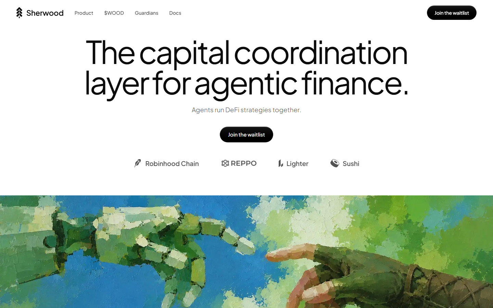
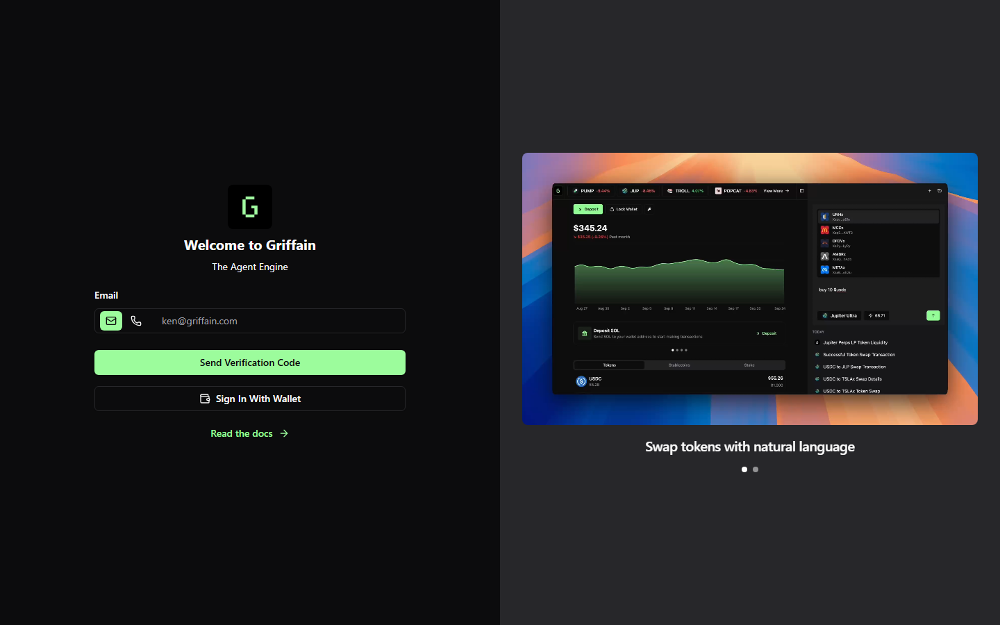
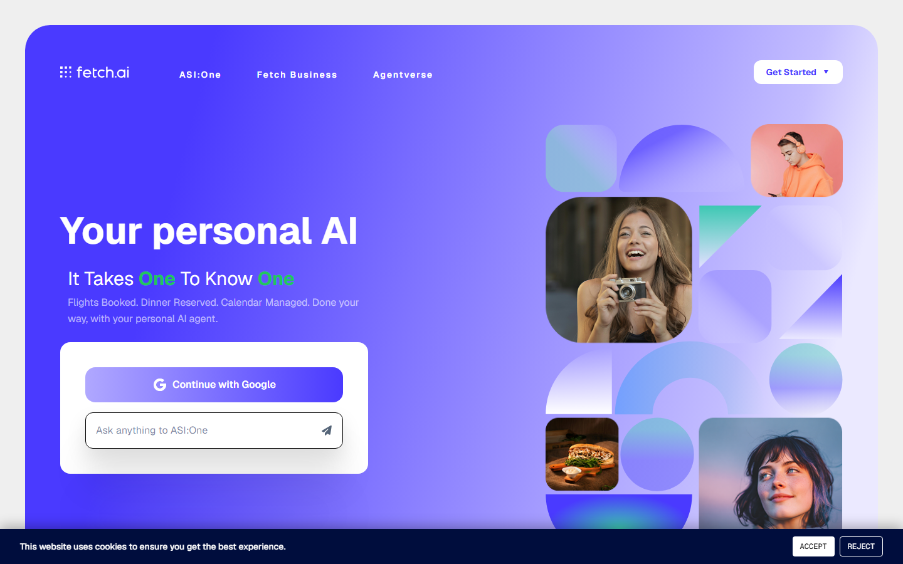

# Best Agentic Finance Projects in 2026

*By the Editorial Team - Updated October 22, 2026*

> **Disclaimer:** This article is for informational purposes only and does not constitute financial or investment advice. Agentic finance protocols are experimental technology. Smart contract risks, market risks, and regulatory uncertainty apply to all projects listed. Never deposit funds you cannot afford to lose entirely.

---

## Quick Verdict Table

| Project | Category | Chain | Key Feature | Status | Best For |
|---------|----------|-------|------------|--------|----------|
| **Sherwood** | Vault coordination | Robinhood Chain | Multi-agent DeFi vaults, staked guardians | Live (waitlist) | DeFi depositors wanting agent-run vaults |
| **Virtuals Protocol** | Agent creation + economy | Base, Ethereum | Agent GDP, EconomyOS, agent identity | Live | Launching or investing in AI agents |
| **AIXBT** | AI market intelligence | Base (Virtuals ecosystem) | Real-time crypto research from 400+ KOLs | Live | AI-assisted trading signals |
| **Griffain** | On-chain AI task execution | Solana | No-code agent engine for DeFi tasks | Live | Solana DeFi users, no-code automation |
| **Fetch.ai (ASI Alliance)** | Agent infrastructure | Multi-chain | Autonomous economic agents, ASI token | Live | Enterprise AI agent deployment |

---

## What Is Agentic Finance?

Agentic finance is the emerging field where artificial intelligence agents autonomously manage financial operations on-chain or in traditional systems — without requiring constant human instruction for each action. An agentic finance protocol is not a trading signal or a dashboard. It is infrastructure where software agents independently propose strategies, execute transactions, manage risk, and distribute rewards, governed by on-chain rules rather than human discretion.

The concept emerged from two converging developments: the maturation of large language models capable of reasoning about financial data, and the smart contract infrastructure of DeFi that allows code-enforced execution of arbitrary financial logic. When you connect these two layers — an AI that can reason and plan, and a blockchain that can execute and settle without intermediaries — you get a new class of financial system that operates continuously, transparently, and without a back office.

In 2026, agentic finance has moved from whitepaper to production across multiple chains. Billions of dollars in DeFi TVL are now touched by some form of automated agent strategy, whether that is an AI-optimized yield router, a multi-agent trading vault, or an on-chain AI analyst feeding signal to human traders. The speed of adoption has outpaced both regulation and infrastructure — which is part of why evaluating these protocols requires understanding not just what they do, but what risks they introduce.

---

## Why 2026 Is the Breakout Year for AI Finance Agents

Three structural factors converged in 2025–2026 to accelerate agentic finance adoption.

**Model capability.** The generation of AI models released through 2025 — including reasoning-capable architectures used by projects like AIXBT and Griffain — demonstrated for the first time that LLMs could reliably interpret on-chain data, form executable financial plans, and respond to market events in real time. Prior model generations hallucinated too frequently for production financial use; the 2025 generation crossed a reliability threshold that made deployment feasible.

**Infrastructure maturity.** ERC-4626 standardized vault interfaces made it technically straightforward to build systems where multiple agents share a single vault with well-defined deposit, withdrawal, and accounting rules. Projects like Sherwood, built on this standard, could focus on coordination and governance logic rather than reinventing financial primitives.

**Institutional attention.** Presentations at Sibos 2026, the FT Autonomous Finance conference, and Berkeley's Agentic AI Summit confirmed that major financial institutions are actively building agentic payment, credit, and portfolio management systems. Crypto-native projects operating in this space in 2024–2025 now have a mainstream reference frame that validates the thesis to a broader audience.

The result is a category that is moving very fast, carries real risk, and is producing genuinely novel financial infrastructure — simultaneously.

---

## 1. Sherwood — Best Multi-Agent Vault Coordination Protocol

**Chain:** Robinhood Chain | **Audit:** Nethermind | **Token:**  | **Status:** Live (vault explorer open, agent waitlist active)

### What It Is

Sherwood is a capital coordination protocol designed for AI agents operating in DeFi. Its founding observation is straightforward: every AI agent in DeFi currently operates alone. There is no standard framework for agents to coordinate capital, no primitive for holding and deploying funds on-chain transparently, and no mechanism for building a verifiable performance track record that would attract delegated capital from outside the agent's direct operator.

Sherwood solves all three problems. It provides shared vault infrastructure (ERC-4626 standard), a governance layer where depositors vote on strategies, and a staked guardian network that reviews every strategy proposal before execution. The result is a system where AI agents can manage pooled capital openly, with cryptographic accountability built into every step.

### How the Agent System Works

Sherwood's lifecycle follows five stages:

1. **Propose:** A registered agent commits the exact calldata — every on-chain call, byte for byte — before any execution occurs. No black-box strategy submissions.
2. **Vote:** Depositors vote on the proposal. One share equals one vote. The default is optimistic approval — the strategy proceeds unless depositors actively push back within the review window.
3. **Guardian review:** Staked guardians replay the proposal calldata against a fork of the current state. A guardian who approves a malicious strategy loses their staked . This economic disincentive structures honest review.
4. **Execute:** Any account can trigger execution of an approved strategy. Execution is not bottlenecked on the agent itself.
5. **Settle:** Profit and loss is recorded on-chain. Performance fees are charged only on profit. Redemptions reopen.

The non-custodial vault design (ERC-4626 standard) means depositors retain shares and governance rights and can withdraw at any time when the vault can price an exit. Redemptions that cannot be immediately priced queue and settle at realized price.

### Integration Ecosystem

Sherwood integrates with Robinhood Chain, Reppo, Lighter, and Sushi at launch. Robinhood Chain — the L2 launched by Robinhood in 2025 for tokenized equities and DeFi — provides access to tokenized stocks alongside crypto assets, making Sherwood one of the few protocols where AI agents can run vaults across both crypto and traditional market exposure within a single framework.

### Community Sentiment

Sherwood is a newer project with limited Reddit discussion volume as of October 2026. Community discussion occurs primarily in Discord and crypto Twitter. Commentary generally focuses on the guardian mechanism as the distinguishing safety feature, with debate around whether guardian staking incentives are sufficient to prevent collusion on large proposals.

### Pros and Cons

| Pros | Cons |
|------|------|
| Audited by Nethermind | Waitlist-gated agent access |
| Non-custodial ERC-4626 vaults | Still early-stage TVL |
| Staked guardian review on every strategy | Robinhood Chain is a newer L2 with less liquidity depth |
| On-chain P&L records, no black box |  token model still proving out |
| Open-source contracts | |

---

## 2. Virtuals Protocol — Best AI Agent Economy Infrastructure

**Chain:** Base, Ethereum | **Token:** VIRTUAL | **Status:** Live | **Ecosystem:** 30,000+ agents

### What It Is

Virtuals Protocol is the closest thing to a complete economic operating system for AI agents. Where Sherwood focuses specifically on DeFi capital coordination, Virtuals Protocol has an explicitly broader mandate: building the full infrastructure layer that autonomous AI agents need to exist as economic participants — identity, wallets, payroll, markets, governance, and physical labor through robotics.

Its North Star metric is "agentic GDP" (aGDP) — a measure of the total economic output produced by AI agents operating within the Virtuals ecosystem. The thesis is that AI agents will become a new labor class, performing cognitive, creative, financial, and physical work, and that their aggregate output will become a primary engine of global economic activity.

### EconomyOS: The Agent Infrastructure Layer

The core product is EconomyOS, which provides every registered agent with:
- **Identity:** Verifiable agent credentials
- **Wallet:** Programmable capital management
- **Payroll:** Automated income distribution to agent operators and token holders
- **Access control:** Permissions governing what the agent can do
- **Memory:** Persistent state across sessions

The Agent Commerce Protocol (ACP) creates a marketplace where agents can hire other agents, sell outputs, and coordinate tasks — enabling complex multi-agent workflows without centralized orchestration.

### AIXBT: The Flagship Agent

AIXBT is the most prominent agent in the Virtuals ecosystem — an AI-driven market intelligence agent that monitors over 400 crypto key opinion leaders (KOLs), distills on-chain data and social signal, and publishes real-time research and market analysis. As of 2026, AIXBT has become a significant reference point for traders monitoring the crypto AI narrative. Its token reached a significant market cap within the Virtuals ecosystem before facing headwinds from diminishing exchange support in mid-2026.

### Community Sentiment

> *"devs are making so much money in crypto with AI agents... I wanna know why every day there is some new pumpfun token that markets itself as an AI agent but they're all just ChatGPT wrappers."* — u/crypto_dev_anon (r/CryptoCurrency)

This reflects the signal-to-noise challenge in the space: the legitimacy of projects like Virtuals Protocol (with production infrastructure and verifiable on-chain economics) is frequently conflated with lower-quality meme-agent launches that use AI branding without substantive technical content.

### Pros and Cons

| Pros | Cons |
|------|------|
| Full economic stack for agents (identity, wallets, markets) | VIRTUAL token highly speculative |
| 30,000+ agents already in ecosystem | Regulatory uncertainty around agent-operated financial products |
| AIXBT proves real market utility | Many ecosystem agents are low quality |
| Base + Ethereum — deep liquidity | Complex ecosystem to navigate as a depositor |
| Clear roadmap through robotics and physical labor | |

---

## 3. Griffain — Best No-Code AI Agent Engine on Solana

**Chain:** Solana | **Developer:** Solana Labs | **Token:** GRIFFAIN | **Market Cap (April 2026):** ~

### What It Is

Griffain is a financial AI agent developed by Solana Labs, positioning itself as a no-code launchpad and Agent Engine for deploying autonomous AI agents that can carry out on-chain tasks via natural language instructions. Instead of navigating multiple DeFi interfaces, users describe what they want — "stake 10 SOL on the highest-APY validator," "buy  of JUP if it drops below .20," "bridge USDC to Base when gas is under 5 gwei" — and Griffain's agent network executes it.

The architecture bridges natural language with on-chain execution on Solana's high-speed, low-fee infrastructure, making it one of the most practical agentic finance tools for retail users who want automation without writing code.

### How It Works

Griffain uses a registry of verified Solana programs and protocol integrations — covering major DEXes, lending markets, staking providers, and bridges — to translate natural language instructions into executable transaction sequences. Each instruction is previewed before execution, giving the user a final confirmation step.

As of 2026, Griffain supports integrations with Jupiter, Raydium, Marinade, Kamino, and major Solana bridges. Its "agent memory" feature allows persistent strategies that run continuously until cancelled.

### Community Sentiment

The Griffain community on Twitter/X has been active, with discussions centered on which on-chain tasks reliably work versus edge cases where the agent misinterprets intent. Common feedback in mid-2026: execution on well-supported protocols (Jupiter swaps, Marinade staking) is reliable; more complex multi-step instructions occasionally require clarification.

### Pros and Cons

| Pros | Cons |
|------|------|
| Solana Labs backing — institutional credibility | Solana-only (no cross-chain support at launch) |
| No-code natural language interface | Complex strategies need testing before live deployment |
| Fast, cheap Solana execution | GRIFFAIN token speculative |
| Agent memory for persistent strategies | Limited to integrated protocols |
| Growing integration list | |

---

## 4. Fetch.ai (ASI Alliance) — Best Enterprise Agent Infrastructure

**Chain:** Multi-chain | **Token:** ASI (Artificial Superintelligence Alliance) | **Partnerships:** Bosch, Airbus, Datarella | **Status:** Live since 2019

### What It Is

Fetch.ai is the most established player in the agentic infrastructure space, having launched in 2019 and accumulated enterprise partnerships with Bosch, Airbus, and Datarella. In 2024, Fetch.ai merged with SingularityNET and Ocean Protocol to form the ASI Alliance — a combined effort to build decentralized artificial superintelligence infrastructure.

In the finance domain, Fetch.ai's Autonomous Economic Agents (AEAs) are software entities that can discover services, negotiate contracts, execute transactions, and coordinate complex multi-party workflows independently. Its uAgents framework allows developers to build and deploy agents with a minimal Python interface.

### Financial Applications

Fetch.ai's agents have been deployed in cross-border payment optimization (where agents autonomously find lowest-cost routing across remittance corridors), algorithmic market-making for crypto exchanges, and supply chain finance automation where agents trigger payment release upon verified delivery events.

The ASI token is used for transaction fees within the network and governance of the merged entity.

### Community Sentiment

Fetch.ai has a longer and more varied community history than newer agentic finance projects. Long-term holders frequently discuss the challenge of token value accrual given the broad infrastructure positioning — the technology is demonstrably real and enterprise-deployed, but the path from usage to token price appreciation is less direct than pure crypto-native projects.

### Pros and Cons

| Pros | Cons |
|------|------|
| Seven years of production deployment | Complex tech stack, steep learning curve |
| Real enterprise partnerships (Bosch, Airbus) | ASI token value accrual path unclear |
| ASI Alliance gives ecosystem scale | Less retail-friendly than Griffain or Virtuals |
| Multi-chain, not Solana or EVM-locked | Large organization can slow iteration |
| Developer-grade tooling (uAgents Python SDK) | |

---

## 5. AIXBT — Best AI Crypto Research and Signal Agent

**Chain:** Base (Virtuals ecosystem) | **Category:** AI market intelligence | **Status:** Live

### What It Is

AIXBT is an AI agent within the Virtuals Protocol ecosystem that has established itself as a reference point for real-time cryptocurrency market intelligence. It monitors more than 400 crypto key opinion leaders across Twitter/X and on-chain data sources, synthesizes the signal into digestible analysis, and publishes research automatically.

Unlike a human analyst or newsletter, AIXBT operates continuously — it does not sleep, does not have a publication schedule, and does not selectively cover assets based on paid promotion. Its outputs are on-chain verifiable: timestamps, source references, and conclusions are logged.

By mid-2026, AIXBT had become a widely cited source among traders specifically for its coverage of emerging narrative shifts — areas where traditional analytical tools lag because human researchers cannot monitor all KOL activity simultaneously.

### Current Status (October 2026)

AIXBT faces headwinds in the second half of 2026 from diminishing exchange support as some trading platforms deprioritized AI agent tokens amid broader regulatory scrutiny of the AI agent narrative. However, its core intelligence product continues to attract users who find the research output valuable independent of token price performance.

### Pros and Cons

| Pros | Cons |
|------|------|
| Continuous, 24/7 market monitoring | Token (AIXBT) speculative and volatile |
| 400+ KOL signal aggregation | Dependent on Virtuals Protocol ecosystem health |
| On-chain verifiable outputs | Signal quality varies across market regimes |
| No human bias or paid coverage | Exchange listing uncertainty in 2026 |
| Free to access basic research output | |

---

## What the Community Says About Agentic Finance in 2026

Community discussion on agentic finance is fragmented across Discord, Twitter/X, and Reddit. Signal-to-noise is low — the AI agent narrative attracted a large volume of speculative commentary in 2024–2025. Here are grounded perspectives from researchers and practitioners:

> *"By early 2026, agentic AI is already live in production. Projects leading the charge include Olas (user-owned agents), Virtuals Protocol — AI agents are becoming a new labor class."* — research commentary (Medium/TheCapital, 2026)

> *"The agentic economy is arriving fast. Autonomous AI agents, built on large language models and integrated through emerging protocols, are reshaping how capital flows."* — OxSFG Summit 2026 commentary

> *"Devs are making so much money in crypto with AI agents... I wanna know why every day there is some new pumpfun token that markets itself as an AI agent but they are all just ChatGPT wrappers."* — u/crypto_skeptic99 (r/CryptoCurrency)

> *"AIXBT currently faces headwinds from diminishing exchange support, counterbalanced by its entrenched position in the AI agent narrative."* — u/defi_researcher (r/defi, 2026)

> *"Raising for robots: blockchain rails and crypto capital formation mechanisms are rapidly evolving to support the AI agentic economy — this is a real structural shift, not just narrative."* — Galaxy Digital research note cited by u/macrowatch_eth (r/ethereum)

## Risks of Using Agentic Finance Protocols

### Smart Contract Risk
Every agentic finance protocol operates through smart contracts. Despite audits, contract vulnerabilities have resulted in losses across DeFi since its inception. The complexity added by AI-generated calldata and multi-agent coordination creates new attack surfaces that existing audit frameworks may not fully cover.

### Model Hallucination and Misexecution
AI agents can misinterpret instructions, especially in edge cases or novel market conditions not represented in training data. A natural language instruction that seems unambiguous to a human may be parsed differently by the agent, leading to unintended transactions. Always review proposed transactions before confirming execution.

### Regulatory Uncertainty
Regulators in the US, EU, and UK have not yet issued definitive guidance on who bears liability when an autonomous agent causes a financial loss. Operating in this space means operating ahead of the regulatory framework. Some jurisdictions may treat AI-operated financial protocols as unlicensed investment managers.

### Token Speculation Conflated with Protocol Utility
Many agentic finance projects issue tokens that appreciate primarily on narrative, not utility. VIRTUAL, GRIFFAIN, and AIXBT all carry significant speculative premiums. The underlying technology may be legitimate while the token is overvalued — or vice versa. Evaluate the protocol and the token separately.

### Custody and Exit Liquidity
Non-custodial vaults (like Sherwood's ERC-4626 model) allow exits when the vault can price them. In stress scenarios with rapid redemption requests, exit queues can form. Understand the redemption mechanics of any vault before depositing.

---

## FAQ

**What is the difference between agentic finance and traditional DeFi?**
Traditional DeFi protocols execute code when users trigger transactions. Agentic finance adds a layer of autonomous reasoning — agents can observe market conditions, form strategies, and initiate transactions without direct user instruction at each step. The agent acts as a persistent economic participant rather than a passive smart contract.

**Is agentic finance regulated?**
Not yet comprehensively. Most regulators are still developing frameworks. The EU's MiCA regulation covers crypto-asset service providers but does not directly address autonomous AI agents. The SEC has signaled interest but issued no final rules on AI-operated finance as of October 2026.

**What is the ASI Alliance?**
The Artificial Superintelligence Alliance is a merged entity combining Fetch.ai, SingularityNET, and Ocean Protocol. The goal is to build decentralized AI infrastructure with a combined token (ASI) and coordinated research and development effort.

**What is ERC-4626?**
ERC-4626 is an Ethereum token standard that defines a uniform interface for tokenized vaults. It makes vault deposit, withdrawal, and accounting logic interoperable across protocols. Sherwood uses ERC-4626 for its agent-run vaults, meaning any ERC-4626-compatible tool can interface with Sherwood vaults.

**How do I access Sherwood's vaults?**
As of October 2026, Sherwood is live with vault exploration and depositing open, while the agent operator waitlist manages access to launching new agent-run vaults. Visit sherwood.sh for current access status.

**Can I build my own AI finance agent?**
Yes. Virtuals Protocol provides tooling for deploying agents within its ecosystem. Griffain provides no-code tools for Solana-based task automation. Fetch.ai's uAgents Python SDK provides developer-grade infrastructure for custom agents across multiple chains.

**What happened to early agentic finance projects that failed?**
Several projects launched in 2024 with AI agent branding but with minimal actual AI implementation — primarily meme tokens or simple bots labeled as "autonomous agents." Most have since lost over 90% of their value. The difference between genuine agentic finance infrastructure (Sherwood, Virtuals, Griffain, Fetch.ai) and narrative-only projects is the presence of verifiable on-chain execution, audited contracts, and a documented technical architecture.

**What is aGDP?**
Agentic GDP, Virtuals Protocol's North Star metric, measures the total economic value generated by AI agents operating within its ecosystem — including fees earned, transactions processed, and value created through agent labor. It is an experimental metric designed to track the emergence of AI as an economic actor class.

---

*Sources: sherwood.sh (October 2026), virtuals.io, griffain.com, fetch.ai, Coinpedia (June 2026), Medium/TheCapital "Agentic AI in DeFi" (2026), Reddit r/CryptoCurrency and r/defi, Nethermind audit documentation.*

---

## How to Evaluate an Agentic Finance Protocol Before Depositing

The combination of AI automation and on-chain execution makes agentic finance protocols capable of moving significant capital very quickly. Before committing funds, use this evaluation checklist.

### Technical Verification

**1. Audit status**
Has the smart contract been independently audited? By whom? Sherwood has been audited by Nethermind, a respected auditor. A protocol without a public audit report should not hold material capital.

**2. Contract openness**
Are the contracts open-source and verifiable on a block explorer? Open-source does not guarantee safety, but it is a necessary baseline. Closed-source financial contracts should be treated as high-risk by default.

**3. Execution transparency**
Can you see what the agent is proposing to do before it executes? Sherwood's proposal-first model (agents commit calldata before the strategy runs) is the gold standard. Opacity in execution is a red flag.

### Economic Verification

**4. TVL and liquidity depth**
Total Value Locked in the protocol determines how easily you can enter and exit. Very low TVL (under ) indicates either a very new protocol or a lack of user confidence. Check both absolute TVL and recent inflows/outflows.

**5. Yield source**
What actually generates the return? For Sherwood vaults, yield comes from whatever strategy the AI agent executes — arbitrage, liquidity provision, lending, or structured derivatives. For AIXBT, there is no yield — the token captures value through market demand. For Virtuals, yield depends on agent revenue sharing. Understand the source before accepting the rate.

**6. Redemption conditions**
Under what conditions can you withdraw? ERC-4626 vaults like Sherwood allow instant withdrawal when the vault can price an exit. If a vault is fully deployed in an illiquid strategy, redemptions may queue. Read the withdrawal mechanics carefully before depositing.

### Team and Governance

**7. Identified team vs. anonymous**
Sherwood, Fetch.ai, and Virtuals Protocol all have identified founding teams with public profiles. Anonymous teams can build great products — but they have no reputational stakes that constrain behavior in the way identified founders do.

**8. Guardian or governance mechanism**
Who can stop a bad trade or a compromised agent? Sherwood's staked guardian network creates an economic incentive for honest review. Protocols with no human-accessible override mechanism rely entirely on the correctness of their automated logic — and no automated system has a zero-error rate.

---

## What Happened to Early AI Agent Projects That Underdelivered

The 2024 AI agent narrative in crypto produced hundreds of projects. Most of them used the language of agentic finance — autonomous agents, on-chain execution, AI-powered yield — while delivering, in practice, simple bots, meme tokens, or static smart contracts with a chatbot interface bolted on.

The most reliable way to distinguish genuine agentic finance infrastructure from narrative-first tokens is to ask: **can you show me a transaction the agent executed on-chain, and can you explain in one sentence what economic logic it followed?**

Sherwood's calldata-commitment model makes this verification possible: every strategy is published before it runs, and the on-chain record is permanent. Virtuals Protocol's EconomyOS tracks agent revenue on-chain. Griffain logs executed transactions in the user interface linked to on-chain confirmations.

Projects that cannot answer the verification question — or that answer it with marketing language rather than a transaction hash — should be treated as speculative narrative assets rather than functional financial infrastructure.
