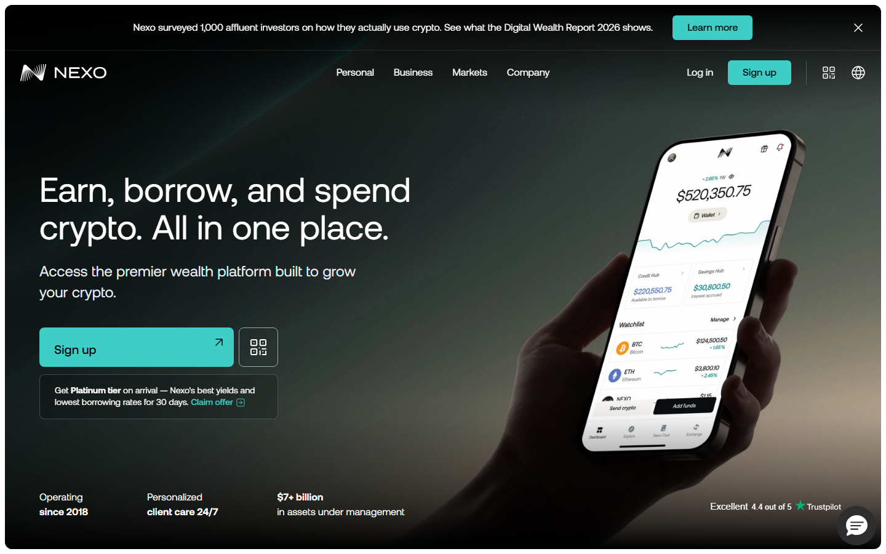
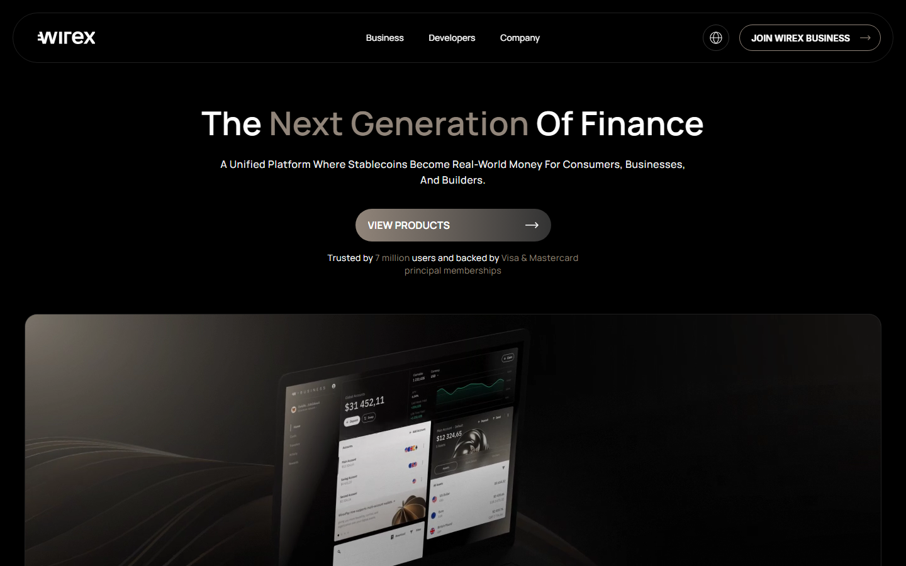
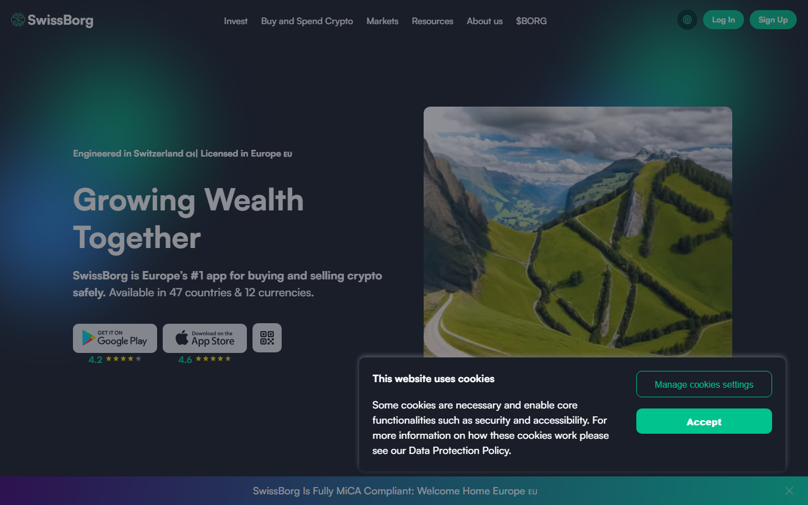
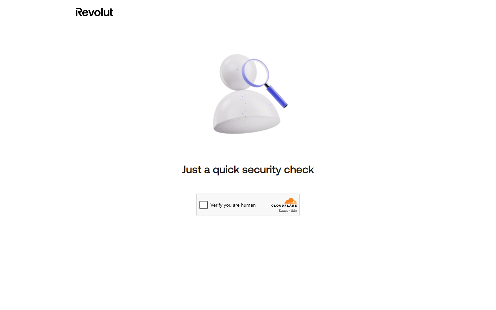

# Best Platforms to Manage Fiat and Crypto in One Place (2026)

*By the Editorial Team - Updated October 22, 2026*

> **Disclaimer:** This article is for informational purposes only and does not constitute financial advice. Crypto and fiat services are subject to regulatory variation by jurisdiction. Platform terms, interest rates, and fee structures change frequently. Verify all figures on official platform pages before transferring funds. This is not an endorsement of any platform.

---

## Quick Verdict Table

| Platform | Fiat Currencies | Crypto Assets | Card | Earn APY | Best For |
|----------|----------------|--------------|------|----------|----------|
| **Nexo** | USD, EUR, GBP + more | 100+ | Yes (Nexo Card) | Up to 12% on stablecoins | All-in-one crypto wealth management |
| **Wirex** | 30+ currencies | 40+ | Yes (Visa card) | Up to 9.75% on savings | Stablecoin spending, global payments |
| **SwissBorg** | EUR, GBP, CHF + more | 50+ | No | Up to 10%+ on select assets | European crypto investors |
| **Revolut** | 30+ currencies | 100+ | Yes (Revolut card) | Varies by plan | UK/EU users wanting banking + crypto |
| **Ledn** | USD | BTC, USDC | No | Up to 9.5% on BTC | BTC holders focused on yield |
| **Monerium** | EUR (IBAN) | ETH, Polygon | No | N/A | On-chain EUR payments with real IBAN |

---

## Why Managing Fiat and Crypto Together Matters in 2026

For most of crypto's history, managing digital assets meant accepting a fundamental inconvenience: your money lived in two separate worlds. On one side, your bank account — euros, dollars, sterling, wire transfers, and a debit card that worked everywhere. On the other, your crypto — inaccessible to merchants, requiring a manual off-ramp every time you wanted to spend or save in traditional currency.

The platforms in this guide have been built to close that gap. They offer, in varying degrees, the combination of fiat banking infrastructure (personal IBANs, multi-currency accounts, direct debits, wire transfers) with crypto capabilities (on-chain wallets, earn programs, trading, lending, and in some cases a card that bridges both) within a single account and app.

In 2026, this category matters for three reasons:

**Regulatory normalization.** MiCA implementation across the EU, the passage of the GENIUS Act in the US (which formalized stablecoin issuance rules), and licensing activity in Singapore, Dubai, and the UK have created clearer operating environments for hybrid fiat-crypto platforms. Platforms that spent 2022–2024 navigating regulatory uncertainty are now operating under clearer frameworks, which improves both their stability and their willingness to offer broader services.

**Institutional adoption as a forcing function.** As pension funds, banks, and family offices hold crypto, their operational teams need unified reporting and account management. Platforms serving retail users are adding institutional-grade features (Nexo's private client offering, Wirex Business) as the demand from professional clients expands.

**The stablecoin economy.** USDT and USDC have proven to be the real-world infrastructure for borderless dollar access. Platforms that treat stablecoins as first-class financial instruments — allowing users to earn yield, spend via card, receive wire transfers in stablecoin form, and send cross-border at near-zero cost — are delivering a compelling alternative to traditional banking for globally mobile individuals.

---

## What to Look for in a Unified Fiat-Crypto Platform

**1. Fiat infrastructure quality**
Does the platform give you a real IBAN (not a pooled account) for wire transfers? Can you receive salary, direct debits, and bank transfers directly? This is the difference between a platform that can replace a bank account and one that merely sits alongside it.

**2. Regulatory status and jurisdiction**
A platform holding your fiat must have appropriate banking or e-money licenses. Verify which regulatory body covers your account, what deposit protection applies (FSCS, FDIC equivalent, or none), and how the platform holds its reserves.

**3. Earn rates and their source**
Interest rates of 8–12% on crypto or stablecoins sound compelling. Understand the source of that yield: is it lending to institutional borrowers (as Nexo does)? Is it DeFi protocol routing? Is it unsustainably high marketing-rate? The Celsius and BlockFi failures of 2022 were cautionary examples of platforms whose headline rates outpaced their ability to generate sustainable yield.

**4. Card utility and fees**
A crypto-linked card that charges 3% FX fee on every international transaction eliminates most of the efficiency gain. Evaluate card fees carefully: FX fees, ATM withdrawal limits, cashback terms, and whether the spend draws from a crypto balance or a fiat balance.

**5. Custody model**
Who holds your assets and how? Nexo holds assets on its own infrastructure as a licensed custodian. Monerium's EUR model is non-custodial, with tokenized euros backed 1:1 by a licensed e-money institution. Your preference for custodial convenience vs. self-custody control determines which model suits you.

---

## 1. Nexo — Best All-in-One Crypto Wealth Platform

**Founded:** 2018 | **HQ:** Zug, Switzerland | **AUM:** + billion | **Users:** 6 million+ | **Jurisdictions:** 200+ | **Trustpilot:** 4/5 (13,000+ reviews)

### What It Is

Nexo is the most established name in the hybrid fiat-crypto platform category, operating since 2018 through multiple market cycles including the crashes of 2022 and 2023. The platform's core product set covers crypto earning (interest on Bitcoin, Ethereum, stablecoins, and 100+ other assets), crypto-backed credit lines (borrowing fiat or stablecoins against crypto collateral without selling), exchange, and the Nexo Card — a Mastercard-linked card that lets users spend against crypto collateral or fiat balances.

### Fiat Features

Nexo offers personal USD, EUR, and GBP accounts that function as crypto-friendly bank alternatives. Users can receive bank transfers under their own name, minimizing the blocked-transaction issues common when third-party names are used. The platform supports Apple Pay and Google Pay integration and regional payment methods across its 200+ operating jurisdictions.

A loyalty program activates at ,000 in account balance, unlocking higher earn rates, lower borrowing rates, and Nexo Card cashback in NEXO tokens.

### Crypto Features

- **Earn:** Up to 12% APY on stablecoins, with daily interest payouts. Rates vary by asset and loyalty tier.
- **Credit Line:** Borrow against crypto without selling — rates from approximately 6.9% APR depending on collateral and tier.
- **Exchange:** Integrated exchange with 100+ trading pairs.
- **100+ supported assets:** Bitcoin, Ethereum, Solana, USDC, USDT, and major altcoins.

### Trustpilot Snapshot (4/5 from 13,000+ reviews)

> *"I've been using Nexo for more than four years now and I have to say that is one of the best platforms to earn very high interest rates on your crypto and stable coins. They have good security standards and great customer service."* — Nexo platform reviewer (2026)

> *"Excellent platform and outstanding customer support... Whether it's earning interest on crypto, accessing instant credit lines, or using the Nexo Card — the platform is intuitive, reliable, and very well designed."* — Nexo platform reviewer (2026)

> *"I've have used all of the features and recently used them to borrow against my investments. I was absolutely delighted — it was a Sunday morning when I started the process and I had received the cleared funds in my personal bank account within 10 minutes."* — Nexo platform reviewer (2026)

### Reddit Sentiment

The r/Nexo subreddit is active but divided. Long-term users praise the consistent interest payouts and multi-year reliability. Post-2022 concerns around the ,000 minimum and fee changes on small deposits have driven some users away.

> *"I can't believe I am saying this but after years on NEXO I have decided to change platforms. When I started into crypto NEXO did me right... however with all the recent changes I see a lot of smaller users leave, for obvious reasons like the 5000 minimum."* — u/Chucklum (r/Nexo)

> *"I am addicted to the interest I receive daily from Nexo but can't help feeling dodgy about the platform in the back of my mind."* — u/BJJnoob1990 (r/CryptoCurrency)

The recurrent concern on Reddit is platform solvency transparency — Nexo survived the 2022 crisis without halting withdrawals, unlike Celsius and BlockFi, but the opacity of its lending book remains a point of ongoing community discussion.

> *"ByBit's woes today definitely got me stirring about Nexo. And I can't shake the Celsius/FTX vibes... Lots of great claims but can't find much to back it up. Strongly considering moving all my funds into cold storage."* — u/MOvert94 (r/Nexo)

### Pros and Cons

| Pros | Cons |
|------|------|
| + AUM, operating since 2018 — survived 2022 | ,000 minimum to access best earn rates |
| USD, EUR, GBP personal accounts | Custody model — you don't hold your own keys |
| Credit line without selling crypto | Earn rates depend on locking terms |
| 4/5 Trustpilot (13K+ reviews) | Lending book opacity concerns on Reddit |
| 200+ jurisdictions |  fee on deposits under  |

---

## 2. Wirex — Best for Stablecoin Spending and Global Payments

**Founded:** 2014 | **HQ:** London, UK | **Users:** 7 million | **Backers:** Visa and Mastercard principal memberships | **Trustpilot:** 2.7/5 (17,000+ reviews)

### What It Is

Wirex is one of the longest-standing crypto-fiat platforms, founded in 2014 as a prepaid bitcoin card service and evolved into a comprehensive multi-currency platform. Its 2026 positioning centers on stablecoins as real-world money — the infrastructure where stablecoins become spendable, earnable, and transferable alongside traditional fiat currencies for consumers, businesses, and builders.

Wirex holds Visa and Mastercard principal memberships, giving it direct issuing relationships rather than going through a third-party BIN sponsor. This structural advantage enables broader product flexibility and more stable card issuance.

### Fiat and Banking Features

Wirex supports 30+ fiat currencies across its accounts, with card capabilities including up to zero FX fees worldwide (on premium plans), standard ATM withdrawals, and Apple/Google Pay compatibility. Wirex Business extends the offering to corporate clients with multi-currency business accounts, stablecoin payroll, and global payment rails.

### Crypto and Earn Features

- Up to 9.75% interest on savings (rates vary by asset and plan tier)
- Up to 8% cashback on everyday spending (in WXT token)
- 40+ supported crypto assets
- Stablecoin support across USDC, USDT, PYUSD

### Trustpilot Note

Wirex's Trustpilot score (2.7/5 from 17,000+ reviews) is notably lower than Nexo's. The most common complaints involve card functionality issues, account verification delays, and customer support response times. Long-term users tend to rate higher; recent users encounter more friction.

### Reddit Sentiment

> *"Absolutely not a better alternative unless you want them to hold your money for months with zero live support. Everything Wirex does Nexo does better."* — u/Nexo_user (r/Nexo)

### Pros and Cons

| Pros | Cons |
|------|------|
| Visa and Mastercard principal memberships | 2.7/5 Trustpilot — below-average satisfaction |
| 7M users, operating since 2014 | Customer support complaints common |
| Up to 9.75% on savings | WXT token cashback model is volatile |
| Zero FX fees on premium plans | Requires premium plan for best rates |
| Stablecoin-native infrastructure | Less feature depth than Nexo |

---

## 3. SwissBorg — Best for European Crypto Investors

**Founded:** 2017 | **HQ:** Lausanne, Switzerland | **Users:** 920,000+ verified | **Licensed in:** EU (Lithuanian EMI license) | **Total user assets:** .35 billion | **App store ratings:** 4.2 iOS / 4.6 Android

### What It Is

SwissBorg is a Switzerland-headquartered crypto wealth management platform operating under a Lithuanian electronic money institution (EMI) license, giving it EU regulatory coverage. It serves as a regulated on-ramp and wealth management tool for European crypto investors, with particular strengths in transparent fee disclosure, fiat on/off-ramp quality, and multi-asset portfolio management.

### Features

- **Supported currencies:** EUR, GBP, CHF, and 13+ more fiat currencies
- **50+ crypto assets** with best-execution routing across multiple exchanges
- **SwissBorg Earn:** Up to 10%+ APY on select assets (rates vary significantly — always verify current rates on platform)
- **Premium tiers:** PREMIUM and Genesis tiers unlock higher yields and lower fees through CHSB token holding
- **Transparent fee model:** SwissBorg displays the spread and fees on each transaction before confirmation

SwissBorg's best-execution routing is a differentiator: rather than routing to a single internal exchange, SwissBorg checks multiple liquidity sources and executes at the best available price, similar to how a DeFi aggregator works for a centralized platform.

### Pros and Cons

| Pros | Cons |
|------|------|
| EU-licensed and regulated | No card offering as of 2026 |
| Transparent fee disclosure | .35B user assets — smaller than Nexo's + |
| 920K+ verified users | CHSB token dependency for premium tiers |
| Best-execution routing | Available in only 47 countries |
| High app store ratings | Lower crypto asset range than Nexo or Revolut |

---

## 4. Revolut — Best for Everyday Banking + Crypto Access

**Founded:** 2015 | **HQ:** London, UK | **Users:** 50 million+ | **Banking license:** EU, UK, US (limited) | **Crypto assets:** 100+

### What It Is

Revolut is the largest neobank in Europe by user count, with 50 million+ global users. Its crypto offering — while not the most sophisticated by yield or trading terms — is the most accessible because it lives inside an already mature consumer banking application. Users who already use Revolut for currency exchange, international transfers, and budgeting can add Bitcoin, Ethereum, and 100+ other assets to the same app without any additional account setup.

For users who primarily need banking and want opportunistic crypto access rather than dedicated crypto financial services, Revolut is the simplest answer: one app, one card, real bank accounts in multiple currencies, and crypto available when needed.

### Fiat Features

Revolut's banking infrastructure is among the strongest of any platform in this list: real banking licenses in the EU (Lithuania) and UK, local account details in USD, EUR, GBP, PLN, RON, and more, international wire transfers, standing orders, and a Revolut Card accepted globally. The Revolut <18 product even extends to children's accounts.

### Crypto Features

The crypto offering in Revolut is more limited by sophisticated standards: trading with a spread markup, no earn/staking at competitive rates (staking available but rates modest), no crypto-backed credit line. For sophisticated crypto users, Revolut's crypto tools are basic. For users who primarily want banking and occasional crypto, they are sufficient.

### Pros and Cons

| Pros | Cons |
|------|------|
| 50M+ users — largest neobank in Europe | Crypto features basic vs. dedicated platforms |
| Full banking infrastructure (IBAN, direct debits) | Spread markup on crypto trades |
| 100+ crypto assets | No competitive earn rates |
| Real banking licenses in EU and UK | No crypto-backed credit line |
| One app for everything | US banking still limited |

---

## 5. Ledn — Best for Bitcoin Holders Seeking Yield

**Founded:** 2018 | **HQ:** Toronto, Canada | **Focus:** BTC and USDC | **Earn rate:** Up to 9.5% on BTC

### What It Is

Ledn is a crypto savings and lending platform purpose-built for Bitcoin holders. Unlike Nexo or Wirex, which are broad multi-asset platforms, Ledn focuses narrowly on BTC and USDC — a deliberate choice that allows the firm to concentrate its institutional lending relationships, risk management, and operational focus on two assets rather than spreading across 100+.

Ledn's Proof of Reserves program, run annually through independent auditors, is one of the strongest transparency commitments in the earn platform category — directly addressing the concern that brought down Celsius and BlockFi.

### Features

- BTC savings account: up to 9.5% APY (varies by tier and market conditions)
- USDC savings: competitive rates for stablecoin yield
- Bitcoin-backed loans: borrow USD against BTC collateral
- Proof of Reserves: annual independent verification of client balances

### Pros and Cons

| Pros | Cons |
|------|------|
| Industry-leading Proof of Reserves transparency | USD only — no EUR/GBP fiat accounts |
| Purpose-built for BTC holders | No card product |
| Conservative 2-asset focus reduces platform risk | Limited crypto asset range by design |
| Bitcoin-backed loans with transparent terms | No mobile-first spending features |
| Canadian regulatory oversight | |

---

## Side-by-Side Comparison: Fees and Limits

| Platform | FX Fee | Min. Balance | Max Earn | Card Cashback | Deposit Insurance |
|----------|--------|-------------|----------|---------------|------------------|
| Nexo | Not disclosed on exchange | ,000 for best rates | ~12% stablecoins | Up to 2% NEXO | None (custodial) |
| Wirex | Zero on premium (fees on base) | None stated | ~9.75% | Up to 8% WXT | UK FSCS on fiat (£85K) |
| SwissBorg | Transparent spread + fee | None | ~10%+ select assets | N/A | EU EMI coverage |
| Revolut | 0.5–1% spread | None for basic | Modest staking | Up to 1% cashback | EU/UK banking protection |
| Ledn | N/A (no fiat exchange) | None | ~9.5% BTC | N/A | None (custodial) |

---

## FAQ

**Is Nexo safe in 2026?**
Nexo survived the 2022 crypto credit crisis without halting withdrawals — unlike Celsius and BlockFi — and currently manages + billion in assets. It holds regulatory licenses in multiple jurisdictions. The primary outstanding risk is the opacity of its lending book, which is not independently audited in real time. Users who prioritize absolute transparency may prefer Ledn's Proof of Reserves model for their earning allocations.

**What happened to Celsius?**
Celsius filed for bankruptcy in July 2022 after a bank run on its platform exposed a liquidity mismatch — it had deployed user funds in illiquid DeFi positions and could not meet withdrawal demands. This is the cautionary baseline event for evaluating any earn-bearing crypto platform.

**Does Wirex or Nexo offer a real bank account?**
Nexo offers USD, EUR, and GBP accounts for direct bank transfers in the user's own name. Wirex offers multi-currency accounts across 30+ fiat currencies. Neither holds a traditional banking license in most markets — they operate under electronic money institution or crypto asset service provider licenses, which do not provide FDIC-equivalent deposit protection on crypto holdings.

**Can I receive my salary into Nexo or Wirex?**
Yes, in most jurisdictions. Both platforms offer account details (sort code / IBAN depending on currency) that can receive bank transfers, salary payments, and direct debits. This is a practical test of whether a platform functions as a genuine banking alternative.

**Is SwissBorg available in the US?**
SwissBorg is currently not available to US residents. It operates in 47 countries, primarily the EU and select global markets. US residents should consider Nexo (operating in the US in limited capacity) or Ledn for Bitcoin earn.

**What is the best platform for earning interest on stablecoins?**
Nexo offers up to 12% APY on stablecoins for top-tier loyalty members. Wirex offers up to 9.75%. Actual received rates depend heavily on loyalty tier, locking terms, and market conditions at the time. Always verify the current rate on the platform's own product page.

**Is Monerium a good alternative for EU users?**
Monerium issues on-chain euro (EURe) backed 1:1 by an e-money license, allowing users to send and receive EUR via blockchain with a real IBAN. It is useful for DeFi-native users who need regulated euro on-chain, not a full fiat-crypto wealth platform. It solves a different problem than Nexo or Wirex.

**How do I choose between Nexo and Wirex?**
If you want a sophisticated earn program, crypto-backed credit, and don't mind the ,000 minimum: Nexo. If you want zero FX fees, stablecoin spending, and a stronger card product for international travel: Wirex. Both are legitimate platforms with large user bases and multi-year operating histories.

---

*Sources: nexo.com, wirexapp.com, swissborg.com, ledn.io, revolut.com, Reddit r/Nexo and r/CryptoCurrency (2023–2026), Trustpilot (nexo.com, wirexapp.com), webopedia.com Nexo review (April 2026), coinbureau.com Nexo review (April 2026).*

---

## 6. Monerium — Best for On-Chain EUR Payments with a Real IBAN

**Founded:** 2015 | **HQ:** Reykjavik, Iceland | **License:** EU e-money institution | **Chain:** Ethereum, Polygon, Gnosis

### What It Is

Monerium is fundamentally different from every other platform in this list. Where Nexo, Wirex, and SwissBorg are custody and earn platforms that happen to support fiat, Monerium is an e-money institution that issues regulated EUR on a blockchain — giving DeFi users a way to interact with on-chain applications using euros backed 1:1 by a licensed financial institution.

When you mint Monerium EURe, you deposit EUR into Monerium's bank account (held at a regulated EU bank) and receive EURe tokens on-chain at a 1:1 rate. Your IBAN is attached to your Ethereum wallet address, meaning you can receive EUR bank transfers directly into an on-chain address and send EURe on-chain with the same finality as a blockchain transaction.

This model is not for users who want to earn yield or spend with a debit card. It is for DeFi participants, DAO contributors, freelancers, and businesses that need to move real euros on-chain with regulatory standing — and back.

### Use Cases

- Receiving EUR salary or client payments directly into a DeFi wallet
- DAO treasury management with regulatory-compliant EUR holdings
- Cross-border EUR settlements with on-chain finality
- Accessing Curve, Aave, or other DeFi protocols with regulated EUR liquidity

### Pros and Cons

| Pros | Cons |
|------|------|
| First fully regulated on-chain EUR with real IBAN | No yield, no card — not a wealth platform |
| 1:1 EUR backing from licensed EU bank | Complex for non-DeFi users |
| Multi-chain: Ethereum, Polygon, Gnosis | Limited to EUR (no USD, GBP) |
| Bridges TradFi and DeFi legally | Smaller scale than Nexo or Wirex |

---

## Platform Safety: What the 2022 Collapse Taught Us

The 2022 collapse of Celsius, BlockFi, and Voyager Digital — platforms offering similar products to those in this guide — created a permanent reference point for evaluating fiat-crypto platform safety. The core failure mode in each case was the same: platforms deployed user deposits into illiquid or high-risk yield strategies and could not return funds when users wanted to withdraw.

Three due diligence steps that emerged from that period:

**1. Proof of Reserves**
Ledn publishes an annual Proof of Reserves, independently audited, that verifies client asset balances are backed. Nexo has not implemented a comparable real-time or frequently-audited transparency mechanism — one of the most consistent criticisms in r/Nexo. When evaluating any earn platform, ask: how do I know my deposits are actually there?

**2. Yield source clarity**
Celsius was earning 18–20% on user deposits by deploying into DeFi protocols that offered those rates — creating a chain of risk that amplified during the 2022 downturn. Any platform offering earn rates significantly above the on-chain reference rate (typically Aave, Compound, or equivalent) is either routing to higher-risk strategies or cross-subsidizing rates from fee revenue. Neither is automatically dangerous, but both warrant scrutiny.

**3. Withdrawal liquidity testing**
Before depositing significant amounts, test small withdrawals and time how long they take. Most legitimate platforms process withdrawals within minutes to hours. If a small test withdrawal delays, escalates, or requires unusual verification, that is an early warning sign.

---

## The Regulatory Landscape in 2026: What Changed for Fiat-Crypto Platforms

**MiCA (EU):** The Markets in Crypto-Assets Regulation is now fully enforced across the EU. Platforms operating in Europe must hold a CASP (Crypto-Asset Service Provider) license and comply with consumer protection, reserve, and disclosure requirements. SwissBorg's Lithuanian EMI license gives it direct EU regulatory coverage. Nexo has pursued licensing across multiple jurisdictions including Switzerland and the EU. This enforcement has raised the compliance floor significantly — platforms that could previously operate informally in Europe now must be licensed or exit the market.

**GENIUS Act (US):** The Genius Act, signed in July 2025, established the regulatory framework for stablecoin issuers in the US. Its key implication for platforms in this list: stablecoin issuers cannot pay yield directly to holders. This means that stablecoin earn programs (Nexo's USDC/USDT earn, Wirex's stablecoin savings) must route through third-party lending arrangements rather than direct issuer yield. Most platforms had already structured their products this way.

**UK:** The FCA continues to implement its crypto-asset marketing and service provider framework. Wirex, based in London, operates under FCA oversight for its UK-registered entity.

The net effect of 2025–2026 regulatory development: the platforms that have invested in licensing and compliance are becoming structurally more stable. Unlicensed platforms offering higher yield are increasingly in a legally untenable position.
