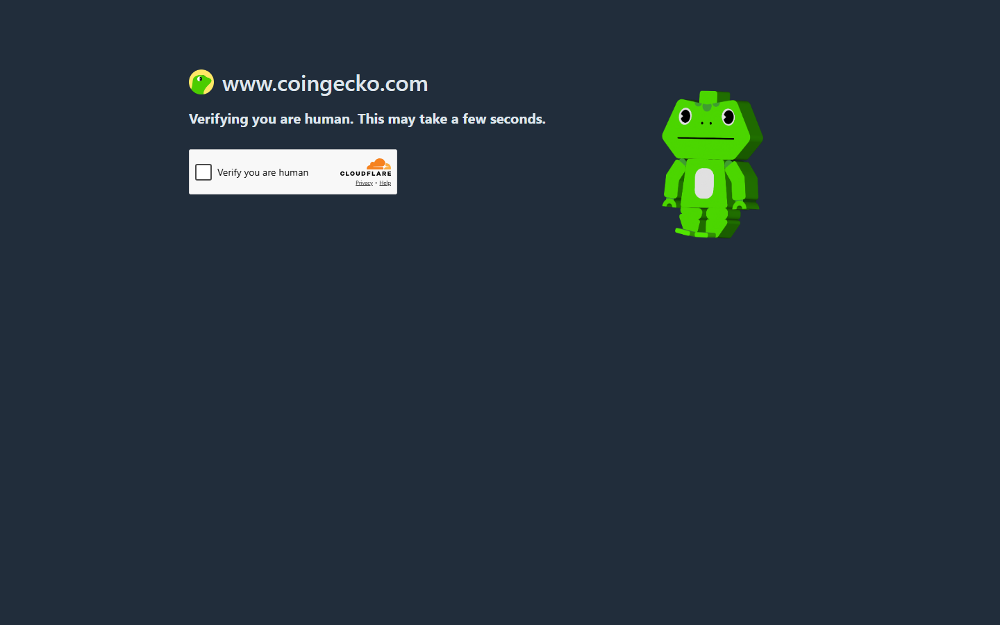

# Best Meme Coins with 50x–100x Potential in 2026

*By Crypto Markets Desk — Updated October 21, 2026*

> **⚠️ Risk Warning:** Meme coins are among the most volatile and speculative assets in existence. The vast majority of meme coins go to zero. Everything in this article is for informational purposes only and does not constitute financial advice. Never invest more than you can afford to lose entirely. Past performance does not guarantee future results.

---

## TL;DR — Quick Comparison Table

| Coin | Chain | Est. Market Cap (Oct 2026) | Tier | Our Rating |
|------|-------|---------------------------|------|------------|
| Dogecoin (DOGE) | Dogecoin L1 | ~$12.3B–$15B | Tier 1 (Established) | ⭐⭐⭐⭐⭐ |
| Shiba Inu (SHIB) | Ethereum / Shibarium | ~$3.4B | Tier 1 (Established) | ⭐⭐⭐⭐ |
| Pepe (PEPE) | Ethereum | ~$1.9B | Tier 1 (Established) | ⭐⭐⭐⭐ |
| Floki (FLOKI) | ETH / BNB Chain | ~$155M | Tier 2 (Mid-Cap) | ⭐⭐⭐ |
| Bonk (BONK) | Solana | ~$330M | Tier 2 (Mid-Cap) | ⭐⭐⭐⭐ |
| Dogwifhat (WIF) | Solana | ~$250M | Tier 2 (Mid-Cap) | ⭐⭐⭐ |
| SPX6900 (SPX) | Ethereum | ~$410M | Tier 3 (Low-Cap Gem) | ⭐⭐⭐ |
| AgentFun.AI (AGENTFUN) | Solana | Low cap | Tier 3 (High Risk) | ⭐⭐ |
| Pudgy Penguins (PENGU) | Solana | ~$600M | Tier 3 (Brand Play) | ⭐⭐⭐⭐ |
| Maxi Doge (MAXI) | ETH / Multi | Presale ($0.0003) | Presale | ⭐⭐ (Speculative) |

*Market cap data sourced from CryptoNews and BitcoinFoundation.org market desks, October 2026. All figures approximate and change rapidly.*

---

## What Separates a 100x Meme Coin from a Zero

Before we dive into individual coins, let's be blunt: for every meme coin that delivered a 100x, thousands more collapsed to zero and took retail investors down with them.

That said, the coins that *did* run shared a recognizable set of traits. Here is what separates a survivable meme play from a rugpull waiting to happen:

**1. Community size and engagement velocity**
A meme coin's community is its only real moat. DOGE has millions of holders across decades. PEPE has one of the most viral internet memes behind it. Coins with active Discord communities, growing Twitter/X follower counts, and genuine organic posting patterns tend to sustain price action longer than those riding paid promotion alone.

**2. Liquidity — minimum $10M daily volume**
Low liquidity is a trap. A coin with only $500K in daily volume can be moved by a single whale, and that same whale will be the one dumping on you. The CryptoNews markets desk uses a $10M daily volume floor as a minimum filter for their ranked lists — a reasonable threshold to adopt.

**3. Exchange listings (Tier-1 matters enormously)**
A coin listed on Coinbase, Binance, or Kraken has passed compliance and due diligence checks, has accessible fiat on-ramps, and reaches tens of millions of users. Coins only available on DEXs — or worse, only on a single obscure DEX — carry an order of magnitude more risk.

**4. Chain narrative**
In Q3–Q4 2026, Solana meme coins continue to dominate mindshare after the $4B+ Solana memecoin market cap milestone earlier this year. Ethereum still hosts PEPE and SHIB with deep institutional-grade liquidity. The chain matters: a meme coin riding a hot chain narrative gets a built-in tailwind.

**5. Verified contract and holder concentration**
Before buying anything, check the contract on Etherscan or Solscan. Run it through Bubblemaps to see if the top 10 holders control 40%+ of supply. Concentrated wallets = concentrated exit pressure. If bundle percentages are in the double digits, veteran traders advise to walk away immediately.

---

## Tier 1: Established Meme Coins (Lower Risk, 5x–20x Potential)

These are the blue chips of meme coins — if such a thing can be said with a straight face. They have survived multiple bear markets, hold Tier-1 exchange listings, and have built communities that span years. They are unlikely to 100x from current levels given their size, but they offer the best combination of upside and survivability in the category.

---

### 1. Dogecoin (DOGE)

**Current price (Oct 2026):** ~$0.0815  
**Market cap:** ~$12.3B–$15B  
**Key exchanges:** Coinbase, Binance, Kraken, Robinhood  
**Chain:** Dogecoin L1 (UTXO-based, Litecoin fork)

Dogecoin is the original. It has a market cap that dwarfs every other meme coin by a wide margin and, according to multiple October 2026 market reports, holds the #1 position in meme coin market capitalization. BitcoinFoundation.org's October 2026 analysis describes DOGE as having "the largest memecoin market cap and routinely trades hundreds of millions of dollars per day."

What makes DOGE interesting in late 2026 is not the Elon Musk factor (though that remains a wildcard) — it's **DogeOS**. The project is building an EVM-compatible application layer around Dogecoin. Its Chikyu testnet is already live, with developers able to deploy smart contracts using DOGE as the network currency. This gives Dogecoin a potential catalyst that has nothing to do with celebrity tweets: actual utility.

For years, the biggest knock on DOGE was that there was nothing to *do* with it besides send, hold, and speculate. DogeOS is attempting to address that structural weakness. If it reaches mainnet and gains developer adoption, DOGE acquires a second identity as a L2-hub asset — not just a meme.

**Upside scenario:** Bitcoin stabilizes above $80K, altcoin season arrives, and DogeOS mainnet launch triggers a new narrative. A return to 2024 highs would represent a meaningful gain from current levels.

**Risk:** Massive market cap means any percentage move requires billions in new capital. DOGE has given back 80%+ in previous bear cycles.

---

### 2. Pepe (PEPE)

**Current price (Oct 2026):** ~$0.00000452  
**Market cap:** ~$1.9B  
**Key exchanges:** Binance, Coinbase, OKX, Kraken  
**Chain:** Ethereum (ERC-20)

PEPE is the meme coin that proved the Ethereum ecosystem still had room for viral growth. Its $1B+ market cap milestone was a landmark moment for the ETH meme coin ecosystem, and the token has maintained relevance long after most expected it to fade.

BitcoinFoundation.org's October 2026 analysis notes that PEPE "gained nearly 30% over the past month before the start of October" and describes it as fitting the role of a momentum asset "almost perfectly" — enough liquidity to absorb large positions, enough volatility to outperform Bitcoin and Ethereum during speculative rallies.

The investment case for PEPE is not complicated: the Pepe the Frog meme has genuine cultural durability spanning decades. When retail speculation returns and capital rotates into the meme coin sector, PEPE typically captures a disproportionate share due to brand recognition and deep exchange liquidity.

CryptoNews' October 2026 market tracking lists PEPE as one of the four most actively traded meme coins by volume, alongside DOGE, FARTCOIN, and PENGU.

**Upside scenario:** Ethereum ecosystem resurgence, altcoin season inflow, and PEPE's proven ability to double or triple during short speculative windows.

**Risk:** No protocol revenue, no roadmap. Purely sentiment-driven. Can give back gains as fast as it makes them.

---

### 3. Shiba Inu (SHIB)

**Current price (Oct 2026):** ~$0.00000512  
**Market cap:** ~$3.4B  
**Key exchanges:** Binance, Coinbase, Kraken, Robinhood  
**Chain:** Ethereum + Shibarium (ETH L2)

SHIB started as a "Dogecoin killer" joke but has since built more infrastructure than almost any other meme coin. Shibarium — its Ethereum Layer 2 — is live and processing transactions. The wider Shiba ecosystem includes ShibaSwap (DEX), BONE (gas token), and LEASH (a scarcer companion token).

Shibarium's existence matters for SHIB bulls not because it immediately drives demand for the token, but because it demonstrates the team's sustained commitment to building past the meme phase. As BitcoinFoundation.org notes in its October 2026 analysis: SHIB has "strong infrastructure layer beneath, major-exchange liquidity, large holder base, and enough brand recognition to survive multiple market cycles."

The roughly $3.4B market cap leaves more room for percentage gains than DOGE.

**Upside scenario:** SHIB burns (the deflationary token-burn mechanism), Shibarium ecosystem activity growth, and renewed speculative interest in the broader Shiba universe.

**Risk:** Ethereum gas costs remain a friction point. Shibarium adoption has been slower than hoped. Multiple tokens in the ecosystem dilute attention.

---

## Tier 2: Mid-Cap Meme Coins (Medium Risk, 20x–50x Potential)

These coins sit in the $150M–$500M market cap range as of October 2026. They are small enough to deliver larger percentage moves when capital flows in, but large enough to have survived at least one major market cycle.

---

### 4. Floki (FLOKI)

**Market cap (Oct 2026):** ~$155M  
**Key exchanges:** Binance, OKX, Gate.io  
**Chain:** Ethereum and BNB Chain (dual deployment)

FLOKI has built more product around its token than almost any other meme coin outside the top three. Its ecosystem includes **Valhalla** (a blockchain RPG where FLOKI is used inside the game economy), **TokenFi** (a no-code tokenization platform), staking contracts, an educational platform, and a trading bot.

This is important: FLOKI is less a pure meme coin than a "utility-adjacent meme," as Tokenist's October 2026 report describes it. Valhalla uses FLOKI in-game rather than having the token exist only as a speculative ticker. That creates organic buy pressure beyond pure speculation.

BitcoinFoundation.org ranks FLOKI as the "utility-heavy memecoin" on their October 2026 list, noting its ecosystem gives it "more upside if attention returns, but also considerably higher risk" given its smaller market cap.

**Upside scenario:** Valhalla player base growth, TokenFi adoption, and meme season rotation into mid-caps.

**Risk:** Dual-chain deployment creates token confusion. Lower liquidity than Tier 1 names. Valhalla has seen slower-than-expected adoption.

---

### 5. Bonk (BONK)

**Market cap (Oct 2026):** ~$330M  
**Key exchanges:** Coinbase, Kraken, Binance  
**Chain:** Solana (SPL token)

BONK is the native Solana meme coin — airdropped to the Solana community in December 2022 as a morale boost during the FTX crisis, and it has never really left. It is deeply integrated across the Solana ecosystem: accepted on multiple Solana DEXs, supported by Jupiter aggregator, and used in Solana DeFi protocols as a reward token.

According to Changelly's September 2026 analysis, BONK ranks second among the best Solana meme coins to buy in 2026, and Tokenist explicitly calls it the "Best Solana-native meme coin with deep ecosystem ties."

The Solana memecoin market hit a $4B+ aggregate market cap milestone in April 2026, establishing Solana as the dominant chain for meme speculation. BONK has first-mover advantage within that ecosystem and is often the first coin traders rotate into when Solana momentum returns.

**Upside scenario:** Another Solana speculative wave, new BONK ecosystem integrations, and continued Solana DeFi growth driving organic demand.

**Risk:** Solana chain risk (network outages have occurred historically). Faces competition from newer, higher-volatility Solana memes.

---

### 6. Dogwifhat (WIF)

**Market cap (Oct 2026):** ~$250M  
**Key exchanges:** Binance, Coinbase, Kraken  
**Chain:** Solana (SPL token)

Dogwifhat is a picture of a Shiba Inu dog wearing a beanie hat. That is the entire concept. It shouldn't work, but somehow it became one of the most recognizable meme coins on Solana and accumulated hundreds of millions in market cap.

WIF is what Tokenist calls "the best high-beta speculative play" — meaning it tends to amplify Solana's moves in both directions. When the Solana meme ecosystem heats up, WIF often leads the charge. When it cools, WIF falls harder than most.

BitcoinFoundation.org's October 2026 comparison table shows WIF at ~$250M market cap, describing it as "one of Solana's most recognizable pure memecoins." Changelly's September 2026 Solana meme coin ranking places WIF at #3, behind PENGU and BONK.

For traders wanting the clearest possible expression of a Solana meme bet, WIF is a liquid, exchange-listed option with a lower barrier to entry than a new DEX-only token.

**Upside scenario:** Solana ecosystem bull run, WIF narrative revival, spot ETF approval for broader crypto assets driving retail FOMO.

**Risk:** Zero utility, zero roadmap. The entire thesis is "the hat dog wins." Competes for the same capital pool as BONK, PENGU, and dozens of newer Solana memes.

---

## Tier 3: Low-Cap Gems (High Risk, 50x–100x Potential)

These are smaller market cap plays where the math for 50x–100x returns is more achievable from a size perspective — but the risk of a total loss is also substantially higher. Position size accordingly.

---

### 7. SPX6900 (SPX)

**Market cap (Oct 2026):** ~$410M  
**Key exchanges:** Listed on major Tier-1 exchanges  
**Chain:** Ethereum  
**CryptoNews top 10 ranking:** #9 of all meme coins globally

SPX6900 is a "culture coin" built around the premise of "flipping the S&P 500" — a joke that became a rallying point for a surprisingly persistent and whale-heavy community. Despite the absurdity of the premise, SPX has climbed into the top 10 meme coins by market cap globally as of October 2026, per CryptoNews' latest rankings.

What makes SPX interesting is community character. The holders tend to be more ideologically committed and less prone to panic-selling than typical meme coin communities. Whale wallets have shown consistent accumulation rather than distribution. On Reddit's r/CryptoCurrency, user u/Icy-Condition-6724 commented in August 2026: *"Spx6900 is going to rip by the end of the year."*

BitcoinFoundation.org's October 2026 comparison table shows SPX at ~$410M with "extremely persistent community narrative" as its distinguishing trait.

At this market cap, SPX is borderline between mid-cap and low-cap, but its whale interest and cultural staying power give it a plausible path to multiple expansion.

**Upside scenario:** Broader altcoin season, new CEX listings, and the SPX6900 cultural narrative continuing to attract crypto-native degen capital.

**Risk:** The "flip the S&P" narrative is inherently ironic and could deflate. No underlying product or revenue.

---

### 8. AgentFun.AI (AGENTFUN)

**Chain:** Solana  
**Narrative:** AI agent infrastructure × meme  
**Risk tier:** Very High

AgentFun.AI sits at the intersection of two of 2026's strongest crypto narratives: AI agents and Solana meme coins. The project positions AGENTFUN as the native token for an on-chain AI agent platform, combining the speculative draw of AI infrastructure with the meme coin community dynamics.

The AI agent narrative has been one of the most powerful meta-narratives in crypto since late 2024. Projects that credibly combine an active meme community with an AI angle have outperformed pure memes in some cycles. AGENTFUN's thesis is that it can capture capital from both ecosystems simultaneously.

**Important caveats:** AGENTFUN is a smaller, higher-risk position. Unlike the established coins on this list, it has not been independently verified by CryptoNews, CoinMarketCap, or BitcoinFoundation.org's October 2026 rankings. Always verify the contract address from the official project website before buying. Check Bubblemaps for holder concentration. Confirm liquidity depth on Jupiter or Raydium before entering.

**Upside scenario:** AI agent meta heats back up, AGENTFUN captures the narrative with a working product, and capital rotates from pure memes into utility-adjacent Solana tokens.

**Risk:** Very high. This is a speculative allocation only, with significant rug pull and abandonment risk. Use only a tiny position size.

---

### 9. Pudgy Penguins (PENGU)

**Market cap (Oct 2026):** ~$600M  
**Key exchanges:** Binance, Coinbase, OKX  
**Chain:** Solana (token issued on Solana, NFT collection on Ethereum)

PENGU is one of the most interesting plays on this list because its value derives from a real-world brand, not just an internet meme. Pudgy Penguins is a blue-chip NFT collection that made it into mainstream retail stores (Walmart sold Pudgy Penguin toys), has millions of social media followers, and has built one of the most recognizable identities in Web3 consumer culture.

The PENGU token launched in late 2024 as the native token for the Pudgy Penguins ecosystem, giving the brand a liquid speculative vehicle. BitcoinFoundation.org October 2026 analysis describes it as "one of crypto's strongest consumer brands," noting it "combines memecoin speculation with a genuine consumer brand."

Tokenist's October 2026 rankings place PENGU as a standalone category: the "NFT-brand crossover." This is genuinely different from pure meme coins — PENGU has brand equity that can survive multiple market cycles and expand to new audiences.

Changelly ranks PENGU #1 among the best Solana meme coins to buy in 2026. Tokenist calls it one of the coins with "the most defensible position" in the meme coin space alongside DOGE.

**Upside scenario:** Pudgy Penguins brand expansion to new platforms, games, or partnerships. NFT-token crossover gains mainstream appeal. Solana ecosystem bull run.

**Risk:** Token price decouples from NFT floor price in unpredictable ways. Consumer brand success does not guarantee token appreciation.

---

## Presale Pick: Maxi Doge (MAXI)

**Presale price:** ~$0.0003  
**Launch target:** Q4 2026  
**Narrative:** Dogecoin-inspired + 1,000x leverage trading utility  
**Available on:** Official website (ETH, USDT, USDC, BNB, Bank Card)

Maxi Doge is a presale-stage project that appears on multiple October 2026 "best meme coins" lists, including CryptoNews and Tokenist. The project's pitch is a Dogecoin-inspired meme coin that incorporates leverage trading utility as a differentiator — positioning it at the intersection of the DOGE meme community and degen futures trading culture.

Key features from the public documentation:
- 1,000x leverage trading integration as a core use case
- High staking rewards for early supporters
- Community contests and partner events
- Q4 2026 token launch target

CryptoNews rates Maxi Doge as one of their three featured presale picks alongside Bitcoin Hyper and LiquidChain, noting it "offers high staking rewards to its early supporters." Tokenist calls it "the next DOGE-style coin with high-leverage, degen-trader branding."

**⚠️ Presale risk warning:** Presale coins carry the highest risk of any investment on this list. The project is pre-launch, the team may be anonymous, and there is no on-chain trading history. Presale investments can go to zero if the team abandons the project, the listing fails, or demand does not materialize post-launch. If you participate, use only capital you are fully prepared to lose, verify the official contract address before any transaction, and never send funds to links shared in social media or Discord DMs.

---

## How to Buy Meme Coins Safely

Whether you're buying an established name like DOGE or a Solana micro-cap, the mechanics matter. Here is the step-by-step:

**For Tier 1 coins (DOGE, SHIB, PEPE):**
1. Create an account on Coinbase, Binance, or Kraken
2. Complete KYC verification (usually same-day)
3. Deposit fiat via bank transfer or card
4. Buy directly — no special tools needed
5. For long holds, withdraw to a hardware wallet (Ledger, Trezor)

**For Solana meme coins (BONK, WIF, PENGU, AGENTFUN):**
1. Download Phantom or Backpack wallet
2. Buy SOL on a CEX and transfer to your wallet
3. Use Jupiter (jup.ag) as your aggregator for best price routing
4. Set slippage: 0.5–2% for established memes, 5–10% for smaller tokens
5. For brand-new launches: 10–15% slippage, with eyes on bundle percentage via GMGN

**For ETH meme coins (SPX, FLOKI):**
1. Use MetaMask or Rainbow wallet
2. Buy ETH on a CEX and transfer to wallet
3. Swap on Uniswap v3 for deep pools
4. Check gas before transacting — ETH gas can make small trades uneconomical

**Slippage guide from experienced traders:**
- 0.5–2%: Established memes with deep pools (PEPE, DOGE, SHIB)
- 5–10%: Mid-cap Solana memes (BONK, WIF)
- 10–15%: Early-stage tokens — proceed with caution

---

## Risk Management

If there is one section of this article to read twice, it is this one.

**Position sizing:**
Most professional crypto traders allocate no more than 1–5% of their total portfolio to any single meme coin. The broader meme coin allocation should be a fraction of a crypto portfolio, which itself should be a fraction of overall investable assets. Size your positions so that a total loss would sting, but not ruin you.

**Take-profit ladders:**
Set sell orders before you buy. A common approach:
- Sell 25% at 3x
- Sell 25% at 5x
- Sell 25% at 10x
- Let the remaining 25% ride (your "house money" position)

This locks in profit and prevents the most common meme coin mistake: watching a 20x turn into a 2x because you got greedy.

**Stop-loss rules:**
Meme coins move fast in both directions. Many experienced traders use a mental stop-loss of -30% to -50% from entry, though the highly volatile nature of meme coins makes traditional stop orders risky (they can trigger on wicks and recover). When setting stops on leverage platforms, always select *fair price* rather than *last price* to avoid liquidation on temporary wicks.

**Rug pull red flags — check before you buy:**
- Team is anonymous and has no verifiable prior projects
- Top 10 wallets control more than 40% of supply (check Bubblemaps)
- No third-party audit exists or the audit is from an unknown firm
- Liquidity pool is not locked (a developer can drain it instantly)
- Token contract has a "mint" function (developers can create more tokens)
- The only promotion comes from paid influencers and Telegram groups
- Bundle percentage is in double digits (per GMGN) — this indicates coordinated whale launch

---

## What Reddit Actually Says About Meme Coins in 2026

The real unfiltered view of meme coin investing comes from Reddit's crypto communities. In August 2026, two threads — one on r/CryptoCurrency and one on r/CryptoMarkets — drew hundreds of comments from investors at every level. Here is what they actually said:

**On whether meme coins are worth it at all:**

> *"Putting a small percentage of your portfolio in a few memecoins that you think could randomly go semi-viral and maybe 10–100x, then sure it's worth a gamble. Just be smart with what you put in and don't get your hopes up. Find established category leaders with a cult following."*
> — u/ArthurCBark, r/CryptoCurrency

> *"They do best when there's a lot of retail capital sloshing about."*
> — u/steepleton, r/CryptoCurrency

**On the survivorship bias problem:**

> *"Looking back it is easy to feel like we missed the 20x or 100x opportunities but survivorship bias plays a huge role. We mostly remember the few winners and forget the thousands of meme coins that went to zero."*
> — u/Next-Ambassador9097, r/CryptoMarkets

**On timing and strategy:**

> *"Meme coins usually make more sense closer to the start of a bull run, when attention and liquidity are returning. Buying them too early can mean watching your position hit one 'bottom' after another for the next couple of years."*
> — u/MarioWilson122, r/CryptoCurrency

> *"Memecoins can still run hard in the short term honestly, but they're tough to see as long-term plans. The attention moves fast, liquidity ends up drying, and the whole narrative can just disappear overnight. Check who holds the supply, how liquid it is, upcoming unlocks, and whether anyone promoting it is invested or paid."*
> — u/Dangerous_Tap_5045, r/CryptoMarkets

**On the blue-chip vs. degen spectrum:**

> *"Been in crypto over 5 years. I don't buy shit coins any more, only blue chip. If you want to indulge in a meme coin, get an established one that isn't going away. No you won't get a 100x, but you will preserve your capital."*
> — u/Tamber12, r/CryptoMarkets

**On market conditions (October 2026):**

> *"Memecoins are generally better for trading rather than long-term crypto investing. Robinhood Chain just launched and numerous memecoins have hit $50–$100 million market cap within the last few weeks including $ANSEM and $CATE, so the market is heating up. For newcomers, suggest monitoring the market for a bit to get a feel for trading and which coins seem to last over time."*
> — u/Memescreener, r/CryptoMarkets

> *"Spx6900 is going to rip by the end of the year."*
> — u/Icy-Condition-6724, r/CryptoCurrency

**On entry timing:**

> *"Been seeing plenty of 5x, 10x runners on Robinhood pop up. You just have to be early and sell at the right time. They are definitely not long-term investments."*
> — u/LavoP, r/CryptoMarkets

The consensus — to the extent a Reddit thread has one — is nuanced: meme coins remain a viable short-term speculation vehicle for those with appropriate risk tolerance and position sizing. The window for naïve "buy and hold anything" meme trading closed long ago. The traders who consistently extract gains are disciplined about entry timing, position size, and exit execution.

---

## FAQ

**Q: Which meme coin has the highest 100x potential in 2026?**

Lower-market-cap coins mathematically need less new capital to achieve large percentage moves. Based on current market caps, Tier 3 plays (SPX, PENGU, AGENTFUN) and presale coins (MAXI) have the arithmetic for 50x–100x returns. However, the probability of that outcome is also substantially lower than for Tier 1 names. There is no free lunch in meme coins.

**Q: Is the Solana meme coin market still alive in 2026?**

Yes. The Solana memecoin market cap hit $4B+ in April 2026, and multiple sources from September–October 2026 (Changelly, Kraken, Airdropalert) confirm active trading in BONK, PENGU, WIF, USELESS, FARTCOIN, and new launches. Pump.fun continues to churn out new tokens. The ecosystem is live and competitive.

**Q: What is the safest meme coin to buy?**

No meme coin is "safe" — they are all speculative assets. Within the category, Dogecoin (DOGE) carries the lowest relative risk due to its multi-year track record, $12B+ market cap, deep institutional liquidity, SEC commodity classification, and Coinbase/Robinhood accessibility. It is still capable of losing 80%+ of value in a bear cycle.

**Q: What are the top meme coins by market cap in October 2026?**

According to CryptoNews' October 2026 market desk: Dogecoin (DOGE), Shiba Inu (SHIB), MemeCore (M), Pepe (PEPE), Official Trump (TRUMP), Pippin (PIPPIN), Bonk (BONK), Pudgy Penguins (PENGU), SPX6900 (SPX), and Floki (FLOKI).

**Q: How do I avoid getting rugged on a new meme coin?**

Check: contract verification on Etherscan/Solscan, liquidity lock status, Bubblemaps for holder concentration (avoid if top 10 hold >40%), bundle percentage on GMGN (avoid if double digits), whether the team has a doxxed or verifiable identity, and whether a third-party audit exists. If you cannot answer yes to at least three of these, reconsider.

**Q: What slippage should I set for meme coins on Solana?**

0.5–2% for BONK, WIF, PENGU (deep pools). 5–10% for mid-tier Solana memes. 10–15% for new launches only. Higher slippage settings expose you to worse fills and MEV sandwich attacks.

**Q: When is the best time to buy meme coins?**

Multiple Reddit traders and market analysts agree: meme coins perform best during periods of high retail activity and broader market momentum, typically in the early-to-mid phases of a bull cycle. Buying at the peak of speculative frenzy is how most meme coin holders end up bagholding.

---

*Updated October 21, 2026. Market cap data sourced from CryptoNews, BitcoinFoundation.org, and Tokenist market desks. All figures are approximate and subject to rapid change. Reddit quotes are sourced from public posts on r/CryptoCurrency and r/CryptoMarkets, August–October 2026.*

*This article is for informational purposes only. It does not constitute financial advice. Cryptocurrency investments, especially meme coins, carry extreme risk. You could lose your entire investment.*
