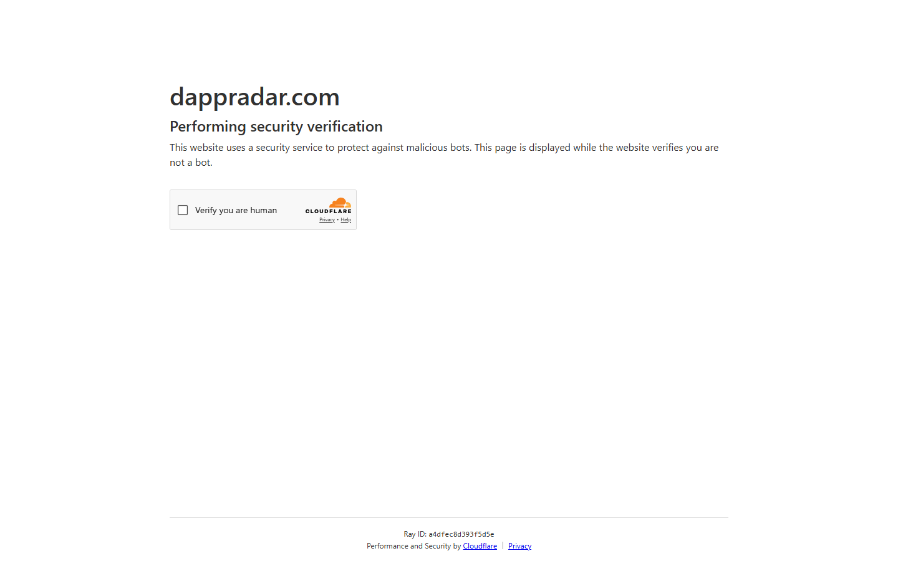
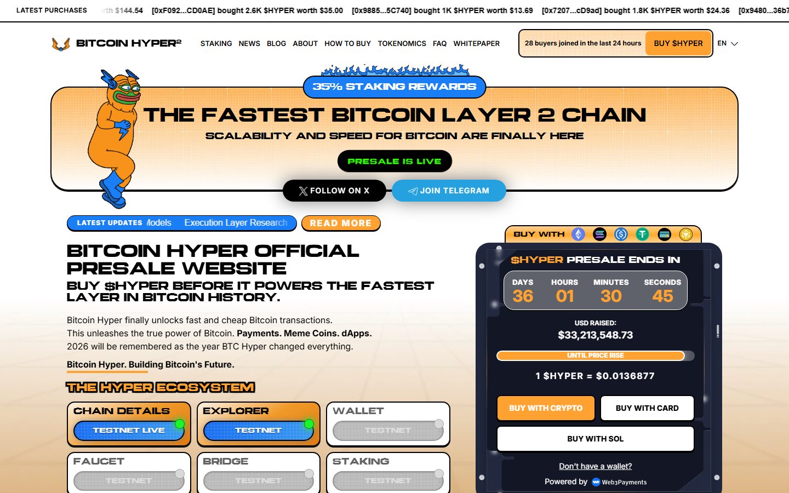
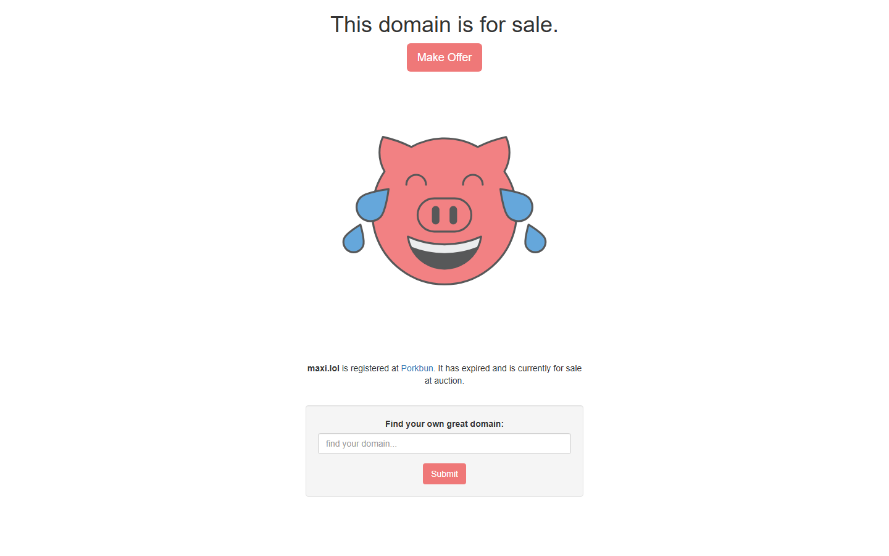

# Top 5 Crypto Presales to Buy in October 2026

*By Editorial Team — Updated October 21, 2026*

> **Disclaimer:** This article is for informational purposes only and does not constitute financial advice. Cryptocurrency presales are highly speculative investments. Token values can fall to zero. Always conduct your own due diligence and consult a licensed financial advisor before investing. Only invest capital you can afford to lose.

---

## Quick Verdict Table

| # | Project | Network | Presale Price | Hard Cap | Raised (Live) | Auditors | Our Rating |
|---|---------|---------|---------------|----------|----------------|----------|------------|
| 1 | Bitcoin Hyper (HYPER) | Bitcoin L2 / SVM | $0.01 (early) → $0.0337 (current) | $52.8M | $32.28M | Coinsult, SpyWolf | ⭐⭐⭐⭐⭐ |
| 2 | Maxi Doge (MAXI) | Ethereum | $0.00028185 | $15.7M | $4.78M | SolidProof, Coinsult | ⭐⭐⭐⭐ |
| 3 | SUBBD (SUBBD) | Multi-chain | $0.05759 | $55M | $1.52M | Coinsult, SolidProof | ⭐⭐⭐⭐ |
| 4 | LiquidChain (LIQUID) | Layer-3 (BTC/ETH/SOL) | $0.0148 | $20M | $926K | SpyWolf, CertiK | ⭐⭐⭐⭐ |
| 5 | EscapeHub (ESCAPE) | Multi-chain | $0.01752 | TBA | $347K+ | Hacken, SolidProof | ⭐⭐⭐½ |

*Raised figures sourced from official project websites and third-party trackers fetched October 21, 2026.*

---

## What Makes a Crypto Presale Worth Buying in 2026?

The presale landscape of 2026 is noisier than ever — thousands of tokens launch each month, and most will never see meaningful trading volume. According to [DappRadar's live presale tracker](https://dappradar.com/narratives/presales), four narratives are driving the credible end of the market right now:

- **Bitcoin Layer 2s** — projects extending BTC's capital base with high-throughput execution
- **AI × crypto utility** — tokens bundling AI tools with token-gated creator platforms
- **PayFi & real-world payments** — presales targeting merchant rails and on-chain forex
- **Inclusive DeFi** — cross-chain liquidity protocols widening access across ecosystems

When evaluating any presale, DappRadar's own guidelines emphasize four must-checks:

1. **Audit status** — Reputable auditors include CertiK, SolidProof, Coinsult, and Hacken. An unaudited contract is an immediate red flag.
2. **Token mechanics** — Look for renounced ownership, fixed supply, 0% transfer tax, and no hidden mint function.
3. **Allocation** — What percentage of total supply is sold in this round? A tiny presale allocation against a massive supply signals heavy future unlock pressure.
4. **Real product** — A live MVP, testnet, or working product beats a roadmap PDF every time.

With those criteria in mind, here are the five presales we tracked across Reddit, live project dashboards, and third-party analytics in October 2026.

---

## 1. Bitcoin Hyper (HYPER) — Best Overall Layer-2 Presale

**Network:** Bitcoin L2 + Solana Virtual Machine (SVM)  
**Presale Entry Price:** $0.01 (early stages) — currently $0.0337 (live on site as of Oct 21, 2026)  
**Hard Cap:** $52.8M  
**Raised:** $32.28M  
**Auditors:** Coinsult + SpyWolf  
**Presale End Date:** November 26, 2026 (per CryptoNews)

### What It Is

Bitcoin Hyper is the first Bitcoin Layer-2 network built on the Solana Virtual Machine — a fundamental architectural choice that unlocks 65,000 TPS on top of Bitcoin, while the underlying L1 still settles at ~7 TPS. Using ZK-rollup technology, Bitcoin Hyper batches Layer-2 transactions and periodically commits their state root to Bitcoin's Layer-1, preserving Bitcoin-grade security without sacrificing speed.

From the official [bitcoinhyper.io](https://bitcoinhyper.io) site, the architecture runs in four stages:

1. **Bridge** — Users deposit BTC to a designated address monitored by the Canonical Bridge. A Bitcoin Relay Program (an SVM smart contract) verifies block headers and transaction proofs, then mints equivalent BTC trustlessly on Layer 2.
2. **L2 Operation** — Near-instant finality, DeFi support (staking, DEXs), and SVM-powered smart contracts.
3. **Settlement & Security** — ZK-proofs validate all L2 transactions; state is periodically committed to Bitcoin L1.
4. **Withdrawal** — Users can withdraw back to BTC L1 at any time via the Canonical Bridge.

The $HYPER token is used for transactions, staking, and governance within the Bitcoin Hyper network.

### Why We Picked It

Bitcoin Hyper ranks first in [Tokenist's "Best Crypto Presales 2026" analysis](https://tokenist.com/investing/best-crypto-presales/) — one of the most methodologically rigorous presale review sites — specifically because of its "SVM-on-Bitcoin architecture, dual-audit coverage, and live fundraising progress."

At the time of writing, live purchase data visible on bitcoinhyper.io shows active wallets buying in bulk:

- `[0xe8Dc...2239a]` bought 90,700 $HYPER for $1,043.58
- `[0x7D7D...3d308]` bought 86,500 $HYPER for $994.99
- `[0x6086...ae434]` bought 5,300 $HYPER for $61.25

This real-time buy ticker signals ongoing retail demand, not just early-stage seed allocation.

### Reddit Sentiment

Sentiment on Reddit is mixed, which is typical for presales at this stage. On r/CryptoCurrency, user **u/TiABBz** suggested treating it as a high-risk speculative position: *"If you want the chance for a moonshot invest small amounts you can lose in REAL high-risk coins, like presales. Bitcoin hyper, Remittix, lilpepe etc."* On the skeptical end, **u/IdeaFrequent4358** in r/CryptoHelp posted: *"Pretty sure Bitcoin Hyper is just a presale scam."* However, in the same r/CryptoHelp thread about Bitcoin Hyper, another user countered: *"If you purchase directly through the Bitcoin hyper website, it is totally safe and legit. Presale crypto is going to be very risky, however..."*

The presence of skeptics is not unusual for presales at this scale — the key check is the dual audit and the live fundraising counter.

### Tokenomics Breakdown

- **Total Supply:** Not published on site (hard cap-based model)
- **Hard Cap:** $52.8M
- **Presale raised:** $32.28M (~61% of hard cap sold)
- **Use cases:** Transactions, staking, ecosystem governance, bridging fees
- **Vesting:** Confirm via official channels before investing

### How to Buy

1. Create or connect a wallet (MetaMask, Best Wallet, or Phantom for SOL buyers)
2. Purchase ETH, BNB, USDT, USDC, or SOL on any major exchange
3. Visit [bitcoinhyper.io](https://bitcoinhyper.io) — type the URL manually; phishing clones are active
4. Connect wallet → select token amount → confirm transaction
5. SOL buyers claim on Solana; ETH/BNB buyers claim on Ethereum at TGE

### Pros / Cons

| ✅ Pros | ❌ Cons |
|--------|--------|
| First SVM-on-Bitcoin L2 architecture | Presale runs until Nov 26 — price rises each stage |
| Dual audit (Coinsult + SpyWolf) | Scam clones actively circulating |
| $32.28M raised — strong demand signal | No mainnet live yet (testnet announced) |
| 65,000 TPS target vs. Bitcoin's 7 TPS | Token claim vesting terms unconfirmed |
| ZK-proofs preserve Bitcoin-grade security | Regulatory uncertainty around BTC derivatives |

---

## 2. Maxi Doge (MAXI) — Best Meme Coin Presale

**Network:** Ethereum  
**Presale Price:** $0.00028185  
**Hard Cap:** $15.7M  
**Raised:** $4.78M (source: DappRadar, Oct 21, 2026)  
**Auditors:** SolidProof + Coinsult  
**Launch Target:** Q3 2026

### What It Is

Maxi Doge ($MAXI) is an Ethereum-native meme token that fuses the Doge brand with a bodybuilding and "maximum gains" aesthetic — 1,000x leverage trading competitions, a 5% dedicated staking pool, and a "proof of workout" community mechanic. As described on [DappRadar's MAXI listing](https://dappradar.com/dapp/maxi): *"Maxi Doge ($MAXI) merges the viral appeal of the Doge brand with a bodybuilding and high-leverage trading aesthetic... featuring a robust staking protocol and trading competitions designed to reward 'diamond hand' holders."*

The structural protections are notable for a meme coin:

- **0% buy/sell tax** — all gains stay with investors, not the protocol
- **Renounced ownership** — the team cannot alter the contract post-deployment
- **No mint function** — fixed supply, no ability to inflate token count
- **Dual audit** — SolidProof + Coinsult both verified the contract

### Why We Picked It

Among meme coin presales, MAXI stands out for one specific reason: it has both structural protections (renounced ownership, 0% tax) AND a utility layer (staking, trading competitions). At $4.78M raised against a $15.7M hard cap, there is still runway before the presale closes. A separate article from [CoinGabbar noted](https://www.coingabbar.com/en/price-prediction/maxi-doge-presale-nears-end-maxi-mirror-dogecoin-2021-bull-run): *"Only $337,000 separates the Maxi Doge presale from closing permanently and Uniswap going live"* — indicating the presale is approaching its final stages.

Multi-chain accessibility is also a plus: despite being Ethereum-native, presale purchases can be made with ETH, BNB, USDT, or credit cards.

### Reddit Sentiment

Reddit sentiment is cautious. On r/CryptoScams, user **u/MissGetClapped** opened a thread asking *"Quick question is maxidoge a scam? Probably right as most presales are, but it seems so legit.."* User **u/intelw1zard** (Top 1% Commenter) responded: *"Those were not news articles, but rather paid press releases the scammers paid to have published."* This is a fair warning applicable to virtually all presale marketing — paid PR placements on news sites are industry-standard but should not substitute for independent verification of the audit and contract.

On the positive side, r/CryptoCurrency user **u/[OP in 1n0fpqe thread]** noted that *"Maxi Doge ($MAXI) is gaining traction with its presale raising over $1.5M, positioning itself as a high-risk, high-reward meme coin."* (The figure has since grown to $4.78M per DappRadar.)

### Tokenomics Breakdown

- **Total Supply:** Fixed (renounced, no mint)
- **Staking Allocation:** 5% of total supply dedicated to staking rewards
- **Tax:** 0% buy / 0% sell
- **Partnerships & Events allocation:** 25% of supply (per Tokenist data)
- **Payment options:** ETH, BNB, USDT, credit card

### How to Buy

1. Set up MetaMask or Best Wallet
2. Fund with ETH, BNB, or USDT
3. Visit the official Maxi Doge presale site (verify via official X or Telegram)
4. Connect wallet → enter amount → confirm
5. Tokens claim at TGE

### Pros / Cons

| ✅ Pros | ❌ Cons |
|--------|--------|
| 0% taxes — full gains retained by holders | Meme coin: no guaranteed utility outside trading |
| Renounced ownership — admin-key risk eliminated | High competition in Doge-derivative market |
| Dual audit (SolidProof + Coinsult) | Paid PR presence raises organic credibility questions |
| Near hard cap = potential listing imminent | Ethereum gas fees make small purchases inefficient |
| Multi-chain payment options | Meme coin sentiment can reverse quickly |

---

## 3. SUBBD (SUBBD) — Best AI Creator Economy Token

**Network:** Multi-chain (Ethereum + BNB)  
**Presale Price:** $0.05759 (current stage, per CoinGabbar)  
**Hard Cap:** $55M  
**Raised:** $1.52M  
**Auditors:** Coinsult + SolidProof  
**Staking APY:** 20%

### What It Is

SUBBD is an AI-powered creator platform targeting the $85 billion subscription content market. It connects over 2,000 top-earning creators with a combined following of 250 million+, offering token-gated content, AI voice cloning, AI influencer creation, and automated fan engagement tools.

From the official [subbdtoken.com](https://subbdtoken.com):

> *"$SUBBD token powers the next generation of content creators. Powered by AI, the SUBBD platform revolutionizes creator-fan relationships."*

The platform's AI toolkit includes:
- **AI Profile Creation** — generate an AI persona
- **AI Voice Cloning** — custom voice notes
- **AI Video** — video editor and generator
- **AI Livestreams** — automated go-live capability

Token holders benefit from staking (20% APY), platform discounts, VIP livestream access, XP multipliers, and early beta feature access.

### Why We Picked It

SUBBD occupies a unique niche: it is the only presale in this list that already has a live creator network before its token launches on exchanges. The 250M+ combined following figure is a real distribution advantage — most crypto projects launch with no user base at all.

The 20% APY staking rate is live during presale, allowing buyers to compound their position before TGE. According to [Tether's Neura investment news coverage on CryptoRank](https://cryptorank.io/news/feed/1c84f-tether-1-billion-neura-ai-investment-subbd-token-presale-roars), SUBBD focuses on *"digital labor for creators through AI assistants and on-chain tools"* — a category that is attracting institutional capital in the broader AI × crypto narrative.

### Tokenomics Breakdown

Total supply: 1,000,000,000 $SUBBD

| Allocation | Tokens | % |
|-----------|--------|---|
| Marketing | 300,000,000 | 30% |
| Product Development | 200,000,000 | 20% |
| Exchange Liquidity | 180,000,000 | 18% |
| Airdrops | 100,000,000 | 10% |
| Community Rewards | 70,000,000 | 7% |
| Staking Rewards | 50,000,000 | 5% |
| Treasury | 50,000,000 | 5% |
| Creator Rewards | 50,000,000 | 5% |

*Note: The 30% marketing allocation is high. Verify that marketing spend translates to platform growth, not just token promotion.*

### How to Buy

1. Connect MetaMask or Best Wallet
2. Acquire ETH, BNB, USDT, or USDC
3. Visit [subbdtoken.com](https://subbdtoken.com) (verify official domain)
4. Select amount → connect wallet → confirm → optionally stake immediately for 20% APY
5. Staked tokens can be withdrawn 7 days after presale claiming goes live

### Pros / Cons

| ✅ Pros | ❌ Cons |
|--------|--------|
| 250M+ creator network = real distribution | 30% marketing allocation is top-heavy |
| 20% APY staking available during presale | TGE date still unconfirmed |
| AI tooling is live (voice cloning, image gen) | $1.52M raised — still very early stage |
| $85B addressable market | Creator platforms face intense Web2 competition |
| Dual audit (Coinsult + SolidProof) | AI claims are broad — product depth TBC |

---

## 4. LiquidChain (LIQUID) — Best Cross-Chain Presale

**Network:** Layer-3 unifying Bitcoin, Ethereum, and Solana  
**Presale Price:** $0.0148  
**Hard Cap:** $20M  
**Raised:** $926,000 (source: EdgeX Exchange article, July 31, 2026)  
**Auditors:** SpyWolf + CertiK  
**Staking APY:** 1,220% (declining as participation increases)

### What It Is

LiquidChain is a Layer-3 protocol designed to solve crypto's deepest infrastructure problem: fragmentation. Bitcoin holds the deepest capital pools. Ethereum underpins the majority of DeFi. Solana delivers high-throughput consumer UX. But moving assets or data between these three networks requires bridges — and as EdgeX Exchange reported on July 31, 2026, cross-chain bridges have accumulated *"over $2 billion in losses from exploits such as Wormhole, Nomad, and Ronin Network."*

LiquidChain's Layer-3 architecture runs a unified execution environment that:

- **Verifies Bitcoin UTXOs, Ethereum states, and Solana accounts** in real time
- Creates **unified liquidity pools** without wrapping — assets from all three chains are fungible within the L3
- Uses a **high-performance VM** (Solana-class) for real-time DeFi across chains
- Enables **atomic cross-chain settlement** — no separate bridge transactions

The $LIQUID token serves as gas across all three ecosystems simultaneously and is designed to become deflationary through token burns.

### Why We Picked It

LiquidChain is the most technically ambitious entry on this list. It is not trying to be the dominant chain — it is trying to make Bitcoin, Ethereum, and Solana work together as one market. If successful, every DEX, lending protocol, and dApp on all three networks becomes its customer.

The dual audit (SpyWolf + CertiK) is particularly notable: CertiK is the most rigorous auditor in the industry, and few presales at this funding level attract their attention.

Per the [EdgeX article](https://pro.edgex.exchange/en-US/news/article/liquidchain-layer3-bitcoin-ethereum-solana): *"LiquidChain distinguishes itself from interoperability projects like Cosmos, Polkadot, and Chainlink by focusing specifically on unifying execution across the three highest-value blockchain networks."*

### Reddit Sentiment

The r/BestIcoPresaleList thread covering best presale projects in 2026 listed LiquidChain at #4, noting its *"seamless cross-chain settlement"* and *"multi-network compatibility."* General Reddit sentiment on cross-chain projects is cautiously positive in 2026, with most skepticism directed at bridge-based approaches rather than execution-layer unification.

### Tokenomics Breakdown

- **Total Supply:** 11,800,000,100 $LIQUID
- **AquaVault (BD + Community):** 15%
- **LiquidLabs (Marketing):** 32.5%
- **Rewards (Staking + Giveaways):** 10%
- **Growth & Listings:** 7.5%
- **Development:** 35%

### How to Buy

1. Create a MetaMask or Best Wallet
2. Fund with ETH, BNB, USDT, or USDC
3. Visit [liquidchain.com](https://liquidchain.com) (verify domain directly — do not click social media links)
4. Connect wallet → choose amount → select Buy and Stake to earn 1,220% APY during presale
5. Claim $LIQUID tokens at TGE

### Pros / Cons

| ✅ Pros | ❌ Cons |
|--------|--------|
| Solves a real infrastructure problem (bridge exploits) | 35% development allocation = team controls large share |
| Dual audit: CertiK (industry gold standard) + SpyWolf | 1,220% APY is unsustainable — will decline fast |
| Only $926K raised — very early entry point | No mainnet yet; still in development phase |
| Targets BTC + ETH + SOL — largest liquidity pools | High execution risk for cross-chain VM |
| Deflationary token mechanic (burn on use) | 32.5% to LiquidLabs (marketing) is significant |

---

## 5. EscapeHub (ESCAPE / $ESC) — Best DeFi Infrastructure Play

**Network:** Solana, Base, BSC, Arbitrum, Ethereum  
**Presale Price:** $0.01752 (Stage 3 at time of article)  
**Hard Cap:** TBA  
**Raised:** $347K+  
**Auditors:** Hacken (smart contract), SolidProof (KYC)  
**Entity:** EscapeHub LLC, Delaware, USA (registered 2026)

### What It Is

EscapeHub is a mobile-first multichain token launchpad — think Pump.fun, but with native iOS/Android apps, multi-chain coverage (Solana, Base, BSC, Arbitrum, Ethereum), signless transactions, and in-app fiat on-ramps via Google Pay, Apple Pay, and credit card.

As the only registered US company on this list, EscapeHub brings a degree of legal accountability rare in the presale space. From [escapehub.ai](https://escapehub.ai/): *"EscapeHub LLC · Delaware, USA · 2026."*

The platform's competitive differentiation vs. Pump.fun and BonkFun:

| Feature | EscapeHub | Pump.fun | BonkFun |
|---------|-----------|----------|---------|
| Native mobile app (iOS/Android) | ✅ | ❌ | ❌ |
| Multi-chain (5+ chains) | ✅ | Solana only | Solana only |
| Signless transactions | ✅ | ❌ | ❌ |
| In-app fiat on-ramp | ✅ | ❌ | ❌ |
| Creator fees (pre-bonding) | 0.5% | 0.3% | 0% |

The $ESC token has a fixed, non-inflationary supply of **1,618,033,988** (notably, 1/φ — the golden ratio — suggesting intentional symbolic design). Token allocation: 41.8% presale, 20% development, 20% staking, 10% liquidity, 8% growth/marketing, 0.2% airdrop (legacy holders).

### Why We Picked It

Launchpad infrastructure is one of the most durable sectors in crypto — Pump.fun has done over $500M in cumulative fees. EscapeHub is the first serious attempt to bring multi-chain launchpad UX to mobile with a regulated US corporate structure. As a tool used by token creators across five chains, it benefits from organic fee revenue regardless of which specific token succeeds or fails.

Per [Investing.com's ESCAPE presale coverage](https://www.investing.com/news/cryptocurrency-news/escape-presale-live-on-ethereum-with-280k-raised-hacken-audited-and-solidproof-kyc-verified-4205313), the presale saw *"180,000 USD raised within 24 hours"* at Stage 3 launch — a strong demand signal for an early-stage infrastructure play.

### Tokenomics Breakdown

| Allocation | Tokens | % |
|-----------|--------|---|
| Presale | 676,000,000 | 41.8% |
| Development | 323,000,000 | 20% |
| Staking | 323,000,000 | 20% |
| Liquidity Provision | 161,000,000 | 10% |
| Growth & Marketing | 129,000,000 | 8% |
| Airdrop (Legacy Holders) | 3,200,000 | 0.2% |

The 41.8% presale allocation is one of the highest on this list — more supply goes to early community rather than insiders.

### How to Buy

1. Visit [escapehub.ai](https://escapehub.ai) (verify the `.ai` domain)
2. Connect wallet (MetaMask, Phantom, or in-app wallet)
3. Purchase with ETH, USDT, or card
4. The presale uses a progressive price increase — earlier stages are cheaper
5. Track Stage status on the official site to catch price-rise windows

### Pros / Cons

| ✅ Pros | ❌ Cons |
|--------|--------|
| Registered US company (legal accountability) | Hard cap and total raise figure not yet published |
| Hacken audit + SolidProof KYC | Platform still in development — no live iOS/Android app yet |
| 41.8% to presale = community-heavy tokenomics | Token revenue depends on launchpad adoption post-TGE |
| Multi-chain + signless mobile UX is a genuine gap | Competing against Pump.fun's Solana brand dominance |
| $347K+ raised — very early entry window | Regulatory risk as a US-registered crypto entity |

---

## Crypto Presale Due Diligence Checklist

Before committing capital to any presale, work through this checklist:

- [ ] **Verify the official domain** by typing it manually — never click presale links in DMs or social posts
- [ ] **Confirm the audit report** is linked from the official site and the audited contract address matches
- [ ] **Check renounced ownership** on Etherscan (for EVM) or Solscan (for Solana) — look for "Ownership Renounced" flag
- [ ] **Read the vesting schedule** — confirm when tokens unlock and whether team allocations are locked
- [ ] **Check hard cap vs. total raise** — projects near their hard cap may be close to listing
- [ ] **Review the team's doxxing status** — are real identities publicly verifiable?
- [ ] **Search the project name + "scam" on Reddit** — patterns of complaints reveal red flags early
- [ ] **Confirm payment method legitimacy** — all five projects in this article accept ETH/USDT/card; no project requires exotic or OTC payment methods
- [ ] **Use only small amounts you can afford to lose entirely** — this is the most important item

---

## Risks to Know Before Investing

### Rug Pulls and Exit Scams

As documented across Reddit's r/CryptoScams threads throughout 2026, presale rug pulls follow a predictable pattern: paid press releases generate buzz, influencer posts amplify reach, and then the team withdraws liquidity at launch. The protection against this is renounced ownership, locked liquidity, and audited contracts — not news coverage or social media hype.

User **u/grapefruitrocket** on r/BestIcoPresaleList put it bluntly: *"Don't joke around, crypto presales are all scams. I don't know of a single presale coin that has been successful."* That's an overstatement — but the underlying skepticism is worth taking seriously.

### Regulatory Risk

All five projects in this list operate in a regulatory environment that is still evolving. EscapeHub's Delaware registration provides some legitimacy, but token securities classification varies by jurisdiction. Always verify whether presale participation is legal in your country.

### Vesting and Unlock Pressure

At TGE (Token Generation Event), presale tokens become claimable. If a significant percentage of supply unlocks simultaneously — and early buyers sell immediately — price impact can be severe. Always read the vesting schedule before entering a presale. Gradual linear vesting over 6–12 months is better than cliff unlocks.

### Market Timing Risk

The r/btc thread *"Are crypto presales still worth the risk in 2026?"* captured the dominant community sentiment: *"the presale meta in 2026 is mostly a lottery where the house always wins."* Even in a favorable macro environment, most presales underperform relative to simply holding BTC, ETH, or SOL.

### Liquidity Risk

Presale tokens are illiquid from purchase until TGE. If market conditions deteriorate between your purchase date and the listing date, you cannot exit the position. Consider this lock-up period carefully, especially for projects with unconfirmed TGE dates (SUBBD, LiquidChain).

---

## FAQ

**Q: What is a crypto presale and how is it different from buying on an exchange?**  
A: A presale is an early-stage token sale that occurs before a project lists on a centralized or decentralized exchange. Presale prices are typically lower than the projected listing price, but the tokens are illiquid until TGE and carry the risk of project failure. Buying on an exchange provides immediate liquidity; a presale does not.

**Q: Which presale on this list is closest to its listing date?**  
A: Bitcoin Hyper has a confirmed presale end date of November 26, 2026 (per CryptoNews). Maxi Doge is reportedly within $337,000 of its hard cap (CoinGabbar), which would trigger a Uniswap listing. The others (SUBBD, LiquidChain, EscapeHub) have not confirmed exact TGE dates as of October 21, 2026.

**Q: How do I verify a presale audit is legitimate?**  
A: Visit the auditor's official website directly (coinsult.net, solidproof.io, certik.com, hacken.io) and search for the project by name. The audit report should link to the exact contract address. Cross-reference the contract address with the one shown on the official presale dashboard. Never rely solely on a badge image on the presale site.

**Q: Is it safe to connect my MetaMask wallet to presale websites?**  
A: Connecting your wallet does not give a website access to your funds — only transaction approvals do. However, phishing clones of legitimate presale sites are designed to submit fraudulent approval requests that drain wallets. Always verify you are on the correct domain before connecting or approving any transaction.

**Q: What is the minimum investment for these presales?**  
A: The projects in this article target retail participants. Network gas fees make very small purchases ($10–$20) on Ethereum economically inefficient. A minimum practical investment on Ethereum-based presales (HYPER, MAXI, LIQUID, SUBBD) is approximately $50–$100 after accounting for gas. EscapeHub and Solana-accessible projects have lower effective minimums.

**Q: What happened to presales that raised big in previous cycles?**  
A: Results vary dramatically. Some presales (like early Solana ecosystem tokens) delivered 100x+ returns for presale buyers. Many others lost all value within weeks of listing. There is no reliable pattern — each project must be evaluated individually on fundamentals, not historical comparisons.

**Q: Should I diversify across multiple presales?**  
A: Diversification reduces single-project risk but also dilutes upside. A common approach is to allocate a small percentage of a broader crypto portfolio to presales — some analysts suggest no more than 2–5% of total crypto holdings in presale positions. Never invest presale capital that you cannot afford to lose entirely.

---

## Final Thoughts

October 2026 offers a credible selection of early-stage projects across different categories. **Bitcoin Hyper** leads on infrastructure ambition and fundraising momentum — $32.28M raised with a November 26 end date creates genuine time pressure. **Maxi Doge** is the strongest pure meme play, with structural protections that most meme coins lack. **SUBBD** has a real creator network and immediate 20% APY staking. **LiquidChain** is the highest-risk, highest-potential infrastructure bet — if it delivers on the BTC/ETH/SOL unification thesis, the market it addresses is enormous. **EscapeHub** is the sleeper: a registered US company building launchpad infrastructure that earns fee revenue regardless of which individual tokens succeed.

None of these are guarantees. All five could lose their entire value. The role of research — audits, tokenomics, community sentiment, live fundraising data — is to narrow the field to projects that at minimum have not already failed the basic checks.

Always DYOR. Always verify the contract. Never invest what you cannot afford to lose.

---

*Sources: bitcoinhyper.io (live data Oct 21 2026), dappradar.com/dapp/maxi (live data Oct 21 2026), subbdtoken.com, liquidchain.com, escapehub.ai, tokenist.com/investing/best-crypto-presales/, pro.edgex.exchange/en-US/news/article/liquidchain-layer3-bitcoin-ethereum-solana (Jul 31 2026), cryptonews.com/cryptocurrency/bitcoin-hyper-launch-date/, coingabbar.com/en/price-prediction/maxi-doge-presale-nears-end-maxi-mirror-dogecoin-2021-bull-run, dappradar.com/narratives/presales, investing.com/news/cryptocurrency-news/escape-presale-live-on-ethereum-with-280k-raised-hacken-audited-and-solidproof-kyc-verified-4205313, Pullpush.io Reddit API (Oct 21 2026), r/CryptoCurrency, r/CryptoHelp, r/CryptoScams, r/BestIcoPresaleList.*
