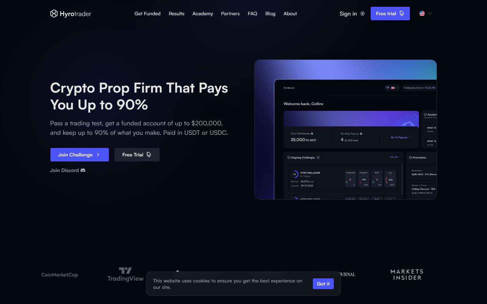
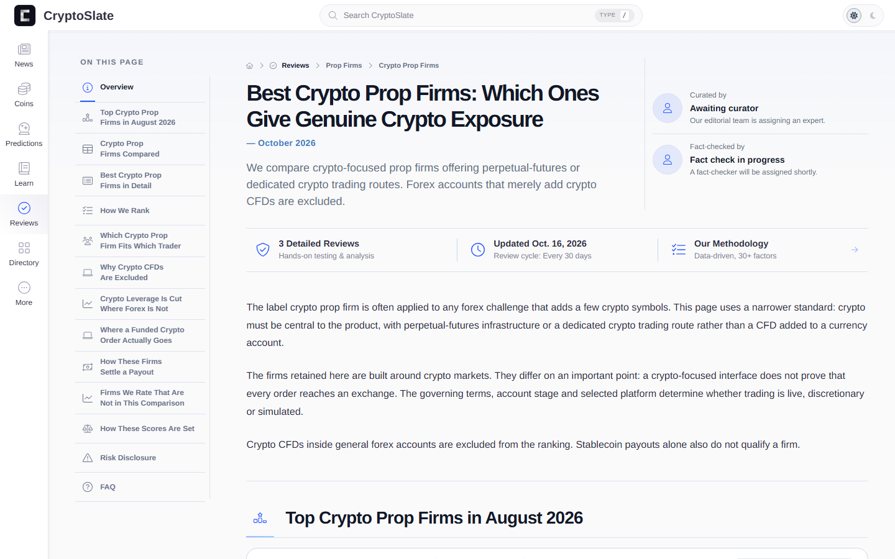
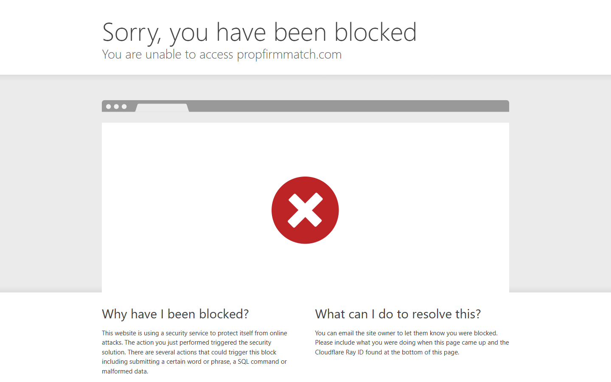

# Top Crypto Prop Trading Firms in 2026

*By the Editorial Team - Updated October 22, 2026*

> **Disclaimer:** This article is for informational purposes only and does not constitute financial advice. Prop trading challenges involve risk of losing your challenge fee. Always read a firm's full terms and conditions before paying for any evaluation. Past payout records do not guarantee future payouts.

---

## Quick Verdict Table

| Firm | Challenge Type | Max Funding | Profit Split | Challenge From | Best For |
|------|---------------|------------|--------------|----------------|----------|
| **HyroTrader** | 1-Step, 2-Step, Zero-Step | ,000 | 80–90% |  | Real exchange execution on Bybit |
| **Breakout** | 1-Step | ,000 | 80–90% |  | Budget-friendly entry, Kraken-backed |
| **Crypto Fund Trader** | 1-Step, 2-Step | ,000 | 80–90% |  | Wide pair coverage |
| **Goat Funded Trader** | 1-Step, 2-Step | ,000 | 80–90% |  | Scaling plans up to  |
| **FTMO** | 2-Step | ,000 | 80–90% |  | Established brand, forex + crypto |

---

## What Is Crypto Prop Trading?

Proprietary trading firms — prop firms — provide traders with access to a funded simulated account sized to reflect real capital. You trade perpetual futures on Bitcoin, Ethereum, and hundreds of altcoins under live market data. When you generate profits while following the firm's defined risk rules, you receive a cash payout; the firm keeps a percentage as its fee.

The model solves a straightforward problem. A skilled trader operating a personal account of ,000 to ,000 can only generate limited income regardless of how well they read the market. The same trader running a ,000 or ,000 funded account converts identical skill into substantially larger payouts. Prop firms monetize that gap: they take a challenge fee upfront and a share of the eventual profits.

Crypto markets suit this model particularly well. Bitcoin, Ethereum, and major altcoins trade twenty-four hours a day, seven days a week. Perpetual futures markets don't close on Fridays, which means the volatility spikes and funding-rate flips that crypto traders are built to exploit are accessible at all times. Most serious crypto prop firms reflect this by allowing weekend trading and overnight holding without restriction.

The segment has grown rapidly. As of mid-2026, there are dozens of crypto-native prop firms operating globally, ranging from bare-minimum operations to sophisticated platforms with real exchange connectivity and on-chain payout verification. The quality gap between the best and the worst is substantial — which is why firm selection matters more than challenge price.

---

## How We Evaluated These Firms

Our methodology uses six criteria:

- **Execution quality:** Does the firm route orders through a real exchange like Bybit or Binance, or does it run a synthetic price feed? Real exchange data is the gold standard.
- **Rule clarity:** Are drawdown calculations, trailing vs. static limits, and consistency rules clearly documented? Hidden rule complexity is a leading cause of payout refusals.
- **Payout speed and reliability:** How quickly does the firm process payouts? Are there verified trader testimonials and on-chain records?
- **Challenge cost per dollar funded:** Entry cost divided by account size tells you how much you're paying for access to capital.
- **Scaling path:** Can you grow your funded account past the initial tier?
- **Community and transparency:** Does the firm maintain an active community, publish a public payout leaderboard, and respond to user concerns openly?

---

## 1. HyroTrader — Best Overall Crypto Prop Firm

**Founded:** 2023 | **HQ:** Dubai, UAE (office in Prague) | **Rating:** 4.7/5 (210+ reviews on site) | **Paid out:** +

### What It Is

HyroTrader is a crypto-native prop firm that routes funded accounts directly through each trader's own Bybit sub-account via secure API. Unlike firms that use a synthetic simulator, HyroTrader's traders see live exchange order books, real spreads, and genuine market depth. The firm covers 700+ USDT perpetual pairs with leverage up to 150x on BTC and ETH, and supports alternative terminals including Tealstreet, BloFin, and Tiger.com.

As of October 2026, HyroTrader has funded more than 1,700 traders, paid out over  million to funded accounts, and maintains a community of 35,000+ members on Discord.

### Challenge Structure and Profit Split

| Plan | Profit Target | Max Drawdown | Days Required | Starting Split |
|------|--------------|--------------|---------------|----------------|
| Zero-Step | No evaluation | 4% trailing | None | 80% |
| One-Step | 10% | 5% daily / 10% max | 5 minimum | 80%, up to 90% |
| Two-Step | Phase 1: 10%, Phase 2: 5% | 5% daily / 10% max | 5 per phase | 80%, up to 90% |

Challenge fees start at  for a ,000 USDT account and scale to  for ,000. The challenge deposit is refundable with the first payout. Payouts are processed within 24 hours in USDT or USDC to the trader's own wallet.

Scaling is available: traders can grow to  in funded capital within 12 months through HyroTrader's scaling plan.

### Trustpilot Snapshot

HyroTrader holds a 4.7/5 score from 210+ verified reviews on its platform. A sample of recent reviewer comments:

> *"The platform is user-friendly, payouts are quick, and trading on Bybit means there's no learning curve. It's been a smooth experience from start to finish."* — Gaijin (April 2026)

> *"Trading through Bybit makes everything even more convenient. Withdrawals have been fast and reliable."* — Richie (April 2026)

> *"I've been trading with HyroTrader for over a year... the biggest advantage is being able to trade directly on Bybit with access to real markets. Payouts are processed within 24 hours."* — Rudolf Poldauf (March 2026)

### Reddit Sentiment

> *"Hands down the best crypto prop firm I have seen out here. Their platform is a real exchange, what makes trading smooth and transparent — no manipulation. The rules are clear, and their support team in Discord is super helpful and responds quick. One of the things I love most is their 24h payouts."* — u/Supheus (r/Hyrotrader)

The r/Hyrotrader community is primarily positive, with most discussion centered on challenge strategies, payout timelines, and the Bybit connection workflow. Common points of friction mentioned: KYC is required after passing the challenge, and US traders using VPNs need to ensure Bybit access is available in their setup.

### Pros and Cons

| Pros | Cons |
|------|------|
| Real Bybit account — no synthetic feed | KYC required post-challenge |
| 700+ trading pairs, up to 150x leverage | US geo-restriction (Bybit region) |
| 24-hour USDT/USDC payouts | Scaling plan has conditions |
| + verified payout record | No forex or stock accounts |
| Refundable challenge deposit | Newer firm (2023), shorter track record than FTMO |

---

## 2. Breakout — Best Entry-Level Crypto Prop Firm

**Owner:** Payward (Kraken's parent company) | **Founded:** 2021 (acquired by Payward 2024) | **CryptoSlate Rank:** #1 (August 2026)

### What It Is

Breakout was acquired by Payward — the holding company behind Kraken — giving it an unusual layer of institutional backing among retail-oriented prop firms. Ranked #1 by CryptoSlate's August 2026 comparison of crypto-native prop firms, Breakout's main differentiators are its extremely low entry cost (challenges from ), a fully disclosed conflict-of-interest statement in its terms, and a public payout leaderboard with cumulative totals.

### Challenge Structure and Profit Split

Breakout offers a single 1-Step evaluation model. Profit split starts at 80% from day one and can reach 90%. Maximum funding reaches ,000 — the highest ceiling of any firm in this list. Maximum drawdown ranges from 3–6% depending on the account tier.

Notably, Breakout publishes its own potential conflicts of interest directly in its trading terms — a level of transparency rare in the prop firm space.

### Reddit Sentiment

> *"Great prop firm, took me a few times to pass the evaluation on a 10k account. They even paid out on the same day which was impressive. I would recommend."* — reviewer on Breakout's listing (2026)

The community frequently highlights Breakout's no-consistency-rule stance, allowing traders to take high-conviction trades without worrying about per-day profit distribution.

### Pros and Cons

| Pros | Cons |
|------|------|
| Challenges from  — lowest in class | Relatively simple 1-step only |
| Kraken/Payward institutional backing | Fewer platform options vs HyroTrader |
| Public payout leaderboard | Geo-restrictions on some regions |
| Discloses conflicts in terms | Less community presence than HyroTrader |
| Up to  max funding | |

---

## 3. Crypto Fund Trader — Best for Altcoin Coverage

**Founded:** 2021 | **CryptoSlate Rank:** #3 (August 2026)

### What It Is

Crypto Fund Trader is one of the earlier crypto-native prop firms, offering both 1-step and 2-step evaluation models with account sizes from ,000 to ,000. The firm supports a wide range of cryptocurrency pairs and has developed a reputation for rule clarity and fast challenge resets. Challenge fees start from .

### Challenge Structure

The 2-step model uses a Phase 1 profit target of 8% and Phase 2 target of 5%, with a static maximum drawdown of 6% of the initial balance. Profit split begins at 80% and scales to 90%. Trading is allowed on weekends with no time restrictions.

### Pros and Cons

| Pros | Cons |
|------|------|
| Long operating history (2021) | Payouts slower than HyroTrader (not 24h) |
| Broad crypto pair support | Proprietary platform, not exchange-native |
| Flexible weekend and news trading | No scaling to + like HyroTrader |
| Competitive pricing from  | Moderate Trustpilot activity |

---

## 4. Goat Funded Trader — Best Scaling Path

**Founded:** 2022 | **Max Scaling:** ,000,000

### What It Is

Goat Funded Trader positions itself around an aggressive scaling program that allows consistent performers to reach  million in funded capital — the highest ceiling in the industry. The firm offers both 1-step and 2-step evaluations with account sizes from ,000 to ,000, starting from .

The scaling plan activates after 10% profit growth on a funded account. Traders can double their account size at each milestone, with the ceiling at  reached after multiple successful scaling events.

### Challenge Structure

| Account | Fee | Profit Target | Max Drawdown | Split |
|---------|-----|--------------|--------------|-------|
| ,000 |  | 10% | 10% | 80–90% |
| ,000 |  | 10% | 10% | 80–90% |
| ,000 |  | 10% | 10% | 80–90% |
| ,000 |  | 10% | 10% | 80–90% |

### Pros and Cons

| Pros | Cons |
|------|------|
|  scaling ceiling — best in class | Many competitors offer lower challenge fees |
| Entry from  | Scaling takes time (multiple milestones) |
| Clear 10-step scaling milestones | Newer, less verified payout history |
| Weekend trading allowed | |

---

## 5. FTMO — The Veteran Standard (Forex + Crypto)

**Founded:** 2015 | **HQ:** Prague, Czech Republic | **Reddit reputation:** Strong but cautionary notes emerging in 2026

### What It Is

FTMO is the firm that largely defined the retail prop trading industry. Founded in 2015 in Prague, it remains the single most recognized brand in the space and was consistently rated the top firm through 2024. In 2025–2026, however, user reports emerged of increasing rule strictness, tighter consistency requirements, and occasional payout disputes — reflected in several Reddit threads.

FTMO's crypto offering uses CFD-based crypto pairs (Bitcoin, Ethereum, major alts) rather than native exchange perpetuals. For pure crypto perpetual futures traders, this is a meaningful distinction: spreads differ, leverage caps are lower, and the trading experience differs from exchange-native platforms like HyroTrader or Breakout.

### Challenge Structure

The classic FTMO Challenge uses a 2-step model: 10% profit target in Phase 1, 5% in Phase 2. Maximum daily loss is 5%, maximum overall loss is 10%. Profit split starts at 80% and reaches 90% after a scaling plan event. Challenges start at  for a ,000 account.

### Reddit Sentiment

> *"FTMO — once was the top firm. It's really not worth it to try all these other firms, they just come and go and screw people over... but watch out for The5ers, many issues keep popping up."* — u/Ill-Purchase-9801 (r/Daytrading, 2026)

> *"I'd say Topstep or Tradeify. Depends on what you are looking for."* — u/kenji_endo10 (r/Daytrading)

### Pros and Cons

| Pros | Cons |
|------|------|
| 10+ years operating history | Crypto via CFD, not native perpetuals |
| Largest brand recognition | Challenge fees higher than competitors |
| Robust community and educational content | Tighter consistency rules in 2026 |
| Available to 180+ countries | Payout dispute reports increasing in 2026 |
| Forex + commodities + crypto in one account | Lower leverage than crypto-native firms |

---

## Red Flags to Avoid in Crypto Prop Trading

The prop trading space has a serious quality problem. For every reputable firm, there are multiple operations that collect challenge fees with no intention of paying out.

**1. No verifiable payout history**
Legitimate firms publish payout leaderboards, trader interviews, or on-chain transaction records. If a firm's only evidence of payouts is a generic counter on its homepage, that is insufficient.

**2. Unrealistically generous rules**
A firm offering a 95% profit split, zero drawdown limits, and instant funding for  is either new and undercapitalized or structurally designed to collect fees. Compare terms carefully against established norms (80–90% split, 5–10% drawdown limit).

**3. Not listed on PropFirmMatch.com**
u/Ill-Purchase-9801 specifically flagged in r/Daytrading: "There are also a lot of firms who are not even listed on PFM; STAY AWAY FROM THOSE. Those firms don't even want traders and prey on complete rookies via ads." PropFirmMatch independently verifies that reviewers are actual traders.

**4. Trustpilot reviews as the only third-party signal**
Multiple Reddit users have noted that Trustpilot does not verify whether reviewers actually traded with the firm. Use PropFirmMatch, CryptoSlate's verified ranking, and Reddit community feedback together, not Trustpilot alone.

**5. Hidden rule changes after funding**
Read the trading rules in full before purchasing a challenge. Key things to verify: Is the drawdown trailing or static? Is there a consistency rule that caps how much profit can come from a single day? Are there restricted trading windows around news events?

**6. No real exchange connectivity**
If a firm does not disclose its execution environment — whether live exchange, simulated, or CFD — treat that as a red flag. HyroTrader and Breakout both explicitly state their execution model in their published terms.

---

## FAQ

**What is the difference between a simulated and a live prop trading account?**
A simulated account mirrors real exchange conditions — live pricing, realistic spreads — but no actual money is committed at the exchange level until a payout is due. A live account uses real funds. Most retail prop firms operate on a simulated model and fund payouts from their own reserves or challenge fee income. HyroTrader's Bybit integration sits in a middle ground: trading happens on a real Bybit account, but the capital is controlled at the API level.

**How much can I realistically earn from a crypto prop firm?**
Verified funded traders at HyroTrader have publicly reported earnings between ,000 and ,645 on individual funded accounts. Earnings depend entirely on trading skill, account size, and market conditions. The challenge fee is the only capital at risk for the trader.

**Is prop trading legal?**
In most jurisdictions, paying a challenge fee and receiving a profit share is legal. The structure is similar to a licensing arrangement rather than a regulated investment service. However, regulations vary; traders in the US should confirm that any firm they use accepts US residents, as many require VPN use or outright block US IPs.

**What happens if I blow my funded account?**
You lose access to the funded account. You do not owe the firm any additional money beyond the original challenge fee. You can purchase a new challenge to attempt the evaluation again, sometimes at a discount offered by the firm.

**How are payouts processed?**
Most crypto prop firms pay in stablecoins (USDT or USDC). HyroTrader processes within 24 hours directly to a wallet address. FTMO uses bank transfer or crypto. Payout frequency is typically on-demand or monthly.

**What is a trailing drawdown vs. a static drawdown?**
A static drawdown is calculated from your account's starting balance. If you start with ,000 and the max drawdown is 10%, you can lose up to ,000 — permanently. A trailing drawdown follows your highest account balance. If you grow to ,000, your floor moves to ,000. Trailing drawdowns are stricter and require more careful risk management.

**Can I use trading bots on a prop firm account?**
Depends on the firm. HyroTrader explicitly allows automated trading. FTMO restricts certain automated strategies. Always check the firm's algorithmic trading policy before connecting a bot.

**What is the best crypto prop firm for beginners?**
Breakout (low cost from , simple 1-step structure) or BonkBot-adjacent Solana prop options for very small capital. For traders ready to commit to a real evaluation, HyroTrader's One-Step at  for a ,000 account is among the most accessible entry points with genuine exchange connectivity.

**How do I avoid prop firm scams?**
Use PropFirmMatch.com as your primary filter. Only consider firms with documented, verifiable payout histories. Read challenge terms in full — specifically the drawdown methodology, consistency rules, and prohibited trading behaviors. Never pay for a challenge fee from a platform you found only through a social media ad with no independent reviews.

**Is FTMO still the best prop firm in 2026?**
FTMO remains a legitimate and historically reliable firm, but its position as the default recommendation has weakened. Crypto-native traders increasingly prefer firms with real exchange connectivity (HyroTrader, Breakout) over FTMO's CFD-based crypto offering. For forex traders, FTMO remains highly competitive. For pure crypto perpetual futures, the newer generation of crypto-native firms has structural advantages.

---

*Sources: hyrotrader.com (October 2026), cryptoslate.com/prop-firms/crypto-trading (August 2026), tradesanta.com/blog/the-best-crypto-prop-trading-firms-2026, altfins.com/knowledge-base/the-best-crypto-prop-trading-firms, goatfundedtrader.com/blog/best-crypto-prop-firm, Reddit r/Hyrotrader and r/Daytrading (2025–2026), PropFirmMatch.com.*

---

## How to Pass a Crypto Prop Challenge: A Practical Strategy

Understanding the mechanics is half the battle. Here is a framework that applies to most 1-step and 2-step crypto prop challenges regardless of firm.

### Step 1: Choose the Right Account Size

The most common mistake is selecting the largest account to maximize payout potential. Larger accounts have larger absolute drawdown limits, but the percentage rules are identical. Start with an account size where the challenge fee is under 1% of your liquid savings — this ensures you can attempt multiple challenges without financial strain.

### Step 2: Calculate Your Risk-Per-Trade First

Before placing a single trade, calculate the maximum risk-per-trade given the drawdown rules. On a standard 10% max drawdown / 5% daily limit:

| Account | Max Loss | Daily Max | Safe Risk Per Trade |
|---------|---------|-----------|---------------------|
| ,000 | ,500 | ,250 | – (0.5–1%) |
| ,000 | ,000 | ,500 | – (0.5–1%) |
| ,000 | ,000 | ,000 | –,000 (0.5–1%) |

Trading 0.5–1% per trade keeps you far from both limits while still generating meaningful progress toward the profit target.

### Step 3: Treat the Challenge Like a Funded Account

The most reliable way to pass a challenge is to trade as if you are already funded — no revenge trading, no doubling down, no forced trades to hit the profit target by an artificial deadline. Consistent small profits compound more reliably than large single-day swings.

### Step 4: Understand the Drawdown Type Before You Start

Trailing vs. static drawdown is not a minor technical detail — it fundamentally changes how you manage your trades. On a trailing drawdown account, locking in profits and reducing your position size after growth milestones is essential. On a static drawdown account, your floor is fixed from day one and does not move.

### Step 5: Withdraw Early on the Funded Account

Once funded, request your first payout as soon as you are eligible. This does two things: it confirms the firm actually pays, and it reduces the psychological pressure of managing a large balance. A firm that processes your first payout smoothly is a firm you can trust with larger subsequent profits.

---

## The Crypto-Native vs. CFD Distinction: Why It Matters

The most important technical distinction in crypto prop trading in 2026 is whether a firm uses crypto-native perpetual futures or contracts for difference (CFDs) for its crypto products.

**Crypto-native perpetuals** (HyroTrader, Breakout) involve trading on real cryptocurrency futures markets — the same instruments used by professional crypto traders on Bybit, Binance, or OKX. Funding rates, open interest, and the order book reflect actual crypto market participants. Leverage up to 100x is standard on major pairs.

**CFDs** (FTMO's crypto offering) are derivative instruments offered by the prop firm itself, priced to track the underlying crypto asset. The firm is your counterparty. Leverage is typically lower (10–25x on most CFD crypto products), spreads can be wider, and the experience is more analogous to trading crypto on a traditional financial platform than on an exchange.

For traders whose strategies are built around funding rate arbitrage, order book analysis, or exchange-specific liquidity dynamics, crypto-native perpetuals provide a materially more authentic trading environment. For traders who simply want directional exposure to Bitcoin and Ethereum price movements, the distinction is smaller.

---

## Community Resources for Crypto Prop Traders

**PropFirmMatch.com** — The most reliable independent verification layer for prop firm reviews. Reviewers must submit evidence they actually traded with the firm. Use this as your first filter.

**r/Daytrading and r/PropFirms on Reddit** — Active communities where traders share challenge experiences, flag payout issues, and discuss strategy. Treat individual reviews with healthy skepticism; patterns across many reviews are more reliable.

**Hyrotrader Discord (35,000+ members)** — One of the largest crypto prop firm communities, useful for challenge strategy discussion and verified payout reports.
