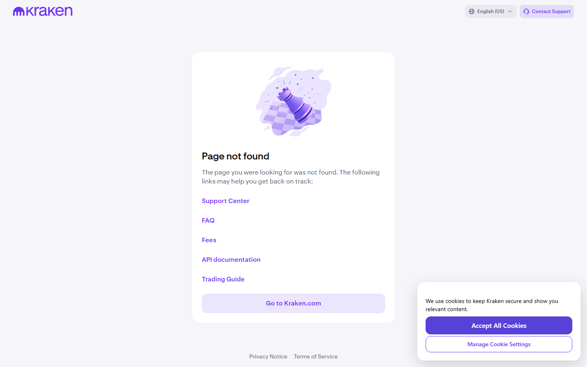
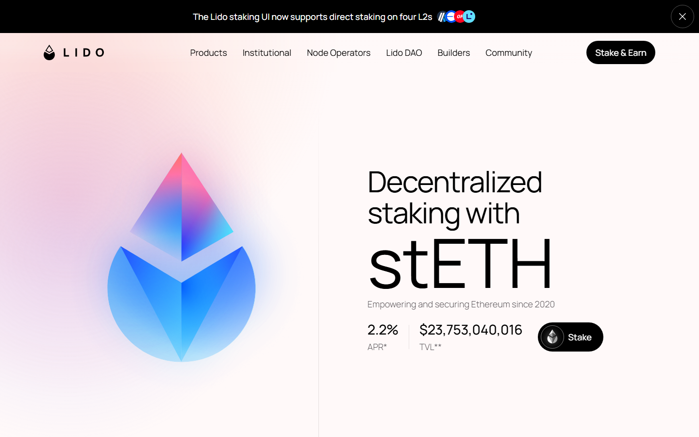
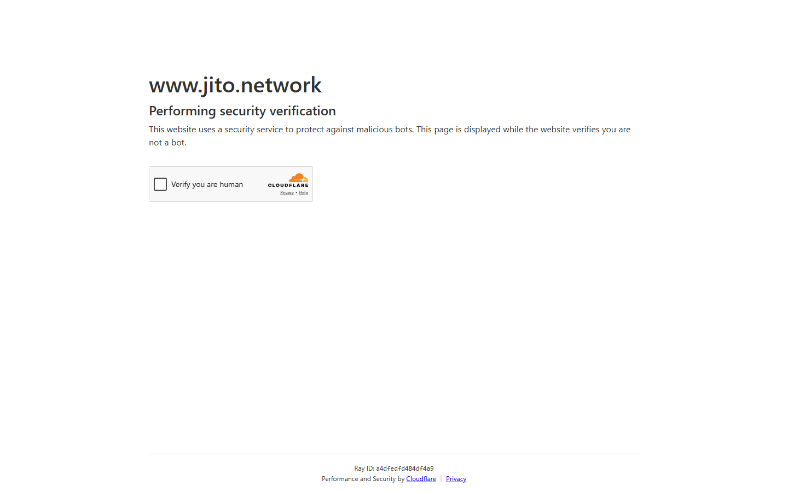
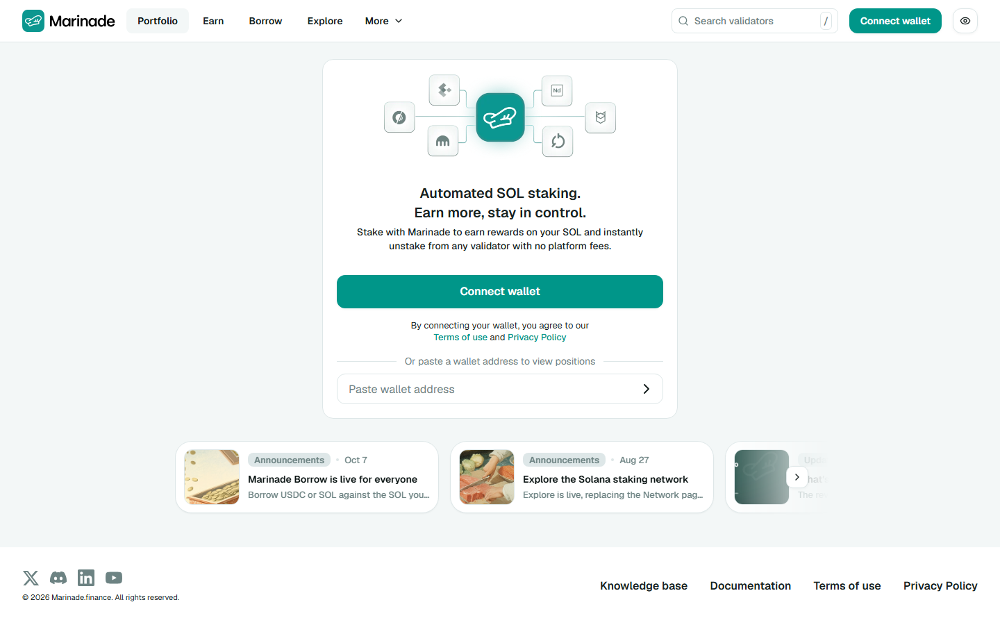

# Best Crypto Staking Platforms in 2026: Highest APY for ETH, SOL & Stablecoins

*By the Upshift Research Team — Updated October 21, 2026*

> **Disclaimer:** This article is for informational purposes only and does not constitute financial or investment advice. Crypto staking carries risk including smart contract exploits and validator slashing. Always do your own research.

> **Rates in this article reflect on-chain and platform data as of September 28, 2026.** APYs change daily. Always verify the current rate on the platform's own page before staking.

---

Crypto staking paid between **1.69% and 4.92% APY** on the two largest proof-of-stake networks in late September 2026 — and the platform you pick can cost you more than 30 percentage points of your rewards before a single dollar lands in your wallet. That gap between Coinbase's 35% commission and Jito's 4% commission is the single biggest variable most stakers ignore.

This guide covers the eight best staking platforms for ETH, SOL, and stablecoins, ranked within each category. It includes live APYs sourced from DefiLlama and each platform's own product page, real Reddit experiences from r/defi, r/ethereum, and r/solana, and a plain-English breakdown of which model — exchange staking, liquid staking, staking-as-a-service, or restaking — fits which type of investor.

---

## Quick APY Comparison Table (September 28, 2026)

| Platform | Asset | Rate | Commission | Custody | Exit Time | Best For |
|---|---|---|---|---|---|---|
| Jito | SOL (jitoSOL) | **4.92%** | 4% of rewards | Non-custodial (smart contract) | ~2 days or sell jitoSOL | Liquid SOL staking with MEV |
| Marinade | SOL (mSOL) | **4.76%** | ~6% of rewards | Non-custodial (smart contract) | ~2 days or sell mSOL | Steady native SOL staking |
| Kraken | ETH | **2.72%** | Taken from quoted rate | Custodial (Kraken holds keys) | Flexible or bonded terms | US users wanting exchange convenience |
| Lido | ETH (stETH) | **2.34%** | 10% of rewards | Non-custodial (smart contract) | ~21 hours or sell stETH | DeFi users needing collateral |
| Binance | ETH (WBETH) | **2.23%** | Not disclosed | Custodial (Binance holds keys) | Daily quota redemption | Non-US Binance users |
| Coinbase | ETH | **1.69%** | **35%** of rewards | Custodial (Coinbase holds keys) | Protocol exit times apply | US beginners wanting simplicity |
| EigenLayer | ETH (restaked) | Variable (+extra) | Operator-set | Non-custodial (smart contract) | Ethereum exit queue | ETH power users seeking extra yield |
| Maple Finance | USDC/USDT | **6–9%** | Platform fee | Custodial (institutional) | Varies by pool | Institutional stablecoin lending |

*Sources: upshift.finance/blog/best-crypto-staking-platforms (published September 29, 2026); DefiLlama yields page; individual platform product pages.*

---

## What Is Crypto Staking?

**Proof-of-Stake** is the consensus mechanism used by Ethereum, Solana, Cosmos, Polkadot, and most major blockchains after Bitcoin. Instead of burning electricity to validate transactions (proof-of-work), these networks require validators to lock up — *stake* — tokens as collateral. In exchange, validators earn newly minted tokens and, on some chains, MEV (maximal extractable value) from transaction ordering. That is the reward you collect when you stake.

Most retail investors never run a validator directly. They delegate to one of four platform models:

### The 4 Staking Models

**1. Exchange Staking** (Coinbase, Kraken, Binance)
The exchange takes custody of your tokens, pools them into validators it controls, and pays you a share of rewards after taking its commission. Simple to use, no wallet required — but you give up custody and pay the highest fees.

**2. Liquid Staking** (Lido, Jito, Marinade, Rocket Pool)
You deposit tokens into a smart contract and receive a *liquid staking token* (LST) in return — stETH for ETH, jitoSOL for SOL. The LST accrues staking rewards over time and can be traded, used as DeFi collateral, or sold instantly. You never lose access to your capital.

**3. Staking-as-a-Service** (Figment, Kiln)
Professional validator operators run the infrastructure on your behalf, but *you keep your own withdrawal keys*. Favored by institutions and high-net-worth holders who want yield without giving up custody.

**4. Restaking** (EigenLayer)
Already-staked ETH (or LSTs like stETH) can be *re-pledged* to secure additional services called Actively Validated Services (AVS), earning extra rewards. The tradeoff: extra slashing conditions mean additional risk of losing principal.

---

## ETH Staking: Best Platforms Compared

Ethereum's exit queue stood at approximately 3 days on September 28, 2026. That means any native ETH unstake — through any platform — goes through the same protocol queue. Platforms differ in their commission, whether they offer a faster market exit via an LST, and what they do with your withdrawal keys.

---

### 1. Kraken — Best for Flexible ETH Staking (up to 2.72% APY)

**Rate:** Up to 2.72% APY on ETH (September 28, 2026)
**Commission:** Taken from the quoted rate (exact percentage not published)
**Custody:** Kraken holds all staked assets
**Availability:** 17 assets available for US clients

Kraken offers both flexible and bonded staking terms for ETH, allowing US customers to choose between immediate liquidity or a slightly higher locked rate. With 17 stakeable assets on the US platform, it is the most asset-diverse exchange staking product available to American investors.

The platform's longevity matters here: Kraken has operated since 2011, has never suffered a major hack, and reinstated US staking products on January 30, 2025 following a settlement with the SEC. That regulatory resolution removed a cloud that had kept risk-averse US stakers away.

**What Trustpilot shows:** Kraken holds a mixed rating on Trustpilot, with many five-star reviews praising security and advanced trading tools, while one-star reviews cluster around KYC delays and account verification friction — not security failures. The staking product itself is rarely the subject of negative reviews.

**Pros:**
- Most asset selection for US stakers (17 assets)
- Flexible and bonded term options
- Long operating history, no security breaches
- Competitive rate vs. other custodial options

**Cons:**
- Custodial — Kraken holds your keys
- Commission percentage not transparently published
- No liquid staking token; you cannot use staked ETH as DeFi collateral

---

### 2. Lido — Best for DeFi Integration (stETH 2.34% APY)

**Rate:** stETH 2.34% APY (September 28, 2026)
**Commission:** 10% of rewards (split between node operators and the Lido DAO treasury)
**Custody:** Non-custodial — smart contract holds ETH, you hold stETH
**Exit:** Withdrawal request takes approximately 21 hours, or sell stETH instantly on Curve or secondary markets

Lido is the largest liquid staking protocol by total value locked, holding over $14 billion in staked ETH at the time of writing. Its stETH token is accepted as collateral across Aave, Maker, and most major DeFi lending protocols — a practical advantage that pure exchange staking cannot match.

A major 2026 development: **Lido Earn** launched instant withdrawal functionality in August 2026, meaning holders no longer need to wait 21 hours for standard withdrawals — they can exit instantly through the new Earn interface, according to an ETH Daily post dated August 12, 2026, from r/ethereum: *"Lido Earn enables instant withdrawals."*

Lido controls approximately 30% of all staked ETH. The concentration risk is a known concern among Ethereum developers, some of whom have advocated for EIPs that would reduce staking yield as total staked ETH grows — making solo staking and Rocket Pool's more decentralized model increasingly discussed alternatives.

**Pros:**
- Non-custodial — you hold stETH, not Lido
- stETH works as DeFi collateral on Aave, Maker, and more
- Largest liquidity pool — easiest to exit quickly
- Instant withdrawals via Lido Earn (August 2026)

**Cons:**
- 10% commission is higher than non-custodial alternatives like Rocket Pool (~14% but decentralized differently)
- Concentration risk — 30% of staked ETH in one protocol
- US regulatory status for LSTs remains unsettled

---

### 3. Coinbase — Best for US Beginners (1.69% APY)

**Rate:** 1.69% APY on ETH (September 28, 2026)
**Commission:** 35% — the highest of any major platform
**Custody:** Coinbase holds all staked assets
**Availability:** Available to eligible US users through a regulated brokerage interface

Coinbase's 35% commission is the most important number to understand before using this platform. On a $10,000 stake earning 1.69% APY, that commission costs you approximately $170 per year compared to staking the same ETH through Jito or Lido — more than the entire Lido 10% commission.

The case for Coinbase staking is entirely about convenience and regulatory clarity. It sits inside a regulated US brokerage, it integrates with Coinbase's tax reporting tools, and it requires zero knowledge of wallets or DeFi. For a new investor depositing $500 to learn about staking, the simplicity premium may be worth the cost. For anyone staking $5,000 or more, the math suggests moving to a non-custodial LST.

**Pros:**
- Simplest onboarding in the market
- Integrated tax reporting and 1099 forms
- Regulated US entity with FDIC-insured cash balances
- 24/7 customer support

**Cons:**
- 35% commission — the highest in this comparison
- Lowest ETH APY (1.69%) of any platform listed here
- Custodial — Coinbase holds your withdrawal keys
- No liquid staking token

---

### 4. EigenLayer — Best for ETH Restaking (Power Users)

**Rate:** Base ETH yield + variable restaking rewards from Actively Validated Services
**Commission:** Set by individual operators; not fixed
**Custody:** Non-custodial smart contracts
**Exit:** Ethereum exit queue (plus a 7-day withdrawal delay for EigenLayer itself)

EigenLayer allows holders of staked ETH or ETH LSTs (including stETH) to *restake* — pledging the same ETH as economic security for additional protocols beyond Ethereum itself. In theory, this earns extra yield on assets you are already staking. In practice, it also subjects your principal to *additional slashing conditions* from the operators and AVS protocols you choose.

EigenLayer is suitable for ETH holders who already understand slashing risk, actively monitor their restaking positions, and are prepared for the complexity of managing multiple operator relationships. It is not a set-and-forget product.

**Pros:**
- Extra yield on already-staked ETH
- Supports the broader Ethereum ecosystem security model
- Non-custodial

**Cons:**
- Additional slashing risk on top of standard ETH staking risk
- 7-day unbonding period on withdrawal
- High complexity — requires active monitoring
- Restaking rewards are variable and protocol-dependent

---

## SOL Staking: Best Platforms

Solana staking operates on an epoch schedule of approximately 2 days. Stakes activate and deactivate at epoch boundaries, which means unstaking takes between 1 and 2 days regardless of platform. Both Jito and Marinade offer an immediate exit by selling the LST (jitoSOL or mSOL) on secondary markets.

---

### 5. Jito — Best SOL Staking with MEV Rewards (4.92% APY)

**Rate:** jitoSOL 4.92% APY (September 28, 2026)
**Commission:** 4% of rewards
**Custody:** Non-custodial — smart contract
**Exit:** Up to 1 epoch (~2 days), or sell jitoSOL on Raydium, Orca, or Jupiter

Jito is the dominant liquid staking protocol on Solana by TVL, and its 4% commission is significantly lower than any ETH staking option. The rate premium over Marinade comes from Jito's MEV extraction — Jito validators run the Jito-Solana client, which captures and redistributes MEV revenue to jitoSOL holders. MEV yield adds variance: some epochs pay more than the headline APY, others less.

Reddit's Solana community has widely adopted jitoSOL as the default staking choice. u/Ok_Gas1070 wrote in r/solana:

> *"Honestly, JitoSOL is still popular not sure about 'the best' but your asset remains liquid so you can still trade it while it's staked. Traditional staking you lock up your SOL (it takes a few days to lock at the end of a epoch). While it's locked you can't trade it and it gets a certain APY. When you unstack it you have to wait a few days, or whenever the current Epoch ends. I recommend the Kyzzen validator if you're going to go the traditional route, but if you want to remain liquid use Jito."*

**Pros:**
- Highest SOL APY in this comparison (4.92%)
- Lowest commission (4%)
- MEV rewards on top of base staking yield
- jitoSOL usable as DeFi collateral on Kamino, Drift, and others

**Cons:**
- MEV rewards add yield variance
- Smart contract risk (audited but non-custodial means no SIPC or insurance)
- Jito Labs controls significant validator share — centralization debate ongoing in the Solana community

---

### 6. Marinade — Best for Steady Native SOL Staking (~4.76% APY)

**Rate:** mSOL approximately 4.76% APY (September 28, 2026)
**Commission:** ~6% of rewards
**Custody:** Non-custodial — smart contract
**Exit:** Up to 1 epoch (~2 days) natively, or sell mSOL on secondary markets

Marinade is the original Solana liquid staking protocol and distinguishes itself from Jito on decentralization: Marinade delegates across hundreds of validators using its stake algorithm, whereas Jito concentrates more stake in its MEV-enabled validator set. For stakers who prioritize Solana's network health over squeezing every basis point of yield, Marinade's broader delegation is a meaningful advantage.

Marinade also offers a *native staking* option (no LST issued) with direct validator delegation for users who want non-custodial staking without taking on the liquidity risk of holding an LST on a DEX.

u/colemusic1 summarized liquid staking's UX advantage in r/ICPTrader:

> *"When I hop on to stake SOL via Marinade or Jito, I don't have to check the hundreds of diversified validators; it's hidden from the user to make it simple, quick and accessible."*

**Pros:**
- Broadly decentralized — delegates across hundreds of validators
- mSOL widely supported as DeFi collateral
- Native staking option for non-LST preference
- Battle-tested — one of Solana's oldest protocols

**Cons:**
- Slightly lower APY than Jito (no MEV extraction)
- ~6% commission slightly above Jito's 4%

---

## Stablecoin Yield: USDC & USDT in 2026

**Important distinction:** Stablecoin "yield" is lending, not staking. You are not validating transactions or locking tokens for network security. You are lending your USDC or USDT to borrowers — through institutional pools like Maple Finance or synthetic yield products like Ethena — and receiving interest in return.

This distinction matters legally. The **GENIUS Act**, signed into law in July 2025, explicitly bars stablecoin issuers from paying yield directly to token holders. This is why Circle's USDC and Tether's USDT pay zero native yield. All stablecoin yield is generated through third-party lending or yield products.

As of October 2026, major DeFi lending platforms (Aave, Compound, Morpho) are paying approximately **3–6% APY** on USDC/USDT, down from the 8–15% peaks of the 2021 cycle.

---

### 7. Maple Finance — Best for Institutional USDC Lending (6–9% APY)

Maple Finance operates institutional under-collateralized lending pools, connecting yield-seeking lenders with vetted institutional borrowers — market makers, quantitative trading firms, and crypto-native companies. Rates on Maple's USDC pools were running **6–9% APY** in October 2026, above the 3–6% range available on permissionless DeFi lending.

The tradeoff is counterparty risk: under-collateralized lending means that if a borrower defaults, lenders can lose principal. Maple has experienced borrower defaults before (notably during the FTX collapse in 2022) and has since revamped its underwriting standards. Suitable for sophisticated investors who understand and accept this risk.

---

### 8. Ethena (USDe) — Best Synthetic Dollar Yield

Ethena issues USDe, a synthetic dollar backed by ETH collateral and a short ETH perpetual position. When funding rates are positive — which they are in most bull-market periods — USDe holders earn the funding rate as yield, minus Ethena's protocol fee. In October 2026, sUSDe (staked USDe) was paying approximately **7–12% APY** depending on market conditions.

The mechanism is clever but carries unique risks: if funding rates go negative persistently, the yield disappears and Ethena draws on its reserve fund. USDe is not a stablecoin in the traditional sense, and it does not fall under GENIUS Act restrictions because it does not use traditional banking rails.

---

## High-APY Altcoin Staking: ATOM, DOT, ADA

Several proof-of-stake networks advertise dramatically higher nominal APYs than ETH or SOL. Understand what is happening before chasing those rates:

| Asset | Nominal APY | Why It Looks High | Real Yield After Inflation |
|---|---|---|---|
| Cosmos (ATOM) | 14–15% | High token inflation (~10%+) | ~4–5% real yield |
| Polkadot (DOT) | 12–14% | Designed to incentivize >50% staked | ~3–5% real yield |
| Cardano (ADA) | ~2.1% | Low inflation design, modest yield | ~2.1% (honest rate) |
| Solana (SOL) | ~5% | MEV + moderate inflation | ~4–5% real yield |
| Ethereum (ETH) | ~2.3% | Low inflation, near-deflationary | ~2.3% (honest rate) |

*Source: StakingRewards, October 12, 2026*

u/root88 put it plainly in r/ethtrader:

> *"Watch out for crazy good interest rates, like Atom. You might be able to get 20%, but Atom also has an inflation rate of 7–20%, so that promised 20% isn't really as nice as it looks. You can get 4–6% or so with Ethereum and it might actually be deflationary."*

Kraken lists some assets at up to 22% APY. Those rates correspond to high-inflation chains where the token supply is growing fast enough to erode real purchasing power. The nominal APY number headline is meaningless without accounting for dilution.

---

## The APY Trap: Why High APY Doesn't Always Mean High Returns

This is the most important section in this article. Staking yields are paid in the native token. If the token price falls faster than your staking rewards accumulate, you lose money in dollar terms — even with a "high" APY.

The table below models a $1,000 investment staking at 50% APY — higher than any ETH or SOL rate, closer to the rates advertised on some altcoins — over 12 months with different token price outcomes:

| Token Price Change at Year End | Value of Stake + Rewards | Real Dollar Return |
|---|---|---|
| Unchanged (0%) | $1,500 | **+50%** |
| Down 30% | $1,050 | **+5%** |
| Down 50% | $750 | **−25%** |
| Down 70% | $450 | **−55%** |
| Down 80% | $300 | **−70%** |

*Assumes 50% APY paid in-kind (same token). All values in USD.*

This is why Ethereum's 2.3–2.7% APY denominated in a large-cap asset can outperform a 25% APY on a token that drops 60% in the same year. Staking does not hedge against token price risk. It slightly reduces it by compounding your position — but it does not eliminate it.

u/TurbulentStiffness captured the community consensus in r/defi:

> *"If you hold raw ETH or SOL, just stick to native liquid staking via Lido or Jito because smart contract risk on complex vaults eventually bites everyone. Chasing double-digit yields in degen liquidity pools or algorithmic basis trades will get you wrecked by impermanent loss and bad debt faster than you can blink."*

---

## What Reddit Says About Staking in 2026

The most upvoted staking discussions across r/ethereum, r/solana, r/defi, and r/CryptoCurrency in 2026 converge on a handful of clear themes:

**On platform choice:**

u/Ok_Gas1070 (r/solana):
> *"JitoSOL is still popular — your asset remains liquid so you can still trade it while it's staked. I recommend the Kyzzen validator if you're going to go the traditional route, but if you want to remain liquid, use Jito."*

**On the DeFi vs. exchange staking tradeoff:**

u/TurbulentStiffness (r/defi):
> *"If you hold raw ETH or SOL, just stick to native liquid staking via Lido or Jito. Smart contract risk on complex vaults eventually bites everyone. Chasing double-digit yields in degen liquidity pools will get you wrecked by impermanent loss and bad debt faster than you can blink."*

**On stablecoin yield:**

u/bluestarfish52 (r/BitgetReddit):
> *"Chasing the highest APY usually matters less than how flexible the product is when the market actually moves. In 2026, it really feels like the best platform just depends on whether you value flexibility, simplicity, or product depth more than raw percentages."*

**On ETH staking APY perspective:**

u/root88 (r/ethtrader):
> *"Watch out for crazy good interest rates, like Atom. You might be able to get 20%, but Atom also has an inflation rate of 7–20%, so that promised 20% isn't really as nice as it looks. You can get 4–6% or so with Ethereum and it might actually be deflationary."*

**On institutional tailwinds:**

u/ethdaily (r/ethereum, August 12, 2026), summarizing the week's ETH news:
> *"Fidelity files to add ETH staking to ETF. Lido Earn enables instant withdrawals."*

---

## Tax Implications of Staking Rewards in the US

Staking taxation in the US was clarified by **IRS Revenue Ruling 2023-14**, which the IRS has continued to enforce through 2026. The key rules:

1. **Income at receipt:** Staking rewards are taxable as ordinary income in the year and at the fair market value at the time you receive them — regardless of whether you sell.
2. **Capital gains on disposal:** When you later sell the staked tokens or LSTs, you owe capital gains tax on the appreciation from your cost basis (the FMV at receipt).
3. **LST treatment:** Receiving stETH, jitoSOL, or mSOL in exchange for ETH/SOL is not currently treated as a taxable event by the IRS (it is considered a continuation of the staking position, not a disposition) — but this interpretation remains under debate, and you should consult a tax professional.
4. **High-APY traps compound tax liability:** If you earn 20% APY on an altcoin and the token subsequently drops 80%, you may owe income tax on the full 20% APY earned — even though your net position is down significantly in dollar terms. Real-money losses on disposal may offset some gains, but timing mismatches create cash-flow problems.

**Non-US investors** should check local guidance — many jurisdictions (UK, Germany, Australia) now have specific staking income provisions that differ materially from US rules.

---

## FAQ

**What is the highest APY available for ETH staking in 2026?**
Kraken offers up to 2.72% APY on ETH for US customers as of September 28, 2026 — the highest among major custodial and liquid staking options. EigenLayer restaking can push the effective yield above this, but restaking adds slashing risk and is not suitable for all investors.

**Is Lido staking safe?**
Lido has operated without a major exploit since 2020 and has been audited multiple times. The primary risks are smart contract vulnerability (mitigated by audits and bug bounties), Ethereum validator slashing (historically rare and small), and LST liquidity risk if the stETH peg breaks during a market crisis. Lido does not hold your ETH — you hold stETH.

**Can US citizens use Lido?**
Yes. Lido is a non-custodial smart contract protocol accessible globally. The GENIUS Act restricts centralized stablecoin issuers, not liquid staking protocols. Lido staking is available to US users.

**Is stablecoin yield staking?**
No. Stablecoin yield (USDC, USDT) comes from lending, not from validating a proof-of-stake network. The GENIUS Act (July 2025) bars stablecoin issuers from paying yield directly to holders, so all stablecoin yield must be accessed via third-party lending platforms like Maple Finance, Aave, or Ethena.

**What is jitoSOL?**
jitoSOL is Jito's liquid staking token for Solana. When you deposit SOL into Jito's staking protocol, you receive jitoSOL in return. jitoSOL accrues staking rewards (including MEV rewards) over time. You can sell jitoSOL immediately on Solana DEXes or wait for the epoch-boundary unstake process (~2 days) to redeem native SOL.

**Why does Coinbase pay less than Lido or Kraken?**
Coinbase charges a 35% commission on staking rewards — the highest of any major platform — before paying you. That commission reduces your net APY from the roughly 3–4% the underlying Ethereum validators earn to 1.69%. You are paying for regulatory certainty, integrated tax tools, and FDIC-insured cash balances on the same platform.

**What is restaking and should I use EigenLayer?**
Restaking means pledging already-staked ETH to secure additional protocols beyond Ethereum, earning extra rewards. EigenLayer is the leading restaking platform. It is suitable for sophisticated ETH stakers comfortable with additional slashing risk, multi-operator management, and a 7-day unbonding delay. It is not recommended for passive investors or those new to ETH staking.

**How do I choose between Jito and Marinade for SOL?**
Choose Jito if you want the highest APY (4.92%) and are comfortable with MEV-driven yield variance. Choose Marinade if you prefer more predictable yield (~4.76%), broader validator decentralization, or a native staking option that does not involve holding an LST.

---

*This article is for informational purposes only and does not constitute financial or investment advice. Crypto staking involves risk of loss including validator slashing and smart contract exploits. Always verify current rates and terms on official platform pages.*
