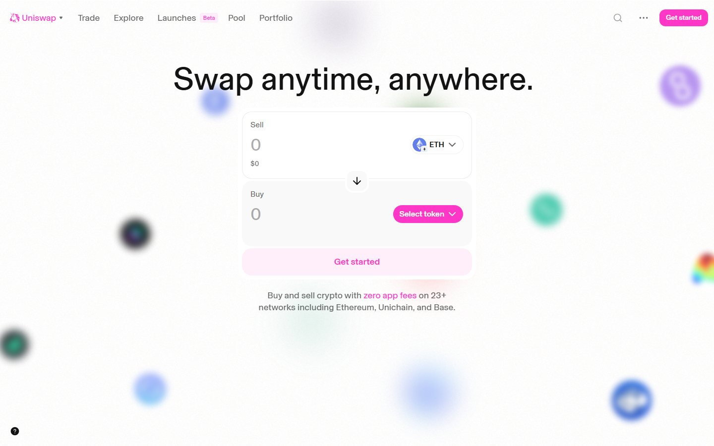
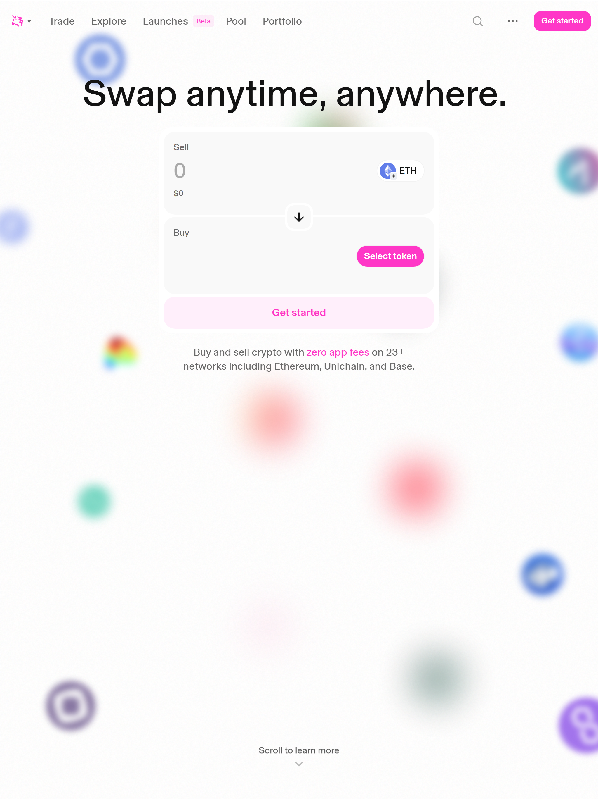
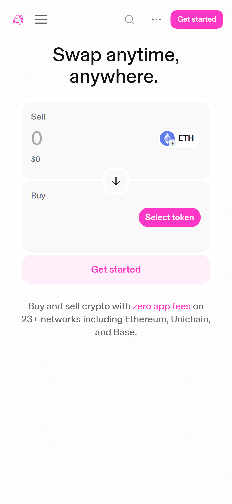
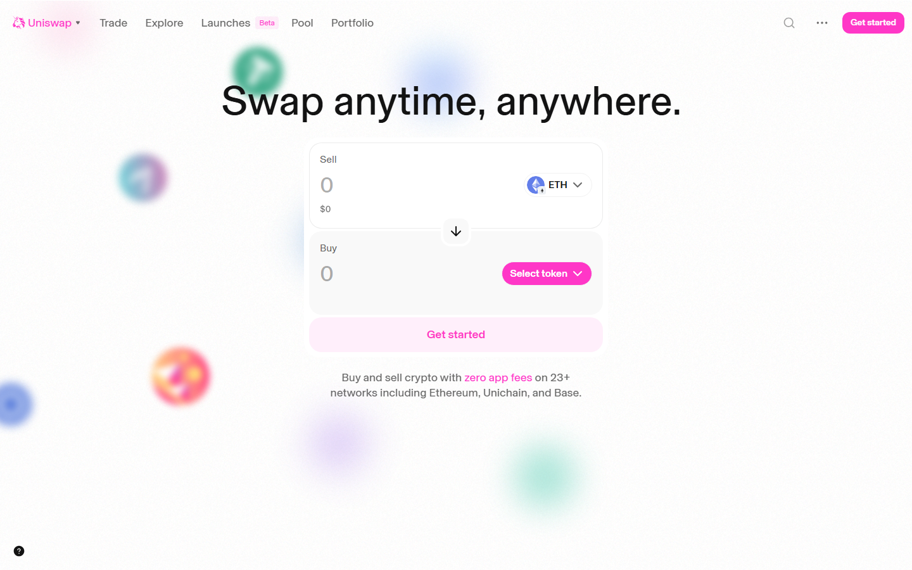
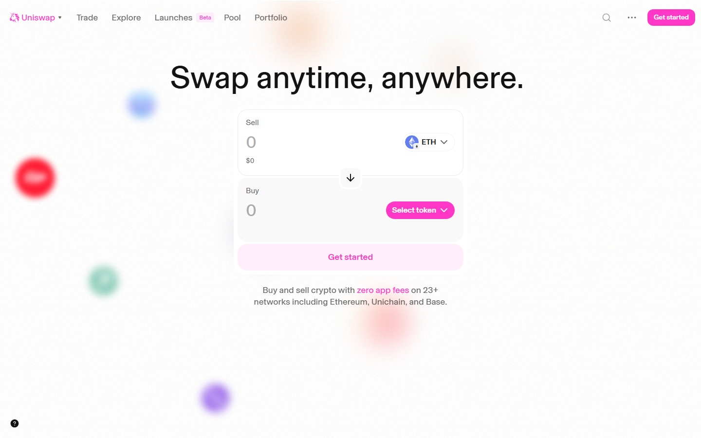
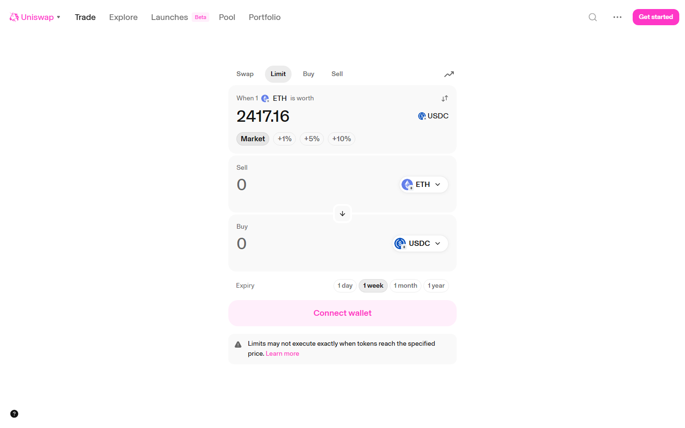
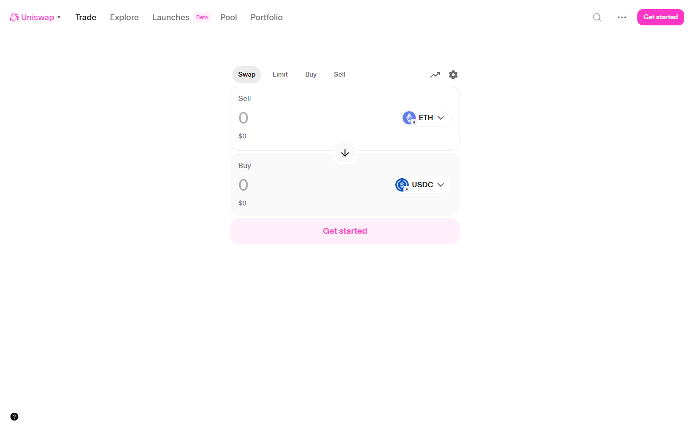
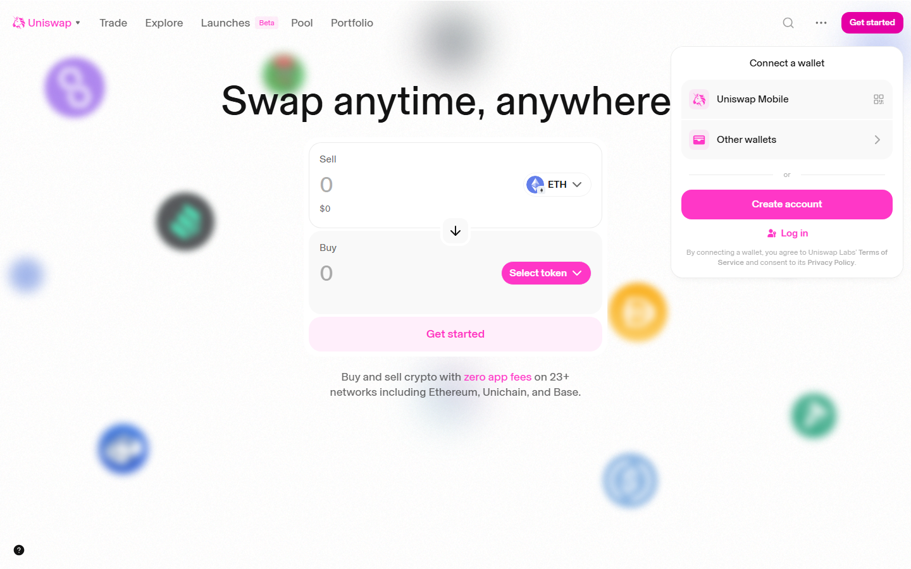

# Uniswap Review 2026: Complete Beginner's Guide — Swap Crypto, Use on Any Device, and Earn with Referral Links

**Who this guide is for:** Anyone who wants to swap (trade) cryptocurrencies without using a traditional exchange like Coinbase or Binance. You do not need to be a crypto expert. If you have ever used a currency exchange at an airport, you already understand the core idea.

**We tested this on three real devices** (screenshots throughout are taken live — not stock photos):
- **Desktop** — 1440px wide screen (Windows laptop / iMac)
- **Tablet** — iPad at 1024px
- **Phone** — iPhone 16 Pro Max at 430px

---

## What Is Uniswap? (Plain English)

Uniswap is a decentralized exchange, or DEX (think of it like a vending machine for crypto rather than a staffed currency exchange desk). Instead of a company holding your money and matching buyers with sellers, Uniswap uses smart contracts — self-running programs stored on the blockchain — to let people swap one cryptocurrency for another directly from their own wallet. Nobody ever takes custody of your funds.

Uniswap currently operates on Ethereum (the world's largest smart-contract blockchain) and also on other networks such as Arbitrum (a faster, cheaper version of Ethereum that runs on top of it).

> **In plain terms:** Uniswap is like a self-service currency-exchange kiosk that runs entirely on software. You connect your crypto wallet, choose what you want to trade, and the swap happens automatically — no account sign-up, no identity checks, no waiting for a human to approve anything.

**Who built it?** Uniswap was created by Hayden Adams and launched in November 2018. Adams, a mechanical engineer with no prior software background, built the first version after being inspired by a blog post from Ethereum co-founder Vitalik Buterin. The project is now maintained by Uniswap Labs, a New York-based company, and governed in part by holders of the UNI token (the platform's governance token, which gives holders a vote on protocol decisions).

**Key facts (October 22, 2026):**
- Platform URL: https://app.uniswap.org
- Total Value Locked (TVL — the amount of crypto currently deposited in the protocol): approximately $479,160,200
- Supported networks include Ethereum and Arbitrum, among others
- UNI token price and market cap: N/A (check docs) — see current data on CoinGecko
- A related wrapped Bitcoin token, Bitget Wrapped BTC (BGBTC), is currently priced at $82,171.00 with a market cap of $97,379,281 (CoinGecko rank #288), illustrating the kind of wrapped assets (tokens that represent another coin's value) you can swap on Uniswap
- Uniswap is widely considered the leading DEX by recognition and historical volume

---

## How Uniswap Looks on Your Device

We opened Uniswap on three different screen sizes and took real screenshots so you know exactly what to expect before you visit.

### On a Laptop or Desktop Computer (1440px wide)

*The Uniswap swap interface on a 1440px desktop screen, showing the token-input panel in the centre, network selector top-right, and navigation menu across the top.*

**Best for:** Getting a full overview of all features — the swap panel, liquidity pool (a shared pot of crypto that powers the swaps) browser, and charts are all visible without scrolling. Recommended for your first time using the platform.

---

### On a Tablet — iPad (1024px wide)

*Uniswap on an iPad at 1024px. The layout remains largely the same as desktop, with the main swap card centred on screen.*

**Best for:** Casual trading while away from your desk. The touch targets (buttons and dropdowns) are large enough to use comfortably with a finger, and all core functions remain accessible.

---

### On a Phone — iPhone 16 Pro Max (430px wide)

*Uniswap on an iPhone 16 Pro Max at 430px. The swap card stacks vertically and the navigation collapses into a bottom bar.*

**Best for:** Quick swaps on the go when you already know what you are doing. Note that for your very first swap, a desktop or tablet is easier because you can read all the fee details without zooming in.

> **Bottom line on devices:** Uniswap works on all three screen sizes without needing to download an app (though a separate Uniswap mobile app does exist). Desktop gives the clearest picture; phone works fine once you are comfortable with the basics.

---

## Core Features

Uniswap is more than just a simple swap button. Here is what the platform offers:

**Token Swapping**
The headline feature. Choose any two tokens that have a liquidity pool on Uniswap and swap between them instantly. The price is set algorithmically (by a formula, not a human) based on the ratio of the two tokens in the pool.

**Limit Orders**
Like a limit order on a stock brokerage, this lets you say "swap my ETH for USDC, but only if the price reaches X." Your order sits waiting until the market hits your target — or you cancel it.

**Liquidity Provision**
You can deposit pairs of tokens into a liquidity pool (think of it as adding stock to a shared vending machine). In return you earn a share of the swap fees that traders pay when they use that pool. This is called being a liquidity provider (LP).

**Multi-chain Support**
Uniswap is available on Ethereum and additional networks including Arbitrum (faster and cheaper), Optimism, Polygon, Base, and others. You choose your network before swapping.

**Token Discovery and Charts**
The interface includes basic price charts and token information so you can research an asset before trading it, without leaving the app.

**Wallet Compatibility**
Uniswap connects with a wide range of wallets (software that stores your crypto keys): MetaMask, Coinbase Wallet, WalletConnect (a protocol that links mobile wallets to web apps), Ledger hardware wallets, and more.

---

## Fee Schedule

Uniswap does not charge a single flat fee. Instead, fees are set per liquidity pool and collected by the liquidity providers who fund those pools. Here is a plain-English breakdown:

| Fee Type | Amount | Who Pays It | Who Receives It |
|---|---|---|---|
| Pool swap fee (most stable pairs, e.g. USDC/USDT) | 0.01% of trade | Trader | Liquidity providers |
| Pool swap fee (most common pairs, e.g. ETH/USDC) | 0.05% or 0.30% of trade | Trader | Liquidity providers |
| Pool swap fee (exotic or less liquid pairs) | 1.00% of trade | Trader | Liquidity providers |
| Uniswap Labs interface fee | 0.15% (on select token swaps via the official front-end) | Trader | Uniswap Labs |
| Network gas fee (the cost of running a transaction on the blockchain) | Varies — roughly $0.50 to $5 on Arbitrum; higher on Ethereum mainnet | Trader | Blockchain validators |

**Important notes:**
- The exact pool fee is shown on screen before you confirm any swap — always check it.
- Gas fees fluctuate with network congestion and are not set by Uniswap.
- If you use a third-party front-end (a different website built on top of Uniswap's smart contracts), the interface fee may differ.
- Full current fee details: N/A (check docs at https://docs.uniswap.org).

---

## Step-by-Step Tutorial

### Step 1 — Connect Your Wallet

Go to https://app.uniswap.org

Click the **"Connect"** button (usually top-right corner).

Choose your wallet — MetaMask, WalletConnect, Coinbase Wallet, and many others are supported.

A wallet is like a keyring for your crypto. If you do not have one yet, MetaMask (available as a free browser extension at metamask.io) is the most widely used starting point. You will need to set it up and fund it with some crypto before using Uniswap. Your wallet never leaves your control — Uniswap only requests permission to read your address and propose transactions, which you always approve or reject inside your own wallet app.

---

### Step 2 — Select Your Network

After connecting your wallet, check which blockchain network you are on. The network selector appears near the top of the page (often shown as a small icon or the network name, such as "Ethereum" or "Arbitrum").

Click the network selector and choose the network that matches where your funds are held. For example:
- If your ETH is on the Ethereum mainnet, select "Ethereum."
- If you want cheaper, faster transactions and your funds are bridged (transferred across) to Arbitrum, select "Arbitrum."

Your wallet must also be set to the same network, or the app will prompt you to switch. Most wallets handle this switch automatically when you confirm in the app.

---

### Step 3 — Perform a Swap

Once connected and on the right network:

1. In the top input box, select the token you want to sell (for example, ETH) and enter the amount.
2. In the bottom input box, select the token you want to receive (for example, USDC — a stablecoin, meaning its value is pegged to the US dollar).
3. Uniswap will instantly calculate how much you will receive based on current pool rates.
4. Click **"Swap"** and review the confirmation screen carefully.
5. Click **"Confirm Swap"** in the app, then approve the transaction in your wallet pop-up.

**Key fields to review before confirming:**

| Field | What It Means |
|-------|---------------|
| **Rate** | How many output tokens you get per input token right now |
| **Minimum Received** | The worst case you will accept — if the rate drops below this during the transaction, it cancels automatically |
| **Price Impact** | How much your trade moves the market price. Under 1% = fine. Over 5% = be careful |

---

### Step 4 — (Optional) Limit Order

If you do not want to swap at the current market price but instead want to wait for a better rate, use the Limit tab (visible at the top of the swap card).

1. Click **"Limit"** instead of "Swap."
2. Enter the token pair and the amount you want to trade.
3. Set your desired price — the rate at which you want the swap to execute.
4. Click **"Place Limit Order"** and approve the transaction in your wallet.
5. Your order will execute automatically when the market price reaches your target. You can cancel it at any time before it fills.

This is useful if you think ETH is currently overpriced and you want to buy only if it dips to a specific level — similar to setting a price alert that also executes the trade for you automatically.

---

## How to Use a Referral Link

### What Is a Referral Link?

A referral link is a specially formatted URL (web address) that contains a code identifying who shared it. When you use Uniswap via someone's referral link and complete a swap, the platform can attribute that activity to the referrer.

**Think of it like a tip jar:** When a friend recommends a great restaurant and you go, the restaurant knows your friend sent you. With Uniswap's referral mechanism, the "restaurant" (the swap interface) can optionally pass a small fee to the person who referred you — funded by an optional tip you add at checkout, not by charging you extra above the standard swap fee.

### How to Use Someone Else's Referral Link

When someone shares a referral link with you, here is what happens step by step:

**Step 1 — Open the link**

Click the referral link your friend or influencer shared. It will open Uniswap with a special parameter in the URL — this is what tells the platform who referred you.

**Step 2 — Connect your wallet**

You connect your wallet exactly as described in the tutorial above.

**Step 3 — Review the swap**

Set up your swap as normal — choose the tokens and amount. The presence of a referral code in the URL does not change the swap rate you receive. You are still getting the same market price minus the same pool and interface fees described in the fee table above.

**Step 4 — The Optional Tip (This Is the "Referral" Part)**

During the swap confirmation screen, you may see an optional tip field. This is a voluntary amount you can add to reward the person who referred you. It is not mandatory, and leaving it at zero does not affect your swap. If you do add a tip, it goes directly to the referrer's wallet address — not to Uniswap Labs.

**Step 5 — Confirm in Your Wallet**

After reviewing everything, click **"Swap"** — your wallet opens a final confirmation showing:
- The exact amounts going in and out
- The network gas fee (a small fee paid to the blockchain, typically $0.50 to $5 depending on the network)
- Approve — the swap executes in seconds

---

### How to Create Your Own Referral Link

Note: Uniswap's referral and affiliate program details are not fully documented in the research material available at the time of writing. The steps below reflect how referral links on Uniswap-style interfaces commonly work. Always verify current program terms at https://docs.uniswap.org before promoting a link.

1. Go to https://app.uniswap.org and connect your wallet.
2. Look for a "Share" or "Referral" option in the interface (this may appear on the swap page or in your account settings).
3. Copy the generated URL, which will include a parameter such as `?referrer=0xYourWalletAddress`.
4. Share this link on social media, in a blog post, in a newsletter, or anywhere your audience might see it.
5. When someone clicks your link and completes a swap, the referral attribution is recorded on-chain (on the blockchain, meaning it is transparent and verifiable by anyone).
6. Any tips sent by referred users will arrive in the wallet you connected when generating the link.

For the most accurate and up-to-date instructions, check: N/A (check docs at https://docs.uniswap.org).

---

## Security: What You Need to Know

Uniswap is one of the most battle-tested DeFi protocols in existence, having processed billions of dollars in trades since 2018. Its smart contracts have been audited (independently reviewed by security firms) multiple times.

However, no DeFi platform is entirely risk-free. Key risks to understand:

- **Smart contract risk:** Even audited code can contain bugs. A flaw could, in theory, be exploited to drain a liquidity pool. This risk applies to all DeFi platforms.
- **Front-end phishing risk:** The most common attack is a fake website that looks like Uniswap but is not. Always confirm you are on https://app.uniswap.org before connecting your wallet.
- **Token scam risk:** Uniswap is permissionless — anyone can create a token and list it. Many scam tokens exist. Always verify a token's official contract address (its unique identifier on the blockchain) before swapping.
- **Slippage and price impact risk:** For small, obscure tokens with low liquidity, your trade can move the price significantly against you. Check the price impact figure before confirming.
- **Wallet compromise risk:** Uniswap itself cannot access your funds, but if your wallet's private key or seed phrase (the master password for your wallet) is stolen, your funds are at risk regardless of which platform you use.

Specific historical security incidents: N/A (check docs) — no major smart contract exploit of Uniswap's core protocol was found in the research material for this review.

**Best practices:**
- Always navigate directly to https://app.uniswap.org — do not click links from emails or unfamiliar social media accounts.
- Double-check the URL in your browser address bar before connecting your wallet.
- Never share your wallet seed phrase with anyone or enter it into any website.
- Use a hardware wallet (a physical device like a Ledger or Trezor) for large amounts — it adds an extra layer of approval for every transaction.
- Before swapping an unfamiliar token, look it up on CoinGecko or Etherscan (a blockchain explorer that lets you see a token's history and contract) to confirm it is legitimate.
- Start with a small test swap when using a new token or network for the first time.

---

## Uniswap vs Competitors

The table below compares Uniswap with other well-known decentralized exchanges. All figures are from the research material or publicly known at the time of writing. Where live data was unavailable, N/A (check docs) is noted.

| Feature | Uniswap | Curve Finance | SushiSwap | dYdX |
|---|---|---|---|---|
| Primary use case | General token swaps | Stablecoin and similar-asset swaps | General token swaps | Derivatives and margin trading |
| TVL (Total Value Locked) | ~$479,160,200 | N/A (check docs) | N/A (check docs) | N/A (check docs) |
| Typical swap fee | 0.05% to 1.00% (pool-dependent) | 0.04% (stable pools) | 0.25% | N/A (check docs) |
| Supported networks | Ethereum, Arbitrum, and others | Ethereum and others | Ethereum and others | Ethereum (own chain) |
| Limit orders | Yes | No (typically) | No (typically) | Yes |
| Beginner friendliness | High — clean, simple interface | Medium — more complex UI | Medium | Low — built for advanced traders |
| Requires account/KYC | No | No | No | Varies by jurisdiction |
| Open-source code | Yes | Yes | Yes | Yes |

Curve Finance is particularly well regarded for swapping between stablecoins (coins pegged to real-world currencies) at minimal price impact, making it the preferred tool when moving between, say, USDC and USDT. For general-purpose swapping of any token pair, Uniswap remains the most widely used option.

---

## Verdict

**Who Uniswap is for:**
- Crypto users of any experience level who want to swap tokens without handing funds to a centralised company.
- People who hold ETH or other Ethereum-based tokens and want to exchange them quickly.
- Those interested in earning passive income by providing liquidity to trading pools.
- Developers and advanced users who want access to a wide range of tokens, including new projects not yet listed on centralised exchanges.

**Who should look elsewhere:**
- Complete beginners who do not yet have a crypto wallet or any crypto — you will need to buy crypto on a centralised exchange (like Coinbase or Kraken) first, since Uniswap has no fiat (traditional money, like dollars or euros) on-ramp of its own built into the main interface.
- Anyone who wants to trade with leverage (borrowed money to amplify gains and losses) — Uniswap is for straightforward swaps, not margin trading.
- Those seeking the absolute lowest fees on stablecoin-to-stablecoin swaps — Curve Finance often beats Uniswap on that specific use case.

**Rating: 4.3 / 5**

Uniswap earns its status as the benchmark decentralised exchange. The interface is clean and approachable, the protocol is well-audited and time-tested, and the multi-chain support covers the networks most users care about. The main drawbacks are the gas fees on Ethereum mainnet (which can make small trades uneconomical) and the absence of a fiat on-ramp, meaning total beginners must take an extra step elsewhere before they can use it. For anyone already in the crypto ecosystem, Uniswap should be one of the first DeFi tools they learn.

---

## Quick Links

- Main app: https://app.uniswap.org
- Official documentation: https://docs.uniswap.org
- Protocol data and TVL: https://defillama.com/protocol/uniswap
- Token information: https://www.coingecko.com
- Smart contract explorer: https://etherscan.io
- MetaMask wallet (to get started): https://metamask.io

---

*Last verified: October 22, 2026. Screenshots taken live from https://app.uniswap.org.*