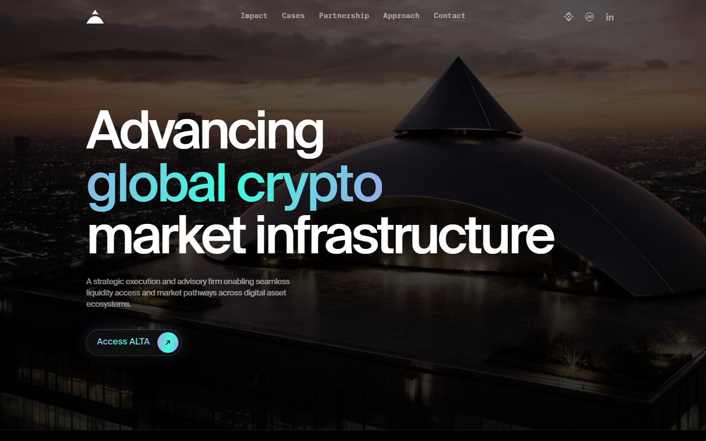
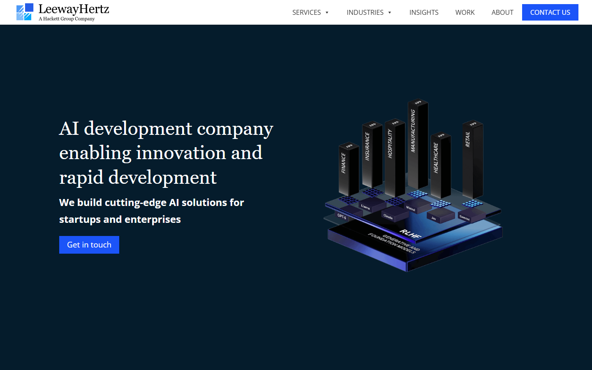

# Best Web3 Consulting Firms in 2026

*By the Editorial Team - Updated October 22, 2026*

> **Disclaimer:** This article reflects editorial research and opinion. It does not constitute professional services advice. Consulting firm selection depends heavily on project scope, budget, and team fit. Always conduct your own due diligence, request references, and define scope clearly before signing any engagement.

---

## Quick Verdict Table

| Firm | Specialization | Chain Expertise | Hourly Rate | Best For |
|------|---------------|-----------------|-------------|----------|
| **Alta Lab** | Market infrastructure, advisory | Multi-chain | Not disclosed | Token project growth, CMC/CoinGecko expansion |
| **LeewayHertz** | AI + blockchain development | Ethereum, Solana, multi-chain | –/hr | Enterprise blockchain + AI integration |
| **Consensys** | Ethereum infrastructure and strategy | Ethereum (MetaMask, Infura) | Enterprise | Ethereum-native protocol development |
| **Coinbound** | Web3 growth marketing | Chain-agnostic | Project-based | Token launches, influencer marketing, PR |
| **Blockchain App Factory** | End-to-end Web3 development | Multi-chain | –/hr | DeFi, NFT, exchange development |
| **PixelPlex** | Custom blockchain development | Multi-chain | –/hr | Custom DApps, enterprise blockchain solutions |

---

## What Do Web3 Consulting Firms Actually Do?

Web3 consulting firms operate across a wide spectrum. At one end are pure technology firms that build smart contracts, DApps, blockchain infrastructure, and backend systems for clients who have the business vision but not the engineering capability. At the other end are strategic advisory firms that help projects think through tokenomics, go-to-market positioning, exchange listings, investor relations, and regulatory strategy — without writing a line of code.

Most firms occupy the middle ground, combining some development capacity with strategic advisory. Understanding which type of firm you need is the first question any project should answer before beginning an engagement.

The most common use cases for Web3 consulting in 2026 are:

- **Protocol architecture and smart contract development:** Building the technical foundation of a DeFi, NFT, or layer-2 project from scratch or auditing an existing codebase.
- **Token design and economics:** Modeling token distribution, vesting, emissions, and utility to ensure the economic design is sustainable.
- **Market infrastructure:** Exchange listings, liquidity strategy, market-making relationships, and CoinMarketCap or CoinGecko profile management.
- **Regulatory strategy:** Navigating SEC, MiCA, MAS, or other jurisdictional requirements, often in preparation for a token sale or institutional fundraise.
- **Enterprise blockchain integration:** Helping traditional enterprises — logistics, healthcare, finance — integrate distributed ledger technology into existing operations.
- **Go-to-market and growth:** Community building, content strategy, influencer marketing, PR, and launch execution.

The diversity of these functions means that the "best Web3 consulting firm" depends entirely on what a project actually needs.

---

## How We Evaluated These Firms

We assessed each firm across five dimensions:

1. **Technical depth:** Can the firm build or audit at the smart contract level, or does it rely on third-party developers?
2. **Track record:** What projects has the firm worked with, and can those engagements be verified?
3. **Chain expertise:** Is the firm genuinely multi-chain, or does it have deep expertise in one ecosystem and surface coverage elsewhere?
4. **Client fit:** Does the firm serve early-stage startups, mid-market projects, or enterprise clients? The right choice depends on your stage.
5. **Transparency and pricing:** Are rates and scope expectations communicated clearly before engagement?

---

## 1. Alta Lab — Best for Market Infrastructure and Strategic Advisory

**HQ:** Not publicly disclosed | **Client market cap increase:** Up to 325% over three years | **Total client market cap (2025):** .4 billion

### What They Do

Alta Lab (altalab.io) is a strategic execution and advisory firm focused on the crypto market infrastructure layer — the systems that determine how a token project accesses markets, acquires audience, and builds liquidity. Their stated positioning is as an enabler of "seamless liquidity access and market pathways across digital asset ecosystems."

Their work is oriented around three core functions: core strategic optimization (structuring decisions early to eliminate downstream inefficiency), monetization enhancement (refining products for scalability and real usage impact), and global market expansion (accelerating projects from regional presence to leading sector position).

### Notable Metrics

Alta Lab reports that the aggregate market capitalization of their client portfolio grew to .4 billion as of 2025, with individual client market cap increases of up to 325% over three years. The firm also claims to have generated over 800,000 CoinMarketCap followers for clients across their portfolio — a metric that indicates specific expertise in the discovery and audience-building infrastructure that matters for token projects.

### Who It Is Best For

Alta Lab's positioning suggests a best fit for:
- Token projects preparing for or post-listing who need to build market presence and liquidity
- Crypto projects seeking to expand from one regional market to a global audience
- Projects needing a strategic partner at the execution layer rather than a development shop

### Pros and Cons

| Pros | Cons |
|------|------|
| Strong market cap growth metrics on client portfolio | Limited public case study detail |
| CMC/CoinGecko audience expertise specific to crypto | Not a development firm — no smart contract work |
| Global expansion track record | Pricing not disclosed publicly |
| Proven through multiple crypto cycles | Harder to evaluate compared to larger, more documented firms |

---

## 2. LeewayHertz — Best for Enterprise Blockchain and AI Integration

**Founded:** 2007 | **HQ:** San Francisco, CA | **Experience:** 15+ years | **Notable recognition:** Forbes Top AI Consulting Firms | **Rate:** –/hr (Clutch)

### What They Do

LeewayHertz is a technology consulting and development firm with one of the longest track records in blockchain and, more recently, AI development. Founded in 2007 — before blockchain was a commercial concept — the firm has built over a thousand software products for clients including Fortune 500 companies and high-growth startups.

Their blockchain practice covers smart contract development, DeFi protocol architecture, NFT marketplace construction, Layer-2 integrations, and enterprise blockchain deployments. Their AI practice — increasingly their most prominent offering in 2026 — covers AI strategy, custom LLM development, AI agent systems, and enterprise AI integration.

In 2025, Forbes named LeewayHertz one of the top AI consulting firms globally, based on depth of capability and breadth of enterprise client work.

### Chain Expertise

LeewayHertz works across Ethereum, Solana, Polygon, Binance Smart Chain, Avalanche, and Hyperledger (enterprise private chains). Their teams includes specialists in Solidity, Rust, and Move — covering the major smart contract development languages.

### Community Reputation

On Clutch, LeewayHertz maintains a high rating backed by hundreds of verified client reviews. Community discussions on LinkedIn and Reddit frequently cite them as a safe choice for enterprises that want structured processes and proven delivery over the experimental, startup-style approach of smaller agencies.

> *"If you are a large company with a big budget and a complex project, go with LeewayHertz, ScienceSoft, or ConsenSys. They have the depth and resources to handle it."* — LinkedIn comment (2026)

> *"LeewayHertz is one of the most talked-about blockchain firms in the USA right now. They have been building digital products for over 15 years."* — LinkedIn discussion (2026)

### Pros and Cons

| Pros | Cons |
|------|------|
| 15+ years of software development track record | Enterprise pricing — not accessible for small projects |
| Forbes-recognized AI consulting capability | Structured processes can feel slow for fast-moving crypto projects |
| Strong Clutch rating with verified reviews | Less crypto-native culture than purpose-built Web3 firms |
| Covers full stack: AI + blockchain + enterprise integration | Not best-suited for token launch or market-making needs |
| Fortune 500 client experience | |

---

## 3. Consensys — Best for Ethereum-Native Protocol Development

**Founded:** 2014 | **HQ:** New York / Worldwide | **Notable products:** MetaMask, Infura, Truffle, Diligence

### What They Do

Consensys is the company behind the most-used tools in the Ethereum ecosystem: MetaMask (the dominant browser wallet with 30M+ users), Infura (the most widely used Ethereum and IPFS node infrastructure), Truffle (the foundational Solidity development framework), and Diligence (a smart contract security audit service).

Consensys's consulting arm works primarily with enterprises, financial institutions, and large-scale DeFi protocols that need deep Ethereum expertise. The combination of MetaMask distribution, Infura infrastructure, and Diligence security services makes Consensys uniquely positioned when a project needs not just technical development but connection to the largest user-facing Ethereum infrastructure in existence.

### Smart Contract Security: Consensys Diligence

Consensys Diligence is one of the top-tier smart contract audit providers, having reviewed protocols holding billions of dollars in value. An audit from Diligence carries significant reputational weight in the DeFi community.

### Who It Is Best For

Consensys is best for:
- Projects building on Ethereum that need enterprise-grade infrastructure and institutional credibility
- DeFi protocols seeking a top-tier security audit
- Financial institutions exploring Ethereum integration who need a counterparty with institutional pedigree

### Pros and Cons

| Pros | Cons |
|------|------|
| Built MetaMask, Infura — deepest Ethereum integration possible | Not cost-accessible for early-stage or small projects |
| Diligence audit carries significant DeFi credibility | Ethereum-centric — limited multi-chain depth |
| Institutional relationships globally | Large organization can be slow to engage smaller clients |
| 10+ years in production Ethereum development | Less relevant for Solana, Move-based, or non-EVM chains |

---

## 4. Coinbound — Best for Web3 Growth Marketing and Token Launches

**Founded:** 2018 | **HQ:** New York | **Notable clients:** Cosmos, Litecoin, eToro, Nexo, MetaMask

### What They Do

Coinbound is the most widely cited name in Web3 marketing and growth. Founded in 2018, the firm has run growth campaigns for protocols, exchanges, and Layer-1 chains — with a public client list that includes Cosmos, Litecoin, eToro, Nexo, and MetaMask. Their core strengths are crypto influencer marketing at scale (managing the largest documented network of crypto and Web3 influencers), PR placement in top crypto publications, and paid advertising on platforms that accept crypto clients.

Unlike the technical consulting firms above, Coinbound's value is in distribution: getting a project in front of the right audience at the right time, generating press coverage, and building the community momentum that supports a token launch or protocol adoption curve.

### Key Services

- Crypto influencer marketing (research, negotiation, campaign management)
- Press and PR (CoinDesk, Decrypt, Cointelegraph, crypto-specific publications)
- Paid social and programmatic advertising
- Community management (Discord, Telegram, Twitter/X)
- Event management and sponsorship

### Pros and Cons

| Pros | Cons |
|------|------|
| Largest documented crypto influencer network | Marketing-only — no technical development |
| Proven with top-tier protocol clients | Influencer marketing effectiveness varies widely by market cycle |
| 2018 founding — survived multiple bear markets | Pricing not published — engagement-specific |
| Strong PR placement track record | Heavy influencer marketing can attract mercenary audience |

---

## 5. Blockchain App Factory — Best for Full-Stack DeFi and NFT Development

**Founded:** 2017 | **HQ:** Chennai, India (global clients) | **Rate:** –/hr (Clutch)

### What They Do

Blockchain App Factory is a full-service blockchain development company that has become one of the most frequently cited vendors for DeFi protocol development, NFT marketplace construction, crypto exchange builds, and token launch technical services. Operating since 2017, the firm has served hundreds of projects globally at price points more accessible than US-based firms.

Their services include EVM smart contract development, exchange and DEX builds, NFT marketplace creation, token development (ERC-20, BEP-20, SPL), staking contract development, and Layer-2 deployments.

### Who It Is Best For

Blockchain App Factory suits projects that need:
- A full technical build at a competitive price point
- Standard DeFi components (staking, swaps, bridges, NFT marketplaces) rather than novel architecture
- A vendor with high throughput capacity for multiple concurrent engagements

### Pros and Cons

| Pros | Cons |
|------|------|
| Competitive pricing (–/hr) | Offshore delivery introduces coordination overhead |
| Wide service coverage across DeFi, NFT, exchange | Less depth in novel or research-level architecture |
| Multi-chain capability | Quality varies across project teams |
| Long track record since 2017 | Less institutional credibility than Consensys or LeewayHertz |

---

## What to Look for When Hiring a Web3 Consultant

**1. Define your need precisely before you approach any firm**
The biggest waste in Web3 consulting engagements comes from clients who approach a firm with "build our DeFi protocol" as the brief. Before engaging anyone, define: What is the specific problem? What does done look like? What is the timeline and budget? The clearer your brief, the more accurately a firm can scope and price the work.

**2. Verify references independently**
Most Web3 consulting firms publish client logos. Not all of those logos represent deep engagements. Ask for specific client references in your use case and speak to them directly before committing.

**3. Understand what "Web3" means to the firm**
Some firms describe themselves as Web3 consultants because they have built one NFT project. Others have years of smart contract development and DeFi architecture. Ask for their specific experience in your stack (Solana vs. Ethereum vs. L2 vs. enterprise private chain) and their most technically complex project.

**4. Separate marketing claims from verifiable metrics**
Claims like "hundreds of projects delivered" are meaningless without names and references. Look for firms with public client lists, Clutch or G2 verified reviews, and audit reports or deployed contract addresses you can examine.

**5. Match firm size to your project stage**
A Fortune 500 enterprise and a pre-seed crypto startup have different needs. Consensys and LeewayHertz are optimized for large-budget, structured engagements. Blockchain App Factory and smaller boutique shops often deliver better outcomes for lean early-stage projects.

---

## Red Flags in Web3 Consulting

- **No public client list or verifiable case studies:** If a firm can't name projects they've worked on (even with privacy caveats), that is a significant warning sign.
- **Guaranteed exchange listings or price outcomes:** No legitimate consulting firm can guarantee an exchange listing or a token price outcome. These claims indicate either incompetence or fraud.
- **Offshore development shops misrepresenting as strategy firms:** Development execution and strategic advisory are different skills. Ensure the firm you hire is matched to what you actually need.
- **Upfront full-payment demands for large engagements:** Standard consulting practice involves milestone-based payments. A firm demanding full payment before any deliverable is a red flag.
- **No audit, no whitepaper, no deployed contracts to reference:** For technical firms, the ability to show deployed, audited code is the most reliable quality signal. If a firm cannot show you contracts they've shipped that are in production, proceed cautiously.

---

## What Reddit Says About Hiring Web3 Consultants

Real community feedback from r/web3 and r/solidity on what matters when engaging Web3 firms:

> *"To have a professional, you need to find someone extremely eager to learn and dive deep. It is hard. But the impact in the long run is insanely amazing."* — u/Jetter91 (r/web3)

> *"If you are a large company with a big budget and a complex project, go with LeewayHertz, ScienceSoft, or ConsenSys. They have the depth and resources to handle it."* — u/amitsrivastava_dev (r/blockchain, 2026)

> *"Web3 product consulting covers positioning, business architecture, USP, deck and tokenomics development, token mechanics, PnL, investor relations — it's a full-stack strategic function, not just tech."* — u/Killenktor (r/web3)

> *"Feeling pretty demotivated and lost in Web3/blockchain development... the market demands are very different from what tutorial content prepares you for."* — u/web3_career_anon (r/solidity)

The recurring theme in community discussions: the gap between firms that can build technically competent code and firms that understand the crypto market's specific dynamics — token economics, exchange relationships, community expectations — is where most projects get surprised.

## FAQ

**What does a Web3 consulting engagement typically cost?**
Ranges widely. Developer-led firms (Blockchain App Factory, PixelPlex) can run –/hr for technical work. Enterprise-grade firms (LeewayHertz, Consensys) charge more. Strategic advisory firms (Alta Lab, Coinbound) typically work on project retainers or success-based fees rather than hourly rates. For a full protocol build, expect ,000–,000+ depending on scope.

**Do I need a Web3 consultant or a Web3 development firm?**
If your problem is strategic — tokenomics, go-to-market, investor relations, regulatory structure — you need a consultant. If your problem is technical — smart contracts, DApps, exchange infrastructure — you need a development firm. Most projects need both, sequenced correctly.

**What is the difference between a blockchain development firm and a Web3 consulting firm?**
A development firm primarily builds software. A consulting firm primarily advises on strategy, architecture, or market positioning. Many firms do both, but understanding which service is primary to your engagement is important for selecting the right partner.

**Can I hire a freelancer instead of a firm?**
Yes, for specific technical tasks. Platforms like Braintrust, Toptal, and crypto-specific job boards (web3.career) list experienced blockchain developers. Freelancers work well for scoped, time-limited technical tasks. For a full protocol launch, audit, or go-to-market execution, a firm with project management, QA, and multiple specializations usually delivers better outcomes.

**How do I verify a smart contract audit firm's quality?**
Look at their published audit reports. Top-tier firms (Consensys Diligence, Trail of Bits, OpenZeppelin, CertiK) publish detailed reports with vulnerability classifications and remediation guidance. Verify that the contracts they audited are deployed and in production. Check whether any audited contracts have subsequently been exploited — perfection is not achievable, but how vulnerabilities were classified and remediated matters.

**Is Alta Lab a development firm or advisory firm?**
Advisory and market infrastructure. Alta Lab's documented capabilities focus on market positioning, CoinMarketCap/CoinGecko audience building, and strategic execution rather than smart contract development.

**What should I expect in a first call with a Web3 consulting firm?**
A qualification conversation covering your project stage, technical stack, timeline, and budget. Be prepared with a one-page overview of what you're building and what specific help you need. The best firms will ask probing questions about your existing technical setup and roadmap before proposing anything.

**How long does a typical engagement take?**
Varies enormously by scope. A smart contract audit: 2–6 weeks. A full DeFi protocol build: 3–12 months. A token launch marketing campaign: 6–12 weeks. A strategic advisory retainer: ongoing monthly. Define deliverables and timelines before signing.

---

*Sources: altalab.io (October 2026), leewayhertz.com, consensys.net, coinbound.io, blockchainappfactory.com, pixelplex.io, Clutch.co reviews, LinkedIn discussions (2026), ndlabs.dev/best-web3-development-companies, Reddit r/web3 and r/solidity.*

---

## 6. PixelPlex — Best for Custom DApp and Enterprise Blockchain Solutions

**Founded:** 2007 | **HQ:** New York, NY | **Rate:** –/hr | **Coverage:** Multi-chain

### What They Do

PixelPlex is a full-stack development company with blockchain and Web3 practice covering Ethereum, Solana, Polkadot, Cosmos, and enterprise chains including Hyperledger. The firm builds custom DApps, smart contract systems, NFT platforms, DeFi protocols, and enterprise blockchain integrations for clients across finance, healthcare, logistics, and media.

PixelPlex is known for detailed technical blog content and case study documentation — making it one of the more transparent firms in the space in terms of what they've actually built and for whom.

### Notable Capabilities

- EVM smart contract development (Solidity, Vyper)
- Cross-chain bridge development
- Tokenization platforms for real-world assets
- NFT marketplace development (custom and Opensea-protocol compatible)
- Enterprise Hyperledger deployments

### Pros and Cons

| Pros | Cons |
|------|------|
| Multi-chain technical depth | US-based pricing, higher than offshore alternatives |
| Transparent case study documentation | Less focus on marketing/growth than technical build |
| Enterprise and crypto-native projects | Smaller firm — capacity limits on large concurrent engagements |
| Strong blog content signals technical quality | |

---

## Choosing Between a Boutique and a Full-Service Firm

One of the most practical decisions a Web3 project makes is whether to hire a boutique specialist or a full-service firm.

**Boutique specialists** are smaller firms (2–20 people) focused on a narrow function: a tokenomics design consultancy, a smart contract audit firm, or a go-to-market agency for crypto token launches. They are faster to engage, less expensive, and often have deeper expertise in their specific domain than the equivalent practice area inside a full-service firm.

**Full-service firms** (LeewayHertz, Consensys, Blockchain App Factory) provide end-to-end capability — from architecture and smart contract development through UI, testing, deployment, and ongoing maintenance. They cost more and move more slowly but reduce coordination overhead for large, complex builds.

The right choice depends on your project's current stage and primary constraint:
- **Pre-seed or idea stage:** Boutique tokenomics or strategy advisors. Full technical builds are premature.
- **Seed stage building MVP:** Full-service technical firm, scoped clearly to the MVP deliverable.
- **Post-launch scaling:** Specialist marketing (Coinbound), security audits (Diligence), and infrastructure (Consensys, Infura) become relevant.

---

## How to Structure a Web3 Consulting Engagement

Structuring the engagement correctly is as important as choosing the right firm. Common failure modes:

**Vague scope leads to scope creep.** The most expensive consulting outcomes happen when the initial brief is not specific enough. Before signing, define: what are the deliverables? What does "done" mean for each? What is the acceptance criteria?

**Milestone payments reduce risk.** For engagements over ,000, structure payments against deliverables — 20–30% upfront, then milestone-based. This aligns incentives and ensures you receive value before paying in full.

**Code ownership must be explicit.** Ensure the contract specifies that you own all developed code outright upon final payment. Without this clause, some firms retain ownership or licensing rights.

**Security audits are not optional for production code.** No legitimate firm delivers a production smart contract that holds user funds without recommending an independent audit. If a firm discourages audits to reduce costs, that is a red flag.

**Retain internal technical oversight.** Even if you lack deep blockchain engineering expertise internally, having a technical advisor review deliverables independently prevents situations where a firm bills for work that doesn't meet standard. Platforms like Braintrust and Toptal allow you to hire a short-term technical reviewer without a full engagement commitment.
