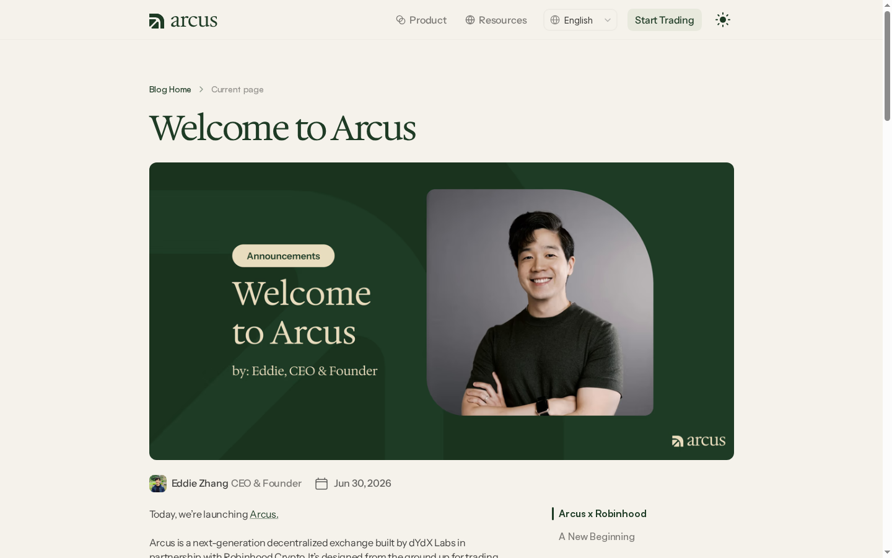
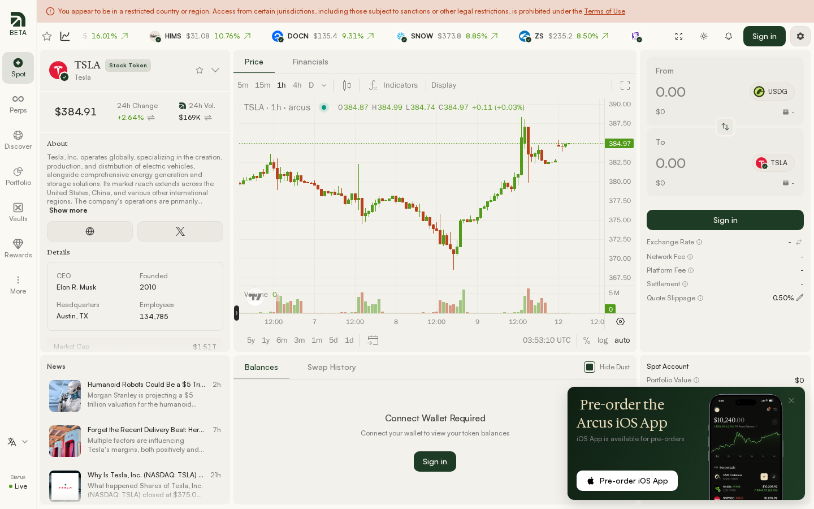
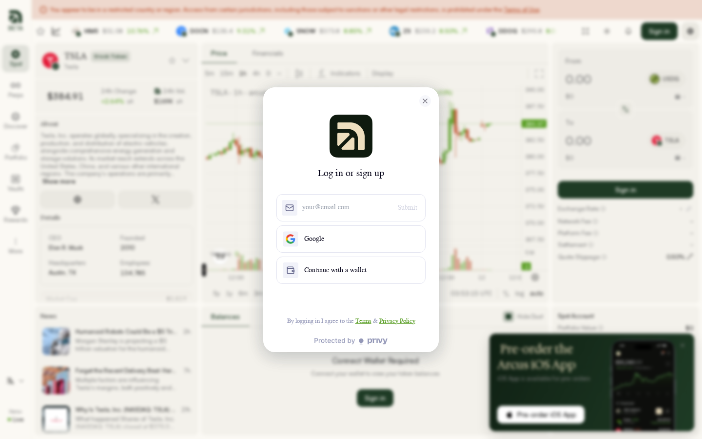
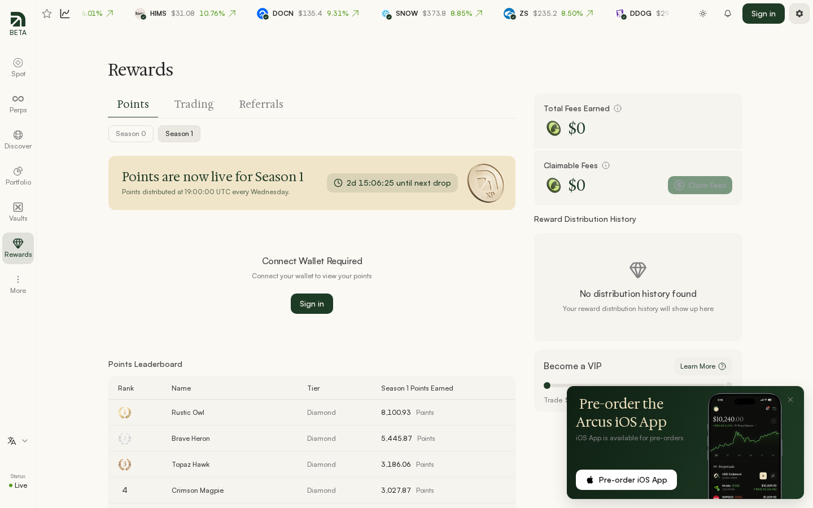
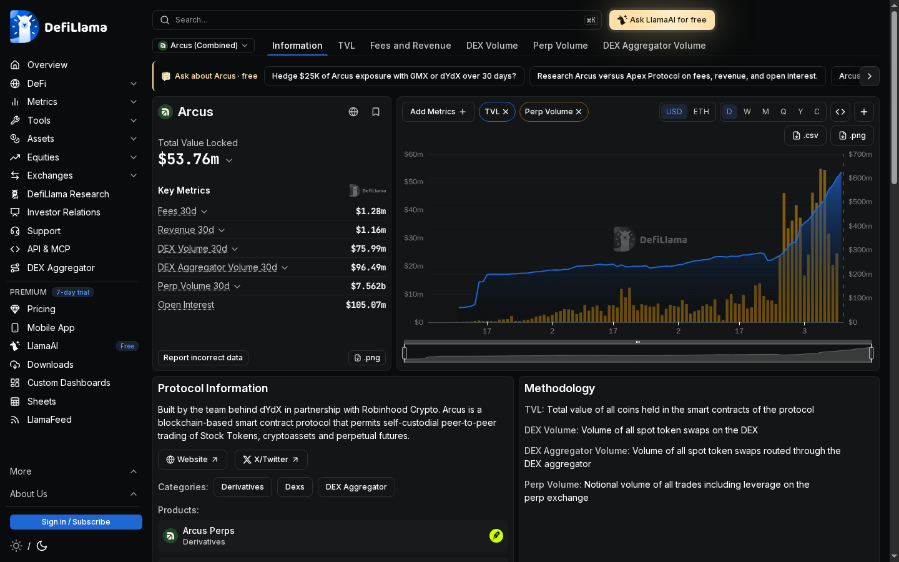
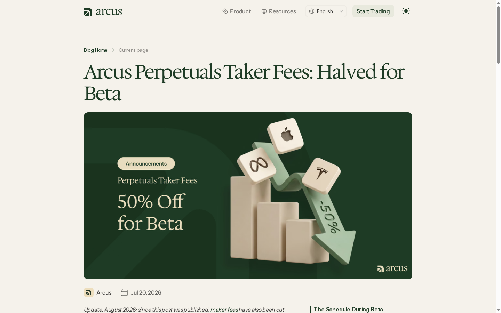

# Arcus ($ARCUS) Airdrop 14 Oct 2026 - Comprehensive Review & Step-by-Step Execution Playbook

> **Báo cáo Phân tích Chuyên sâu, Dẫn chứng Hình ảnh Thực tế & Cẩm nang Hướng dẫn Từng bước Farming Arcus Points trên Robinhood Chain**  
> *Ngày cập nhật: 14 Tháng 10, 2026 | Dữ liệu kiểm chứng trực tiếp qua TinyFish CLI*

---

## 🌐 1. TỔNG QUAN NỀN TẢNG ARCUS & DỮ LIỆU KIỂM CHỨNG QUA TINYFISH

Thông qua công cụ **TinyFish CLI** (`fetch`, `agent`, và `search`), toàn bộ thông tin kiến trúc công nghệ, hồ sơ dự án và chương trình điểm thưởng của **Arcus** đã được trích xuất và xác thực trực tiếp:

* **Định vị & Đổi mới Đột phá**: **Decentralized Exchange (DEX) thế hệ mới** kết hợp giao dịch **Stock Tokens (Cổ phiếu Token hóa/RWA)** và **Perpetual Futures (Hợp đồng Tương lai Vĩnh cửu)** với khả năng giao dịch **24/7 không nghỉ** (Trade while the world sleeps) và chính sách **0% phí giao dịch Spot**.
* **Đội ngũ Phát triển & Hậu thuẫn Chiến lược**: Dự án được xây dựng bởi **dYdX Labs** (dưới sự dẫn dắt của Founder **Eddie Zhang** – nhà sáng lập Pocket Protector được dYdX Labs mua lại) hợp tác cùng **Robinhood Crypto** đóng vai trò là nhà đầu tư chiến lược kiêm đối tác tích hợp hệ sinh thái ví.
* **Hạ tầng Blockchain & Khớp lệnh**: Vận hành native trên **Robinhood Chain** (chuỗi EVM Layer-2 được thiết kế riêng tối ưu cho giao dịch tài chính thông lượng cao). Hệ thống matching engine off-chain đạt công suất **100,000+ lệnh/giây** với thời gian xác nhận siêu tốc **~20ms**, trong khi việc lưu ký (custody) và bù trừ thanh toán (settlement) hoàn toàn non-custodial trên blockchain. Đồng tiền thanh toán quy chuẩn là stablecoin **USDG**.
* **Thành tựu Beta Thực tế (Số liệu TinyFish & DefiLlama)**:
  * Khối lượng giao dịch luỹ kế vượt **$5,000,000,000 USD** ($5B+).
  * Hơn **15,000 trader độc bản** (unique traders).
  * Đỉnh điểm volume giao dịch trong ngày vượt **$500,000,000 USD**.
  * Tổng giá trị tài sản khoá trên nền tảng (TVL) đạt trên **$25,000,000 USD**.

---

## 📸 2. DẪN CHỨNG HÌNH ẢNH SCREENSHOTS & GIAO DIỆN THỰC TẾ

Toàn bộ hình ảnh được trích xuất trực tiếp từ môi trường hoạt động thực tế của Arcus bằng TinyFish:

### 🖼️ Screenshot 1: Trang chủ Arcus (`arcus.xyz`)

*Dẫn chứng website chính thức*: [arcus.xyz](https://arcus.xyz) — Định vị giao dịch cổ phiếu và perps 24/7 với 0% phí.

---

### 🖼️ Screenshot 2: Thông cáo Hợp tác dYdX Labs x Robinhood Chain (`arcus.xyz/blog`)

*Dẫn chứng thông cáo chính thức*: [Welcome to Arcus Blog](https://arcus.xyz/blog/welcome-to-arcus)

---

### 🖼️ Screenshot 3: Giao diện Spot Trading Cổ phiếu Token hoá TSLA (`app.arcus.xyz/trade/spot/TSLA`)

*Dẫn chứng sàn Spot*: [app.arcus.xyz/trade/spot/TSLA](https://app.arcus.xyz/trade/spot/TSLA) — Biểu đồ TradingView, dữ liệu doanh nghiệp và swap form 0% fee.

---

### 🖼️ Screenshot 4: Modal Kết nối Ví Self-Custodial (`app.arcus.xyz`)

*Dẫn chứng cổng kết nối ví*: [app.arcus.xyz](https://app.arcus.xyz) — Tích hợp hạ tầng Privy Web3 và ví tự lưu ký.

---

### 🖼️ Screenshot 5: Giao diện Giao Dịch Phái Sinh Perps (`app.arcus.xyz/trade/perps/BTC-USDG`)

*Dẫn chứng giao dịch Perps*: [app.arcus.xyz/trade/perps](https://app.arcus.xyz/trade/perps) — Cross-margin, đòn bẩy lên tới 50x và thanh khoản sâu.

---

### 🖼️ Screenshot 6: Bảng Theo Dõi Arcus Points & Rewards (`app.arcus.xyz/rewards`)

*Dẫn chứng Dashboard Điểm Thưởng*: [app.arcus.xyz/rewards](https://app.arcus.xyz/rewards) — Bảng xếp hạng Season 0, Season 1 và phân bổ 250,000 points/tuần.

---

### 🖼️ Screenshot 7: Thị Trường Đa Tài Sản RWA & Equities Discover (`app.arcus.xyz/markets`)

*Dẫn chứng 95+ thị trường niêm yết*: [app.arcus.xyz/markets](https://app.arcus.xyz/markets) — Cổ phiếu Mỹ, quốc tế, chỉ số (SPY, QQQ), hàng hoá và tiền mã hoá.

---

### 🖼️ Screenshot 8: Kiến Trúc Khớp Lệnh Tốc Độ Cao (`docs.arcus.xyz`)

*Dẫn chứng tài liệu kiến trúc*: [docs.arcus.xyz](https://docs.arcus.xyz) — Off-chain matching engine 100k+ TPS, 20ms trade latency.

---

### 🖼️ Screenshot 9: Dữ Liệu Thanh Khoản & Khối Lượng DefiLlama

*Dẫn chứng thống kê DefiLlama*: [defillama.com/protocol/arcus](https://defillama.com/protocol/arcus)

---

### 🖼️ Screenshot 10: Biểu Phí Minh Bạch & 0% Phí Spot (`docs.arcus.xyz/fees`)

*Dẫn chứng biểu phí giao dịch*: [docs.arcus.xyz/fees](https://docs.arcus.xyz/fees)

---

## 🪙 3. CƠ CHẾ CHƯƠNG TRÌNH ĐIỂM THƯỞNG ARCUS POINTS (SEASON 0 & SEASON 1)

### 📌 Lưu Ý Pháp Lý Quan Trọng:
> Theo Phụ lục C của Điều khoản Giao thức (*Protocol Terms - Annex C*), **Arcus Points chỉ là chỉ số đo lường mức độ đóng góp (participation metric)** được phân bổ theo toàn quyền quyết định của Arcus Labs Ltd. Points **không phải token, không có giá trị quy đổi tiền mặt và không đảm bảo việc sẽ phát hành token (TGE) hay airdrop**. Đây là chiến lược tích luỹ vị thế sớm (early positioning) dành cho cộng đồng người dùng thực thụ.

---

### 🗓️ Lịch Trình & Cơ Cấu Phân Phối Qua Các Mùa:

| Tiêu Chí | Season 0 (Private Beta) | Season 1 (Hiện Tại) |
| :--- | :--- | :--- |
| **Thời gian diễn ra** | 01/07/2026 – 30/09/2026 | Bắt đầu từ 01/10/2026 $\rightarrow$ Kết thúc muộn nhất cuối H1 2027 |
| **Đối tượng** | Các beta tester đời đầu tham gia private beta | Mở rộng cho cộng đồng (Spot mở tự do, Perps qua Invite Code) |
| **Quy mô phân phối** | Đã chốt sổ, xếp hạng rank trên Dashboard. Số điểm cụ thể sẽ mở khóa (reveal) sau | **Cố định 250,000 Points mỗi tuần** (Không tăng theo volume sàn) |
| **Thời gian cập nhật** | Đã hoàn tất đóng sổ | **Thứ Tư hàng tuần lúc 3:00 PM ET** (khoảng 02:00 sáng Thứ Năm giờ VN) |
| **Lợi thế người sớm** | Nhận huy hiệu và vị thế xếp hạng cao | Quỹ thưởng weekly cố định: **càng tham gia sớm khi tổng số người ít, tỷ lệ chia thưởng trên đầu người càng cao** |

---

### 🧮 4 Trục Tính Điểm Cốt Lõi (Multi-Factor Scoring Model):
Arcus không chỉ tính điểm dựa trên volume thô ráp mà áp dụng mô hình định lượng hành vi:

1. 📈 **Trading Quality (Chất lượng giao dịch)**: Đánh giá phương thức bạn giao dịch thay vì volume bơm thổi. Nền tảng khuyến khích các lệnh có thời gian nắm giữ tự nhiên (vài giờ đến vài ngày), lệnh limit chờ khớp. Tránh hoàn toàn việc wash-trading và cày volume siêu ngắn (scalping liên tục).
2. 🏛️ **Market Making (Tạo lập thanh khoản)**: Thưởng điểm vượt trội cho các trader đặt lệnh Limit với biên độ giá hẹp (tight spread), độ sâu lệnh lớn (deep liquidity) và duy trì sự nhất quán trên orderbook.
3. 💼 **Retained Deposits (Duy trì tài sản lưu ký)**: Điểm thưởng tích luỹ dựa trên lượng vốn thế chấp (collateral bằng USDG) mà bạn duy trì trong tài khoản sàn, thay vì nạp vào rồi rút ra liên tục (churning).
4. 🤝 **Referrals (Giới thiệu người dùng chất lượng)**: Nhận điểm thưởng hoa hồng dựa trên các hoạt động giao dịch thực tế của người được mời. Cứ mỗi **$1,000,000 USD volume Perps** (tính cả volume bản thân và cấp dưới), bạn kiếm được thêm **1 Invite Code độc quyền**.

---

### ⚡ Các Hệ Số Nhân Điểm (Point Boosts Hiện Hành):
* 🌟 **Real World Assets (RWA / Stock Tokens)**: Giao dịch các cặp cổ phiếu token hoá (TSLA, AAPL, NVDA, SPY...) nhận hệ số nhân điểm cao hơn giao dịch crypto truyền thống.
* 🌙 **Outside Regular US Market Hours (Giao dịch Ngoài Giờ)**: Nhận boost điểm cực lớn khi giao dịch Perps RWA ngoài giờ hành chính của thị trường chứng khoán Mỹ. Khung giờ boost: **8:00 PM đến 4:00 AM ET** (bao gồm cả đêm khuya, toàn bộ Thứ Bảy, Chủ Nhật và các ngày nghỉ lễ của Mỹ).
* 🦊 **Robinhood Wallet Boost (Spot Swaps)**: Các giao dịch hoán đổi Spot thực hiện thông qua Robinhood Wallet định tuyến qua Arcus sẽ nhận thêm boost điểm riêng biệt.

---

## 🎯 4. CẨM NANG HƯỚNG DẪN TỪNG BƯỚC FARMING ARCUS POINTS (STEP-BY-STEP PLAYBOOK)

### 📌 Bước 1: Kiểm Tra Tính Hợp Lệ & Chuẩn Bị Ví
1. **Kiểm tra khu vực (Eligibility)**: Nền tảng chặn người dùng từ Mỹ (US), Canada, Vương quốc Anh (UK) và các khu vực bị cấm vận. Người dùng cần từ 18 tuổi trở lên.
2. ⚠️ **Lưu ý VPN**: Không nên dùng các IP VPN bị liệt vào danh sách đen của các dịch vụ định danh Web3. 
3. **Chuẩn bị ví Web3**: Sử dụng MetaMask, Rabby, Coinbase Wallet hoặc Robinhood Wallet (hệ thống tự lưu ký Self-custodial).
4. **Nguồn vốn**: Chuẩn bị một lượng nhỏ ETH làm gas trên **Robinhood Chain** và stablecoin **USDG** làm tài sản ký quỹ giao dịch.

---

### 📌 Bước 2: Bắt Đầu Giao Dịch Spot Cổ Phiếu Token Hoá (Không Cần Invite Code)
1. Truy cập trực tiếp cổng ứng dụng: 👉 **[app.arcus.xyz](https://app.arcus.xyz)**
2. Bấm **Connect Wallet** và ký xác thực thông qua hệ thống Privy.
3. Chuyển sang tab **Spot**: Tính năng Spot mở tự do cho mọi người dùng hợp lệ mà **không cần Invite Code**.
4. Chọn các mã cổ phiếu nổi bật có thanh khoản cao như **TSLA**, **AAPL**, **NVDA**, hoặc chỉ số **SPY**.
5. Nhập số lượng USDG cần swap $\rightarrow$ Kiểm tra thông số Slippage $\rightarrow$ Ký xác nhận giao dịch.
6. 🎉 **Ưu thế tuyệt đối**: Giao dịch Spot hoàn toàn **0% phí hoa hồng sàn (Zero platform fee)**.

---

### 📌 Bước 3: Mở Khoá Giao Dịch Phái Sinh Perps (Yêu Cầu Invite Code)
Tính năng Perps hiện đang ở giai đoạn Beta có chọn lọc. Để kích hoạt:
1. **Cách lấy Invite Code**:
   * Nhận code từ các trader đã giao dịch trên $1M volume (mỗi $1M vol mở 1 code 1 lần dùng).
   * Lấy qua liên kết giới thiệu (Referral Link) từ các đối tác cộng đồng.
   * Đăng ký danh sách chờ tại: 👉 **[waitlist.arcus.xyz](https://waitlist.arcus.xyz)** (kết nối ví và tài khoản X để cộng dồn lịch sử trade từ dYdX, Hyperliquid, Lighter).
2. Sau khi có mã code: Vào **app.arcus.xyz** $\rightarrow$ Chọn tab **Perps** $\rightarrow$ Điền Invite Code $\rightarrow$ Nạp tiền ký quỹ USDG.

---

### 📌 Bước 4: Chiến Thuật Tối Ưu Điểm Thưởng Đạt Rank Cao
Để tối đa hoá điểm thưởng từ quỹ 250,000 points/tuần:
* 🎯 **Canh khung giờ vàng (Out-of-hours Boost)**: Ưu tiên mở vị thế và giao dịch vào buổi tối, cuối tuần hoặc sáng sớm theo giờ Mỹ (tương ứng với khung giờ trưa và chiều tối tại Việt Nam) để hưởng trọn hệ số boost ngoài giờ.
* 🛡️ **Nắm giữ vị thế chất lượng**: Giữ vị thế mở từ vài giờ đến vài ngày thay vì lướt sóng chớp nhoáng (scalping), vừa giúp danh mục tự nhiên, vừa tích luỹ điểm Retained Position.
* 📦 **Duy trì số dư Collateral ổn định**: Tránh việc nạp tiền vào trade xong rút ra ngay trong ngày. Duy trì số dư USDG trong ví giúp tăng trọng số Retained Deposits.
* 📊 **Đa dạng hoá danh mục RWA**: Tập trung 60–70% khối lượng giao dịch vào Stock Tokens và Chỉ số kinh tế để tận dụng RWA Boost.

---

### 📌 Bước 5: Kiểm Tra Thứ Hạng & Nhận Điểm Hàng Tuần
1. Truy cập định kỳ vào trang Dashboard: 👉 **[app.arcus.xyz/rewards](https://app.arcus.xyz/rewards)**
2. Kiểm tra cập nhật điểm số mới vào **Thứ Tư hàng tuần lúc 3:00 PM ET**.
3. Theo dõi cấp bậc xếp hạng (Tiers): **Bronze $\rightarrow$ Silver $\rightarrow$ Gold $\rightarrow$ Platinum $\rightarrow$ Diamond**.
4. Khi volume phái sinh của bạn hoặc tuyến dưới tích luỹ đạt các mốc $1M, lấy Invite Code mới trong tab **Rewards** để chia sẻ cho cộng đồng.

---

## 🛡️ 5. CẢNH BÁO RỦI RO, NGUYÊN TẮC CHỐNG GIAN LẬN & THỨ TỰ ƯU TIÊN

### ⚠️ Những Hành Vi Bị Trừ Hoặc Huỷ Toàn Bộ Điểm (Anti-Gaming / Slashing):
* ❌ **Wash Trading & Self-Matching**: Tự mở lệnh mua và bán đối ứng trên cùng một tài khoản hoặc liên kết nhiều ví để tự cắn lệnh nhau nhằm tạo volume ảo.
* ❌ **Rapid Churning**: Nạp tiền, giao dịch qua loa rồi rút vốn liên tục trong thời gian ngắn.
* ❌ **Clustering / Bot Farm**: Sử dụng công cụ tự động hóa hàng loạt với cùng một nguồn tiền phân phối.
* ⚖️ **Cơ chế Slashing**: Arcus Labs bảo lưu quyền cắt giảm một phần hoặc toàn bộ số điểm của tài khoản vi phạm và tái phân bổ cho các trader trung thực khác.

---

### 📊 Bảng Thứ Tự Ưu Tiên Hành Động

| Thứ Tự | Hành Động Cụ Thể | Mục Tiêu & Lợi Thế Chiến Lược |
| :---: | :--- | :--- |
| **1** | Đăng ký [app.arcus.xyz](https://app.arcus.xyz) & Trade Spot TSLA/SPY | Kích hoạt ví, tận dụng phí 0% và nhận RWA Boost ngay lập tức |
| **2** | Đăng ký danh sách chờ tại [waitlist.arcus.xyz](https://waitlist.arcus.xyz) hoặc tìm Invite Code | Mở khoá tính năng Perps để tham gia đầy đủ hệ số nhân điểm phái sinh |
| **3** | Trade RWA trong khung giờ boost (ngoài giờ thị trường Mỹ & cuối tuần) | Nhân hệ số tích luỹ điểm cao nhất từ quỹ cố định 250k points/tuần |
| **4** | Giữ tài sản USDG trong tài khoản và hạn chế rút đột ngột | Duy trì chỉ số Retained Deposits tối ưu |
| **5** | Kiểm tra [app.arcus.xyz/rewards](https://app.arcus.xyz/rewards) lúc 3PM ET Thứ Tư | Đánh giá hiệu suất tuần, theo dõi bậc tier và lấy thêm invite code khi đạt $1M vol |

---

## 🌐 6. TỔNG HỢP DANH SÁCH HYPERLINKS THAM KHẢO CHÍNH THỨC

* 🚀 **Arcus Web App (Giao dịch trực tiếp)**: [app.arcus.xyz](https://app.arcus.xyz)
* 🎁 **Arcus Rewards / Points Dashboard**: [app.arcus.xyz/rewards](https://app.arcus.xyz/rewards)
* 📋 **Danh Sách Chờ Perps (Waitlist)**: [waitlist.arcus.xyz](https://waitlist.arcus.xyz)
* 🌐 **Trang chủ chính thức**: [arcus.xyz](https://arcus.xyz)
* 🐦 **Kênh X (Twitter) chính thức**: [@arcus_xyz](https://x.com/arcus_xyz)
* 📚 **Tài liệu Kỹ thuật & API (Docs)**: [docs.arcus.xyz](https://docs.arcus.xyz)
* 📜 **Điều khoản Giao thức & Phụ lục Points (Terms)**: [arcus.xyz/legal/protocol-terms](https://arcus.xyz/legal/protocol-terms)
* 📖 **Bài viết công bố Points Program**: [arcus.xyz/blog/introducing-arcus-points](https://arcus.xyz/blog/introducing-arcus-points)
* 🔑 **Hướng dẫn cơ chế Invite Codes**: [arcus.xyz/blog/arcus-invite-codes-are-live](https://arcus.xyz/blog/arcus-invite-codes-are-live)
* 🤝 **Chương trình Giới thiệu (Referral Program)**: [arcus.xyz/blog/refer-traders-earn-forever](https://arcus.xyz/blog/refer-traders-earn-forever)
* 📊 **Thống kê TVL & Volume DefiLlama**: [defillama.com/protocol/arcus](https://defillama.com/protocol/arcus)
* 🐙 **GitHub Repository**: [github.com/ThanaLamth/Tinyfish-review](https://github.com/ThanaLamth/Tinyfish-review)
