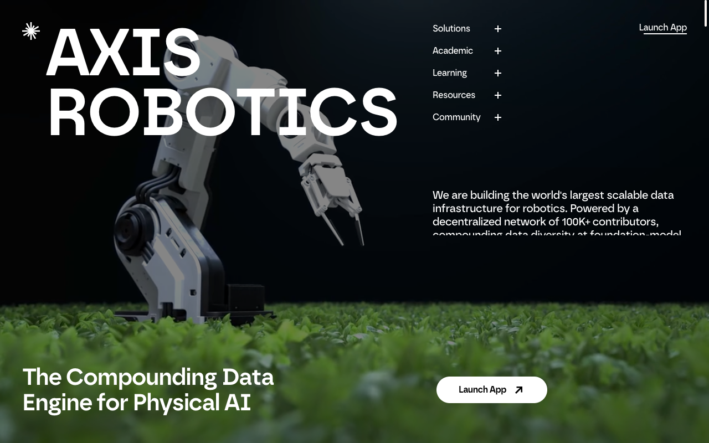
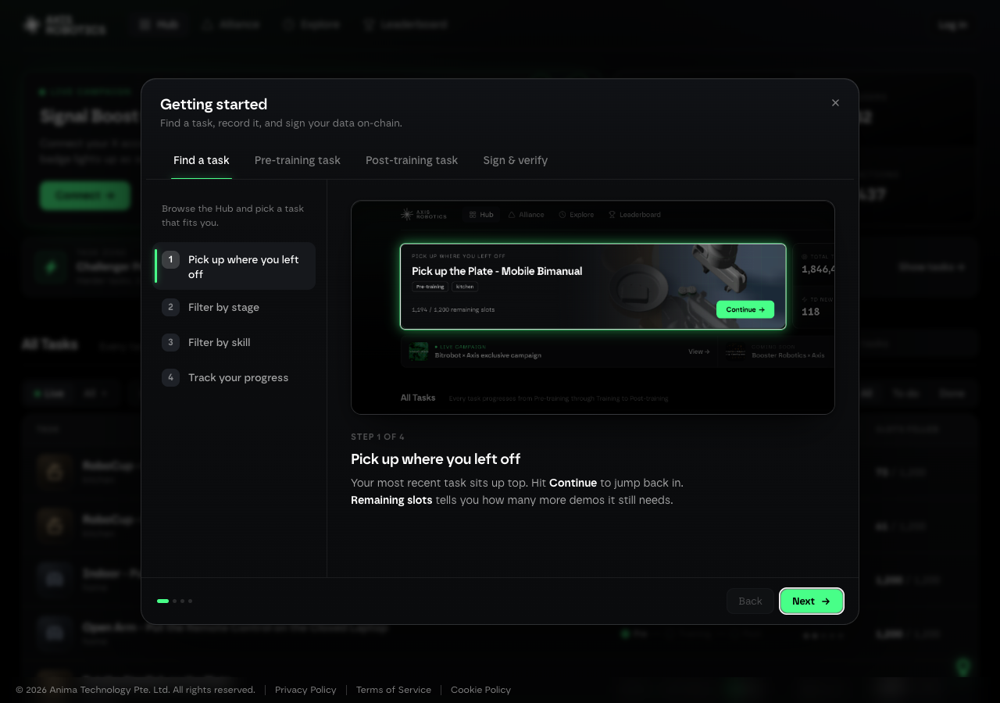
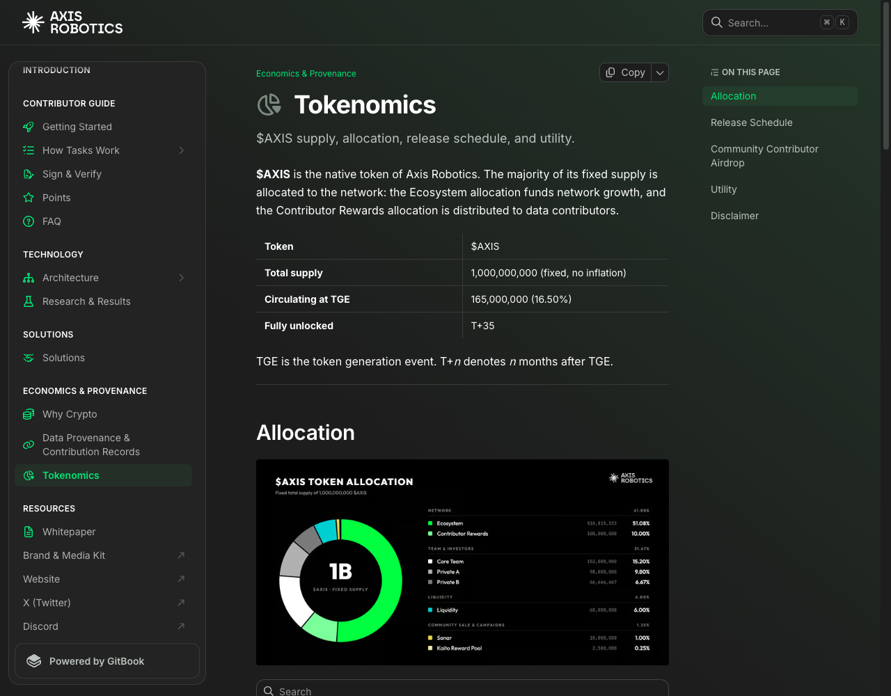
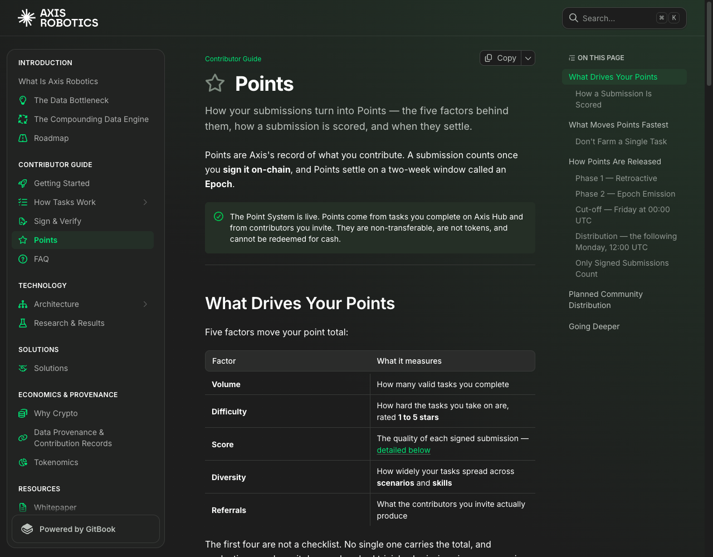
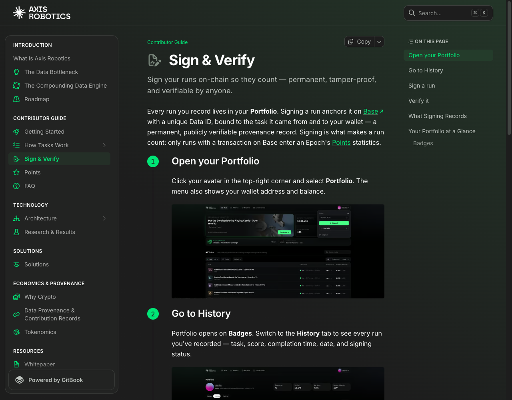

# Axis Robotics Airdrop 13 Oct 2026 - Comprehensive Review & Step-by-Step Execution Playbook

> **In-Depth Analysis Report, Real-World Screenshots & Step-by-Step Playbook for Farming Axis Points ($AXIS) on Base** 
> *Updated: October 13, 2026 | Data verified live via TinyFish CLI*

---

## 1. AXIS ROBOTICS PLATFORM OVERVIEW & TINYFISH-VERIFIED DATA

Using **TinyFish CLI** (`fetch`, `agent`, and `search` commands), all platform parameters, fundraising data, and architecture of Axis Robotics were verified directly from primary sources:

* **Positioning & Technology**: A **Compounding Data Engine for Physical AI (Embodied AI)** built natively on Layer-2 **Base**. The project addresses the biggest "data bottleneck" in modern robotics: the severe shortage of movement and physical-world interaction data.
* **Fundraising (Seed Round)**: **$12,000,000 USD** led by **Hack VC**, with participation from Nomad Capital, Pi Network Ventures, and 10K Ventures.
* **Core Team**: Leading AI and Robotics researchers and engineers from UC Berkeley, Carnegie Mellon (CMU), UCLA, NTU, and Shanghai Jiao Tong University.
* **Data Collection Mechanism**: Uses **MuJoCo** physics simulation running directly in the web browser via WebAssembly / Three.js, combined with an IsaacSim processing system on GPU servers.

---

## 2. SCREENSHOT EVIDENCE & LIVE INTERFACE DOCUMENTATION

All screenshots were captured directly from the live Axis Robotics environment using TinyFish & Headless Web Engine:

### Screenshot 1: Axis Robotics Homepage (`axisrobotics.ai`)

*Official website evidence*: [axisrobotics.ai](https://axisrobotics.ai)

---

### Screenshot 2: Axis Hub Dashboard & Onboarding Tasks (`hub.axisrobotics.ai`)

*Task center evidence*: [hub.axisrobotics.ai](https://hub.axisrobotics.ai)

---

### Screenshot 3: Tokenomics Allocation — 10% Airdrop (`docs.axisrobotics.ai/tokenomics`)

*Official tokenomics documentation evidence*: [docs.axisrobotics.ai/tokenomics](https://docs.axisrobotics.ai/economics-and-provenance/tokenomics)

---

### Screenshot 4: Points Algorithm & Epoch Settlement (`docs.axisrobotics.ai/points`)

*Points mechanism documentation evidence*: [docs.axisrobotics.ai/points](https://docs.axisrobotics.ai/contributor-guide/points)

---

### Screenshot 5: On-chain Sign & Verify Process on Base (`docs.axisrobotics.ai/sign-and-verify`)

*On-chain signing guide documentation evidence*: [docs.axisrobotics.ai/sign-and-verify](https://docs.axisrobotics.ai/contributor-guide/sign-and-verify)

---

## 3. TOKENOMICS & COMMUNITY CONTRIBUTOR AIRDROP ALLOCATION (10%)

According to official Axis Robotics documentation:
* **Fixed Total Supply**: **1,000,000,000 $AXIS** (Non-inflationary).
* **Circulating Supply at TGE**: **165,000,000 $AXIS (16.50%)**.
* **Contributor Rewards Allocation (Airdrop)**: **100,000,000 $AXIS (10.00% of total supply)**.

### Airdrop Distribution Plan across 2 Seasons:
| Season | Contribution Focus | Allocation ($AXIS) | Unlock Schedule |
| :--- | :--- | :---: | :--- |
| **Season 1** (Pre-TGE) | Simulation on Web Hub | **40,000,000** (4%) | • **50%** at TGE • **25%** at T+3 (3 months after) • **25%** at T+6 (6 months after) |
| **Season 2** (Post-TGE) | Sim-to-real & mobile ego-centric data | **60,000,000** (6%) | Terms and mechanism to be announced after TGE |

---

## 4. STEP-BY-STEP AXIS ROBOTICS AIRDROP PLAYBOOK

### Step 1: Register on Axis Hub & Start with 6 "For Newbies" Tasks
1. Visit the official site: **[hub.axisrobotics.ai](https://hub.axisrobotics.ai)**
2. Sign in via Google, Email, X account, or personal wallet (Privy wallet integration is automatic).
3. Use a **desktop or laptop with a separate mouse** (Chrome, Firefox, Safari). *Mobile is not recommended — the simulation requires precise drag control.*
4. Complete all **6 "For Newbies"** introductory tasks first — these teach the submission flow and are the easiest to score.

---

### Step 2: Complete Tasks Across Diverse Scenarios
Complete simulation tasks across multiple different environments per day (aim for 3–5 tasks per session):
* Choose task scenarios from **different environments** (kitchen, factory floor, outdoor) to maximize the Diversity multiplier.
* Complete tasks on **different robot types** (Humanoid, Quadruped, Arm) for additional Diversity points.
* Avoid running **more than 5 valid completions of the same task** — the Hub caps valid completions per task and rewards diminish after the limit.

---

### Step 3: On-chain Sign & Verify on Base (Required — 100%)
Completing a task only saves data locally. If you don't sign on-chain, all your effort will not count toward points.

1. Click your avatar in the top-right corner → Select **Portfolio**.
2. Switch to the **History** tab to view your runs.
3. When a run shows the status `Signable` (passed physical consistency check), click the **Sign** button.
4. Confirm the signature on the **Base** network (gas fees are near-zero or gasless subsidized by the system).
5. After signing, each run receives a permanent **Data ID** on the blockchain.

---

### Step 4: Earn Bonus Points via Alliance & Challenger Programs
* **Challenger Program**: Once comfortable, choose 4–5 star difficulty tasks in the Challenger Program to earn **2x–3x multiplier bonuses** on your point score.
* **Alliance Tab (BitRobot Partner)**: Participate in exclusive alliance missions (e.g., *BitRobot x Axis*) to earn **additional Alliance Points** on top of your regular simulation score.

---

### Step 5: Link Social Accounts & Track Epoch Cycles
1. Go to **Portfolio**, link your **X (Twitter)** and **Discord** accounts.
2. **Epoch Cycle (every 2 weeks)**:
 * **Cut-off deadline**: **00:00 UTC Friday** (only runs signed before this deadline are counted).
 * **Points Distribution**: Points are credited to accounts at **12:00 UTC Monday** of the following week.
3. Join the official Discord: **[discord.gg/axisrobotics](https://discord.gg/axisrobotics)** to receive task announcements and epoch updates.

---

## 5. SAFETY WARNINGS, ANTI-BOT RULES & PRIORITY ORDER

### Things to Absolutely Avoid (Anti-Sybil Rules):
* **Do not spam a single task**: The Hub limits **maximum 5 valid completions per task**, and points for that task decrease with each additional attempt.
* **Do not use bots/automation scripts**: The system has physical replay validation layers and Vision-Language Model (VLM) detection to identify fake or AI-generated movement data.
* **Do not send money or real tokens**: Participation is completely free — only your time contributing data is required.

---

### Priority Action Table

| Priority | Specific Action | Goal & Benefit |
| :---: | :--- | :--- |
| **1** | Register at [hub.axisrobotics.ai](https://hub.axisrobotics.ai) & complete 6 For Newbies tasks | Get familiar with the process, avoid mistakes that invalidate runs |
| **2** | Link X and Discord accounts in Portfolio | Meet the Signal Boost campaign requirements & protect account identity |
| **3** | Complete diverse tasks daily (3–5 tasks across different contexts) | Optimize the **Diversity** and **Score** multipliers in the epoch formula |
| **4** | Hunt 4–5 star tasks in **Challenger Program** & **Alliance** | Boost your score with 2x–3x reward multipliers |
| **5** | **Go to Portfolio → History → Click SIGN before 00:00 UTC Friday** | **Required: Lock in epoch data — unsigned runs earn zero points** |

---

## 6. OFFICIAL REFERENCE LINKS

* **Axis Hub (Complete tasks)**: [hub.axisrobotics.ai](https://hub.axisrobotics.ai)
* **Official Homepage**: [axisrobotics.ai](https://axisrobotics.ai)
* **Official X (Twitter) Channel**: [@axisrobotics](https://x.com/axisrobotics)
* **Community Discord**: [discord.gg/axisrobotics](https://discord.gg/axisrobotics)
* **Documentation (Docs)**: [docs.axisrobotics.ai](https://docs.axisrobotics.ai)
* **$AXIS Tokenomics Details**: [docs.axisrobotics.ai/tokenomics](https://docs.axisrobotics.ai/economics-and-provenance/tokenomics)
* **Points Mechanism Guide**: [docs.axisrobotics.ai/points](https://docs.axisrobotics.ai/contributor-guide/points)
* **On-chain Sign & Verify Process**: [docs.axisrobotics.ai/sign-and-verify](https://docs.axisrobotics.ai/contributor-guide/sign-and-verify)
* **BitRobot Alliance Partner**: [bitrobot.ai](https://bitrobot.ai)
* **GitHub Repository**: [github.com/ThanaLamth/Tinyfish-review](https://github.com/ThanaLamth/Tinyfish-review)
