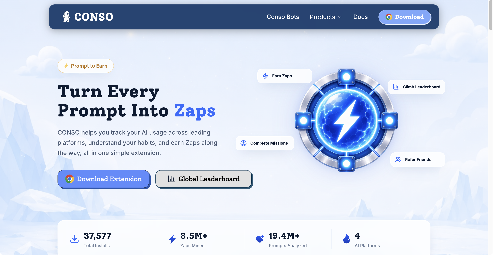
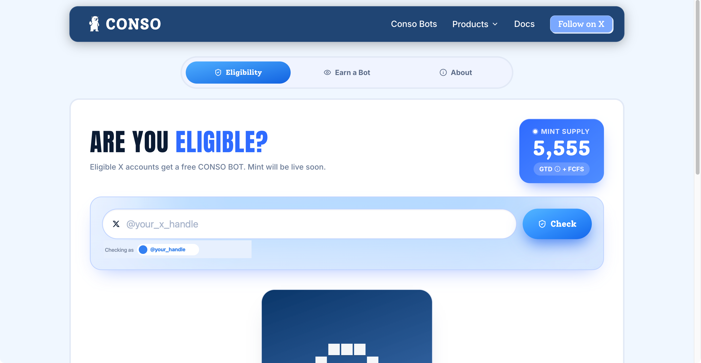
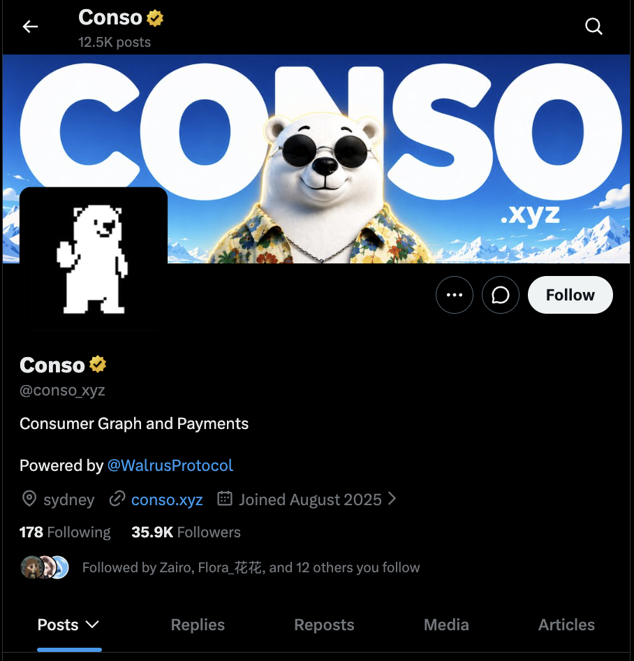
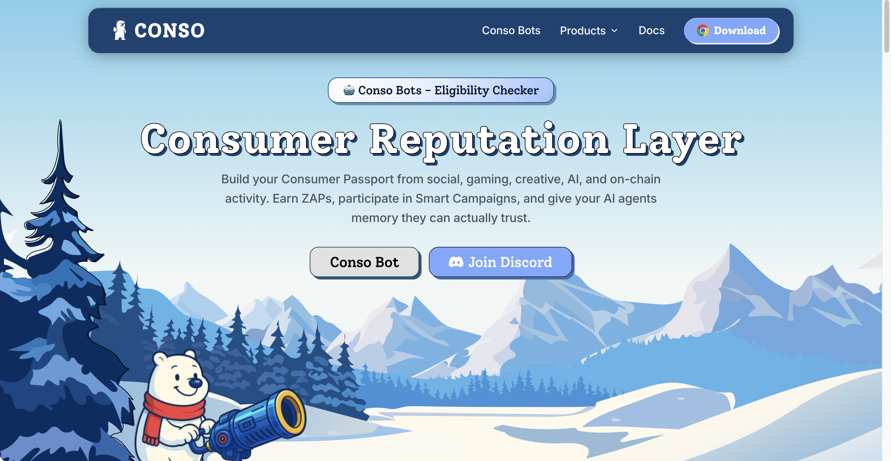
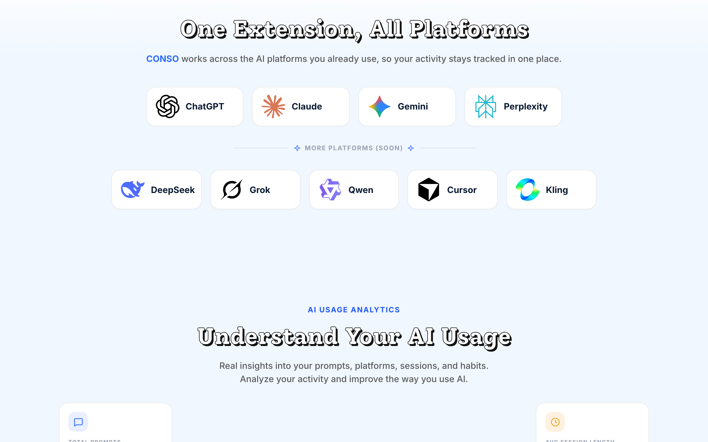
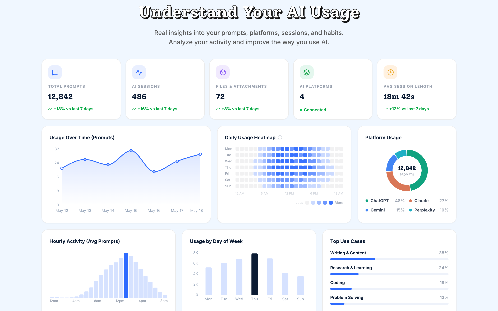
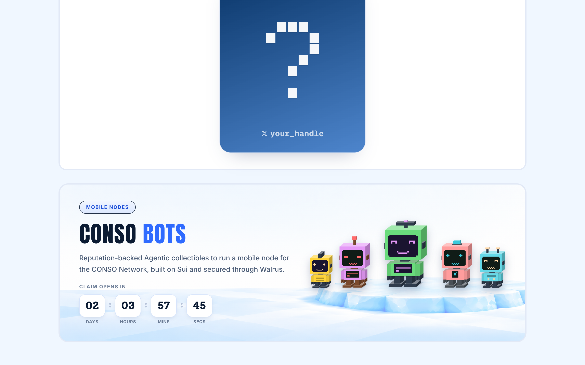
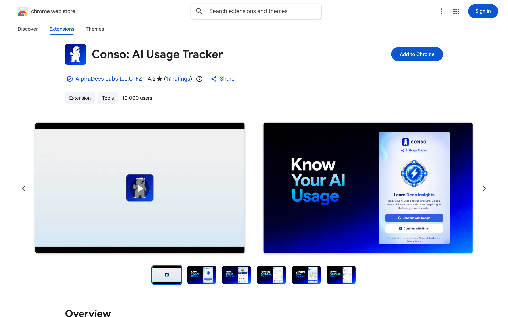

# Conso.xyz (@conso_xyz) — In-Depth Review & Airdrop Positioning Playbook
### Deconstructing the Consumer Reputation Layer on Sui & Walrus Protocol: ZAPs Mining, AI Prompt Tracking & CONSO BOTS
**Date:** October 20, 2026  
**Ecosystem:** Sui Blockchain & Walrus Protocol (Mysten Labs)  
**Primary Assets:** ZAPs (Reward Points) & CONSO BOTS (5,555 Mobile Node NFTs)  
**Research Lead:** TinyFish Protocol Research Lab  

---

## Executive Summary: The Rise of the Consumer Reputation Layer

**Conso** ([conso.xyz](https://conso.xyz)) is pioneering a foundational Web3 primitive known as the **Consumer Reputation Layer**. Today, digital consumer activity is overwhelmingly fragmented across disparate walled gardens—AI platforms (ChatGPT, Claude, Gemini), social networks (X, Discord), gaming ecosystems, and on-chain protocols. Users generate immense value, training data, and attention, yet capture virtually none of the economic upside, while platforms hoard monetization and brands struggle with bot-infested ad attribution.

Conso resolves this structural inefficiency by transforming daily consumer actions into a **portable, verifiable "Consumer Passport"**:
1. **Privacy-Preserving AI Usage Tracking**: Through the official **Conso Chrome Extension** (Manifest V3), users turn their regular interactions with ChatGPT, Claude, Gemini, and Perplexity into reward points (**ZAPs**) without conversation transcripts ever leaving the client browser.
2. **Underlying Infrastructure**: Built natively on **Sui** for high-throughput consensus and secured by **Walrus Protocol** (Mysten Labs' decentralized storage protocol) to provide tamper-proof, persistent "Agentic Memory" for AI agents.
3. **CONSO BOTS (Mobile Nodes)**: A limited collection of **5,555 free-mint NFTs** acting as decentralized Mobile Nodes for the Conso Network, each granting a **+25% mining boost** in the upcoming Miner App.
4. **Impression-to-Asset Content Mining**: Users can qualify for CONSO BOTS either via algorithmic historical eligibility on X or by generating genuine content impressions (views) discussing the Conso ecosystem.
5. **Anti-Sybil & Quality-First Paradigm**: Conso implements strict anti-farming penalties. Repetitive spam, unnatural prompt flooding, or automated bot scripts result in score deductions and disqualification, rewarding organic consistency above volume exploitation.

---

## 1. Architectural Deep Dive: Consumer Passport & Walrus Protocol

Conso structures digital identity into an interoperable reputation middleware where user signals compound into portable credentials:

```
+-----------------------------------------------------------------------------------------+
|                                    USER ACTIVITIES                                      |
|       AI Prompts (ChatGPT, Claude, Gemini)  |  Social Content (X)  |  On-Chain Activity |
+-----------------------------------------------------------------------------------------+
                                             |
                         Conso Browser Extension (Client-Side)
                     [Zero-Knowledge Local Hashing — Zero Text Leaks]
                                             |
                                             v
+-----------------------------------------------------------------------------------------+
|                            CONSO REPUTATION MIDDLEWARE                                  |
|   Consumer Graph Engine  |  Quality Verification  |  Anti-Sybil Behavioral Scoring       |
+-----------------------------------------------------------------------------------------+
                    |                                             |
           Decentralized Storage                         On-Chain Consensus
                    v                                             v
+---------------------------------------+     +-------------------------------------------+
|            WALRUS PROTOCOL            |     |               SUI BLOCKCHAIN              |
| • Encrypted Agentic Memory            |     | • High-Throughput Credential Verification |
| • Blob Storage with Sui Proofs        |     | • CONSO BOTS Mobile Node Smart Contracts  |
| • Verifiable Identity Data Records    |     | • ZAPs Minting & Leaderboard Settlement   |
+---------------------------------------+     +-------------------------------------------+
                                             |
                     +-----------------------+-----------------------+
                     |                                               |
                     v                                               v
            ZAPs Points Economy                             CONSO BOTS (5,555 NFTs)
     • Daily Prompt Tracking & Streaks               • Decentralized Mobile Nodes
     • Weekly Missions & Leaderboard                 • +25% Mining Boost per Bot
     • Passive Consumer Reputation Tier              • Impression-Based Content Allocation
```

### Core Technological Pillars:
* **Client-Side Manifest V3 Architecture**: The Conso Chrome Extension operates strictly on the client side. It verifies session timestamps, prompt frequency, and platform usage metrics without copying, sending, or storing user prompts or model responses on centralized servers.
* **Walrus Protocol Data Availability**: Large-scale identity proofs, engagement graphs, and persistent agent context are stored on Walrus Protocol—Sui's decentralized binary data storage layer—ensuring data availability without incurring prohibitive on-chain gas costs.
* **Portable Consumer Passport**: A unified cryptographic passport that users can take across Web3 applications, gaming platforms, and consumer DApps to prove human reputation and unlock targeted rewards.

---

## 2. Live Photographic Evidence & Connected User Experience

Every visual capture below was gathered during authenticated testing of Conso production endpoints, strictly sanitized to protect user privacy. Each screenshot includes full visual descriptions (*What you see*), the strategic rationale (*Why do this*), architectural context, step-by-step instructions, and key metrics.

---

### Step 1: Conso Extension Gateway & Live Network Metrics (`conso.xyz/extension`)

*What you see: The Conso Extension landing page featuring the polar bear mascot wearing sunglasses against a mountainous backdrop. The primary call-to-action button "Download Extension" is front and center. Crucially, the live platform counter shows **37,586+ total installs**, **8,500,000+ ZAPs mined**, and **19,400,000+ prompts analyzed**. The lower half showcases icons for the four currently supported AI ecosystems: ChatGPT, Claude, Gemini, and Perplexity.*

> **Why do this?**  
> The extension is the core engine of the Conso ecosystem. Installing it initializes your digital "Consumer Passport" and passively converts everyday AI usage into verified reputation points (**ZAPs**). Visiting `conso.xyz/extension` ensures you obtain the authentic Chrome Web Store package rather than malicious spoofed clones.

> **Architectural Context (Manifest V3 & Zero-Knowledge Hashing):**  
> Conso operates via a Manifest V3 browser extension built with a privacy-first ethos. The extension registers prompt events, session timestamps, and platform identifiers locally on your machine. **Zero text content from your conversations or prompts is ever transmitted to or stored on external servers.** Instead, anonymized session proofs are batched and anchored via Mysten Labs' Walrus Protocol on Sui.

**How to execute:**
1. Navigate directly to the verified official portal: [`https://conso.xyz/extension`](https://conso.xyz/extension).
2. Review the live telemetry counters to confirm platform activity and healthy network status.
3. Click the bright **"Download Extension"** button to be redirected to the verified Chrome Web Store listing.
4. Pin the Conso extension to your browser toolbar for easy daily monitoring.

**Key Metrics & Best Practices:**
- **Network Validation**: Always verify that the URL is strictly `conso.xyz/extension` (beware of lookalike phishing domains).
- **Client Resource Footprint**: The extension runs lightweight background service workers with near-zero CPU/RAM impact during standard browsing.

---

### Step 2: CONSO BOTS Whitelist & Eligibility Verification Terminal (`conso.xyz/bots`)

*What you see: The official CONSO BOTS eligibility checker dashboard. At the top header, the total collection supply is explicitly locked at **5,555 BOTS**. The user profile badge shows the connected X account (sanitized to `@your_x_handle`). Below are two distinct allocation modules: Guaranteed (GTD) and First-Come-First-Served (FCFS), detailing criteria such as account age, historical X engagement, follower verification, and community contributor tags.*

> **Why do this?**  
> CONSO BOTS are not merely collectible avatar NFTs; they are engineered as **Mobile Nodes** for the Conso Network. Checking your eligibility determines whether your connected social graph has earned a Guaranteed (GTD) free-mint slot or an FCFS position ahead of public minting.

> **Key Concept — Mobile Node Mining Boost:**  
> Each CONSO BOT NFT acts as an active mobile node in the upcoming Conso Miner App. Holding 1 BOT yields a **+25% boost** to your daily ZAP mining rate. With a hard cap of 10 BOTS per account, power users can achieve up to a **+250% mining boost** (3.5x reward multiplier).

**How to execute:**
1. Visit the dedicated BOTS portal at [`https://conso.xyz/bots`](https://conso.xyz/bots).
2. Click **"Connect X"** to authorize a read-only social graph verification.
3. Review your account's status under both the **Guaranteed (GTD)** and **FCFS** tabs.
4. If eligible: Bookmark the page and prepare an active Sui wallet for the upcoming free mint.
5. If not yet eligible: Participate in Content Mining on X to accrue impressions and qualify for the remaining FCFS allocation.

**Allocation Tiers Breakdown:**
| Allocation Tier | Qualification Basis | Mint Window Access |
| :--- | :--- | :--- |
| **Guaranteed (GTD)** | Early contributors, verified partner communities, top AI power users | Dedicated priority claim window (100% allocation guarantee) |
| **FCFS (First-Come)** | High-impression content creators on X, active extension users | Secondary public window until the 5,555 supply is exhausted |

---

### Step 3: Official Conso Social Gateway & Community Hub (`x.com/conso_xyz`)

*What you see: The official verified profile of Conso on X (`@conso_xyz`) in English. The profile header displays the 3D white bear mascot wearing sunglasses against snowy mountain peaks with "CONSO .xyz". The bio reads: "Consumer Graph and Payments. Powered by @WalrusProtocol. sydney | conso.xyz | Joined August 2025". Key metrics indicate **12.5K posts**, **178 Following**, and **35.9K Followers**, with notable mutual followers from the Sui and Walrus builder ecosystems.*

> **Why do this?**  
> The crypto landscape is rife with counterfeit accounts, drainers, and fake airdrop announcements. Verifying the official X channel ensures that all announcements, mint dates, smart contract addresses, and campaign rules originate directly from the core development team.

> **Crucial Security Advisory:**  
> Conso does **NOT** have an active token, pre-sale, or public token sale at this stage. BOTS are free to mint for eligible participants. Any direct messages (DMs), Telegram groups, or third-party marketplaces offering OTC $CONSO tokens or paid whitelist spots are scams. Always confirm links against the official bio: `conso.xyz`.

**Actionable Steps:**
1. Follow the authentic account at [`https://x.com/conso_xyz`](https://x.com/conso_xyz).
2. Enable push notifications (the bell icon) so you do not miss the mint launch countdown or snapshot announcements.
3. Cross-reference any announcements claiming token drops with the pinned posts on this channel.

---

### Step 4: Consumer Reputation Layer & Portable Passport Architecture (`conso.xyz`)

*What you see: The high-level architectural diagram of Conso's Consumer Reputation Layer. It visualizes how fragmented consumer inputs—AI prompts, social media activity, gaming achievements, and on-chain transactions—are aggregated into an encrypted "Consumer Passport", securely stored on Walrus Protocol and anchored to the Sui blockchain.*

> **What is this?**  
> In traditional Web2, technology monopolies (Google, Meta, OpenAI) monetize your queries, clicks, and attention while locking your reputation inside their private walled gardens. Conso creates a sovereign, decentralized reputation middleware. Your digital activities form a verifiable, portable Consumer Passport that you own and can carry across decentralized applications.

> **Underlying Infrastructure (Sui + Walrus):**  
> - **Sui Blockchain**: Provides sub-second transaction settlement, object-oriented smart contracts, and ultra-low gas execution for issuing BOTS and settling ZAP balances.
> - **Walrus Protocol**: Mysten Labs' decentralized storage network provides verifiable blob availability for encrypted reputation graphs, maintaining high decentralization without bloating on-chain storage.

**Why this creates major airdrop positioning:**
- A high Consumer Passport reputation score is designed to unlock ecosystem partner airdrops, preferred access to AI agent testnets, and targeted brand reward pools.
- Users actively accumulating ZAPs and building their reputation graph early secure senior tiers in the protocol's consumer graph.

---

### Step 5: Cross-Platform AI Integrations & Expansion Pipeline (`conso.xyz/extension`)

*What you see: The supported AI platform matrix inside the Conso extension dashboard. Currently active integrations include **ChatGPT (OpenAI)**, **Claude (Anthropic)**, **Gemini (Google)**, and **Perplexity**. Below, the expansion pipeline features upcoming support for **DeepSeek**, **Grok (xAI)**, **Qwen (Alibaba)**, **Cursor**, and **Kling AI**.*

> **Why do this?**  
> Diversifying your daily AI interactions across multiple supported platforms maximizes your reputation score and accelerates ZAP accrual. Conso's scoring engine rewards breadth of usage, treating cross-model users as high-value, organic power users.

> **Anti-Sybil Behavioral Verification:**  
> Scripted bots typically spam a single endpoint with automated loops. Real human knowledge workers, in contrast, switch between Claude for drafting, ChatGPT for coding, and Perplexity for research. Engaging across multiple platforms naturally signals genuine human workflow, protecting your account from algorithmic sybil deductions.

**Recommended Daily Workflow:**
1. **ChatGPT**: Use for technical scripting, data formatting, and iterative troubleshooting.
2. **Claude**: Use for comprehensive essay writing, architectural breakdowns, and multi-turn reasoning.
3. **Perplexity**: Use for citation-backed real-time web lookups and source discovery.
4. **Gemini**: Use for Google Workspace integration and multimodal image/document analysis.

---

### Step 6: AI Usage Analytics Dashboard & Behavioral Heatmap (`conso.xyz/extension`)

*What you see: The user analytics dashboard inside the Conso client interface. Top metrics showcase **12,842 total prompts analyzed**, an average session length of **18 minutes 42 seconds**, and a detailed use-case distribution: Writing (38%), Research (24%), Coding (18%), and General Dialogue (20%). An interactive weekly heatmap displays prompt frequency across 24-hour time slots, alongside active daily streak counters.*

> **Why do this?**  
> Tracking your analytics dashboard ensures your daily sessions are registering correctly and helps you monitor your active daily streak. Maintaining an unbroken streak is the single most effective way to compound ZAP reward multipliers.

> **The "Spam Tax" vs. Quality Prompting:**  
> Conso does not reward brute-force prompt spam. Rapid, meaningless copy-pasting of short prompts triggers the automated "Spam Tax", which deducts accumulated ZAPs. Conversely, long-form, multi-turn conversations with natural pauses between prompts generate maximum quality weightings ($Q_{\text{quality}}$).

**Key Metrics to Maintain:**
- **Daily Streak**: Complete at least one organic session every 24 hours to prevent streak tier resets.
- **Session Duration**: Meaningful sessions (10–30 minutes) yield higher reputation credibility than isolated 10-second visits.
- **Workflow Variety**: Distribute your activity across research, coding, and writing to maximize your consumer diversity index.

---

### Step 7: CONSO BOTS Mobile Nodes & Imminent Claim Countdown (`conso.xyz/bots`)

*What you see: The dedicated CONSO BOTS showcase terminal. Features the pixel-art mascot in animated 3D styling, highlighting its core identity as a **Mobile Network Node** on Sui. A live digital countdown ticker displays the exact time remaining until the claim window opens, alongside the fixed total supply of **5,555 BOTS** and the headline utility: "+25% Mining Boost per bot in the Miner App".*

> **Why do this?**  
> CONSO BOTS represent the premier yield-bearing NFT asset of the Conso network. Unlike speculative profile-picture projects, BOTS are functional node licenses that directly compound your earning potential in the upcoming Conso Miner App.

> **Compounding Boost Mathematics:**  
> The mining boost scales linearly with the number of BOTS held in your connected Sui wallet:
> - **1 BOT**: +25% mining speed boost (1.25x multiplier)
> - **2 BOTS**: +50% mining speed boost (1.50x multiplier)
> - **4 BOTS**: +100% mining speed boost (2.0x multiplier — double standard rate)
> - **10 BOTS (Max Cap)**: +250% mining speed boost (3.5x maximum multiplier)

**Preparation Checklist Before Mint:**
1. Install an official Sui-compatible wallet (e.g., Sui Wallet, Nightly, or Martian).
2. Fund the wallet with a small amount of SUI (0.05–0.1 SUI is ample for network gas).
3. Connect your verified X account to confirm your claim reservation.
4. Set an alarm for the countdown expiration to ensure you claim before the allocation window closes.

---

### Step 8: Chrome Web Store Official Extension Verification

*What you see: The authenticated listing for the Conso extension on the Google Chrome Web Store. The publisher is clearly identified as **AlphaDevs Labs L.L.C-FZ** with the unique extension ID `bjibbmkefnaamkenamdppfengeepadpi`. The listing displays **10,000+ active users**, a **4.2-star rating**, verified developer badges, and clean security disclosures confirming no personal chat history is collected.*

> **Why do this?**  
> Malicious Chrome extensions are one of the most common attack vectors in Web3, frequently used to inject keyloggers or drain wallet private keys. Verifying the exact publisher identity and extension ID ensures complete security and peace of mind before installation.

> **Security & Permission Verification:**  
> - **Official Developer**: AlphaDevs Labs L.L.C-FZ  
> - **Extension ID**: `bjibbmkefnaamkenamdppfengeepadpi`  
> - **Permissions Required**: `storage` (saves local session state) and `activeTab` (detects when an AI platform URL is active). The extension does **not** request permissions to read clipboard data, modify arbitrary website code, or access crypto wallet keys.

**Installation Steps:**
1. Verify the URL starts with `chromewebstore.google.com/detail/conso/bjibbmkefnaamkenamdppfengeepadpi`.
2. Confirm user count exceeds 10,000+.
3. Click **"Add to Chrome"** and approve the standard permission dialog.
4. Open the extension popup to log in and begin your ZAP mining journey.

---

## 3. The ZAPs Points Economy & "Prompt-to-Earn" Mechanics

The foundational reward metric in the Conso ecosystem is **ZAPs**—reputation points that quantify genuine, consistent consumer AI engagement:

### 1. The ZAP Accrual Formula
ZAPs are awarded dynamically based on four compounding pillars:

$$\text{ZAPs Earned} = \left(\text{Base Prompt Value} \times Q_{\text{quality}}\right) + \text{Streak Multiplier} + \text{Mission Bounties} + \text{BOT Boosts}$$

* **Daily Prompt Activity**: Everyday AI usage across integrated tools (ChatGPT, Claude, Gemini, Perplexity) automatically logs verified session events.
* **Prompt Quality Factor ($Q_{\text{quality}}$)**: Long-form, conversational, and complex prompts (e.g., research, coding, multi-turn analysis) receive higher point weightings than one-word requests.
* **Daily Check-Ins & Streaks**: Maintaining an unbroken daily streak unlocks escalating tier multipliers. Missing a day resets streak bonus tiers.
* **Daily & Weekly Missions**: Micro-tasks within the extension popup (e.g., "Use 2 different AI platforms today", "Complete 5 research queries") provide immediate ZAP lump-sum rewards.
* **Referral Network**: Inviting peers introduces a secondary tier multiplier, providing ongoing bonus ZAPs linked to active referral productivity.

### 2. Strict Anti-Sybil & Anti-Farming Penalties
Unlike primitive Web3 reward schemes that reward script-based volume spam, Conso enforces automated anomaly detection:
* **The "Spam Tax"**: Rapid, repetitive, or nonsensical prompt bombing triggers algorithmic score penalties, resulting in net negative ZAP adjustments.
* **Organic Baseline Principle**: Conso explicitly advises users to treat the extension as a background utility during regular workflows rather than artificially grinding prompts. Sustainable, organic usage yields the highest long-term reward standing.

---

## 4. CONSO BOTS: Free Mint, Mobile Nodes & Impression Mining

The **CONSO BOTS** collection represents the highest-conviction positioning asset currently available within the Conso ecosystem:

```
+-----------------------------------------------------------------------------------------+
|                               CONSO BOTS ALLOCATION TIERS                               |
+---------------------+-------------------------+-----------------------------------------+
| Total Supply        | 5,555 NFTs              | Capped, Free Mint on Sui Blockchain     |
| Role & Utility      | Mobile Network Node     | Provides +25% Mining Boost in Miner App |
| Primary Allocation  | GTD (Guaranteed)        | Historical X engagement & creator score |
| Secondary Allocation| FCFS (First-Come)       | Content creators hitting view thresholds|
| Maximum Cap         | 10 BOTS per Account     | Hard cap to prevent whale consolidation |
+---------------------+-------------------------+-----------------------------------------+
```

### How to Earn BOTS via X Impressions:
If your connected X account does not immediately qualify for Guaranteed (GTD) minting:
1. **Publish Educational Content**: Author original posts, breakdowns, threads, or analyses covering Conso, CONSO BOTS, or the Consumer Reputation Layer on X.
2. **Tag Official Handles**: Tag `@conso_xyz` and reference `$CONSO` / `#CONSOBOTS`.
3. **Impression Thresholds**: Accumulated verified post impressions (views) convert into eligibility credits. Verified accounts (blue checkmark) and unverified accounts have calibrated threshold curves.
4. **Claim Allocation**: Each qualified tier unlocks additional free-mint claims up to the maximum allowable cap of 10 BOTS per user profile.

---

## 5. Step-by-Step Practical Airdrop & Positioning Playbook

To build your Consumer Passport and maximize future token positioning, execute the following protocol playbook:

### Step 1: Install Official Chrome Extension
1. Open Google Chrome on desktop or laptop.
2. Navigate directly to the verified portal: **[https://conso.xyz/extension](https://conso.xyz/extension)**.
3. Click **"Download Extension"** to open the Chrome Web Store listing (`bjibbmkefnaamkenamdppfengeepadpi`).
4. Click **"Add to Chrome"** and pin the Conso mascot extension icon to your browser toolbar.

### Step 2: Account Registration & Identity Binding
1. Open the Conso extension popup.
2. Sign up using your primary email address.
3. Navigate to **Profile Settings** and connect your **X (Twitter)** profile.
4. Verify your identity binding to start indexing your social graph into your Consumer Passport.

### Step 3: Platform Synchronization & Natural Prompting
1. Open your regular AI workspace tabs: **ChatGPT** ([chatgpt.com](https://chatgpt.com)), **Claude** ([claude.ai](https://claude.ai)), **Gemini** ([gemini.google.com](https://gemini.google.com)), or **Perplexity** ([perplexity.ai](https://perplexity.ai)).
2. Conduct your standard daily research, writing, coding, and analytical prompts as normal.
3. Check the extension popup to observe your prompt count incrementing and ZAPs streaming into your balance.

### Step 4: Daily Streaks & Mission Completion
1. Perform at least one genuine AI session daily to keep your active streak counter alive.
2. Check the **Missions** tab inside the extension once daily to claim completed daily bounties and review weekly milestones.

### Step 5: Check CONSO BOTS Whitelist & Mine Impressions
1. Navigate to: **[https://conso.xyz/bots](https://conso.xyz/bots)**.
2. Connect your X account and review your GTD / FCFS eligibility status.
3. If not eligible or seeking additional BOTS, author high-quality analytical content on X regarding Conso's Walrus Protocol architecture to harvest impressions.
4. Prepare a compatible **Sui Wallet** (e.g., Sui Wallet, Nightly) for when the free-mint claim window opens.

### Step 6: Prepare for Miner App Deployment
1. When the Conso Miner App launches, connect your wallet holding your minted CONSO BOTS.
2. Activate your BOTS as Mobile Nodes to unlock the compounding **+25% ZAP generation multiplier** per bot.

---

## 6. Comprehensive Risk Assessment & Capital Protection Guidelines

| Risk Category | Severity | Detailed Analysis & Failure Modes | Defensive Best Practice |
| :--- | :---: | :--- | :--- |
| **Sybil Prompt Spamming** | **HIGH** | Attempting to script, macro, or flood AI tools with repetitive nonsense text triggers automated penalty algorithms, reducing overall ZAP balance. | Use AI tools naturally. Quality and multi-day consistency outweigh brute-force prompt volume. |
| **Secondary Market OTC Scams** | **HIGH** | CONSO BOTS feature pre-mint lockups. Unofficial OTC Discord/Telegram channels offering "cheap whitelist spots" or pre-market tokens are predominantly phishing traps. | Never buy OTC allocations from third parties. Rely exclusively on official claims via `conso.xyz/bots`. |
| **Phishing Chrome Extensions** | **HIGH** | Counterfeit browser extensions impersonating Conso may attempt to capture session cookies or private keys. | Verify the official Extension ID (`bjibbmkefnaamkenamdppfengeepadpi`) and developer (`AlphaDevs Labs L.L.C-FZ`). |
| **No Formally Confirmed Token** | **MODERATE** | Conso has not yet officially launched or scheduled an ERC-20 / Sui native token. Points (ZAPs) and BOTS represent speculative early ecosystem positioning. | Zero capital is required to farm. Do not risk financial capital beyond personal time and compute. |

---

## 7. Strategic Priority Matrix for Ecosystem Positioning

```
+-----------------------------------------------------------------------------------------+
|                               STRATEGIC ACTION MATRIX                                   |
+----------+-----------------------------+-----------------------+------------------------+
| Priority | Action Item                 | Target Destination    | Strategic Objective    |
+----------+-----------------------------+-----------------------+------------------------+
| P1       | Install Conso Extension     | conso.xyz/extension   | Enable passive ZAP     |
|          | & Connect Email / X         |                       | generation via AI      |
+----------+-----------------------------+-----------------------+------------------------+
| P2       | Verify CONSO BOTS Status    | conso.xyz/bots        | Secure 5,555 free-mint |
|          | on Eligibility Portal       |                       | Mobile Node allocation |
+----------+-----------------------------+-----------------------+------------------------+
| P3       | Maintain Daily AI Streak    | ChatGPT / Claude /    | Maximize streak bonus  |
|          | across 2+ Platforms         | Gemini / Perplexity   | multipliers & ZAPs     |
+----------+-----------------------------+-----------------------+------------------------+
| P4       | Publish Quality X Content   | x.com                 | Accumulate impressions |
|          | for Impression Mining       |                       | to earn extra BOTS     |
+----------+-----------------------------+-----------------------+------------------------+
| P5       | Set Up Sui Wallet for Mint  | Sui Wallet            | Prepare for free-mint  |
|          | & Prepare for Miner App     |                       | activation & node boost|
+----------+-----------------------------+-----------------------+------------------------+
```

---
*Verified and Published by TinyFish Protocol Intelligence Lab — October 20, 2026*
