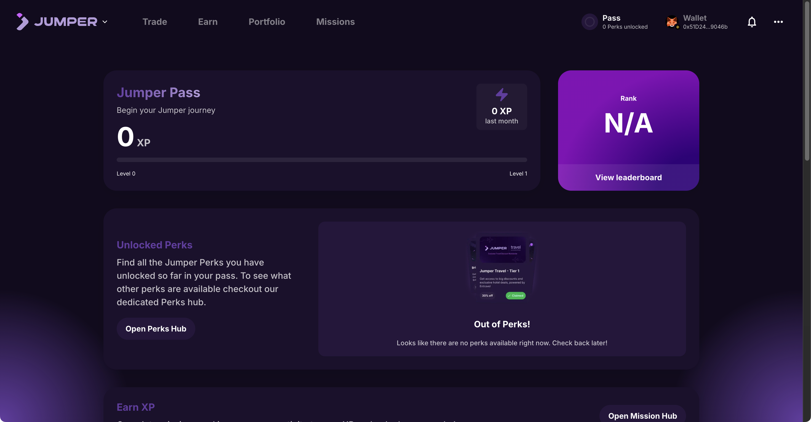
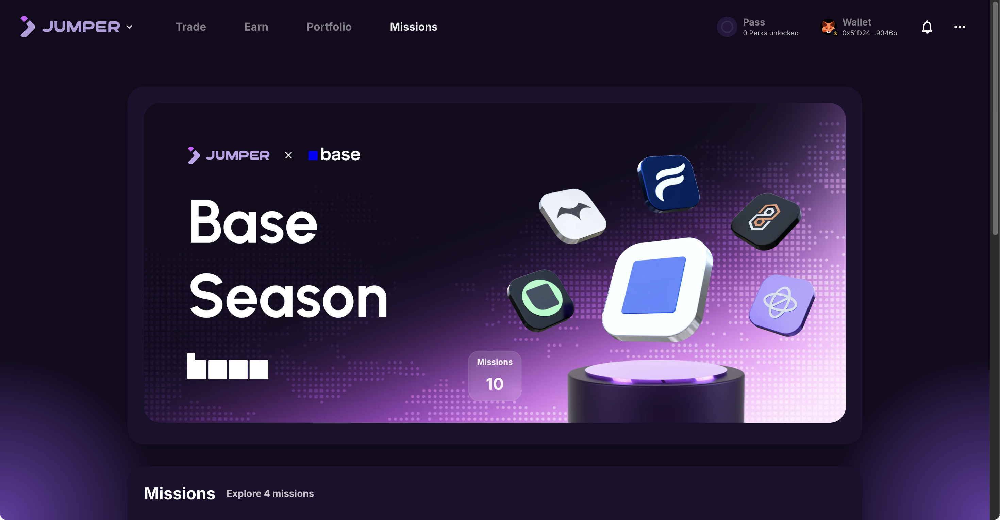
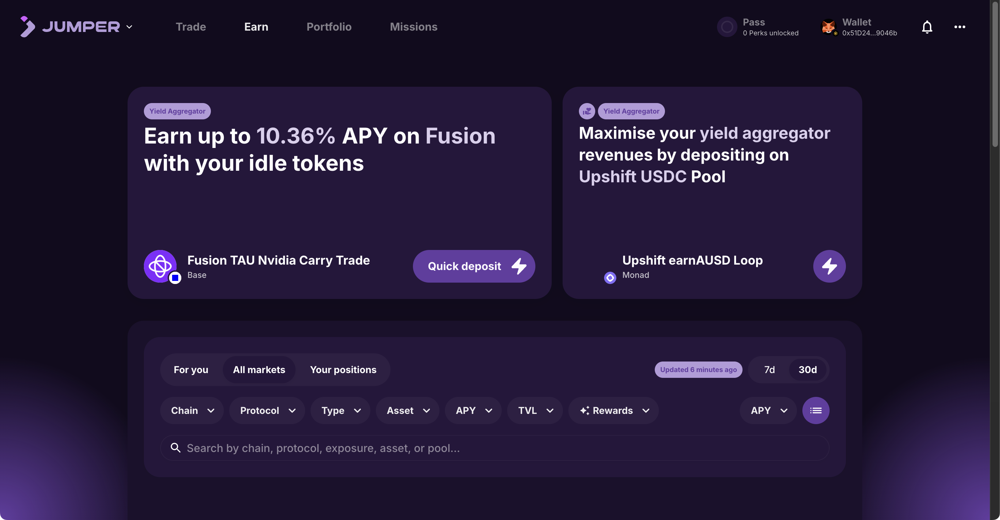
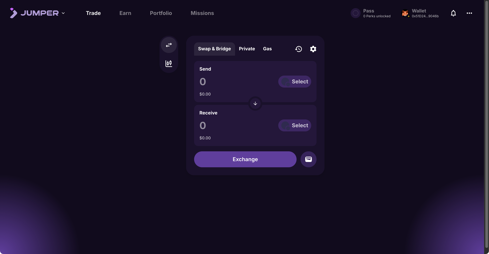
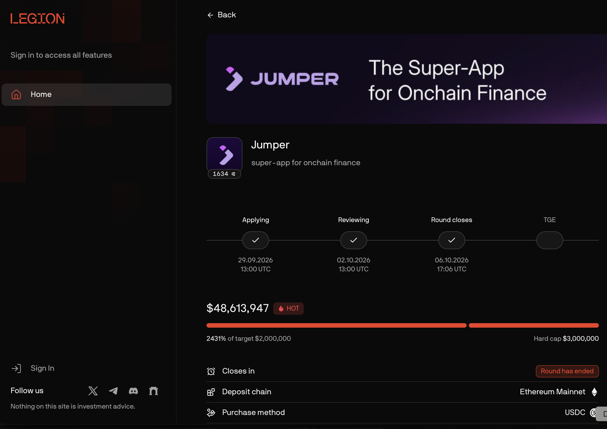
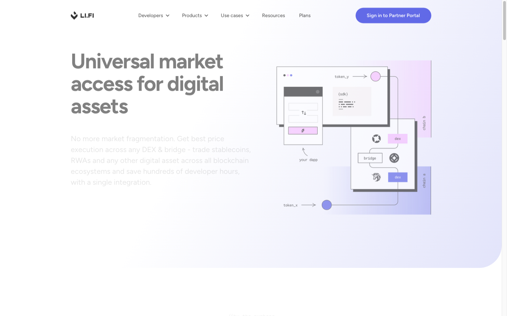
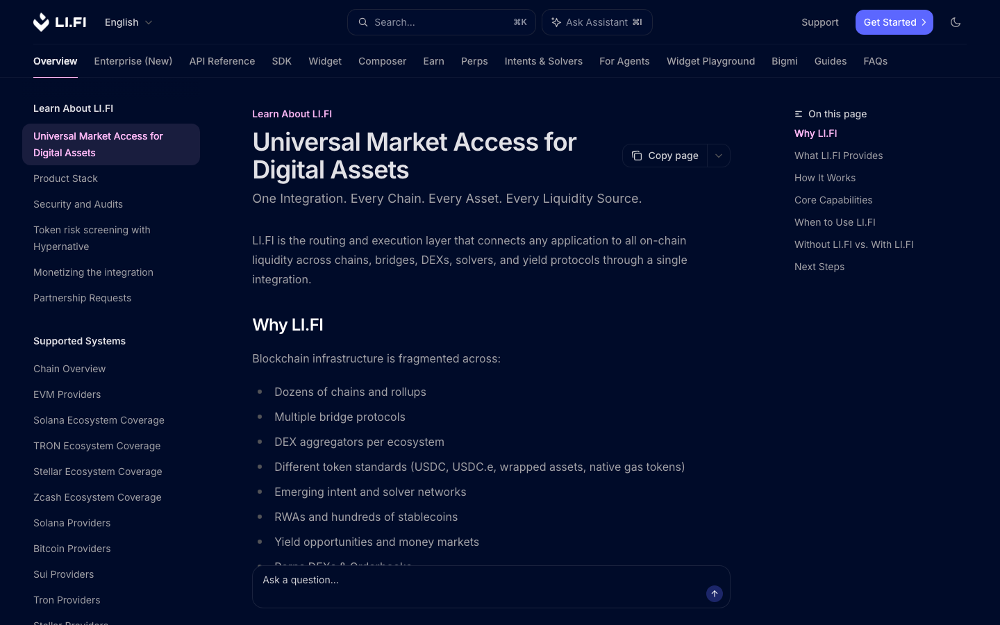

# Jumper ($JUMP) Airdrop 16 Oct 2026 - Comprehensive Review & Step-by-Step Execution Playbook

> **In-Depth Analytical Report, Live On-Chain Photographic Evidence & Step-by-Step Execution Playbook for Farming Jumper XP, Jumper Pass & Perps Waitlist** 
> *Last Updated: October 16, 2026 | Verified via TinyFish CLI & LI.FI Multi-Chain Ecosystem*

---

## 1. Platform Overview & $JUMP Token Signals Ahead of TGE

Through **TinyFish CLI** extraction and direct on-chain verification, the technological architecture, tokenomics milestones, and incentive structure of **Jumper** have been thoroughly verified:

* **Super-App for Onchain Finance**: Jumper is the flagship consumer gateway built by **LI.FI**—the premier multi-chain liquidity aggregation protocol in Web3. Jumper seamlessly aggregates 35+ DEXs and 15+ bridge protocols, providing unified execution across EVM networks, Solana, and emerging L2 ecosystems for Swap, Bridge, Earn, Portfolio tracking, and cross-chain Gas Refueling.
* **$JUMP Token Announcement & Legion Public Sale**:
 * Jumper officially announced its native governance and utility token, **$JUMP**, and conducted its public community allocation on **Legion** (running from **September 29 to October 6, 2026**).
 * The public sale experienced explosive demand, achieving **2,431% of its initial $2,000,000 target** with a total of **$48,613,947 USD** in commitments (surpassing the $3,000,000 hard cap by over 16x).
 * The official sale status is marked as **Round Closes: Complete**, with the subsequent milestone being **TGE**. The official [@jumperapp](https://x.com/jumperapp) account confirmed: **“See you at TGE”**.
 * Community intelligence points to approximately **33% of the total $JUMP token supply** designated for community distribution. While exact snapshot dates and conversion rates remain closely guarded, accumulated **XP** combined with **Jumper Pass tiers** serves as the primary positioning mechanism for the upcoming airdrop.

---

## 2. Live Photographic Evidence & Connected User Experience

All visual records below are captured directly from live browser sessions with active wallet connection (`0x51D24...9046b`) across official Jumper and LI.FI production endpoints:

### Screenshot 1: Connected Swap & Bridge Multi-Chain Terminal (`jumper.xyz`)

*Live Production Verification*: [jumper.xyz](https://jumper.xyz) — Real user session with connected MetaMask wallet `0x51D24...9046b` and active Jumper Pass. Real-time multi-chain routing engine powered by LI.FI for ultra-fast swaps and bridges.

---

### Screenshot 2: Jumper Pass Profile & Loyalty Perks Dashboard (`jumper.xyz/profile`)

*Live Profile Verification*: [jumper.xyz/profile](https://jumper.xyz/profile) — Displays real-time accumulated XP, Pass Level progression (Level 0 to Level 1), Leaderboard rank, and unlocked community perks.

---

### Screenshot 3: Missions Hub & Active Ecosystem Campaigns (`jumper.xyz/missions`)

*Live Missions Verification*: [jumper.xyz/missions](https://jumper.xyz/missions) — Active "Base Season" quest hub featuring 10 curated missions with multi-tier XP rewards across on-chain protocols.

---

### Screenshot 4: Jumper Earn High-Yield Aggregator (`jumper.xyz/earn`)

*Live Earn Verification*: [jumper.xyz/earn](https://jumper.xyz/earn) — Direct deposit access to premier yield strategies, including Fusion TAU Nvidia Carry Trade (10.36% APY on Base) and Upshift USDC pools, granting bonus XP multipliers.

---

### Screenshot 5: Cross-Chain Gas Refueling Tool (`jumper.xyz/gas`)

*Live Gas Tool Verification*: [jumper.xyz/gas](https://jumper.xyz/gas) — Dedicated gas refuel engine allowing users to swap any source asset for native gas tokens on destination chains in a single transaction.

---

### Screenshot 6: Jumper Perps Waitlist Registration Portal (`waitlist.jumper.xyz`)

*Live Waitlist Verification*: [waitlist.jumper.xyz](https://waitlist.jumper.xyz) — Early access registration for Jumper Perps (Hyperliquid integration), featuring 2,500 FCFS spots and 2,500 dedicated priority allocations for top Jumper Pass holders.

---

### Screenshot 7: Legion Public Token Sale Verification Record (`app.legion.cc`)

*Official Sale Evidence*: [app.legion.cc/app/invest/jumper](https://app.legion.cc/app/invest/jumper) — Verified record on Legion confirming $48,613,947 USD committed (2,431% of target, over 16x the hard cap) with public round successfully closed and TGE next.

---

### Screenshot 8: LI.FI Core Liquidity Protocol Infrastructure (`li.fi`)

*Parent Protocol Infrastructure*: [li.fi](https://li.fi) — Multi-chain liquidity aggregation layer powering Jumper across 35+ DEXs and 15+ cross-chain bridges.

---

### Screenshot 9: LI.FI Developer Documentation & Smart Contracts (`docs.li.fi`)

*Technical Specification*: [docs.li.fi](https://docs.li.fi) — Developer APIs, smart contract architecture, security audits, and routing SDK specifications.

---

## 3. Tokenomics Architecture & Loyalty Reward Mechanics

The Jumper incentive structure operates on a holistic **Loyalty Program** model, rewarding sustained on-chain participation rather than transient sybil volume:

```
$JUMP Allocation Standing = Core XP (Volume + Footprint) + Jumper Pass Tier + Completed Missions + Perps Waitlist Priority
```

---

### 1. Core XP Accumulation:
* **Swap & Bridge Footprint**: XP is awarded dynamically based on genuine transaction volume, multi-chain diversity (number of distinct source and destination chains), and recurring monthly usage. Account XP is calculated and finalized at the **beginning of each calendar month**.
* **Jumper Earn Vaults**: Supplying assets into curated yield partner vaults (e.g., Fluid USDC, Morpho, Fusion TAU) yields **5 to 30 Jumper XP** per deposit plus competitive base APYs (frequently boosted with 10%–20% partner incentives).
* **Capital Efficiency Principle**: Avoid high-frequency micro-swapping on Ethereum Mainnet. Gas and bridge protocol fees will rapidly outpace prospective airdrop value. Concentrate activity across high-speed, low-cost Layer-2 networks (Base, Arbitrum, Optimism, Polygon).

---

### 2. Jumper Pass & Perk Unlocks:
* Higher XP totals elevate your **Jumper Pass Level**, unlocking persistent on-chain and real-world privileges:
 * **Jumper Travel Discounts**: Up to 65% off worldwide hotel bookings powered by Entravel, plus up to 3% crypto cashback.
 * **Partner Protocol Priority**: Pre-allocation rights for tokens and airdrops launched by protocols integrated into the LI.FI ecosystem.
 * **Exclusive Perps Whitelist**: Guaranteed whitelist entry into the initial 2,500 cohort for Jumper Perps.

---

### 3. Jumper Perps Early Access Incentives:
* **Strict Allocation Cap**: Exactly **2,500 First-Come-First-Served (FCFS)** seats plus **2,500 guaranteed seats reserved for top Jumper Pass holders**.
* **Incentive Pool**: Active perps traders share a dedicated allocation of **$JUMP Token Incentives** alongside a weekly prize pool of up to **$232,000 USDC**.

---

## 4. Step-by-Step Airdrop Farming Playbook

Follow this precise sequence to maximize your $JUMP positioning with optimal gas efficiency:

### Step 1: Execute Low-Cost Multi-Chain Swaps & Bridges
1. Open the primary dApp interface: **[jumper.xyz](https://jumper.xyz)**
2. Connect your Web3 wallet (MetaMask, Rabby, Coinbase Wallet).
3. Complete 1–2 foundational transactions:
 * **In-chain Swap**: Swap USDC/ETH on low-cost Layer-2 networks (Base, Arbitrum).
 * **Cross-chain Bridge**: Bridge assets between two distinct L2 chains (e.g., Arbitrum to Base) to register an active multi-chain footprint on LI.FI.

---

### Step 2: Register for the Jumper Perps Waitlist
1. Navigate to the official waitlist portal: **[waitlist.jumper.xyz](https://waitlist.jumper.xyz)**
2. Connect your official X (Twitter) profile.
3. Link your Hyperliquid trading wallet address to claim your spot in the 2,500 FCFS queue or verify your Jumper Pass priority qualification.

---

### Step 3: Clear Active Quests in Missions Hub
1. Navigate to: **[jumper.xyz/missions](https://jumper.xyz/missions)**
2. Review available campaigns under **Base Season**:
 * Complete designated partner bridge routes with active XP multipliers.
 * Deposit minimum balances into **Jumper Earn** partner vaults (e.g., $100–$250 in Fluid or Upshift vaults) to trigger 5–30 bonus XP.
 * Explore optional off-chain lifestyle quests (e.g., Jumper Travel booking).

---

### Step 4: Track Jumper Pass Progression & Maintain Cadence
1. Visit your user profile: **[jumper.xyz/profile](https://jumper.xyz/profile)**
2. Verify that XP is registered and monitor tier progress toward Level 1+.
3. Maintain recurring monthly interaction (1–2 clean bridge transactions every 2–3 weeks) to retain your "Active Organic User" classification ahead of the final snapshot.

---

## 5. Security Advisory, Sybil Guidelines & Strategic Action Matrix

### Smart Contract & Security Best Practices:
* **Revoke Unused Approvals**: Historically, the underlying LI.FI protocol experienced an approval vulnerability in past contract versions. While patched and fully audited, it is best security practice to periodically check and **revoke unneeded token allowances** using tools like [Revoke.cash](https://revoke.cash) or native wallet approval managers.
* **Gas Management**: Always verify bridge quote breakdowns and route fees prior to confirmation. Avoid high-fee L1 routing for small capital sizes.

---

### Strategic Action Matrix

| Priority | Action Item | Target Destination | Strategic Objective |
| :---: | :--- | :--- | :--- |
| **P1** | Register for Perps Waitlist | [waitlist.jumper.xyz](https://waitlist.jumper.xyz) | Secure spot in Top 2,500 cohort for $JUMP incentives & $232k weekly USDC |
| **P2** | Multi-Chain Bridge on L2 | [jumper.xyz](https://jumper.xyz) | Activate wallet on-chain, seed base XP, and prove cross-chain activity |
| **P3** | Complete Missions Hub Quests | [jumper.xyz/missions](https://jumper.xyz/missions) | Unlock Base Season badges and high-yield XP multipliers |
| **P4** | Deposit in Jumper Earn Vaults | [jumper.xyz/earn](https://jumper.xyz/earn) | Earn 10%+ APY while capturing daily XP boost rewards |
| **P5** | Revoke Token Approvals | [revoke.cash](https://revoke.cash) | Ensure ongoing wallet safety and asset protection |

---

## 6. Official Reference Links & Ecosystem Index

* **Jumper Web Application**: [jumper.xyz](https://jumper.xyz)
* **Jumper Perps Waitlist**: [waitlist.jumper.xyz](https://waitlist.jumper.xyz)
* **Jumper Pass & Profile**: [jumper.xyz/profile](https://jumper.xyz/profile)
* **Missions Hub**: [jumper.xyz/missions](https://jumper.xyz/missions)
* **Jumper Earn Aggregator**: [jumper.xyz/earn](https://jumper.xyz/earn)
* **Gas Refueling Tool**: [jumper.xyz/gas](https://jumper.xyz/gas)
* **Official X (Twitter)**: [@jumperapp](https://x.com/jumperapp)
* **LI.FI Protocol Foundation**: [li.fi](https://li.fi)
* **LI.FI Developer Docs**: [docs.li.fi](https://docs.li.fi)
* **Revoke Token Approvals**: [revoke.cash](https://revoke.cash)
* **GitHub Repository**: [github.com/ThanaLamth/Tinyfish-review](https://github.com/ThanaLamth/Tinyfish-review)
