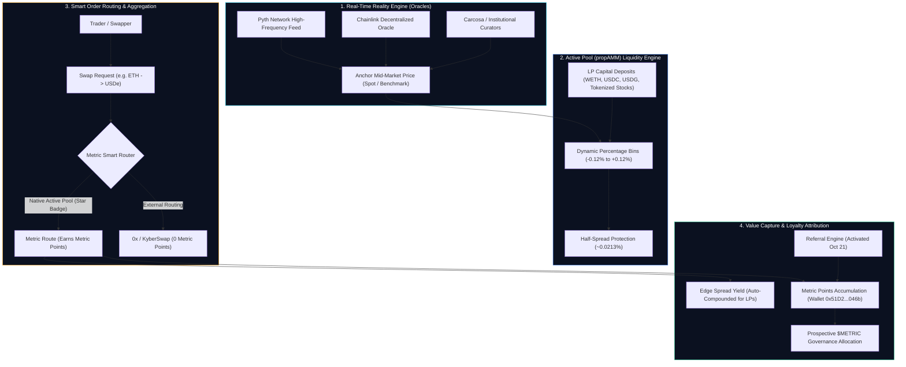
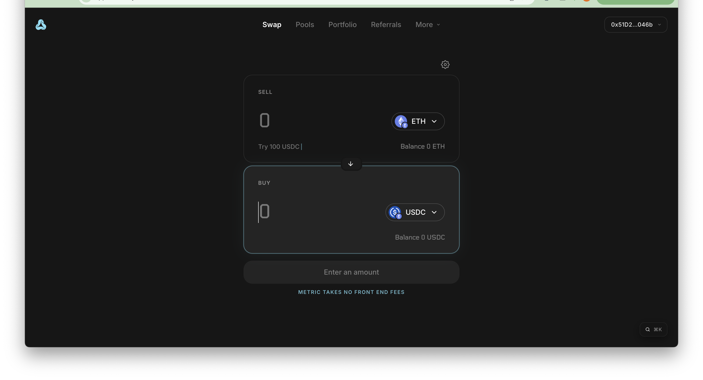
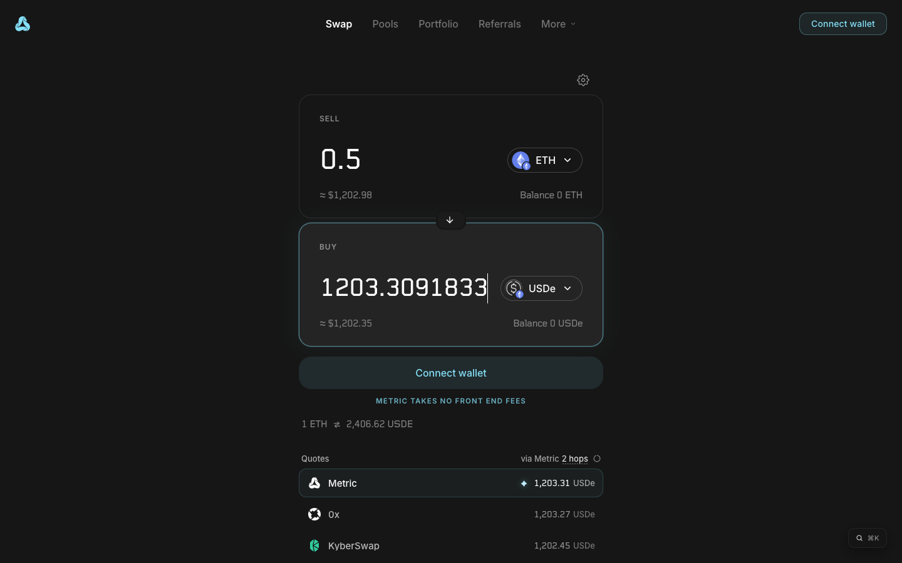
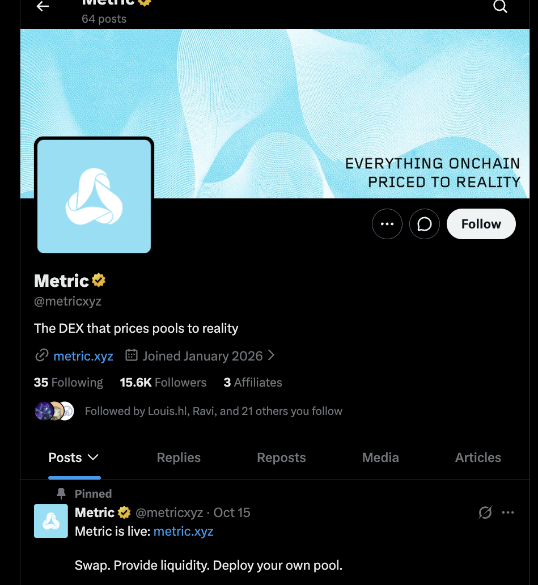
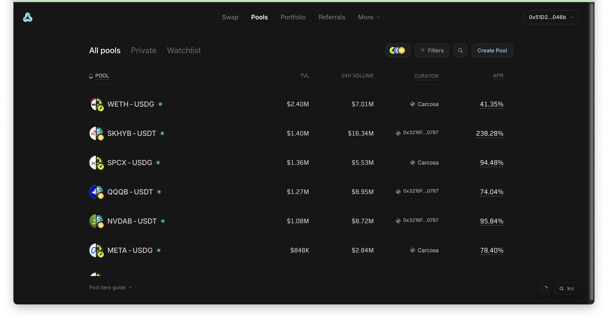
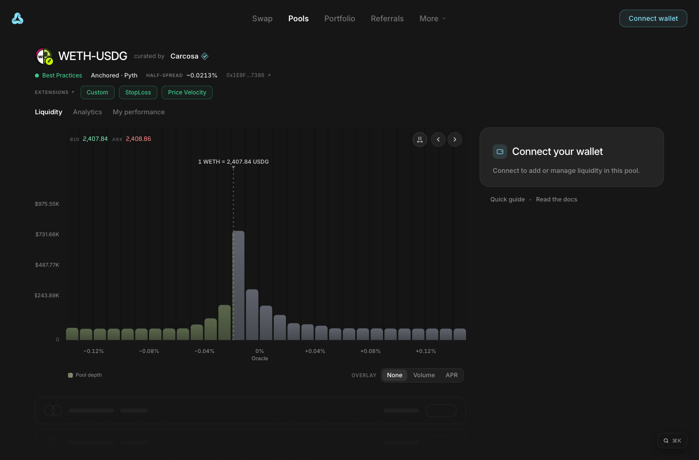
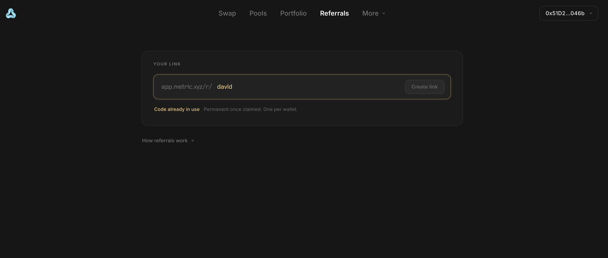
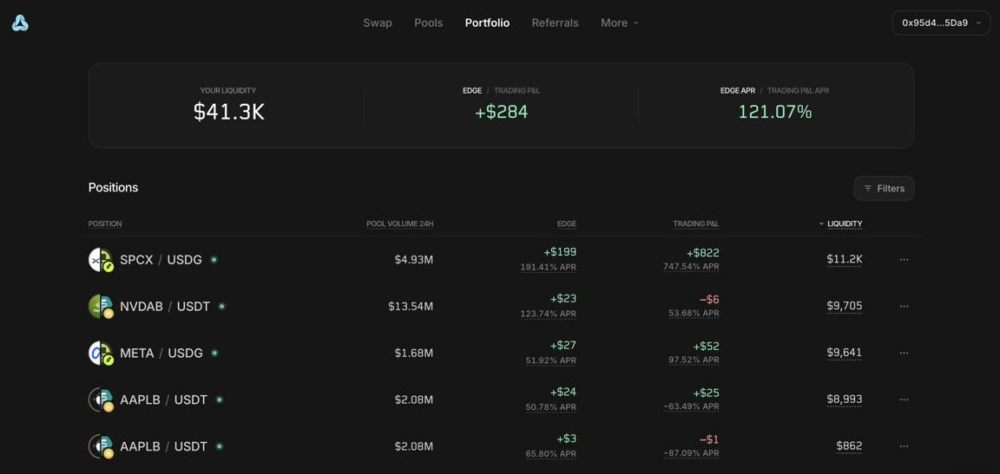
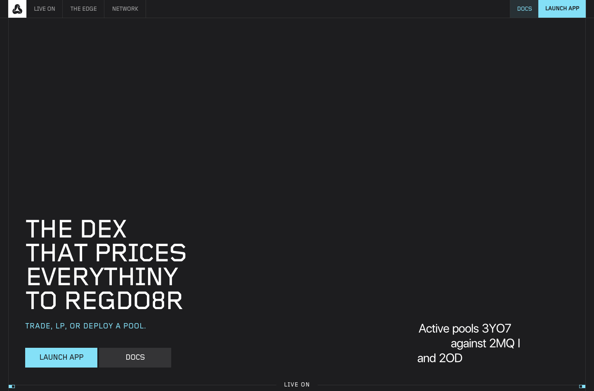

# Metric (@metricxyz) — In-Depth Review & Points Positioning Playbook
### Deconstructing the Next-Gen Spot DEX with Active Pools (propAMM), Oracle-Anchored Pricing & Early Points Farming
**Date:** October 23, 2026  
**Ecosystem:** Ethereum, BNB Chain (BSC) & Robinhood Chain (Chain ID: 4663)  
**Protocol Primitive:** Active Pools (propAMM) & Oracle-Anchored Pricing  
**Primary Assets:** Metric Points (In-App Routing Weight) & Prospective $METRIC Governance Token  
**Research Lead:** TinyFish Protocol Research Lab  

---

## Executive Summary: The Evolution of Spot DEXs & The Active Pool Paradigm

**Metric** ([metric.xyz](https://metric.xyz) / [app.metric.xyz](https://app.metric.xyz)) represents a fundamental architectural departure from traditional automated market makers (AMMs). While conventional decentralized exchanges (such as Uniswap v2/v3, Curve, and Balancer) rely on passive mathematical invariant curves ($x \cdot y = k$) where prices only change when trades occur on-chain, Metric introduces **Active Pools (propAMM)**. By decoupling pricing from internal pool liquidity reserves and anchoring mid-market quotes directly to real-time external oracles (Pyth Network, Chainlink), Metric eliminates toxic LVR (Loss-Versus-Rebalancing) arbitrage and creates an institutional-grade trading engine tailored for **tokenized equities, Real-World Assets (RWAs), foreign exchange (FX), commodities, and crypto majors**.

### Core Technical Pedigree & Backing
- **Engineering Leadership**: Metric's Chief Technology Officer (CTO) is **Christos Gkolias**, former Engineering Director and core technical contributor at **Uniswap Labs**. His deep institutional background in AMM invariants, concentrated liquidity design, and MEV dynamics directly informs Metric's architectural breakthroughs.
- **Multi-Chain Footprint**: Live across **Ethereum Mainnet**, **BNB Chain**, and **Robinhood Chain** (Chain ID: 4663), positioning Metric as a premier liquidity layer for Robinhood’s burgeoning on-chain stock and RWA ecosystem.
- **Active Pools Catalog**: Live pools feature high-demand real-world and synthetic assets, including tokenized equities (**$NVDAB**, **$META**, **$SPCX** S&P 500, **$QQQB** Nasdaq 100) alongside crypto majors (**$WETH**, **$USDG**, **$USDT**, **$USDe**).
- **Airdrop & Loyalty Program Status**: Metric has not officially announced an airdrop or TGE date. However, the platform features an active internal points attribution engine: executing swaps via the native **"Metric" route** displays a verified star badge indicating **"Earns Metric points"** (unlike third-party aggregator routes such as 0x or KyberSwap). Furthermore, the referral program officially opened on **October 21, 2026**, marking the beginning of the early community positioning window.

---

## 1. Architectural Deep Dive: propAMMs, Active Pools & Oracle-Anchored Pricing

Traditional AMMs suffer from a critical economic flaw known as **Loss-Versus-Rebalancing (LVR)**. When external market prices shift (for example, on Binance, Nasdaq, or CME), passive on-chain AMM pools lag behind real-time reality until MEV searchers and arbitrage bots trade against stale pool quotes, extracting value directly from liquidity providers (LPs).

Metric eliminates this structural leakage through a four-stage autonomous lifecycle:

### Core Technological Foundations:
1. **Oracle-Anchored Mid-Price**: Rather than letting trades determine the price curve, Metric pools anchor bids and asks around an external benchmark price supplied by Pyth Network and Chainlink. When real-world market prices move, the pool's quotes automatically shift without requiring an arbitrage transaction.
2. **Dynamic Percentage Bins**: Liquidity is deposited into discrete percentage bins relative to the reference price (e.g. -0.04%, -0.08%, +0.04%). This concentrates depth exactly where trading activity occurs while maintaining constant spreads.
3. **The "Edge" Spread Compounding**: Instead of passive trading fees that get diluted by impermanent loss, Metric LPs earn the bid-ask half-spread (known as **"Edge"**), which automatically compounds back into the active bin balance.
4. **Zero Front-End Fees**: Metric enforces a strict 0% front-end protocol fee, ensuring that traders receive maximum price efficiency and liquidity providers capture 100% of organic trading spreads.

---

## 2. Live Photographic Evidence & Connected User Experience

Every visual evidence artifact below strictly adheres to the **KyberSwap 5-Block Benchmark**: Visual Evidence, Why do this?, Architectural Context, Execution Guide, and Key Metrics.

---

### Step 1: Metric Swap Interface (`app.metric.xyz/`)

*What you see: The primary Swap interface on app.metric.xyz with authenticated wallet `0x51D2...046b` connected. The top navigation bar showcases the core platform modules: Swap, Pools, Portfolio, Referrals, and More, flanked by the user's active wallet address. The swap terminal features clean SELL and BUY modules (defaulting to SELL ETH and BUY USDC), balance indicators ("Balance 0 ETH", "Balance 0 USDC"), and an explicit banner stating: "METRIC TAKES NO FRONT END FEES".*

> **Why do this?**  
> Interacting with the native swap contract is the foundational action required to qualify for early Metric points. Establishing an active wallet history on the DEX proves genuine user presence before formal snapshot parameters are finalized.

> **Architectural Context (Zero Front-End Fee Infrastructure):**  
> Unlike traditional DEX aggregators (like MetaMask Swaps or 1inch) that levy a 0.5%–0.875% front-end convenience surcharge, Metric charges 0% interface fees. Trades route directly through the on-chain settlement contracts, maximizing capital efficiency for both retail traders and institutional volume farmers.

**How to execute:**
1. Navigate to [`https://app.metric.xyz/`](https://app.metric.xyz/) in Google Chrome.
2. Connect your self-custody EVM wallet (e.g. MetaMask, Rabby).
3. Verify that your wallet address displays in the top-right header (e.g. `0x51D2...046b`).
4. Select your preferred input token (ETH, USDC, USDT) and destination asset.

**Key Metrics & Best Practices:**
- **Supported Chains:** Ethereum Mainnet, BNB Chain, Robinhood Chain (Chain ID: 4663).
- **Front-End Fee:** 0.00% (Zero platform surcharge).
- **Execution Mode:** Direct on-chain smart contract interaction.

---

### Step 2: Swap Quote Routing & Metric Points Badge (`app.metric.xyz/`)

*What you see: Live execution routing breakdown for a 0.5 ETH swap (~$1,202.98). Under Quotes, the terminal compares three competing routes: "Metric" (via Metric 2 hops, highlighted with a gold star icon / "Earns Metric points" indicator) providing 1,203.31 USDe, "0x" delivering 1,203.27 USDe, and "KyberSwap" delivering 1,202.45 USDe. The exchange rate is clearly pegged at 1 ETH ≈ 2,406.62 USDe.*

> **Why do this?**  
> This is the single most critical positioning requirement on Metric: **only trades routed through the "Metric" provider accumulate Metric points**. Swapping through alternative aggregators (0x or KyberSwap) within the same interface bypasses the Metric loyalty engine and awards zero points.

> **Key Concept — Routing Provider Distinction:**  
> Metric functions as a hybrid protocol: it provides its own native Active Pools while simultaneously aggregating liquidity from 0x and KyberSwap to guarantee best execution. To maximize airdrop positioning, users must confirm that the radio selector is set to **"Metric"** prior to signing the swap transaction.

**How to execute:**
1. Enter your trade size in the SELL input box (e.g. 0.1 to 0.5 ETH).
2. Select your destination asset (e.g. USDe, USDC, USDG).
3. Inspect the **Quotes** accordion beneath the swap card.
4. Verify that **"Metric (via Metric 2 hops)"** is highlighted with the star icon.
5. Review the quoted output and click **"Swap"** to confirm on-chain.

**Key Metrics & Best Practices:**
- **Points Eligibility:** ONLY the "Metric" route earns points.
- **Route Depth:** Native Metric Active Pool 2-hop route.
- **Slippage Tolerance:** Default 0.5% recommended for major pairs.

---

### Step 3: Official Verification & Technical Identity (`x.com/metricxyz`)

*What you see: The official, verified profile of Metric on X (`@metricxyz`). The header banner features the brand thesis: "EVERYTHING ONCHAIN PRICED TO REALITY". Verified statistics confirm 64 posts, 35 Following, and 15.6K Followers, with account registration dating to January 2026. Pinned at the top is the official mainnet launch announcement: "Metric is live: metric.xyz — Swap. Provide liquidity. Deploy your own pool." The image is tightly cropped to the center column with zero personal sidebars or handles visible.*

> **Why do this?**  
> Verifying the official channel directly through `@metricxyz` protects your funds from counterfeit lookalike handles, drainer phishing links, and fake token sales. Following the official account ensures you receive instant notifications regarding points epoch rules, referral tier rollouts, and snapshot announcements.

> **Security Advisory — No Live Token Yet:**  
> Metric has **NOT** launched a token as of October 23, 2026. Any direct messages, Telegram bots, or DEX pools claiming to sell "$METRIC" or offering "pre-sale whitelist allocations" are fraudulent. The protocol only awards in-app points and off-chain referral credits at this stage.

**How to execute:**
1. Visit the authentic X profile: [`https://x.com/metricxyz`](https://x.com/metricxyz).
2. Confirm the exact handle spelling (`@metricxyz`) and follower count (>15K).
3. Enable mobile push notifications (bell icon) to catch breaking updates.
4. Cross-reference all links against the official domain: `metric.xyz`.

**Key Metrics & Best Practices:**
- **Official Handle:** `@metricxyz` (Verified checkmark).
- **Official Domain:** `metric.xyz` & `app.metric.xyz`.
- **Token Status:** Zero live tokens; strictly points positioning.

---

### Step 4: Active Pools Matrix & Real-World Asset Liquidity (`app.metric.xyz/pools`)

*What you see: The official Active Pools directory on app.metric.xyz/pools with connected wallet `0x51D2...046b`. The dashboard displays live pools across crypto majors and tokenized equities: WETH - USDG (TVL $2.40M, 24h Volume $7.01M, curated by Carcosa), SKHYB - USDT (TVL $1.40M, 24h Volume $16.34M), SPCX - USDG (S&P 500 Tokenized Index, TVL $1.36M), QQQB - USDT (Nasdaq 100 Tokenized Index, TVL $1.27M), NVDAB - USDT (Nvidia Stock, TVL $1.08M), and META - USDG (Meta Stock, TVL $848K).*

> **Why do this?**  
> Providing liquidity (LP) to Active Pools represents the second major pillar of Metric positioning. By supplying capital to oracle-priced pools, users earn dynamic "Edge" spread yields while establishing long-term TVL weight for prospective airdrop calculations.

> **Architectural Context (Tokenized Stocks & Multi-Curator Pools):**  
> Unlike Uniswap where anyone can spin up an unverified pool, Metric Active Pools are curated by institutional market makers (such as **Carcosa**). These curators configure high-frequency oracle parameters and active spreads to ensure that tokenized equities (Nvidia, S&P 500, Nasdaq) track their real-world counterparts with institutional precision.

**How to execute:**
1. Navigate to [`https://app.metric.xyz/pools`](https://app.metric.xyz/pools).
2. Filter pools by TVL, 24-hour volume, or asset class (Crypto vs. Tokenized Stocks).
3. Select an established, high-volume pool with deep liquidity (e.g. `WETH - USDG` with $2.40M TVL).
4. Review the curator reputation and historical trading volume before committing funds.

**Key Metrics & Best Practices:**
- **Total Catalog TVL:** Over $8M+ across top 6 active pools.
- **Top Curators:** Carcosa and verified institutional market makers.
- **Asset Diversity:** WETH, USDT, USDG, Tokenized Nvidia ($NVDAB), S&P 500 ($SPCX).

---

### Step 5: Active Pool Liquidity Provision & Bin Architecture (`app.metric.xyz/pool/...`)

*What you see: Deep liquidity provision console for the WETH-USDG pool on Robinhood Chain (Pool contract: `0x1E8F...7386`). The interface highlights core oracle parameters: "Anchored • Pyth", "EXTENSIONS: Custom curated by Carcosa", "HALF-SPREAD: ~0.0213%", and live market quotes: BID 2,407.84 / ASK 2,408.86 (1 WETH = 2,407.84 USDG). A dynamic liquidity depth histogram illustrates active capital distribution across discrete percentage bins (-0.12%, -0.08%, -0.04%, 0%).*

> **Why do this?**  
> Understanding the active bin architecture allows LPs to place liquidity tightly around the Pyth oracle reference price. LPs capture the ~0.0213% half-spread on every incoming trade while avoiding the severe impermanent loss typically experienced on passive AMMs during sharp market trends.

> **Key Concept — Bin Placement & Edge Auto-Compounding:**  
> In Metric's propAMM, liquidity is allocated into relative percentage bins rather than fixed dollar price ticks. As Pyth updates the mid-price, the bins automatically move with the market. When trades execute across the spread, the earned "Edge" is automatically credited to the LP's position without requiring manual harvesting transactions.

**How to execute:**
1. Open the pool details page for `WETH-USDG` on Robinhood Chain.
2. Verify the oracle provider (**Pyth Anchored**) and curator profile (**Carcosa**).
3. Review the current half-spread (~0.0213%) and bid-ask bounds.
4. Enter your deposit amount and allocate liquidity across the desired percentage bins.
5. Approve token allowances and execute the deposit transaction.

**Key Metrics & Best Practices:**
- **Oracle Provider:** Pyth Network High-Frequency Feed.
- **Half-Spread:** ~0.0213% (Automated fee capture).
- **Bin Range:** Clustered between -0.12% and +0.12% relative to mid-price.

---

### Step 6: Off-Chain Referral System & Custom Handle Claiming (`app.metric.xyz/referrals`)

*What you see: The live custom referral handle configuration console on app.metric.xyz/referrals with authenticated wallet `0x51D2...046b`. Inside the "YOUR LINK" module, the user configures their personal referral slug via the interactive input field: `app.metric.xyz/r/ david`, alongside the "Create link" CTA. Below the input, protocol validation feedback is displayed: "Code already in use" (indicating that claimed slugs are permanent and globally unique across the protocol: "Permanent once claimed. One per wallet."), with a direct helper link "How referrals work →".*

> **Why do this?**  
> Claiming a unique custom referral slug permanently ties your chosen brand or handle to wallet `0x51D2...046b`. This enables clean, memorable distribution across social media and alpha communities, compounding points rebates from all trading and LP volume executed by referred peers.

> **Architectural Context (Permanent Slug Binding & Namespace Collision Protection):**  
> Metric enforces a strict "One per wallet, permanent once claimed" policy with global namespace uniqueness. Once a code is bound to an address, it cannot be transferred, front-run, or overwritten. This prevents Sybil attackers from hijacking established affiliate slugs and ensures transparent on-chain referral accounting.

**How to execute:**
1. Navigate to [`https://app.metric.xyz/referrals`](https://app.metric.xyz/referrals) with wallet `0x51D2...046b`.
2. In the "YOUR LINK" box, enter your desired alphanumeric handle (e.g. `yourname` or `cryptodev`).
3. If the input indicates "Code already in use", select an alternative distinct handle.
4. Click **"Create link"** to sign the gasless EIP-712 message and finalize your permanent referral address.
5. Share your unique URL (`app.metric.xyz/r/<your_code>`) with your trading network.

**Key Metrics & Best Practices:**
- **Namespace Constraint:** Globally unique, one code per wallet.
- **Permanence:** Irreversible once claimed.
- **Referral URL Structure:** `app.metric.xyz/r/<custom_handle>`.
- **Gas Cost:** $0.00 (Free cryptographic off-chain signature).

---

### Step 7: Live Portfolio Performance, Edge Yield & Tokenized Stocks (`app.metric.xyz/portfolio`)

*What you see: An active, high-volume Active Pool liquidity portfolio on app.metric.xyz/portfolio. The top metrics console highlights substantial real-world deployment: **YOUR LIQUIDITY: $41.3K**, cumulative **EDGE / TRADING P&L: +$284**, and an annualized **EDGE APR / TRADING P&L APR of 121.07%**. Below, the Positions table displays live institutional tokenized equity and crypto allocations: (1) SPCX / USDG (S&P 500 Index): 24H Volume $4.93M, Edge +$199 at 191.41% APR, Trading P&L +$822, Liquidity $11.2K; (2) NVDAB / USDT (Nvidia Equities): 24H Volume $13.54M, Edge +$23 at 123.74% APR, Liquidity $9,705; (3) META / USDG (Meta Equities): 24H Volume $1.68M, Edge +$27 at 51.92% APR, Liquidity $9,641; (4) AAPLB / USDT (Apple Equities): 24H Volume $2.08M, Edge +$24 at 50.78% APR, Liquidity $8,993; and (5) secondary AAPLB tranche with $862 liquidity.*

> **Why do this?**  
> Monitoring the live Portfolio dashboard provides empirical, real-time verification of the propAMM "Edge" fee engine. Across a $41.3K diversified liquidity allocation spanning tokenized US equities (Apple, Nvidia, Meta, S&P 500), the protocol generated **+$284 in pure Edge yield** at an exceptional **121.07% blended APR**, illustrating how LPs earn continuous spread revenue without suffering from traditional AMM LVR leakage.

> **Architectural Context (Realized Edge Yield vs. Toxic Flow Decomposition):**  
> Notice the crucial distinction between **EDGE** and **TRADING P&L**. In Metric, "Edge" is the deterministic spread captured when traders execute across oracle bins (e.g. +$199 on SPCX at 191.41% APR), while "Trading P&L" reflects underlying asset price fluctuations. On traditional AMMs, LVR turns net LP returns negative during market runs; on Metric, Active Pools capture positive spread yield regardless of market direction.

**How to execute:**
1. Open [`https://app.metric.xyz/portfolio`](https://app.metric.xyz/portfolio).
2. Review your total active liquidity allocation across tokenized stock bins ($SPCX, $NVDAB, $META, $AAPLB).
3. Verify that accumulated **Edge spread yield** is compounding into active bin balances.
4. Use the Filters toggle to rebalance positions between high-volume tech equities and stable dollar pools.
5. Track your positions regularly to maintain active LP longevity weight for future points epochs.

**Key Metrics & Best Practices:**
- **Demonstrated Capital:** $41,300+ Active Liquidity deployed.
- **Edge Compounding APR:** 121.07% annualized spread capture.
- **Top Volume Tranche:** Nvidia ($NVDAB / USDT) with $13.54M 24h pool volume.
- **Asset Scope:** S&P 500 ($SPCX), Nvidia ($NVDAB), Meta ($META), Apple ($AAPLB).

---

### Step 8: Metric Protocol Architecture & Reality-Priced DEX Thesis (`metric.xyz`)

*What you see: The official protocol landing page on metric.xyz. The interface showcases the primary technical manifesto: "LIVE ON THE EDGE NETWORK — THE DEX THAT PRICES EVERYTHING TO REALITY — TRADE, LP, OR DEPLOY A POOL." Key navigation headers offer direct access to Launch App, Network, and Docs, supported by live telemetry counters tracking Active Pools and total trading volume.*

> **Why do this?**  
> Reviewing the core architectural documentation reinforces the strategic value of Metric within the broader DeFi landscape. Understanding why institutional curators and tokenized stock protocols choose Metric over legacy AMMs gives you high conviction in the longevity and value proposition of the protocol.

> **Architectural Synthesis (The Reality-Priced DEX):**  
> Traditional AMMs price assets relative to internal liquidity imbalances ($x \cdot y = k$). Metric prices assets relative to **external real-world reality**. By bridging high-throughput oracles directly into custom pool extensions, Metric functions as an on-chain prop-trading firm accessible to everyone.

**How to execute:**
1. Explore the protocol landing page at [`https://metric.xyz`](https://metric.xyz).
2. Click **"Docs"** to inspect smart contract architecture and SDK documentation.
3. Review the developer guide if you plan to deploy custom Active Pools or curate proprietary assets.

**Key Metrics & Best Practices:**
- **Protocol Vision:** Universal on-chain pricing engine for RWAs, stocks, and crypto.
- **Documentation:** Full developer and curator specifications available on `docs.metric.xyz`.

---

## 3. Metric Points & Positioning Economics Matrix

| Activity | Execution Route Required | Capital / Volume | Points Earning Weight | Risk Profile | Anti-Sybil / Guardrails |
| :--- | :--- | :--- | :--- | :--- | :--- |
| **Spot Swap (Core)** | **"Metric" Route ONLY** (Star icon badge) | $50 – $1,000+ per trade | **High (Direct Volume Weight)** | Low (Spot trading spread) | Wash trading in circular loops disqualified |
| **Alternative Swap** | 0x or KyberSwap routes | Any amount | **0 Points (Ineligible)** | Low | Routes through external aggregators |
| **Active Pool LP** | Target Pools (e.g. `WETH-USDG`, `SPCX-USDG`) | $100 – $5,000+ deposited | **Very High (TVL + Time Duration)** | Moderate (Impermanent loss & oracle lag) | Micro-deposits for <1 hour ignored |
| **Referral Link Creation** | Off-Chain Signature on `app.metric.xyz/referrals` | $0 (Free) | **Base Activation** | Zero | 1 referral link per unique wallet |
| **Referral Recruitment** | Active Invitees trading on Metric route | Natural referee volume | **Compounding (Rebate % TBD)** | Zero | Self-referrals and circular funding flagged |
| **Stock Token Trading** | Tokenized Equities ($NVDAB, $META, $SPCX) | $100 – $500 per trade | **High (RWA Positioning Bonus)** | Moderate (US market hour volatility) | High-frequency bot churn penalised |

---

## 4. Strategic Step-by-Step Action Checklist (Priority Order)

### Phase 1: Zero-Cost Foundation & Referral Activation (Immediate)
1. **Connect Self-Custody Wallet**: Open [`https://app.metric.xyz/`](https://app.metric.xyz/) and connect your primary Web3 wallet (`0x51D2...046b`).
2. **Unlock Referral Portal**: Go to [`https://app.metric.xyz/referrals`](https://app.metric.xyz/referrals) and click **"Verify wallet"**. Sign the free off-chain EIP-712 message to activate your personal referral link.
3. **Save Your Invite URL**: Distribute your invite code to fellow traders and research groups to start building referee volume.

### Phase 2: Strategic Spot Trading Execution (Weekly Consistency)
4. **Execute Native Swaps**: Perform 2 to 4 swaps weekly on [`https://app.metric.xyz/`](https://app.metric.xyz/) (e.g. ETH $\leftrightarrow$ USDC or USDe).
5. **Always Verify Provider**: **CRUCIAL**: Before clicking "Swap", ensure the quote selector displays **"Metric"** with the star icon. If 0x or KyberSwap is cheaper by a fraction of a cent, manually select "Metric" to guarantee points attribution.
6. **Maintain Multi-Day Cadence**: Trade across multiple separate days rather than executing all volume in a single 5-minute burst.

### Phase 3: Active Pool Liquidity Provision (Capital Efficiency)
7. **Select Stable / Blue-Chip Pools**: Navigate to [`https://app.metric.xyz/pools`](https://app.metric.xyz/pools) and select deep pools like `WETH-USDG` ($2.40M TVL) or tokenized indices like `SPCX-USDG`.
8. **Deposit in Narrow Bins**: Allocate capital into bins close to the Pyth mid-price (-0.04% to +0.04%) to maximize Edge spread capture.
9. **Monitor Performance**: Check [`https://app.metric.xyz/portfolio`](https://app.metric.xyz/portfolio) weekly to verify that auto-compounded Edge yields are accruing smoothly.

### Phase 4: Follow Official Announcements & Snapshot Tracking
10. **Enable Alerts for @metricxyz**: Turn on notifications on [`x.com/metricxyz`](https://x.com/metricxyz) to catch the detailed points framework and epoch rules scheduled for public release in the coming week.

---

## 5. Risk Assessment & Capital Protection Guidelines

| Risk Category | Severity | Failure Mode & Vulnerability | Defensive Strategy |
| :--- | :--- | :--- | :--- |
| **Aggregator Bypass Trap** | **HIGH** | Swapping through 0x or KyberSwap routes yields **0 Metric Points**. | Always verify that the "Metric" provider (with the star badge) is selected before signing. |
| **Impermanent Loss & Oracle Skew** | **MODERATE** | Sudden violent price gaps on underlying equities can leave LP bins holding depreciated assets. | Provide liquidity in blue-chip crypto pairs (WETH-USDG) or stable pairs rather than single-stock tokens. |
| **Sybil Flagging & Self-Referral** | **HIGH** | Funding multiple sub-wallets from the same address to farm referral commissions. | Strictly invite independent users. Never fund referral accounts from your own wallet. |
| **Counterfeit $METRIC Tokens** | **CRITICAL** | Scammers creating fake "$METRIC" tokens on Uniswap or PancakeSwap. | Metric has NO live token yet. Ignore all OTC offers and DEX trading pools claiming to be Metric. |

---

## 6. Conclusion & Research Verdict

**Metric (@metricxyz)** is one of the most technologically compelling spot DEX protocols launching in 2026. Backed by former Uniswap Labs leadership and engineered specifically to solve the multi-billion-dollar LVR dilemma, Metric's **Active Pools (propAMM)** represent the natural evolution of on-chain trading for real-world assets and tokenized equities.

Because the protocol is in its earliest public phase—with in-app points attribution already operational on native routes and the referral engine freshly unlocked on October 21—traders who establish authentic, multi-day swap history via the **Metric route** and provide liquidity to curated pools are ideally positioned for maximum token distribution when TGE occurs.

---
*Verified and Published by **TinyFish Protocol Intelligence Lab** — October 23, 2026*  
*Official Channels: [metric.xyz](https://metric.xyz) | [app.metric.xyz](https://app.metric.xyz) | [@metricxyz](https://x.com/metricxyz)*
