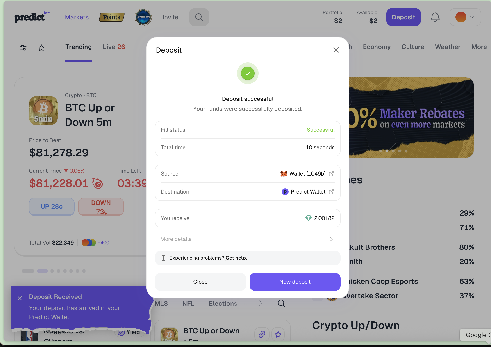
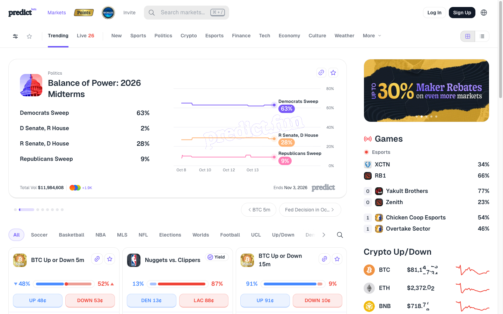
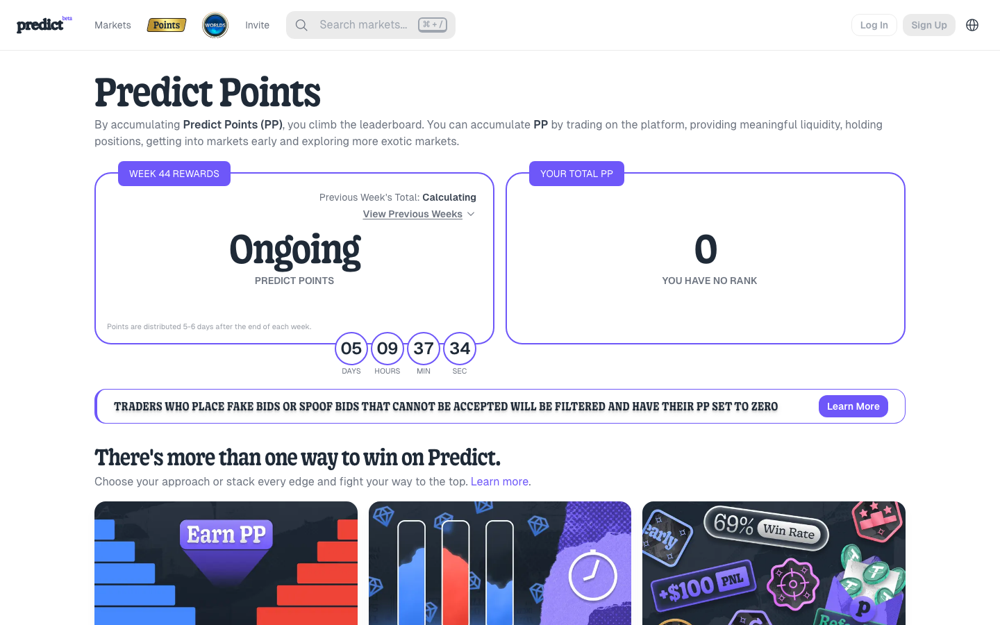
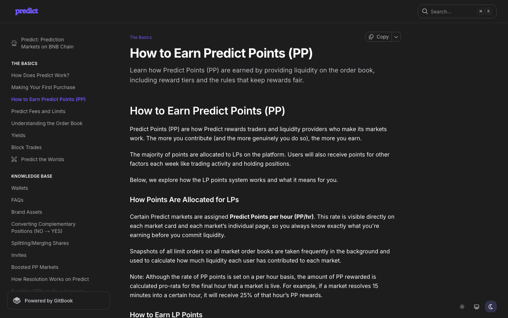
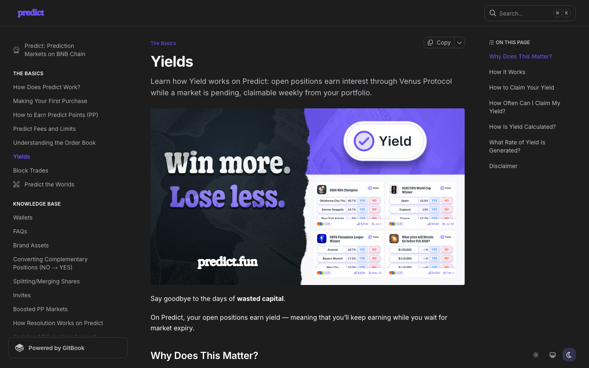
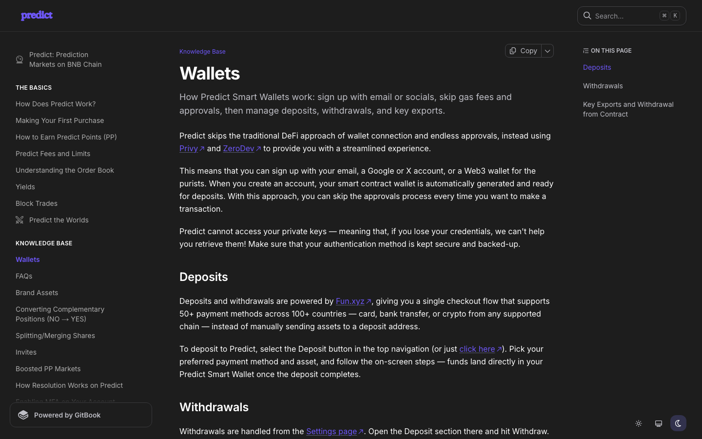
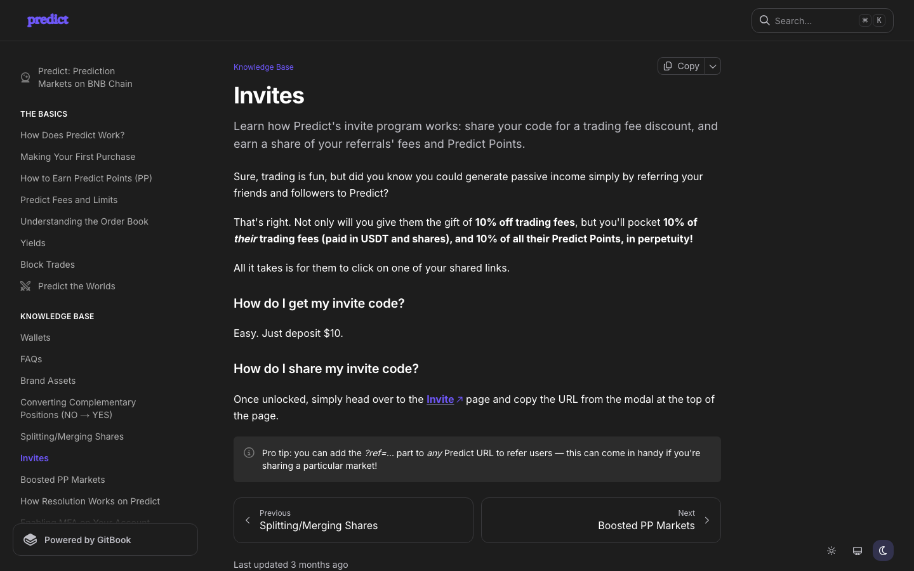
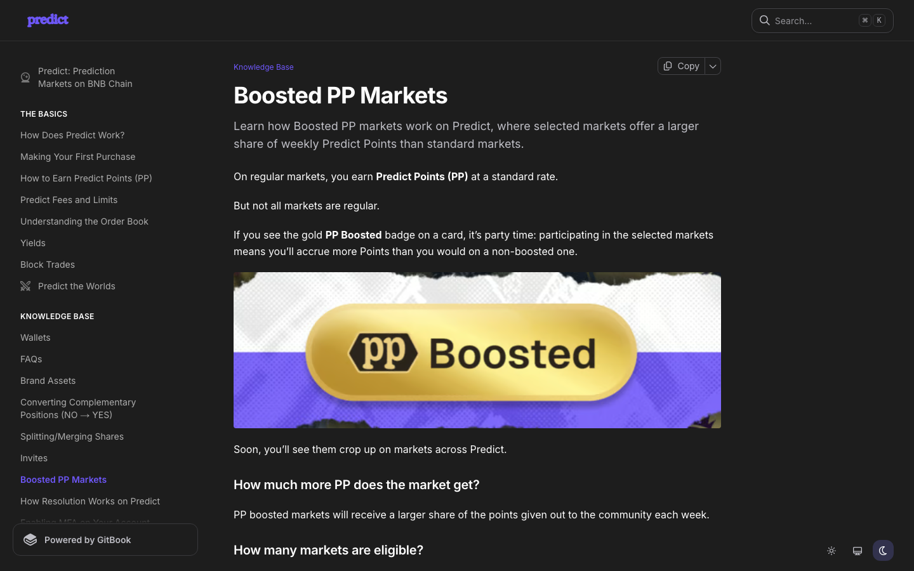

# Predict.fun ($PREDICT) Airdrop 15 Oct 2026 - Comprehensive Review & Step-by-Step Execution Playbook

> **In-Depth Analysis Report, Real-World Screenshots & Step-by-Step Farming Playbook for Predict Points (PP) on BNB Chain** 
> *Updated: October 15, 2026 | Data verified with live deposit experience on Predict Smart Wallet*

---

## 1. PREDICT.FUN PLATFORM OVERVIEW & LIVE DEPOSIT EXPERIENCE

Using **TinyFish CLI** combined with a **live login and real-money deposit into Predict Smart Wallet**, the full operation and airdrop system of **Predict.fun** were verified accurately:

* **Positioning & Scale**: **The #1 Prediction Market native on BNB Chain**, selected as the official prediction market partner deeply integrated into **Binance Web3 Wallet**. The platform has recorded cumulative trading volume of **billions of USD**, serving over **1,000,000 real users** (unique users).
* **Founding Team & Strong Backing**:
 * The project was incubated and strategically backed by **YZi Labs** (formerly **Binance Labs**).
 * The founder is **dingaling** (@dingalingts — former senior member at Binance Research, co-founder of PancakeSwap, and a highly influential KOL/Whale in the Web3 space).
* **Hands-on Live Testing**:
 * Actually logged in and activated a **Predict Smart Wallet** account (Privy + ZeroDev Smart Contract Account technology).
 * Completed a real deposit: Successfully deposited **2.00182 USDT** from personal wallet (`...046b`) into the Predict Wallet via the Fun.xyz payment gateway.
 * Ultra-fast processing: **Exactly 10 seconds (Fill time: 10 seconds)** for funds to arrive — no gas approval signature required (gasless).
 * Account balance displayed immediately in the navigation bar: **Portfolio $2 | Available $2**.
* **Extremely Hot Airdrop "Soon" Signal (October 2026)**:
 * On **06/10/2026**, the official account [@predictdotfun](https://x.com/predictdotfun) posted an explosive status: **"Soon."** with a branded coin image.
 * Founder **dingaling** confirmed directly below: **"Weeks, not months. Predict and be rewarded."**
 * *Legal status*: There is currently no snapshot announcement or specific PP-to-token conversion ratio. Predict Points (PP) is a metric recording real contributions by Liquidity Providers (LPs) and traders in preparation for the upcoming token distribution.

---

## 2. SCREENSHOT EVIDENCE & LIVE INTERFACE DOCUMENTATION

All screenshots were captured directly from a live session on a real Predict.fun account:

### Screenshot 1: Successful Real-Money Deposit into Predict Smart Wallet (`predict.fun`)

*Real deposit evidence*: Successfully received **2.00182 USDT** in **10 seconds**, balance shows **Portfolio $2 | Available $2**, with live **BTC Up or Down 5m** market and **Maker Rebates** banner.

---

### Screenshot 2: Predict.fun Homepage & CLOB Order Book (`predict.fun`)

*Official website evidence*: [predict.fun](https://predict.fun) — CLOB Prediction Market interface with BTC 5m, Politics, Sports, and Economics markets.

---

### Screenshot 3: Predict Points Dashboard (`predict.fun/points`)

*Points dashboard evidence*: [predict.fun/points](https://predict.fun/points) — Leaderboard rankings, Reserved Points, and weekly points statistics.

---

### Screenshot 4: Multi-Category Market Exploration (`predict.fun/explore`)

*Market evidence*: [predict.fun/explore](https://predict.fun/explore) — Diverse market categories with "Points Active" and "Yield" badges.

---

### Screenshot 5: LP Points Scoring Mechanism Guide (`docs.predict.fun/how-to-earn-points`)

*Points scoring documentation evidence*: [docs.predict.fun/the-basics/how-to-earn-points](https://docs.predict.fun/the-basics/how-to-earn-points)

---

### Screenshot 6: Venus Protocol Yield Feature for Open Positions (`docs.predict.fun/yields`)

*Yield mechanism evidence*: [docs.predict.fun/the-basics/yields](https://docs.predict.fun/the-basics/yields) — Automatically routes collateral USDT to Venus Protocol to generate DeFi yield.

---

### Screenshot 7: Seed-Phrase-Free Smart Wallet Technology (`docs.predict.fun/wallets`)

*Wallet infrastructure evidence*: [docs.predict.fun/knowledge-base/wallets](https://docs.predict.fun/knowledge-base/wallets) — Privy + ZeroDev integration for gasless smart contract wallets.

---

### Screenshot 8: 10% Referral Commission Policy + 10% PP (`docs.predict.fun/invites`)

*Referral policy evidence*: [docs.predict.fun/knowledge-base/invites](https://docs.predict.fun/knowledge-base/invites) — 10% fee reduction for referred users + 10% of their PP permanently to referrer.

---

### Screenshot 9: Boosted PP Reward Markets (`docs.predict.fun/boosted-pp-markets`)

*Boosted markets evidence*: [docs.predict.fun/knowledge-base/boosted-pp-markets](https://docs.predict.fun/knowledge-base/boosted-pp-markets) — Up to 6 markets with the Boost flag active at any time.

---

## 3. PREDICT POINTS (PP) FARMING MECHANISM — SCORE OPTIMIZATION SECRETS

Unlike DEXs that only measure raw trading volume, **Predict.fun allocates the majority of points to Liquidity Providers (LPs)** — users who place limit orders on both sides of the order book to create a deep, tight market.

```
Total Points Allocated = LP Points (largest weight) + Trading Points + Holding Points + Referral Bonus
```

---

### 1. Liquidity Provider (LP) Points Scoring Rules:
* **Publicly listed PP/hr rate**: Each market is assigned a **Predict Points per hour (PP/hr)** quota displayed directly on the market page.
* **5-Star Tier System**:
 * (1 star): Basic market.
 * (5 stars): Market urgently needing liquidity $\rightarrow$ Highest points quota.
* **Random Snapshot Mechanism**: The system takes continuous per-minute order book snapshots to calculate liquidity volume and distribute proportional PP/hr.
* **4 Critical Conditions for Earning LP Points**:
 1. **Meet Minimum Order Size**: Each market has a minimum order size requirement (e.g., 10–50 shares). Orders that are too small are ignored.
 2. **Tight Spread**: Keep the gap between Bid and Ask below the maximum allowed threshold.
 3. **Two-Sided Orders**: Place both **YES** and **NO** orders (or Bid and Ask) simultaneously to earn maximum points.
 4. **Distance to Midpoint**: The **closer your order is to the current market price**, the higher the points multiplier.

---

### 2. Other Point Acceleration Mechanisms:
* **PP Boosted Markets (Gold Badge)**: At any given time, up to **6 markets are flagged as Boosted**. Providing liquidity at these markets earns a significantly higher PP/hr rate.
* **Trading & Position Holding**: Actual matched trades and maintaining open positions (holding) are also recorded by the system for additional Trading Points and Holding Points.
* **Exclusive Yield from Venus Protocol**: Collateral USDT from pending positions automatically earns DeFi yield via Venus Protocol — you earn while you wait.
* **Referral Program**: After depositing a minimum of **$10 USDT**, you unlock your Invite Code. You permanently receive **10% of referred users' PP** (no expiration) and they get a **10% fee discount**.
* **Reserved Points**: Wallets with historical activity on Polymarket, Opinion Labs, Aster, etc., may receive Reserved Points from the system as early recognition.

---

### Points Distribution Schedule:
* The points cycle runs **weekly**.
* After the weekly cycle ends, the system takes approximately **2–3 days (or 5–6 days during peak periods)** to process before points appear in your account.

---

## 4. STEP-BY-STEP PREDICT POINTS FARMING PLAYBOOK

### Step 1: Create Smart Wallet & Deposit USDT
1. Visit the official site: **[predict.fun](https://predict.fun)**
2. Sign up via Google, X account, or connect a personal Web3 wallet (MetaMask/Rabby).
3. The **Privy + ZeroDev** integration will automatically create a dedicated **Smart Contract Wallet** for you (no seed phrase to manage).
4. Click **Deposit** in the top-right corner $\rightarrow$ Deposit USDT on BNB Chain (the Fun.xyz gateway is extremely fast — just **10 seconds**).

---

### Step 2: Hunt Boosted & Points Active Markets
1. Go to the **Explore** tab (or browse the market list on the homepage).
2. Filter for markets with the gold **PP Boosted** badge and **Points Active** indicator.
3. Prioritize markets rated **3 to 5 stars** for the highest PP/hr accumulation rate.

---

### Step 3: Place Limit Orders to Provide Liquidity (Two-Sided Strategy)
1. Open the detail view of your chosen market (e.g., BTC Up or Down 5m, or World Cup/Elections).
2. Switch order mode to **Limit Order** (avoid Market Order — higher fees and fewer points).
3. **Safe order placement strategy**:
 * Place 1 YES buy order just below the current market price (e.g., if market is at 50¢, place at 48¢–49¢).
 * Place 1 NO buy order at the corresponding price on the other side.
 * Ensure each order size exceeds the Minimum Size shown on the form.
4. Keep orders in **Live (pending)** status on the order book. The longer orders persist across per-minute snapshots, the more LP Points you accumulate.

---

### Step 4: Order Fill Risk Management (Hedging)
* When you place limit orders close to the market price to maximize points, your orders may occasionally get matched (filled) by others.
* **How to handle**:
 * If your order gets filled, you become a position holder (Holding) and continue earning Holding Points + DeFi yield from Venus Protocol.
 * If you don't want exposure to the market outcome, you can go to **Polymarket** and open a corresponding opposite position to hedge (Hedging).

---

### Step 5: Unlock Invite Link & Claim Venus Yield Weekly
1. Deposit a minimum of **$10** to unlock the **Invite** page.
2. Share your referral link with friends to earn an additional **10% PP passively**.
3. Visit the **Portfolio** page weekly to click **Claim Yield** from Venus Protocol and check for newly credited points.

---

## 5. SAFETY WARNINGS, FAIR PLAY RULES & PRIORITY ORDER

### Mandatory Fair Play Rules (Avoid Having Points Reset to Zero):
* **Never place fake orders (Non-executable orders)**: Placing orders then immediately cancelling (cancellation abuse), or submitting orders that can never be filled, will trigger the system's anti-gaming detection.
* **No self-trading**: Do not create multiple wallets to trade with yourself.
* Predict.fun runs periodic ban waves based on historical on-chain data to remove accounts that game the system.

---

### Priority Action Table

| Priority | Specific Action | Goal & Strategic Advantage |
| :---: | :--- | :--- |
| **1** | Register on [predict.fun](https://predict.fun) & Deposit USDT on BNB Chain | Activate Smart Wallet, receive deposited funds and unlock all features |
| **2** | Choose **PP Boosted** markets rated **3–5 stars** | Achieve the highest PP/hr accumulation rate on the platform |
| **3** | Place limit orders on both sides (YES & NO) with tight spread near Midpoint | Fully optimize the LP Points scoring formula |
| **4** | Keep orders live continuously, adjust only when market price moves significantly | Ensure presence in all per-minute snapshots |
| **5** | Get Invite link to expand your network & check Leaderboard weekly | Earn an extra 10% passive PP and track your position before the token snapshot |

---

## 6. OFFICIAL REFERENCE LINKS

* **Predict Web App (Join now)**: [predict.fun](https://predict.fun)
* **Predict Points Dashboard**: [predict.fun/points](https://predict.fun/points)
* **Market Explorer**: [predict.fun/explore](https://predict.fun/explore)
* **Official X (Twitter) Channel**: [@predictdotfun](https://x.com/predictdotfun)
* **Founder dingaling Account**: [@dingalingts](https://x.com/dingalingts)
* **Documentation (Docs)**: [docs.predict.fun](https://docs.predict.fun)
* **PP Scoring Mechanism Details**: [docs.predict.fun/the-basics/how-to-earn-points](https://docs.predict.fun/the-basics/how-to-earn-points)
* **Boosted PP Markets Mechanism**: [docs.predict.fun/knowledge-base/boosted-pp-markets](https://docs.predict.fun/knowledge-base/boosted-pp-markets)
* **Venus Protocol Yield Mechanism**: [docs.predict.fun/the-basics/yields](https://docs.predict.fun/the-basics/yields)
* **Friend Referral Program (Invites)**: [docs.predict.fun/knowledge-base/invites](https://docs.predict.fun/knowledge-base/invites)
* **GitHub Repository**: [github.com/ThanaLamth/Tinyfish-review](https://github.com/ThanaLamth/Tinyfish-review)
