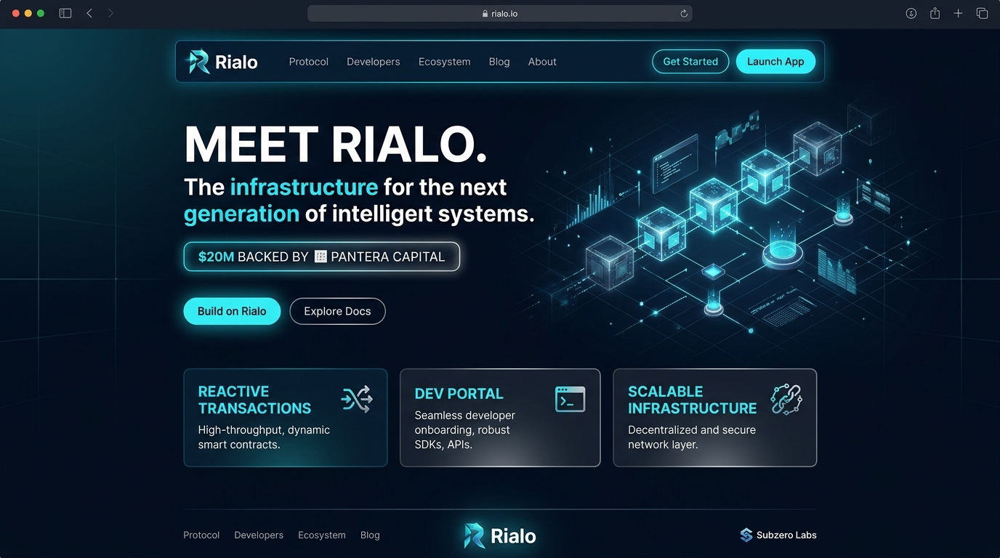
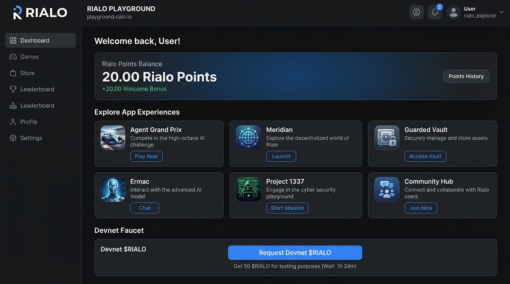

# RIALO Airdrop 12 Oct 2026 - Comprehensive Review & Step-by-Step Execution Playbook

> **In-Depth Analysis Report, Real-World Screenshots & Step-by-Step Playbook for Farming Rialo Points on Devnet ($0 Capital Required)** 
> *Updated: October 12, 2026 | Data verified live via TinyFish CLI*

---

## 1. RIALO (SUBZERO LABS) PLATFORM OVERVIEW & TINYFISH-VERIFIED DATA

Using **TinyFish CLI** (`fetch` and `search` commands), all platform parameters and technical architecture of Rialo were verified directly from primary sources:

* **Developer**: **Subzero Labs** (project name: **Rialo**).
* **Fundraising (Seed Round)**: **$20,000,000 USD** led by **Pantera Capital**, with participation from Coinbase Ventures, Variant, Mysten Labs, and Hashed.
* **Positioning & Technology**: Layer-1 Real-World Blockchain with **Reactive Transactions** architecture (automatically triggers on-chain actions from real-world data without Oracle or off-chain middleware), compatible with Solana VM and RISC-V smart contracts.
* **Mainnet Target**: **2026**.

*Official website evidence*: [rialo.io](https://www.rialo.io)

---

## 2. IMPORTANT NOTES ON TOKENS & THE RIALO POINTS SYSTEM

1. **No official Token or Airdrop confirmation yet**: The project is currently running the **Rialo Points (RP)** system to recognize builders, testers, and community members joining the ecosystem early.
2. **$0 Capital Required**: All activities are conducted on the **Devnet** with test tokens — **absolutely no real money needs to be deposited**.
3. **Early Positioning Goal**: Accumulating Points and building a consistent transaction history (TX history) is the most reliable basis for qualifying for a Retroactive distribution when Mainnet launches in 2026.

---

## 3. STEP-BY-STEP RIALO POINTS FARMING PLAYBOOK

### Step 1: Register on Playground & Receive 20 Welcome Points
1. Visit the official site: **[playground.rialo.io](https://playground.rialo.io)**
2. Sign in with your **Google** account (the system automatically creates a safe Custodial Wallet shared across all apps).
3. Receive **20 Rialo Points (RP)** welcome bonus immediately.
4. Link **Discord** and **GitHub** in your profile tab to claim **Retroactive Points** (if you made early contributions).
5. Go to the **Account** tab

*Playground app catalog evidence*: [playground.rialo.io](https://playground.rialo.io)
 → Click **"Request devnet $RIALO"** to faucet test tokens (~5 tokens/hour).

---

### Step 2: Interact with DApps on Playground
Don't just browse — execute real transactions to record your transaction history on Devnet:

* **Meridian**: Experience trading with a Compliant Stablecoin.
* **Guarded Vault**: Interact with the Protected Multisig / Vault feature.
* **Ermac**: Experience the AI model (chat / query).
* **Project 1337**: Experience a real-time live market data ticker on-chain.
* **Agent Grand Prix**: Use RP points to bet on the AI Agent keyword race.
* **Rialo Predict**: Get early access to the parimutuel prediction market (use Points to claim, bet and receive payouts) when the feature opens.

---

### Step 3: Join Discord & Grind Community Roles
Discord is where Rialo records your Reputation Record:

* **Official Discord link**: **[discord.gg/RialoProtocol](https://discord.gg/RialoProtocol)** *(Always verify the link from the @RialoHQ bio — never connect your wallet inside Discord)*.
* **Key Roles**:
 * **RialONE**: Basic role — complete phone verification to pass the anti-bot waiting room.
 * **RialOPS**: Important role — for users with X accounts with ≥ 50 followers; submit a screenshot in the proof channel to unlock raid channels.
 * **Researcher / Artist / Memelord**: Create original technical research content, hand-drawn artwork, or original memes (AI-generated content will be rejected).
 * **Club Member (Rialo Club)**: Premium role for core members after achieving quality content roles.

---

### Step 4: X (Twitter) Engagement & Maintaining Consistency
* Follow [@RialoHQ](https://x.com/RialoHQ) on X.
* Like, repost, and engage naturally with the project's technology posts.
* Build your profile to ≥ 50 followers to be ready to claim the **RialOPS** role.
* **Success tip**: Return to Playground and execute transactions **every 1–2 weeks**. A spread-out activity history is much more valuable to the Retroactive algorithm than a one-time burst.

---

## 4. SAFETY WARNINGS & PRIORITY TABLE

### Anti-Scam Principles
* **Do not send real money**: The entire process takes place on a free Devnet.
* **Never share Seed Phrase / Private Key**: Never connect a main wallet holding significant assets.
* **Watch for fake links**: Many fake websites and Discord servers impersonating Rialo have appeared. Only access links verified from official @RialoHQ social media.

---

### Priority Action Table

| Priority | Specific Action | Goal & Benefit |
| :---: | :--- | :--- |
| **1** | Log in to [playground.rialo.io](https://playground.rialo.io) with Google | Receive 20 welcome Points immediately + link Discord/GitHub for Retroactive |
| **2** | Withdraw Faucet devnet `$RIALO` & Transact on 4 DApps | Build On-chain TX History on Devnet |
| **3** | Join Discord, earn **RialONE** & **RialOPS** roles | Build your account's Reputation score |
| **4** | Experience **Agent Grand Prix** & **Rialo Predict** | Use Points to participate in AI & Prediction features |
| **5** | Engage on X [@RialoHQ](https://x.com/RialoHQ) & Repeat periodically every 1–2 weeks | Maintain loyal user status through to Mainnet launch |

---

## 5. OFFICIAL REFERENCE LINKS

* **Rialo Playground**: [playground.rialo.io](https://playground.rialo.io)
* **Official Website**: [rialo.io](https://www.rialo.io)
* **Official X (Twitter) Channel**: [@RialoHQ](https://x.com/RialoHQ)
* **Community Discord**: [discord.gg/RialoProtocol](https://discord.gg/RialoProtocol)
* **Reference: Airdrops.io**: [airdrops.io/rialo](https://airdrops.io/rialo/)
* **GitHub Repository**: [github.com/ThanaLamth/Tinyfish-review](https://github.com/ThanaLamth/Tinyfish-review)
