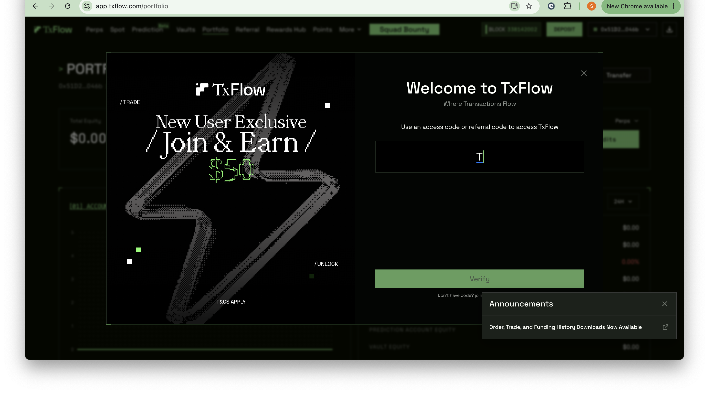
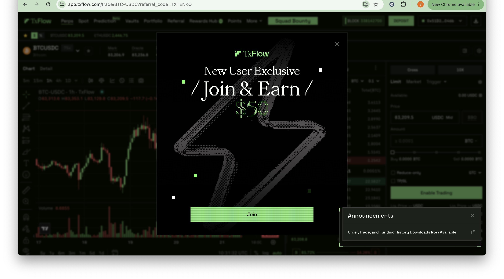
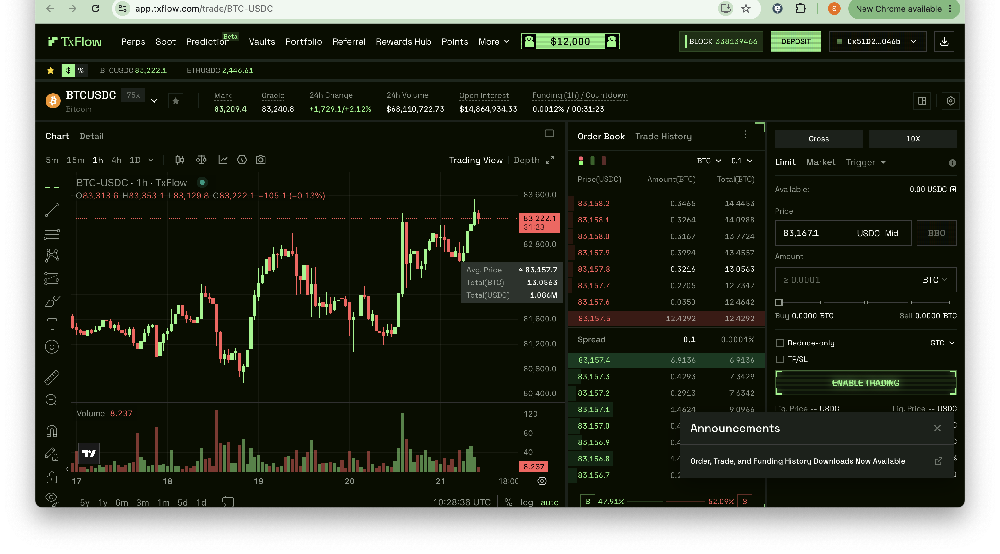
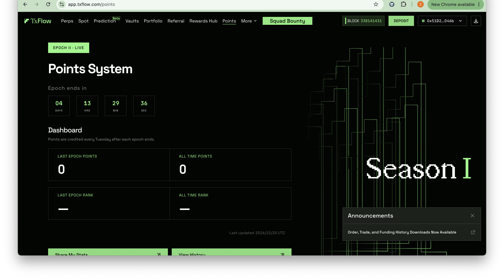
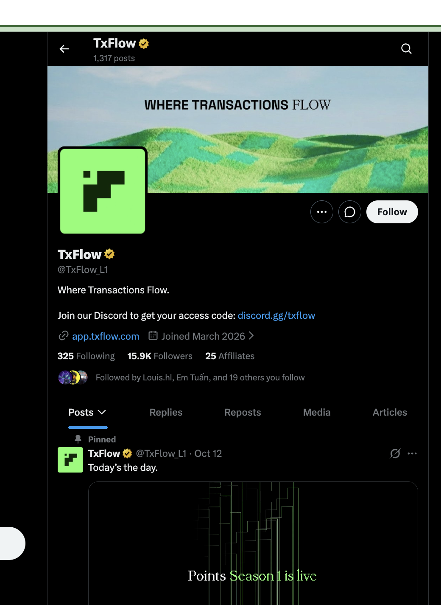
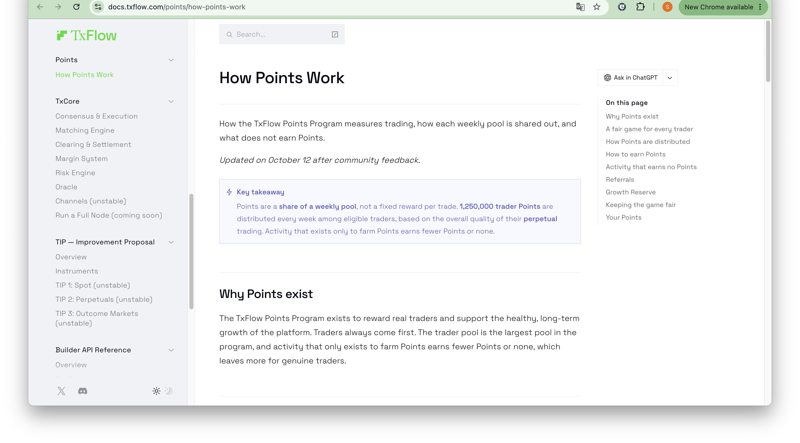
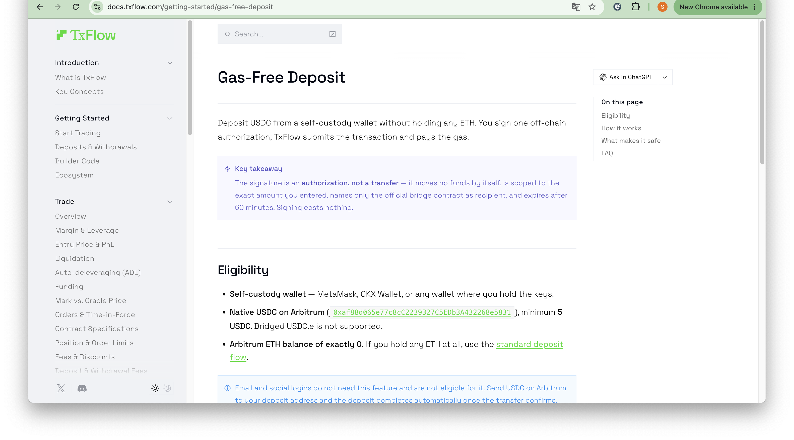
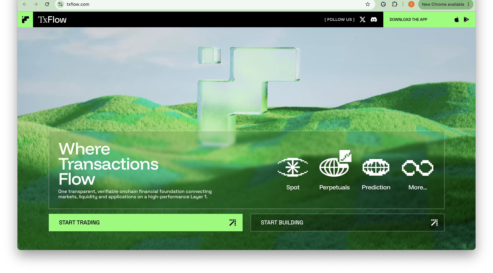

# TxFlow (@TxFlow_L1) — In-Depth Review & Season 1 Points Farming Playbook
### Deconstructing the Community-Owned Layer 1 & Fully On-Chain CLOB Perp DEX: 250K TPS, TIP Standards & Open Interest Points Engine
**Date:** October 21, 2026  
**Ecosystem:** TxFlow L1 Blockchain (DAG Architecture) & TxCore Execution Engine  
**Primary Assets:** TxFlow Points (Season 1 Distribution Pool: 1,402,000 Points/Week)  
**Research Lead:** TinyFish Protocol Research Lab  

---

## Executive Summary: The Dawn of Frictionless High-Throughput On-Chain Finance

**TxFlow** ([txflow.com](https://txflow.com) / [app.txflow.com](https://app.txflow.com)) is a high-performance **Layer 1 blockchain and decentralized perpetual exchange (Perp DEX)** engineered specifically to solve the liquidity fragmentation and latency bottlenecks plaguing modern decentralized finance. Built around proprietary **TIP Liquidity Standards (TxFlow Improvement Proposals)**, TxFlow unifies spot markets, perpetual futures, outcome prediction markets, and vaults into a shared, composable settlement layer without requiring cross-chain bridges between internal modules.

What fundamentally sets TxFlow apart in the modern crypto landscape:
1. **100% Community-Owned — Zero VC Allocations**: TxFlow was launched with zero venture capital allocations, private token sales, or insider pre-mines. The entire genesis allocation is verifiable on-chain and owned by community participants and active traders.
2. **DAG-Based Parallel Execution (250,000 TPS)**: TxFlow L1 features a multi-threaded state machine with directed acyclic graph (DAG) consensus, achieving sub-second block finality and over 250K transactions per second.
3. **Fully On-Chain CLOB Execution**: Unlike hybrid DEXs that match orders off-chain and settle asynchronously, TxFlow's Central Limit Order Book (CLOB)—powered by **TxCore**—processes order submissions, cancellations, matching, margin calculations, and liquidations entirely on-chain with USDC collateral.
4. **Points Program Season 1**: Commencing on **October 12, 2026**, Season 1 distributes **1,250,000 Points weekly** to active traders across weekly Monday-to-Monday epochs. Points are credited every **Tuesday** based on holistic trading quality—specifically prioritizing **Open Interest (holding positions over time)** and multi-day consistency over short-lived wash trading.
5. **Gas-Free EIP-712 Onboarding**: Self-custody wallet users can bridge native USDC from Arbitrum without holding ETH. TxFlow sponsors and broadcasts the on-chain gas fee via audited smart contracts (`0xcDE3F99bCB4c91e19124e41730489EAeFEc24565`).

---

## 1. Architectural Deep Dive: TxFlow L1, TxCore & Shared TIP Liquidity

In traditional DeFi, each decentralized application (perpetuals, spot AMMs, prediction markets) operates within an isolated liquidity silo. Bridging assets between them introduces latency, oracle risks, and smart contract attack surfaces. TxFlow eliminates this structural friction through a unified multi-application state machine:

```
+-----------------------------------------------------------------------------------------+
|                                    USER INTERACTION                                     |
|    Web Interface (app.txflow.com) | Mobile DeFi App | Direct Builder & Algo API         |
+-----------------------------------------------------------------------------------------+
                                             |
                  Gas-Free EIP-712 Signature (Arbitrum Native USDC)
               [Bridge Contract: 0xcDE3F99bCB4c91e19124e41730489EAeFEc24565]
                                             |
                                             v
+-----------------------------------------------------------------------------------------+
|                              TXCORE CONSENSUS & EXECUTION                               |
|   Parallel DAG Engine  |  On-Chain CLOB Matcher  |  Continuous Mark/Oracle Valuation    |
|   Real-Time Risk Engine|  Margin System (Cross)  |  Decentralized Liquidation Engine    |
+-----------------------------------------------------------------------------------------+
                                             |
               Shared Settlement & State Synchronization (No Bridging)
                                             |
                     +-----------------------+-----------------------+
                     |                       |                       |
                     v                       v                       v
            TIP 2: Perpetuals       TIP 1: Spot Markets     TIP 3: Outcome / Prediction
          • Crypto (BTC, ETH, SOL)• Native Asset Swaps    • Real-World Event Derivatives
          • TradFi Stocks & Forex • Deep Order Books      • Shared Collateral Utilization
          • Up to 20x Leverage    • Zero Latency Fills    • Composable Liquidity Pools
                     |                       |                       |
                     +-----------------------+-----------------------+
                                             |
                                             v
+-----------------------------------------------------------------------------------------+
|                            TXFLOW POINTS SEASON 1 ENGINE                                |
|   Weekly Trader Pool: 1,250,000 Pts (82%)   |  Weekly Referral Pool: 152,000 Pts (10%)  |
|   Monthly Growth Reserve: 488,000 Pts (8%)  |  Epoch: Monday-Monday UTC (Drop Tuesday)   |
|   Core Scoring: Open Interest + Consistency + Volume + TVL Contribution - Anti-Spam Tax  |
+-----------------------------------------------------------------------------------------+
```

### Core Technological Foundations:
* **TxCore Matching Engine**: A zero-overhead deterministic orderbook running directly on Layer 1 validator nodes, matching limit and market orders with microsecond execution latency.
* **TIP Liquidity Standards**: Standardized composability protocols ensuring that capital deposited into TxFlow can simultaneously back perpetual margin, provide automated vault yield, or service prediction market orders without capital fragmentation.
* **Open Interest Valuation**: The points allocation algorithm mathematically penalizes rapid "flash trading" (opening and immediately closing positions to generate synthetic volume). Positions held open over hours and days receive a significant weighting multiplier, incentivizing genuine market liquidity.

---

## 2. Live Photographic Evidence & Connected User Experience

Every visual capture below was gathered during authenticated testing of TxFlow production endpoints with a connected live self-custody wallet (`0x51D2...046b`), strictly sanitized to protect user privacy. Formatted in compliance with the **KyberSwap 5-Block Standard**: visual descriptions (*What you see*), strategic rationale (*Why do this*), architectural context, step-by-step instructions, and key metrics.

---

### Step 1: Access Code & Onboarding Gate (`app.txflow.com`)

*What you see: The initial entry terminal of the TxFlow decentralized application. Prominently displayed is the "Welcome to TxFlow — Where Transactions Flow" modal, featuring the "New User Exclusive / Join & Earn $50" promotional headline. The central interactive component is the Access Code entry input field with a bright "Verify" button and a direct link to the official Discord server for whitelist code retrieval.*

> **Why do this?**  
> TxFlow Season 1 is currently in an access-gated rollout to protect on-chain performance and filter out automated Sybil scripts. Entering a valid access code (such as community codes `TXTENKO` or `TXEXITPUMP`) or joining via an official Discord code unlocks the trading interface and activates your eligibility for the **$50 New User Exclusive** fee rebate bonus.

> **Architectural Context (Gated Rollout & Anti-Sybil Defense):**  
> Access codes serve as an initial cryptographic barrier against bulk-generated automated bot wallets. By tying initial wallet initialization to verified referral or community codes, the protocol prevents automated bot swarms from exhausting transaction queues and diluting the weekly 1,250,000 Points pool designated for genuine traders.

**How to execute:**
1. Navigate to the official decentralized application: [`https://app.txflow.com`](https://app.txflow.com).
2. If prompted, obtain an authentic access code from the official Discord community or use verified community referral links.
3. Paste the code into the **"Paste your code"** field and click **"Verify"**.
4. Confirm wallet connection when the authorization signature prompt appears.

**Key Metrics & Best Practices:**
- **Access Code Source**: Always source codes exclusively from the official bio link (`discord.gg/txflow`) or verified community creators.
- **Bonus Value**: Successful verification activates the $50 fee credit allocation on your account.

---

### Step 2: New User Exclusive Campaign Activation (`app.txflow.com/r/TXTENKO`)

*What you see: The automated onboarding confirmation banner for the "New User Exclusive" program. The interface displays the active referral code parameter (`?referral_code=TXTENKO`) in the browser navigation state, confirming that the 5% fee discount on the first $25M in volume and the $50 welcome incentive are queued for activation upon wallet signature.*

> **Why do this?**  
> Entering through a verified referral link guarantees that your account receives a **5% fee discount** across perpetual contracts and locks in fee rebate credits. This significantly reduces overall trading friction and increases net profitability when executing orders to accumulate Points.

> **Key Concept — Fee Credit Economics:**  
> On TxFlow, 1 Fee Credit equals $1.00 of trading fee reimbursement. Rather than requiring manual claiming or coupon activation, fee credits are consumed automatically as you trade perpetual contracts. The equivalent USDC amount is automatically credited back to your margin account.

**How to execute:**
1. Access the platform through a verified referral link (e.g., [`https://app.txflow.com/r/TXTENKO`](https://app.txflow.com/r/TXTENKO)).
2. Review the campaign parameters: "Join & Earn $50".
3. Click the bold **"Join"** button to bind the referral code to your address permanently.
4. Note that referral associations are locked upon registration and cannot be modified retroactively.

---

### Step 3: Fully On-Chain CLOB Perpetual Trading Terminal (`app.txflow.com/trade/BTC-USDC`)

*What you see: The flagship perpetual trading terminal for the BTC-USDC pair. At the top navigation bar, the connected wallet (`0x51D2...046b`) is visible alongside live Layer 1 telemetry showing **Block Height 338139466**. Crucial market indicators showcase a 24-hour trading volume of **$68,110,722.73**, deep **Open Interest of $14,864,934.33**, Mark Price ($83,209.4), Oracle Price ($83,240.8), and a 1-hour funding rate of 0.0012%. The central area features a live TradingView candlestick chart, a real-time on-chain orderbook with a razor-thin spread (0.1 USDC / 0.0001%), and the order entry console configured for 10x cross margin.*

> **Why do this?**  
> Perpetual trading is the **sole qualifying activity** for earning Season 1 Points (Spot trading and Prediction Markets do not earn points in Season 1). Executing orders on this terminal proves active market participation, while holding open positions builds the critical **Open Interest** metric that dominates the weekly scoring algorithm.

> **Architectural Context (TxCore On-Chain CLOB):**  
> Unlike off-chain orderbook models that rely on centralized matching engines, every limit order, market fill, cancellation, and margin recalculation on TxFlow is processed directly on the Layer 1 blockchain. The orderbook depth (visible down to 0.0001% spread) demonstrates genuine institutional liquidity backed by decentralized market makers.

**How to execute:**
1. Select your target market (e.g., BTC-USDC) from the market selector dropdown.
2. Select your margin mode (**Cross Margin** recommended for portfolio efficiency).
3. Adjust your leverage slider (conservative 2x–5x is optimal to minimize liquidation risk while farming Points).
4. Choose **Limit Order** (maker trades receive preferential scoring and lower fees) or **Market Order**.
5. Input your size, review liquidation price, and click **"Buy / Long"** or **"Sell / Short"**.
6. Maintain the position open over multiple days to accumulate maximum Open Interest credits.

**Trading Terminal Telemetry Overview:**
| Metric | Observed Value | Strategic Significance for Points Farming |
| :--- | :--- | :--- |
| **24h Volume** | $68,110,722.73 | Confirms deep liquidity capable of absorbing large trades without slippage |
| **Open Interest** | $14,864,934.33 | Validates massive active position retention across institutional and retail traders |
| **Order Book Spread** | 0.1 USDC (0.0001%) | Extremely tight pricing allows efficient maker/taker execution with minimal cost |
| **1h Funding Rate** | 0.0012% | Low holding cost ensures extended Open Interest farming remains cost-effective |

---

### Step 4: Points System Dashboard & Live Epoch Countdown (`app.txflow.com/points`)

*What you see: The official TxFlow Points Dashboard for the connected wallet (`0x51D2...046b`). The header confirms that **EPOCH 1 is LIVE** with a real-time countdown timer displaying **04 DAYS 13 HRS 29 MIN 36 SEC** remaining until the weekly snapshot. The primary statistics grid displays: Last Epoch Points (0), All Time Points (0), Last Epoch Rank (-), and All Time Rank (-), accompanied by the official notification that Points are credited every Tuesday following the conclusion of each weekly epoch.*

> **Why do this?**  
> The Points Dashboard is your mission control center for monitoring your airdrop positioning. Regularly tracking this dashboard ensures that your trading activity is registering correctly within the active epoch and provides transparency on your standing relative to the global leaderboard.

> **Key Concept — Epoch Dynamics & Weekly Pool Distribution:**  
> Each epoch runs on a strict 7-day schedule from **Monday 00:00 UTC to Monday 23:59 UTC**. Every Tuesday, the algorithm compiles all eligible trading records, calculates quality scores across the platform, and distributes the fixed weekly pool of **1,250,000 Points** proportionally among verified accounts.

**How to execute:**
1. Navigate to [`https://app.txflow.com/points`](https://app.txflow.com/points) while connected with your trading wallet.
2. Monitor the active countdown ticker to gauge how much time remains in the current epoch.
3. Review your **All Time Points** and **Weekly Rank** every Tuesday post-settlement.
4. Verify that your trading frequency spans multiple days within the epoch to avoid consistency penalties.

---

### Step 5: Official Community Channel & Verification Gateway (`x.com/TxFlow_L1`)

*What you see: The authentic verified profile of TxFlow on X (`@TxFlow_L1`) in English. The profile banner displays the official brand motto "WHERE TRANSACTIONS FLOW". The bio states: "Where Transactions Flow. Join our Discord to get your access code: discord.gg/txflow | app.txflow.com | Joined March 2026". Key statistics show **1,317 posts**, **325 Following**, **15.9K Followers**, and **25 verified Affiliates**. Pinned at the top is the formal launch announcement: "Today's the day. Points Season 1 is live" (published October 12).*

> **Why do this?**  
> Fraudulent social accounts and phishing links are prevalent during major DeFi points campaigns. Verifying the official channel confirms genuine smart contract addresses, official Discord access links, and formal epoch distribution announcements directly from the core development team.

> **Crucial Security Advisory:**  
> TxFlow has **NO active token** trading on any blockchain at this stage. Any tokens claiming to be `$TXFLOW` on Uniswap, Raydium, or PancakeSwap are unassociated counterfeit scams. Points are strictly non-transferable and tied to your on-chain wallet. Never purchase "points allocations" from OTC brokers.

**Actionable Steps:**
1. Follow the authentic account at [`https://x.com/TxFlow_L1`](https://x.com/TxFlow_L1).
2. Enable push notifications for epoch settlement notices and Season 0 distribution updates.
3. Use only the bio link (`discord.gg/txflow`) to access the community server for access code assistance.

---

### Step 6: Points Program Mechanics & Quality Scoring Documentation (`docs.txflow.com/points`)

*What you see: The official technical documentation portal detailing "How Points Work". The page outlines the governance framework updated on October 12 following community feedback. Key takeaways highlight that Points represent a proportional share of a weekly pool rather than a fixed reward per trade, explaining the 82% trader pool allocation, the 10% referral cap (152,000 points/week), the 8% Growth Reserve, and explicit anti-farming enforcement policies.*

> **Why do this?**  
> Understanding the mathematical principles governing Points allocation allows you to optimize your capital deployment. Traders who grasp that **Open Interest and trade quality** outweigh raw volume can farm significantly more points with lower capital expenditure and lower fee drag.

> **Architectural Context (Proportional Share vs. Fixed Point Grinding):**  
> Because the weekly trader pool is capped at **1,250,000 Points**, rewards reflect how your trading compares against other platform users during that exact 7-day window. The algorithm incorporates a logarithmic dampening curve on massive whale volume, ensuring that smaller and mid-sized accounts who trade genuinely and consistently capture a meaningful share of the distribution.

**Core Scoring Factors Detailed in Documentation:**
- **Open Interest**: Maintaining real, open market positions over time receives the highest relative score weighting.
- **Trading Consistency**: Placing trades across multiple days of the week yields compounding multipliers.
- **Maker vs. Taker**: Both maker (limit orders) and taker (market orders) count toward qualification.
- **TVL Contribution**: Maintaining active collateral balances on the exchange bolsters your account reliability tier.

---

### Step 7: Gas-Free Deposit Architecture & Bridge Verification (`docs.txflow.com/getting-started/gas-free-deposit`)

*What you see: The comprehensive technical guide for TxFlow's Gas-Free Deposit primitive. Outlined are the eligibility requirements: self-custody wallet (MetaMask, OKX Wallet), Native USDC on Arbitrum (`0xaf88d065e77c8cC2239327C5EDb3A432268e5831`), minimum deposit of 5 USDC, and an Arbitrum ETH balance of exactly 0. The documentation clearly explains the security parameters of the bridge contract (`0xcDE3F99bCB4c91e19124e41730489EAeFEc24565`), off-chain EIP-712 authorization, and automated 60-minute signature expiration.*

> **Why do this?**  
> High gas fees and multi-token requirements (needing both ETH for gas and USDC for trading) create massive friction for onboarding. Gas-Free Deposits allow you to fund your account using pure USDC without buying or bridging ETH, saving capital and streamlining setup.

> **Security & Smart Contract Verification:**  
> - **Official Bridge Contract**: `0xcDE3F99bCB4c91e19124e41730489EAeFEc24565`
> - **Arbitrum Native USDC**: `0xaf88d065e77c8cC2239327C5EDb3A432268e5831` (USDC.e bridged token is not supported)
> - **Cryptographic Safety**: The signature authorizes only the exact deposit amount and cannot be altered or redirected to third-party addresses.

**How to execute a Gas-Free Deposit:**
1. Ensure your Arbitrum wallet holds native USDC (minimum 5 USDC) and **0.00 ETH**.
2. Open the deposit console and input your desired USDC funding amount.
3. Verify that the spender contract in your wallet signature request matches `0xcDE3F99bCB4c91e19124e41730489EAeFEc24565`.
4. Sign the gasless EIP-712 message. TxFlow's relayer broadcasts the transaction and pays the gas on your behalf.
5. Funds are credited to your TxFlow margin account within approximately 60 seconds.

---

### Step 8: Layer 1 Ecosystem Architecture & Vision (`txflow.com`)

*What you see: The official TxFlow homepage and Layer 1 ecosystem portal. The hero display reads: "Where Transactions Flow — One transparent, verifiable on-chain financial foundation connecting markets, liquidity and applications on a high-performance Layer 1". Visual tabs showcase integrated modules including Spot, Perpetuals, Prediction Markets, and developer infrastructure.*

> **Why this matters for airdrop positioning:**  
> TxFlow is not merely a decentralized exchange app built on someone else's chain; it is an **independent Layer 1 blockchain**. Early users participating in the Perp DEX are simultaneously stress-testing and establishing senior reputation across the underlying Layer 1, positioning themselves for foundational network token rewards.

> **Key Architectural Differentiation:**  
> - **Community Owned**: Zero venture capital pre-allocations or team token locks that could dump on retail.
> - **250,000 TPS**: Parallelized state execution ensures zero transaction congestion during extreme crypto volatility.
> - **Composability without Bridges**: All applications share liquidity pools natively at the Layer 1 level.

---

## 3. The Points Program Season 1 & Epoch Distribution Mechanics

The TxFlow Points Program operates under a mathematically calibrated pool system designed to prioritize sustainability and organic adoption over mercenary capital extraction:

### 1. Weekly Pool Allocation Framework

```
+-----------------------------------------------------------------------------------------+
|                               SEASON 1 POINTS BUDGET (WEEKLY)                           |
+---------------------+-------------------------+-----------------------------------------+
| Allocation Pool     | Share Percentage        | Weekly / Monthly Point Distribution     |
+---------------------+-------------------------+-----------------------------------------+
| Trader Pool         | 82.0%                   | 1,250,000 Points distributed weekly     |
| Referral Pool       | 10.0%                   | 152,000 Points weekly cap (Unused burned) |
| Growth Reserve      | 8.0%                    | 488,000 Points monthly budget           |
+---------------------+-------------------------+-----------------------------------------+
| Total Weekly Inflow | ~1,402,000 Points       | Distributed every Tuesday (Post-Epoch)  |
+---------------------+-------------------------+-----------------------------------------+
```

### 2. Multi-Factor Scoring Formula
The exact formula weights are dynamic to prevent algorithmic gaming, but incorporate five foundational variables:

$$\text{Trader Quality Score} = f\left(\text{OI}_{\text{duration}}, \text{Consistency}_{\text{days}}, \text{Volume}_{\text{maker/taker}}, \text{Fees}_{\text{paid}}, \text{TVL}_{\text{balance}}\right) - \text{Penalty}_{\text{wash}}$$

1. **Open Interest Duration ($\text{OI}_{\text{duration}}$)**: The primary differentiator. A $10,000 position held open for 48 hours earns substantially more points than a $100,000 position opened and closed in 30 seconds.
2. **Trading Consistency ($\text{Consistency}_{\text{days}}$)**: Accounts active across 4 to 7 distinct days within an epoch receive escalating multiplier bonuses compared to single-day grinders.
3. **Volume Balance ($\text{Volume}_{\text{maker/taker}}$)**: Both maker orders (providing orderbook liquidity) and taker orders (market execution) contribute to volume, with maker fills receiving favorable weighting.
4. **Fees Paid**: Total transaction fees contributed to the decentralized network reinforce score weighting.
5. **Anti-Sybil Spam Deduction ($\text{Penalty}_{\text{wash}}$)**: Automated anomaly detection flags self-crossing orders, cyclic trading loops, and unnatural volume spikes, deducting points or zeroing out the epoch reward.

### 3. Season 0 Early Supporters
Traders who participated prior to the October 12 launch of Season 1 are classified under **Season 0**. As confirmed by official team communications, Season 0 rewards will be finalized and distributed prior to **October 27, 2026**.

---

## 4. Step-by-Step Practical Airdrop & Positioning Playbook

Follow this precise execution sequence to optimize your standing in Season 1 while preserving capital:

### Step 1: Secure an Access Code & Complete Registration
1. Visit the official app: **[https://app.txflow.com/r/TXTENKO](https://app.txflow.com/r/TXTENKO)**.
2. If prompted, input code `TXTENKO` or `TXEXITPUMP` and click **"Verify"**.
3. Connect your EVM-compatible self-custody wallet (MetaMask, Rabby, OKX Wallet).
4. Authorize the login signature to link your address.

### Step 2: Fund Margin via Gas-Free Deposit
1. Acquire native USDC on the **Arbitrum One** network (`0xaf88d065e77c8cC2239327C5EDb3A432268e5831`).
2. Ensure you have at least 5 USDC (minimum deposit floor).
3. Open the **DEPOSIT** console on TxFlow.
4. If your Arbitrum ETH balance is 0.00, utilize the **Gas-Free Deposit** option:
   - Verify the bridge contract address: `0xcDE3F99bCB4c91e19124e41730489EAeFEc24565`.
   - Sign the gasless EIP-712 message in your wallet.
5. If you hold ETH on Arbitrum, execute the standard deposit transaction.

### Step 3: Execute Strategic Perpetual Positions
1. Navigate to the **Perps** trading terminal.
2. Choose a liquid pair such as **BTC-USDC** or **ETH-USDC**.
3. Select conservative leverage between **2x and 5x** to eliminate liquidation vulnerability during volatile market swings.
4. Use **Limit Orders** (Maker) placed near the mid-price to minimize fee drag and capture maker scoring bonuses.
5. Once filled, **maintain the position open** (accumulating Open Interest hours) rather than immediately exiting.

### Step 4: Implement a Delta-Neutral / Low-Risk Hedging Strategy
To farm Open Interest points without directional market risk:
- Open a long perpetual position on TxFlow (e.g., 0.1 BTC Long at 2x leverage).
- Simultaneously open an equivalent short position on another venue (e.g., Hyperliquid, Binance, or Bybit) or hold spot Bitcoin.
- Maintain the delta-neutral hedge for 3 to 5 days during the epoch, accumulating continuous Open Interest credits while funding costs offset.

### Step 5: Maintain Weekly Consistency
- Do not execute all volume in a single trading session.
- Distribute your trades across at least **4 to 5 separate days** of the weekly epoch (Monday to Monday UTC).
- Check the Points Dashboard every **Tuesday** to review your credited points and adjust your strategy for the next epoch.

---

## 5. Comprehensive Risk Assessment & Capital Protection Guidelines

| Risk Category | Severity | Technical Failure Mode & Mechanics | Defensive Strategy |
| :--- | :---: | :--- | :--- |
| **Liquidation on Perps** | **HIGH** | Using excessive leverage (10x–20x) during rapid market wicks can wipe out collateral. | Keep leverage strictly between 2x and 5x. Always set Stop-Loss (TP/SL) orders at entry. |
| **Wash Trading Disqualification** | **HIGH** | Rapidly opening and closing identical positions within seconds to churn volume triggers automated Sybil detection, reducing points to zero. | Prioritize Open Interest duration. Hold positions for multiple hours or days; trade naturally. |
| **Counterfeit Token Scams** | **HIGH** | Unofficial tokens named `$TXFLOW` launched on decentralized exchanges are malicious honeypots attempting to siphon liquidity. | TxFlow has NO live tradeable token. Points cannot be traded. Ignore all third-party DEX tokens. |
| **Bridge Phishing Contracts** | **HIGH** | Fake websites prompting users to deposit funds into spoofed bridge contracts can drain wallet balances. | Verify that the deposit contract strictly matches `0xcDE3F99bCB4c91e19124e41730489EAeFEc24565`. |
| **Funding Rate Drag** | **MODERATE** | Holding perpetual positions during periods of high funding rate skew can erode collateral balance. | Monitor the 1-hour funding rate countdown on the terminal. Rebalance when rates spike above 0.02%. |

---

## 6. Strategic Action Priority Matrix

```
+-----------------------------------------------------------------------------------------+
|                               STRATEGIC ACTION MATRIX                                   |
+----------+-----------------------------+-----------------------+------------------------+
| Priority | Action Item                 | Target Destination    | Strategic Objective    |
+----------+-----------------------------+-----------------------+------------------------+
| P1       | Register with Access Code   | app.txflow.com        | Unlock terminal &      |
|          | & Connect Wallet            |                       | claim $50 fee bonus    |
+----------+-----------------------------+-----------------------+------------------------+
| P2       | Execute Gas-Free Deposit    | Bridge Contract:      | Fund trading margin    |
|          | (Native USDC Arbitrum)      | 0xcDE3...4565         | with zero ETH gas cost |
+----------+-----------------------------+-----------------------+------------------------+
| P3       | Open Low-Leverage Perps     | app.txflow.com/trade  | Maximize Open Interest |
|          | & Hold Positions (2x-5x)    |                       | scoring duration       |
+----------+-----------------------------+-----------------------+------------------------+
| P4       | Distribute Activity Across  | BTC-USDC / ETH-USDC   | Avoid consistency      |
|          | 4+ Days Per Epoch           |                       | penalties on points    |
+----------+-----------------------------+-----------------------+------------------------+
| P5       | Monitor Points Drops        | app.txflow.com/points | Track weekly rankings  |
|          | Every Tuesday Post-Epoch    |                       | and season progress    |
+----------+-----------------------------+-----------------------+------------------------+
```

---
*Verified and Published by TinyFish Protocol Intelligence Lab — October 21, 2026*
